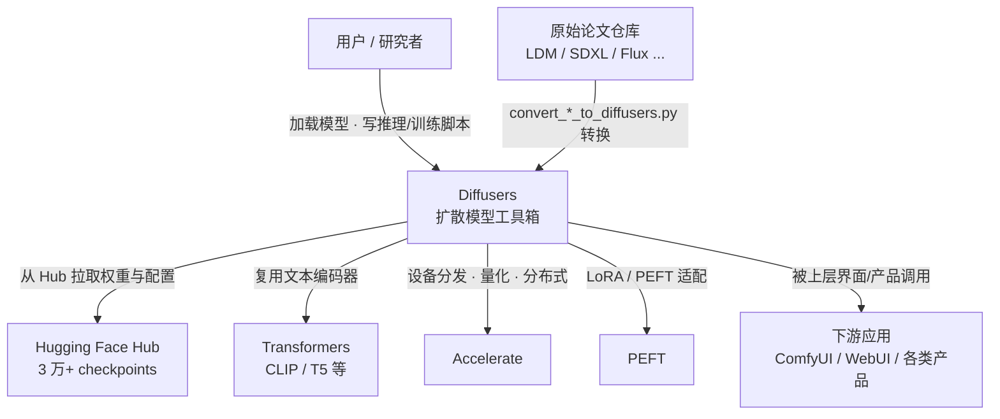
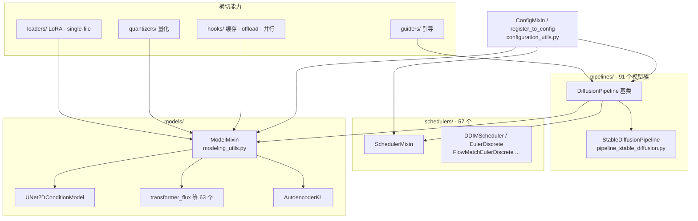
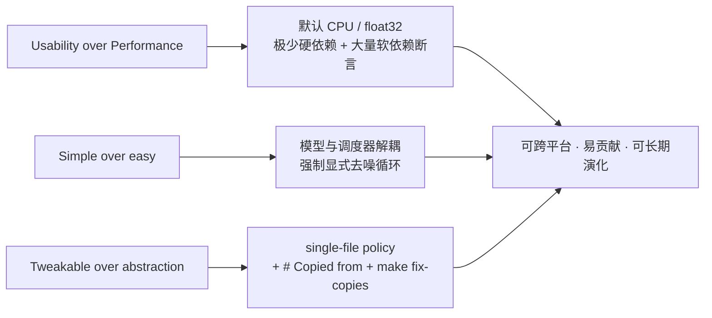
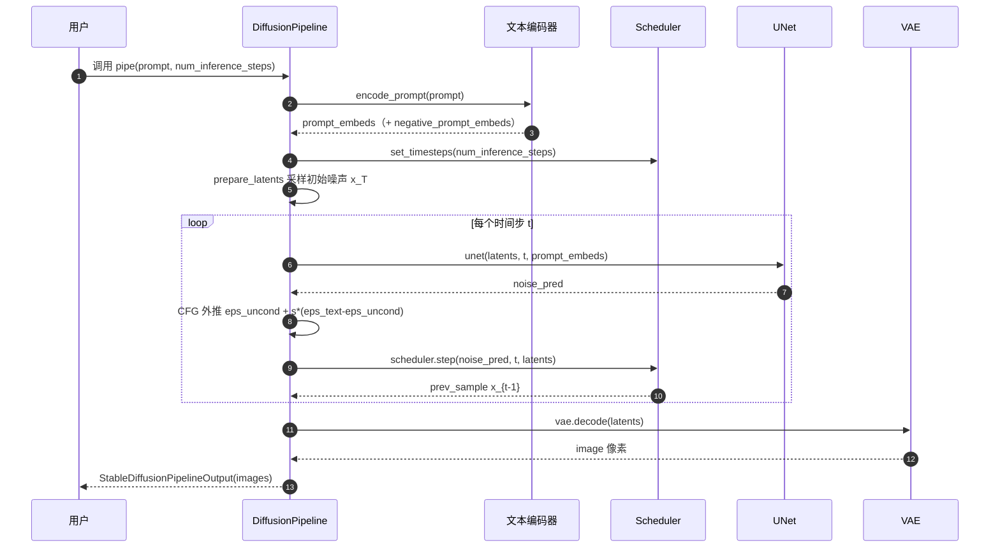
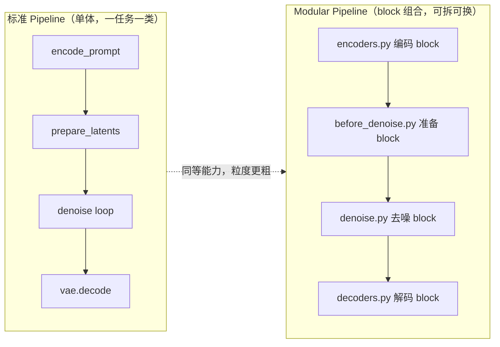

# 🤗 Diffusers 代码深度解读 · 第一篇：整体观 —— 项目全貌解读

> **导读**｜本系列以「三观递进」的方法论解读 HuggingFace **Diffusers** 项目：
> **整体观（看见）→ 具体观（看懂）→ 深刻不忘观（看透）**。
> 本篇是第一观，目标是先站在高处鸟瞰全貌——它是谁、在生态里处于什么位置、代码如何组织、遵循什么理念、整体流程怎样运转，从而建立一张完整的**项目认知地图**。
> 读完本篇，你会得到"是什么、怎么组织"的答案；第二篇将潜入水下，回答"怎么算、如何实现"；第三篇再跃出水面，回答"为什么长成这样"。

---

## 〇、总：Diffusers 是一把"扩散模型的万能工具箱"

Diffusers 是 HuggingFace 出品、面向扩散模型（Diffusion Models）的**开源工具箱**。它的野心并不局限于"根据文字生成一张图"：图像、视频、音频，乃至 3D 分子结构，凡是"从噪声中逐步去噪、还原出某种数据"的生成任务，都是它的射程范围。官方 README 用一句话定位自己：*the go-to library for state-of-the-art pretrained diffusion models*——即**扩散模型的默认入口**。

它要解决的核心痛点是：扩散模型的**研究**和**工程**之间隔着一条鸿沟。一篇论文的官方仓库往往自带一套难读的训练代码、隐式的采样循环、与特定权重强绑定的脚本；而把它变成能稳定推理、能换采样器、能挂 LoRA、能部署到各种显卡上的东西，需要大量重复劳动。Diffusers 的答案是把整套系统**拆成可替换的积木**，并给出统一的加载、保存、运行接口。

这个"拆积木"的思路，具体落成**三大核心组件**：

- **Pipelines（推理流水线）**：把多个组件串成一条端到端推理链路，几行代码即可生成结果；
- **Schedulers（调度器）**：可插拔的噪声日程与反向采样算法，决定"如何从噪声一步步走回数据"；
- **Models（模型）**：可组装的预训练网络积木（去噪主干、VAE、ControlNet……），配合调度器可自建端到端系统。

一句话概括本篇要建立的直觉：**Diffusers 不是"一个模型"，而是"一整套把模型、调度器、编码器拼装成生成系统的规则与零件"**。接下来的四个追问——它站在哪里、长什么样、为何这么设计、如何跑起来——就是这篇"整体观"要逐层回答的问题。

---

## 一、生态定位：它站在生成式 AI 产业链的哪一层

理解一个库，先看它与周边的关系。Diffusers 处在 HuggingFace 生态的"**中间层**"：向上，它被各种 GUI 与产品（ComfyUI、Automatic1111 WebUI、InvokeAI 等）调用；向下，它依赖 Hub 分发权重、依赖 Transformers 提供文本编码器、依赖 Accelerate/PEFT 补足部署与适配能力。它本身**不训练基础大模型、不做权重托管、不提供界面**，而是做"把它们黏合成可运行系统"的那层。

它同时扮演了**"论文实现的统一封装层"**的角色。Diffusers 的 `scripts/` 目录里躺着上百个 `convert_*_to_diffusers.py` 转换脚本，专门把各家原始仓库（LDM、SDXL、Flux、Wan、CogVideoX……）的权重格式转换成 Diffusers 的统一格式。这意味着：**研究者的新模型 → 通过转换脚本进入 Diffusers → 立刻获得统一的加载/推理/优化/部署能力**。这条"入海口"是它形成网络效应的关键。

**图 1-1｜Diffusers 生态上下文（C4 Context 风格）**：下图展示 Diffusers 与用户、Hub、姊妹库及下游应用之间的依赖与调用关系，帮助你在动手前先建立"谁依赖谁"的坐标感。



与同类项目的分野也很清楚：**原始论文仓库**是"单模型、单任务、训练即全部"；**ComfyUI/WebUI** 是"面向终端用户的节点式/图形化应用"；而 **Diffusers 是"面向开发者的库"**——它以 API 与代码为界面，追求的是可编程、可组合、可嵌入到任何产品里。这种"不做应用而做底座"的定位，决定了它后面所有的设计取舍。

---

## 二、整体代码结构：从目录树读懂职责分工

Diffusers 的代码结构的最大特征是**按"概念角色"而非"业务流程"切分目录**。`src/diffusers/` 下并列着若干顶层包，每个包对应系统里的一个角色。实测规模：**973 个 Python 文件、约 54.7 万行代码**，其中 `pipelines/` 有 **91 个模型族目录**、`schedulers/` 有 **57 个调度器实现**、`models/transformers/` 有 **63 个主干模型**、`modular_pipelines/` 有 **16 个模型组**。规模之大，靠的正是"按角色分目录 + 每角色内部再按模型分文件"的秩序。

```text
src/diffusers/
├── __init__.py                    # 顶层导出：_import_structure 懒加载，避免一次性 import 全部依赖
├── configuration_utils.py         # ConfigMixin / register_to_config —— 一切可序列化组件的基座
├── pipelines/
│   ├── pipeline_utils.py          # DiffusionPipeline 基类：from_pretrained / save_pretrained / to / offload
│   ├── auto_pipeline.py           # AutoPipeline*：按任务自动路由到合适的 pipeline
│   ├── stable_diffusion/          # 一个模型族 = 一个目录；文生图/图生图/修复各一个文件
│   └── <model>/pipeline_<model>.py
├── schedulers/
│   ├── scheduling_utils.py        # SchedulerMixin / KarrasDiffusionSchedulers
│   └── scheduling_*.py            # DDPM / DDIM / Euler / DPM-Solver / Flow-Match / LCM ...
├── models/
│   ├── attention.py / attention_processor.py   # Attention 类与 Processor 模式（共享层）
│   ├── attention_dispatch.py      # dispatch_attention_fn：统一调度 flash/sage/flex/xformers 等后端
│   ├── modeling_utils.py          # ModelMixin：from_pretrained、_no_split_modules、各类优化开关
│   ├── transformers/              # 63 个 DiT / Transformer 主干（Flux / SD3 / Wan ...）
│   ├── unets/ autoencoders/ controlnets/       # UNet / VAE / ControlNet 各自成族
│   └── lora.py                    # LoRA 层实现
├── guiders/                       # 引导抽象：CFG / APG / 扰动注意力引导 ...
├── hooks/                         # 极致工程：offload · 特征缓存 · 上下文并行 · 分层 cast
├── loaders/                       # LoRA / single-file / textual_inversion / ip_adapter 加载器
├── quantizers/                    # 量化后端：bnb / gguf / quanto / torchao / modelopt
├── modular_pipelines/             # 模块化 Diffusers：可组合的 block 式流水线
├── optimization.py                # 细粒度优化算法（如 attention slicing 的底层实现）
└── utils/                         # 通用工具（含 dummy_* 软依赖守卫）
```

这张树里最关键的是**四个"基座类"**，它们定义了整个库的抽象骨架：

| 基座类 | 所在文件 | 职责 | 关键机制 |
|--------|----------|------|----------|
| `ConfigMixin` | `configuration_utils.py` | 组件配置的序列化/反序列化 | `register_to_config`、`save_pretrained`、`from_config` |
| `ModelMixin` | `models/modeling_utils.py` | 模型权重加载与优化能力 | `from_pretrained`、`_no_split_modules`、`enable_*` |
| `SchedulerMixin` | `schedulers/scheduling_utils.py` | 调度器的通用载入与通用接口 | `set_timesteps`、`step`、`scale_model_input` |
| `DiffusionPipeline` | `pipelines/pipeline_utils.py` | 组件的注册、加载、设备管理、串联 | `register_modules`、`from_pretrained`、`.to()` |

它们的关系是**"组合"而非"继承"**：一个 `DiffusionPipeline` 内部持有若干 `ModelMixin` 与一个 `SchedulerMixin`，而这三者都通过 `ConfigMixin` 获得统一的配置读写能力。于是在磁盘上，一个可加载的模型仓库就是一个 `model_index.json`（描述组件清单）+ 若干子目录（每个组件一份 `config.json` + 权重），pipeline 按清单逐个实例化组件。**"约定（清单格式）+ 组合（持有组件）"由此取代了"写死的继承树"**。

**图 1-2｜代码结构与依赖**：下图把上表的基座类关系可视化——注意所有箭头最终都指向 `ConfigMixin`，这说明"统一的配置序列化"是整个库的黏合剂。



---

## 三、设计理念：三条原则，一套"反直觉"的工程哲学

要真正读懂 Diffusers，必须知道它**刻意选择了"看起来不够聪明"的设计**。官方在 [philosophy.md](file:///workspace/docs/source/en/conceptual/philosophy.md) 里写得很直白，三条原则环环相扣：

1. **Usability over Performance（可用优先于性能）**：默认在 CPU、以 float32 加载，绝不默认开启任何激进的优化。这样"任何平台、任何环境 `pip install` 后就能跑"，代价是默认慢。性能优化是**用户显式开启的可选项**，而非隐藏的默认行为。
2. **Simple over easy（简单优先于省事）**：显式优于隐式。最典型的是**模型与调度器彻底解耦**——你不会拿到一个"调用一次就出图"的黑盒，而是被要求亲手写那个 `for t in timesteps:` 的去噪循环。这看起来很"不友好"，但换来了**完全可调试、可替换**的控制权：想换采样器？改一行。想在中途注入引导？插进循环即可。
3. **Tweakable / contributor-friendly over abstraction（可改性与可贡献优先于抽象）**：这条最反直觉，也最深刻——Diffusers **主动违背 DRY 原则**，采用**单文件策略（single-file policy）**：几乎每个类的完整实现都写在一个自包含文件里，宁可复制代码，也不做跨文件的"优雅抽象"。理由在原文里点破：机器学习领域**变化快于抽象能力**，过早的抽象会僵化；而自包含的文件对贡献者最友好——改坏一个文件不会波及其他功能。

为了既"复制"又不失控，库引入了两个配套机制：**`# Copied from` 注释**（标记"这段是从某文件复制来的"，`make fix-copies` 一键把源变动同步到所有副本，`utils/check_copies.py` 实现校验）与**约定优于配置**（`model_index.json` 声明组件清单、`register_to_config`/`register_modules` 自动登记）。

**图 1-3｜设计理念如何落为代码机制**：下图把三条抽象原则与其对应的具体工程机制连起来，说明"理念"在 Diffusers 里绝非口号，而是能精确对应到代码事实的。



理解了这三条原则，你就理解了为什么 Diffusers 里到处是"长长的、看起来很重复"的 `pipeline_*.py`——那不是疏漏，而是**深思熟虑后的选择**：用"每一份代码都能独立读懂"换取"这个库能活得比任何一次抽象都久"。

---

## 四、实现原理概述：扩散系统 = 四个正交部件 + 一个引导策略

理念之下，Diffusers 的**技术骨架**来自对扩散系统的分解。一个"图/视频/音频生成系统"通常由四个**相互独立训练、可分别替换**的部件组成：

1. **条件编码器（Conditioning Encoder）**：把文字（或图像/音频）变成条件向量。图像生成里常是 CLIP/T5 文本编码器。
2. **去噪主干（Denoising Backbone）**：一个神经网络（早期是 UNet，现在是 Transformer/DiT），学习"在某个噪声程度下，预测噪声/速度"。
3. **调度器（Scheduler）**：定义**噪声日程**（beta/alpha/sigma 序列，即"每个时刻加多少噪"）与**反向采样算法**（如何从 `x_t` 推到 `x_{t-1}`）。它**不含任何可学习权重**，纯数学。
4. **潜空间编解码器（VAE）**：把像素压缩到低维潜空间（如 8× 下采样），让扩散在高压缩比的空间里进行，大幅降低算力；生成后再解码回像素。

再加上一个**引导策略（Guidance）**——最常见的是 Classifier-Free Guidance（CFG），即"把有条件的预测和无条件的预测做一次外推"来增强文本贴合度。

这套分解最精妙的地方在于**接口的极简**：主干模型只需实现"**输入带噪样本 + 时间步 + 条件 → 输出预测**"，调度器只需实现"**输入预测 + 当前时刻 → 输出下一个更干净的样本**"。于是：

> **任何模型 × 任何调度器 × 任何编码器 × 任何引导策略，原则上都可以组合**——只要它们满足上述两个最小契约。

这正是 Diffusers 能同时容纳 91 个 pipeline、57 个调度器、63 个模型却不混乱的根因：**它不是把每个模型包成一个定制系统，而是把系统拆成满足统一契约的零件**。第一篇只需要记住这个骨架；第二篇将逐个展开这些零件内部真实的数学与工程。

---

## 五、整体流程：端到端的一次"文生图"

现在把骨架跑起来。以最经典的 `StableDiffusionPipeline` 为例，一次 `pipe("a cat")` 调用在代码里的**五段式**流程如下（对应 [pipeline_stable_diffusion.py](file:///workspace/src/diffusers/pipelines/stable_diffusion/pipeline_stable_diffusion.py)）：

1. **输入校验与准备**：检查 prompt、步数、引导等参数，决定是否启用 CFG（`do_classifier_free_guidance = guidance_scale > 1`）。
2. **编码提示词**：`encode_prompt()` 把文本 → `prompt_embeds`；若启用 CFG，同时算出 `negative_prompt_embeds` 并拼接。
3. **准备时间步与潜变量**：`retrieve_timesteps()` 让调度器按 `num_inference_steps` 生成时间步序列；`prepare_latents()` 用 `randn_tensor` 采样初始噪声 `x_T`，形状为 `(B, C, H/8, W/8)`。
4. **去噪循环**（核心，见 [L1028-L1062](file:///workspace/src/diffusers/pipelines/stable_diffusion/pipeline_stable_diffusion.py#L1028-L1062)）：对每个时间步 `t`——
   - 若走 CFG，把潜变量复制成 `[uncond, cond]` 两份；
   - `scale_model_input` 按当前时刻缩放输入；
   - `unet(latents, t, prompt_embeds)` 预测噪声 `noise_pred`；
   - 做 CFG 外推：`noise_pred = noise_pred_uncond + s * (noise_pred_text - noise_pred_uncond)`；
   - `scheduler.step(noise_pred, t, latents)` 得到更干净的 `x_{t-1}`。
5. **解码与后处理**：循环结束后 `vae.decode(latents)` 解回像素空间，再经 safety checker 与 image processor，包装成输出对象。

**图 1-4｜文生图端到端时序**：下图以时序图还原上述五段式中各组件的交互顺序，重点是看清"去噪循环"如何被反复执行、CFG 如何在循环内作用于噪声预测。



值得强调的是：**"去噪循环"这一段正是 `Simple over easy` 的体现**——它不是藏在某个黑盒里，而是明明白白地写在 pipeline 的 `__call__` 中，任何人都能读、能改、能在循环里插入自己的逻辑（比如中途保存中间图、注入自定义引导）。

同一条流程，在 **Modular Diffusers（模块化流水线）** 里被进一步"拆成 block"：`encoders.py`（编码）→ `before_denoise.py`（时间步/潜变量/噪声准备）→ `denoise.py`（去噪循环）→ `decoders.py`（解码），每一段都是一个**声明了输入/输出、无权重、可独立运行**的 block，最后在 `modular_blocks_<model>.py` 里用 `SequentialPipelineBlocks`/`AutoPipelineBlocks` 组装成完整工作流。这带来了一个关键能力：**你可以只取出其中一块单独运行**——例如只跑文本编码 block 缓存 embeddings，之后喂给不同参数的去噪循环复用。

**图 1-5｜标准 Pipeline 与 Modular Pipeline 的流程对照**：左为单体式（一段 `__call__` 走到底），右为 block 组合式（可拆、可换、可单独运行）。这张图是理解 Diffusers 架构演进方向的关键。



---

## 六、使用指南 & 实践案例

> 本篇的"使用指南"聚焦**如何把整体观落地**：安装、最小推理、拆开工具箱自己搭、以及组件加载/保存/路由。第二、三篇会分别补充"优化与定制"和"扩展与贡献"的实践。

### 6.1 安装

```bash
pip install --upgrade diffusers[torch]
# 可选：加速与生态协同
pip install accelerate safetensors
```

### 6.2 案例一：三行代码完成文生图（最高层视角）

```python
from diffusers import DiffusionPipeline
import torch

pipeline = DiffusionPipeline.from_pretrained(
    "stable-diffusion-v1-5/stable-diffusion-v1-5",
    torch_dtype=torch.float16,
)
pipeline.to("cuda")
image = pipeline("An image of a squirrel in Picasso style").images[0]
```

这里 `DiffusionPipeline` 是"通用外壳"：它会读取该仓库的 `model_index.json`，按清单实例化文本编码器、UNet、VAE、调度器等组件——**这正是"约定 + 组合"在用户侧的直接体现**。

### 6.3 案例二：拆开工具箱，亲手写去噪循环（理解整体观的最佳方式）

这个案例刻意不用 Pipeline，而是**只用 model + scheduler** 复刻扩散的核心机制（呼应 README Quickstart）：

```python
from diffusers import DDPMScheduler, UNet2DModel
from PIL import Image
import torch

scheduler = DDPMScheduler.from_pretrained("google/ddpm-cat-256")
model = UNet2DModel.from_pretrained("google/ddpm-cat-256").to("cuda")
scheduler.set_timesteps(50)

sample_size = model.config.sample_size
noise = torch.randn((1, 3, sample_size, sample_size), device="cuda")
x = noise

for t in scheduler.timesteps:                     # ← 显式的去噪循环
    with torch.no_grad():
        noise_pred = model(x, t).sample           # 模型：预测噪声
        x = scheduler.step(noise_pred, t, x).prev_sample  # 调度器：推进一步

image = (x / 2 + 0.5).clamp(0, 1)
image = image.cpu().permute(0, 2, 3, 1).numpy()[0]
Image.fromarray((image * 255).round().astype("uint8"))
```

**读法**：`model` 只负责"**预测一个量**"，`scheduler` 只负责"**据此走一步**"——这就是第四节所说的最小契约。掌握了这十几行，你就掌握了所有扩散 pipeline 的骨架；区别只在于：主干换成 Transformer、调度器换成 Euler/FlowMatch、再加 VAE 与文本编码。

### 6.4 案例三：加载、保存与设备管理

```python
pipe = DiffusionPipeline.from_pretrained("stable-diffusion-v1-5/stable-diffusion-v1-5")
pipe.save_pretrained("./my_pipe")           # 写回 model_index.json + 各组件子目录
pipe = DiffusionPipeline.from_pretrained("./my_pipe")  # 从本地一模一样地还原
pipe.to("cuda")                             # 把所有 nn.Module 搬到设备（PyTorch 语义）
```

### 6.5 案例四：换一个调度器，立刻提升质量/速度

因为调度器与模型解耦，**替换只需一行**：

```python
from diffusers import DPMSolverMultistepScheduler

pipe = DiffusionPipeline.from_pretrained("stable-diffusion-v1-5/stable-diffusion-v1-5", torch_dtype=torch.float16)
pipe.scheduler = DPMSolverMultistepScheduler.from_config(pipe.scheduler.config)  # 换采样器
pipe.to("cuda")
image = pipe("a scenic landscape", num_inference_steps=20).images[0]  # 20 步即可出好图
```

`from_config` 复用了原调度器的配置（如 beta 日程），只把"采样算法"换成 DPM-Solver——**这就是"正交分解"带给用户的直接红利**。

### 6.6 案例五：用 AutoPipeline 让库自己选流水线

当你只关心任务、不关心具体模型族时：

```python
from diffusers import AutoPipelineForText2Image
pipe = AutoPipelineForText2Image.from_pretrained("stable-diffusion-v1-5/stable-diffusion-v1-5", torch_dtype=torch.float16).to("cuda")
image = pipe("a cat riding a bike").images[0]
```

`AutoPipeline*` 会根据仓库元信息自动路由到正确的 pipeline 类，进一步降低"该用哪个类"的心智负担。

---

## 七、总：整体画像与通往第二篇的路

回到本观要建立的认知地图，可以把 Diffusers 的整体形象收敛成以下几句话：

- **它的定位**是"面向开发者的扩散模型底座"——不做应用、不训大模型，专注把研究实现统一封装成可编程零件；
- **它的结构**是"按角色分目录 + 按模型分文件"，由 `ConfigMixin / ModelMixin / SchedulerMixin / DiffusionPipeline` 四个基座类黏合，靠"清单约定 + 组件组合"取代继承树；
- **它的理念**是"用透明度换可演化性"——默认可用优先、显式简单优先、反 DRY 的单文件策略优先，让库能在飞速变化的领域里活得更久；
- **它的原理**是"四个正交部件 + 一个引导策略"的极简契约：模型预测一个量，调度器据此走一步；
- **它的流程**是清晰的五段式（校验 → 编码 → 准备 → 去噪循环 → 解码），而模块化版本把同一流程拆成可独立运行的 block。

> **一句话画像**：**Diffusers = 用最小的耦合、最透明的代码，把整个扩散生成世界拆成可自由拼装的积木工具箱。**

但地图只是地图。真正的问题是：这些"积木"内部的**数学与工程**究竟如何实现？DDIM 的一步到底怎么算？注意力如何做到在十几种后端间无缝切换？显存爆炸时库用了哪些手段把 12GB 模型塞进 6GB 显卡？模块化的 block 状态又是如何流转的？——这些"**看见之后需要看懂**"的细节，正是**第二篇·具体观**要回答的。