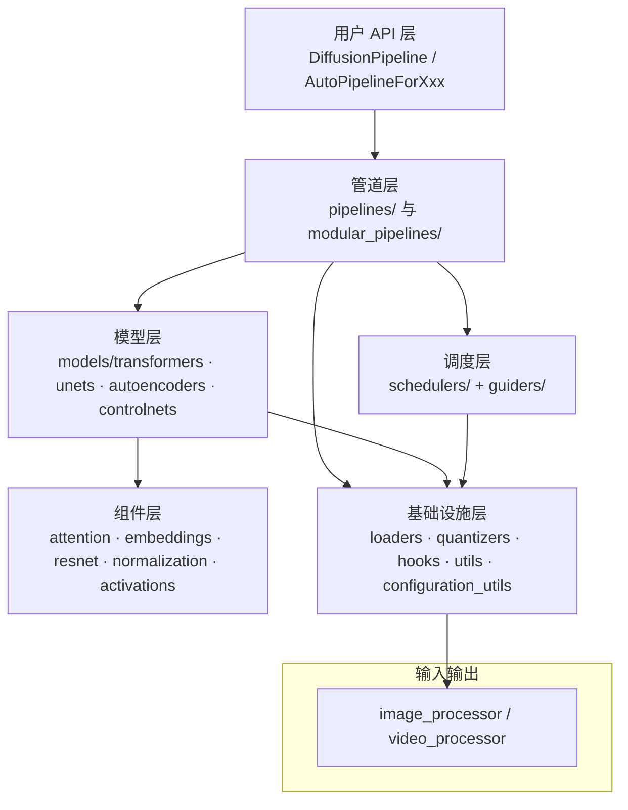
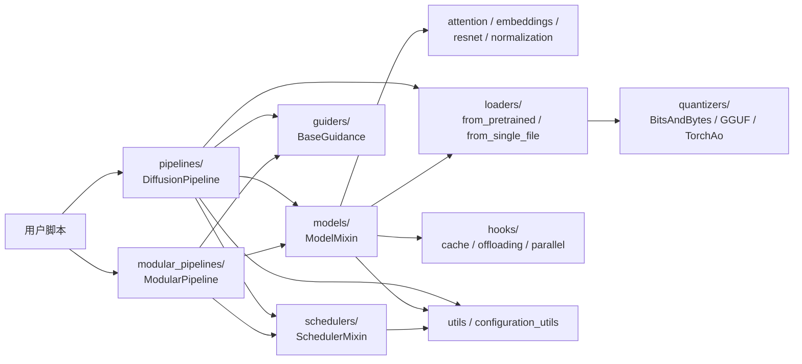
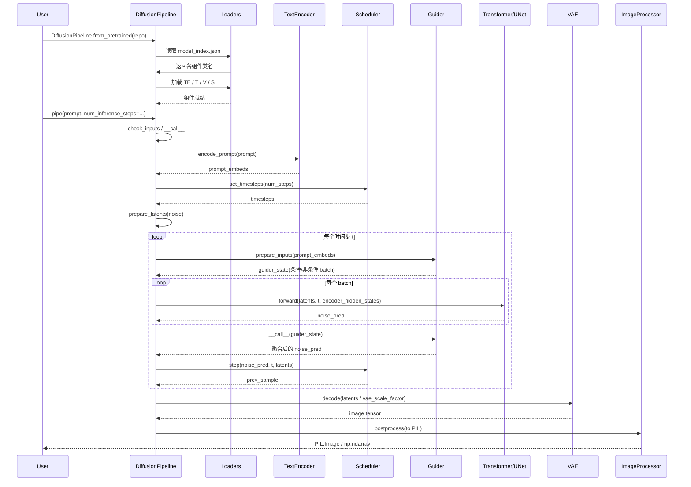

# 01 总览 - 项目架构与设计哲学

> 基于 diffusers 0.39.0.dev0 版本

本文是 Diffusers 代码分析全套文档的总起篇，旨在从宏观层面勾勒出整个项目的模块划分、设计哲学与推理全链路，为后续 02-15 分论篇章奠定共同的认知基础。

---

## 1. 总起：模块概览

### 1.1 Diffusers 定位

🤗 Diffusers 是 HuggingFace 团队维护的扩散模型（diffusion models）工具库，定位为"生成图像、音频甚至 3D 分子结构"的预训练扩散模型首选库。它既提供开箱即用的推理方案，也支持用户训练自己的扩散模型，是一个面向"推理 + 训练"双场景的模块化工具箱。其 PyPI 包描述为 "State-of-the-art diffusion in PyTorch and JAX."（详见 [setup.py](file:///workspace/setup.py#L285-L286)）。

### 1.2 三大核心组件

正如 [README.md](file:///workspace/README.md#L32-L36) 所述，Diffusers 提供三大核心组件：

1. **diffusion pipelines（管道）**：仅需几行代码即可运行推理的端到端扩散管道，是用户最直接接触的 API 层。涵盖文生图、图生图、inpainting、超分、音频生成、视频生成等任务。
2. **schedulers（调度器）**：可互换的噪声调度器，控制去噪速度与输出质量的权衡。典型代表有 DDPM、DDIM、DPM-Solver、Euler、Flow Match 系列等。
3. **models（模型）**：可作为构建块的预训练模型，配合 schedulers 即可组装自定义的端到端扩散系统。包括 VAE、UNet、Transformer、ControlNet、T2IAdapter 等。

### 1.3 设计哲学

README 中明确给出了三条设计取舍原则（见 [README.md](file:///workspace/README.md#L30)）：

- **可用性 > 性能（usability over performance）**：宁可损失一点速度，也要让 API 直观、易用。
- **简单 > 便利（simple over easy）**：宁可写法显式、稍长，也不要隐式魔法；用户应能读懂每一行代码在做什么。
- **可定制 > 抽象（customizable over abstractions / tweakable, contributor-friendly over abstraction）**：暴露足够的内部结构，方便用户改造与贡献，而不是用一层不可穿透的抽象把一切封死。

这三条原则贯穿整个代码库，是理解后续所有约定的钥匙。

### 1.4 与 Transformers 生态关系

Diffusers 与 HuggingFace 的 Transformers 是兄弟库：

- 依赖上，Diffusers 把 `transformers>=4.41.2` 列为可选依赖（见 [setup.py](file:///workspace/setup.py#L146)），许多文本/视觉编码器（CLIP、T5、Qwen 等）由 transformers 提供。
- 机制上，Diffusers 复用了 Transformers 的若干工程范式，最典型的就是 `_LazyModule` 惰性导入机制——在 [__init__.py](file:///workspace/src/diffusers/__init__.py#L31-L32) 的注释中明确写道："Lazy Import based on https://github.com/huggingface/transformers/blob/main/src/transformers/__init__.py"。
- Hub 协同上，二者共享 `huggingface_hub` 客户端，模型加载、缓存、`from_pretrained` 行为高度一致，用户在两个库之间迁移成本极低。

### 1.5 模块架构图

**图 1-1：Diffusers 模块分层架构**



图 1-1 说明：架构自上而下分为五层。最顶层是用户直接调用的 `DiffusionPipeline` 与 `AutoPipelineFor*` 系列；管道层向下编排调度层（schedulers 负责噪声步进、guiders 负责引导策略）与模型层（VAE 编解码、Transformer/UNet 去噪骨干、ControlNet 等条件控制）；模型层再下沉到组件层（attention、embeddings、resnet 等可复用积木）；所有层都依赖最底层的基础设施（loaders 加载、quantizers 量化、hooks 加速、utils 通用工具）。

---

## 2. 分述：核心实现

### 2.1 代码组织约定

#### 2.1.1 惰性导入（`_LazyModule`）

Diffusers 顶层包 [__init__.py](file:///workspace/src/diffusers/__init__.py#L1-L1765) 通过 `_import_structure` 字典登记所有可对外暴露的符号，但**真正执行 import 的时机被推迟到符号被访问时**。在文件末尾（[L1756-L1765](file:///workspace/src/diffusers/__init__.py#L1756-L1765)）将整个模块替换为 `_LazyModule` 实例：

```python
sys.modules[__name__] = _LazyModule(
    __name__,
    globals()["__file__"],
    _import_structure,
    module_spec=__spec__,
    extra_objects={"__version__": __version__},
)
```

`_LazyModule` 的实现位于 [import_utils.py](file:///workspace/src/diffusers/utils/import_utils.py#L1003-L1024)，其本质是一个 `ModuleType` 子类，维护 `class -> submodule` 的映射表，在 `__getattr__` 时才触发真实 import。这样 `import diffusers` 几乎零开销，且不会强制拉起 torch 等重依赖。

#### 2.1.2 可选依赖管理（`is_X_available` + `dummy_*.py`）

每个可选后端都通过 `is_torch_available()`、`is_transformers_available()`、`is_bitsandbytes_available()` 等探测函数判断是否可用（见 [__init__.py](file:///workspace/src/diffusers/__init__.py#L5-L28) 的导入列表）。当某依赖缺失时，`__init__.py` 把对应的 `utils/dummy_*_objects.py` 中同名占位类塞入 `_import_structure`，让用户在尝试 `from diffusers import X` 时得到一条清晰的依赖缺失错误，而不是 import 阶段就崩溃。`setup.py` 通过 `extras` 字典（[L223-L267](file:///workspace/setup.py#L223-L267)）把依赖按场景拆成 `torch`、`flax`、`bitsandbytes`、`gguf`、`torchao`、`optimum_quanto` 等多个 extras，用户按需安装。

#### 2.1.3 `ModelMixin` 模式

所有 PyTorch 模型继承 [`ModelMixin`](file:///workspace/src/diffusers/models/modeling_utils.py)（配合 `ConfigMixin`），通过 `register_to_config` 序列化配置、`from_pretrained` / `from_single_file` 加载权重。详见 [models.md](file:///workspace/.ai/models.md#L13-L16) 的"Common model conventions"。

#### 2.1.4 单文件策略（single-file policy）

[models.md](file:///workspace/.ai/models.md#L19-L25) 规定：一个模型的完整实现应集中在单个 `transformer_<name>.py`（或 `unet_<name>.py`）中，包括 `Attention` 类及其 processor、transformer block、RoPE、模型专属层。共享基础块可从 `normalization.py` / `attention.py` / `embeddings.py` 导入，或用 `# Copied from ...` 头部注释复制并重命名。

#### 2.1.5 Copied Code 同步机制

许多类通过 `# Copied from ...` 头部注释与源保持同步。AGENTS.md 明确要求：**不要直接编辑 `# Copied from` 块**，而应通过 `make fix-copies`（[AGENTS.md](file:///workspace/.ai/AGENTS.md#L20-L26)）从源处自动传播修改。要"故意断开"链接时，删除该头部即可。这套机制由 `utils/check_copies.py` 校验，是 Diffusers 在"复制优于继承"哲学下保证多份代码不漂移的关键工具。

#### 2.1.6 Attention dispatch 模式

[models.md](file:///workspace/.ai/models.md#L27-L66) 要求所有 attention 必须遵循统一模式：`Attention` 类及其 processor 都定义在模型文件内，processor 的 `__call__` 必须通过 `dispatch_attention_fn`（而非直接调用 `F.scaled_dot_product_attention`）来执行真正的注意力计算。`Attention` 类继承 `AttentionModuleMixin`，并声明 `_default_processor_cls` 与 `_available_processors`。`dispatch_attention_fn` 位于 [attention_dispatch.py](file:///workspace/src/diffusers/models/attention_dispatch.py)，支持 flash / sage / sdpa 等多种后端切换。

### 2.2 模块依赖关系图

**图 1-2：核心模块依赖关系**



图 1-2 说明：用户脚本既可走传统 `pipelines/` 路径，也可走新的 `modular_pipelines/` 路径，二者最终都依赖 schedulers（步进）、guiders（引导）、models（骨干）。模型层再向底层的 attention/embeddings/resnet 等组件复用。`loaders` 负责加载与格式转换，`quantizers` 提供量化后端，`hooks` 提供缓存/卸载/并行等运行时增强，`utils` 与 `configuration_utils` 是所有模块共享的基础设施。注意 `modular_pipelines/` 与 `pipelines/` 是平行系统，互不导入（见 [modular.md](file:///workspace/.ai/modular.md#L177-L180)）。

### 2.3 推理全链路时序图

**图 1-3：典型文生图推理全链路时序**



图 1-3 说明：用户调用 `from_pretrained` 后，管道通过 `loaders` 读取 `model_index.json` 并实例化全部组件。`__call__` 内部按"输入校验 → encode prompt → set_timesteps → prepare_latents → 去噪循环（guider 聚合 + scheduler.step）→ VAE decode → postprocess"的固定顺序推进。值得注意的是，传统管道把 CFG 直接写在循环里，而新的 modular_pipelines 把引导策略抽到 `guider` 对象中（见 [modular.md](file:///workspace/.ai/modular.md#L48-L81)），让 denoise 循环与具体引导算法解耦。

### 2.4 关键代码细节

#### 2.4.1 版本号与惰性导入入口

[__init__.py](file:///workspace/src/diffusers/__init__.py#L1) 顶部声明 `__version__ = "0.39.0.dev0"`，与 [setup.py](file:///workspace/setup.py#L285) 中的版本号保持一致。`_import_structure` 字典（[L38-L65](file:///workspace/src/diffusers/__init__.py#L38-L65)）登记了无条件可用的核心符号（如 `ConfigMixin`、`FromOriginalModelMixin`、`PipelineQuantizationConfig`），随后一连串 `try/except OptionalDependencyNotAvailable` 块（[L67-L966](file:///workspace/src/diffusers/__init__.py#L67-L966)）按可选依赖动态扩展该字典：

```python
try:
    if not is_torch_available():
        raise OptionalDependencyNotAvailable()
except OptionalDependencyNotAvailable:
    from .utils import dummy_pt_objects
    _import_structure["utils.dummy_pt_objects"] = [name for name in dir(dummy_pt_objects) if not name.startswith("_")]
else:
    _import_structure["guiders"].extend([...])
    _import_structure["models"].extend([...])
    _import_structure["pipelines"].extend([...])
    _import_structure["schedulers"].extend([...])
```

#### 2.4.2 `_LazyModule` 的实现要点

[import_utils.py](file:///workspace/src/diffusers/utils/import_utils.py#L1003-L1024) 中 `_LazyModule.__init__` 构建了 `_class_to_module` 反查表与 `__all__` 列表（供 IDE 自动补全），并保留 `__file__`、`__spec__`、`__path__` 以兼容 `inspect`、`pkgutil` 等工具。`DIFFUSERS_SLOW_IMPORT` 环境变量（[__init__.py](file:///workspace/src/diffusers/__init__.py#L968)）可强制走非惰性路径，便于调试。

#### 2.4.3 `DiffusionPipeline` 基类

[pipeline_utils.py](file:///workspace/src/diffusers/pipelines/pipeline_utils.py#L185-L225) 中 `DiffusionPipeline` 继承 `ConfigMixin` 与 `PushToHubMixin`，关键类属性包括 `config_name = "model_index.json"`、`model_cpu_offload_seq`（CPU 卸载顺序）、`_optional_components`。`register_modules`（[L211-L224](file:///workspace/src/diffusers/pipelines/pipeline_utils.py#L211-L224)）将每个组件以 `(library, class_name)` 元组形式登记到 config，同时 setattr 到实例，这是管道序列化/反序列化的核心约定。

#### 2.4.4 管道 `__call__` 形态

[pipelines.md](file:///workspace/.ai/pipelines.md#L10) 指出，标准管道的 `__call__` 固定为"输入校验 → encode prompt → timesteps → latent prep → denoise loop → decode"六段式。以 [pipeline_stable_diffusion.py](file:///workspace/src/diffusers/pipelines/stable_diffusion/pipeline_stable_diffusion.py#L780-L785) 与 [pipeline_flux.py](file:///workspace/src/diffusers/pipelines/flux/pipeline_flux.py#L654-L657) 为例，两者签名都以 `prompt` 为首参、`num_inference_steps` 为关键参数。装饰器 `@torch.no_grad()`（见 [pipelines.md](file:///workspace/.ai/pipelines.md#L45-L47)）是必须项，且内部不应再叠加冗余的 no_grad。

---

## 3. 使用指南

### 3.1 安装

推荐在虚拟环境中通过 pip 安装 PyTorch 后端版本（与 [README.md](file:///workspace/README.md#L44-L48) 一致）：

```bash
pip install --upgrade diffusers[torch]
```

社区维护的 conda 渠道：

```sh
conda install -c conda-forge diffusers
```

如需量化后端，可按需安装对应 extras（见 [setup.py](file:///workspace/setup.py#L253-L258)）：

```bash
pip install diffusers[torch,bitsandbytes]   # 4bit/8bit 量化
pip install diffusers[torch,gguf]           # GGUF 格式
pip install diffusers[torch,torchao]        # torchao 量化
```

注意 [setup.py](file:///workspace/setup.py#L298) 要求 `python_requires=">=3.10.0"`，核心运行时依赖（[L269-L279](file:///workspace/setup.py#L269-L279)）包括 `huggingface-hub>=0.34.0,<2.0`、`safetensors>=0.8.0`、`numpy`、`Pillow` 等。

### 3.2 最小推理示例

**Stable Diffusion 文生图**（与 [README.md](file:///workspace/README.md#L64-L71) 一致）：

```python
from diffusers import DiffusionPipeline
import torch

pipeline = DiffusionPipeline.from_pretrained(
    "stable-diffusion-v1-5/stable-diffusion-v1-5",
    torch_dtype=torch.float16,
)
pipeline.to("cuda")
image = pipeline("An image of a squirrel in Picasso style").images[0]
image.save("squirrel.png")
```

**Flux 文生图**（Flux 走 Flow Match 调度，常配 bf16）：

```python
from diffusers import FluxPipeline
import torch

pipeline = FluxPipeline.from_pretrained(
    "black-forest-labs/FLUX.1-dev",
    torch_dtype=torch.bfloat16,
)
pipeline.to("cuda")
image = pipeline(
    "A cyberpunk cat neon portrait, ultra detailed",
    num_inference_steps=28,
    guidance_scale=3.5,
).images[0]
image.save("flux_cat.png")
```

### 3.3 常用参数

- **`torch_dtype`**：模型加载精度。`torch.float16` 适合 SD 系列，`torch.bfloat16` 适合 Flux / 大模型。
- **`variant`**：选择权重变体，如 `variant="fp16"` 只加载 fp16 分片，节省下载与显存。
- **`device_map`**：传 `"auto"` 让 accelerate 自动切分大模型到多卡；要求模型声明了 `_no_split_modules`（见 [models.md](file:///workspace/.ai/models.md#L82-L99)）。
- **`num_inference_steps`**：去噪步数，步数越多质量通常越好但越慢。
- **`guidance_scale`**：CFG 强度；Flux 等蒸馏模型可设为 0 并跳过 CFG。
- **`generator`**：传入 `torch.Generator` 控制可复现性。

---

## 4. 实战案例

### 4.1 案例 1：从 0 到 1 跑通 Stable Diffusion 文生图

```python
import torch
from diffusers import DiffusionPipeline

# 1) 加载管道（fp16 + 自动从 Hub 下载）
pipe = DiffusionPipeline.from_pretrained(
    "stable-diffusion-v1-5/stable-diffusion-v1-5",
    torch_dtype=torch.float16,
    variant="fp16",
    use_safetensors=True,
)
pipe.to("cuda")

# 2) 可选：启用 CPU offload 以节省显存
# pipe.enable_model_cpu_offload()

# 3) 推理
generator = torch.Generator("cuda").manual_seed(42)
output = pipe(
    prompt="a photorealistic photo of a red panda chef cooking ramen",
    negative_prompt="lowres, blurry, deformed",
    height=512,
    width=512,
    num_inference_steps=30,
    guidance_scale=7.5,
    generator=generator,
)
output.images[0].save("red_panda_chef.png")
```

执行流程对照图 1-3：`from_pretrained` → 加载 `text_encoder`、`unet`、`vae`、`scheduler`；`__call__` 内部先 encode prompt（含 CFG 拼接），`set_timesteps(30)`，循环 30 次 `unet.forward + scheduler.step`，最后 `vae.decode` 并 postprocess 成 PIL 图像。

### 4.2 案例 2：Flux 模型快速推理（bf16 + 优化）

```python
import torch
from diffusers import FluxPipeline

pipe = FluxPipeline.from_pretrained(
    "black-forest-labs/FLUX.1-dev",
    torch_dtype=torch.bfloat16,
)
# 显存不够时优先用 sequential offload
pipe.enable_sequential_cpu_offload()

generator = torch.Generator(device="cpu").manual_seed(0)
image = pipe(
    prompt="a cinematic still of a lone astronaut on Europa, volumetric light",
    num_inference_steps=24,
    guidance_scale=3.5,
    generator=generator,
).images[0]
image.save("flux_astronaut.png")
```

Flux 使用 `FluxTransformer2DModel`（[transformer_flux.py](file:///workspace/src/diffusers/models/transformers/transformer_flux.py)）与 `FlowMatchEulerDiscreteScheduler`（[scheduling_flow_match_euler_discrete.py](file:///workspace/src/diffusers/schedulers/scheduling_flow_match_euler_discrete.py)）。Flux 不需要 attention mask（见 [models.md](file:///workspace/.ai/models.md#L72) 的 Flux pattern），因此能跑在 flash / sage / sdpa 全部后端上。

---

## 5. 总结

### 5.1 要点回顾：模块协作全景

Diffusers 是一个五层架构的扩散模型工具箱：**用户 API → 管道层 → 调度/引导层 → 模型层 → 组件/基础设施层**。三大核心组件（pipelines、schedulers、models）通过 `ModelMixin` / `ConfigMixin` / `SchedulerMixin` 三个 Mixin 体系统一配置与序列化；新引入的 `guiders/` 与 `modular_pipelines/` 把引导策略和管道编排从 `__call__` 中解耦出来，让同一个去噪骨干能灵活搭配 CFG、APG、PAG 等多种引导算法。惰性导入与可选依赖管理让 `import diffusers` 既轻量又能按需启用 torch / flax / 各类量化后端。

### 5.2 与其他文档的关系

本篇是后续 02-15 分论的基础：

- **02 篇** 深入惰性导入、`ModelMixin` / `ConfigMixin` 序列化机制（对应 §2.1）。
- **03/04 篇** 分别剖析 VAE 家族与 Transformer 家族（对应 §1.5 模型层）。
- **05/06 篇** 详解 schedulers 与 guiders（对应 §1.5 调度层）。
- **07 篇** 聚焦 attention dispatch 与 processor 模式（对应 §2.1.6）。
- **08/09 篇** 覆盖 loaders 与 quantizers（对应 §2.2 基础设施层）。
- **10 篇** 解析 hooks（cache/offloading/parallel）。
- **11 篇** 对比标准 pipelines 与 modular_pipelines（对应 §2.3）。
- **12-15 篇** 走查 SD / SDXL / Flux / 视频等代表性管道的端到端推理（对应 §4）。

### 5.3 设计哲学如何体现在代码中

- **可用性 > 性能**：`DiffusionPipeline.from_pretrained("repo")(...)` 三行出图，所有加载/调度/解码细节被封装。
- **简单 > 便利**：每个变体（img2img / inpaint）独立成文件而非子类化（[pipelines.md](file:///workspace/.ai/pipelines.md#L72)），牺牲代码复用换可读性；AGENTS.md 反复强调"inline 小 helper、不要防御性代码、不要 fallback"。
- **可定制 > 抽象**：组件以 `register_modules` 形式setattr 到管道实例，用户可自由替换 `pipe.scheduler`、`pipe.unet`、注入 ControlNet；modular_pipelines 把每个 block 设计成可独立运行的单元（[modular.md](file:///workspace/.ai/modular.md#L114-L128)），鼓励用户"拼装"而非"继承"。
- **贡献友好**：`# Copied from` + `make fix-copies` 让多人维护的复制代码自动同步；`.ai/` 目录下的 models.md / pipelines.md / modular.md 把评审规则写成可机器校验的规范，配合 self-review skill 让 AI 代理也能按规范贡献代码。

这三条原则不是装饰性的口号，而是每一处 API 形态、每一份代码约定的决策依据。理解了它们，就理解了 Diffusers 的"为什么这么写"。

---

## 参考资料

### 项目内源文件

- [README.md](file:///workspace/README.md) — 项目定位、三大组件、Quickstart
- [src/diffusers/__init__.py](file:///workspace/src/diffusers/__init__.py) — 版本号、`_import_structure`、惰性导入入口
- [src/diffusers/utils/import_utils.py](file:///workspace/src/diffusers/utils/import_utils.py#L1003-L1024) — `_LazyModule` 实现
- [src/diffusers/pipelines/pipeline_utils.py](file:///workspace/src/diffusers/pipelines/pipeline_utils.py#L185-L225) — `DiffusionPipeline` 基类
- [src/diffusers/pipelines/stable_diffusion/pipeline_stable_diffusion.py](file:///workspace/src/diffusers/pipelines/stable_diffusion/pipeline_stable_diffusion.py#L780-L785) — SD 管道 `__call__`
- [src/diffusers/pipelines/flux/pipeline_flux.py](file:///workspace/src/diffusers/pipelines/flux/pipeline_flux.py#L654-L657) — Flux 管道 `__call__`
- [src/diffusers/models/transformers/transformer_flux.py](file:///workspace/src/diffusers/models/transformers/transformer_flux.py) — Flux Transformer 实现
- [src/diffusers/schedulers/scheduling_flow_match_euler_discrete.py](file:///workspace/src/diffusers/schedulers/scheduling_flow_match_euler_discrete.py) — Flow Match Euler 调度器
- [src/diffusers/models/attention_dispatch.py](file:///workspace/src/diffusers/models/attention_dispatch.py) — Attention dispatch 后端
- [setup.py](file:///workspace/setup.py) — 打包、依赖、extras

### `.ai/` 规范

- [.ai/AGENTS.md](file:///workspace/.ai/AGENTS.md) — 编码风格、Copied Code、技能指南
- [.ai/models.md](file:///workspace/.ai/models.md) — 模型约定、Attention 模式、单文件策略
- [.ai/pipelines.md](file:///workspace/.ai/pipelines.md) — 管道 `__call__` 形态、guider/scheduler 复用
- [.ai/modular.md](file:///workspace/.ai/modular.md) — 模块化管道约定、Block 类型决策树
