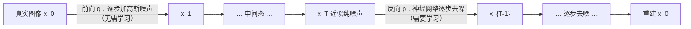
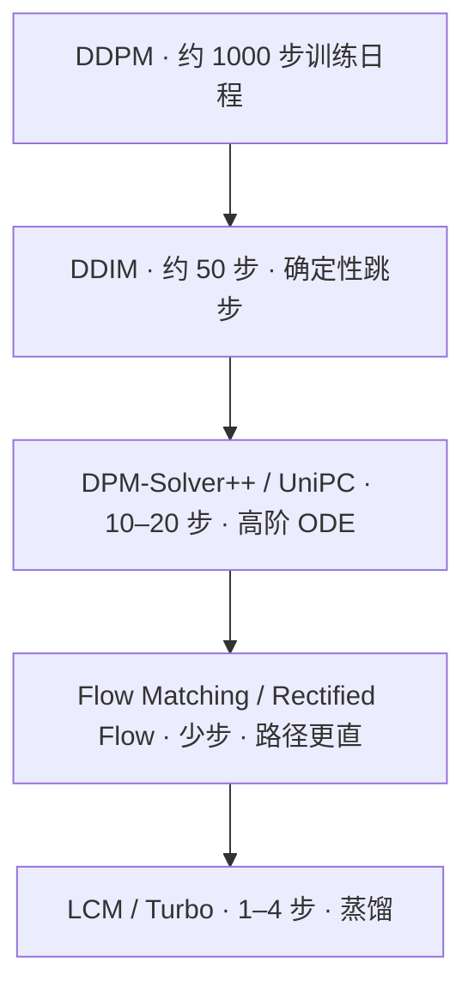
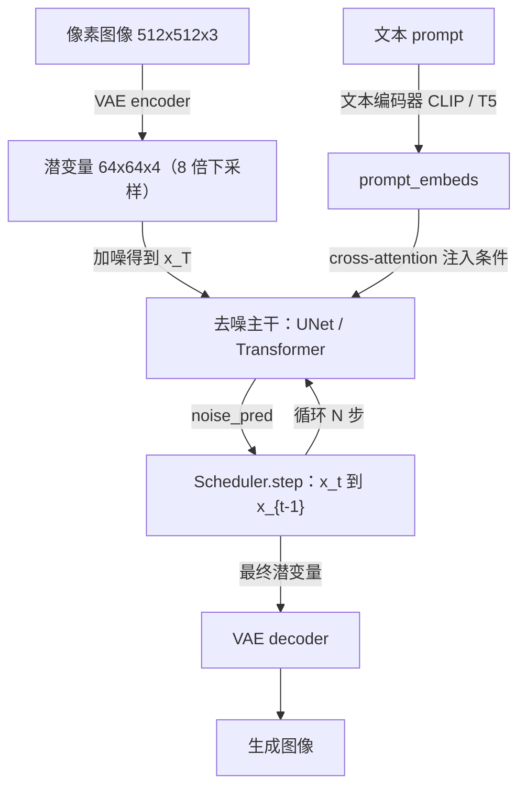
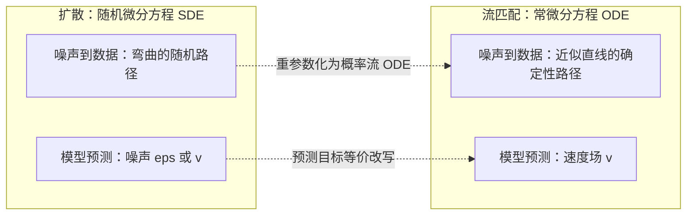
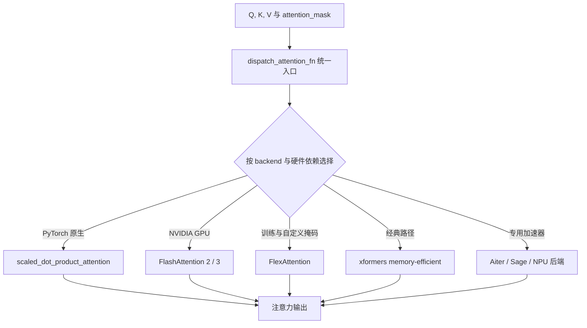
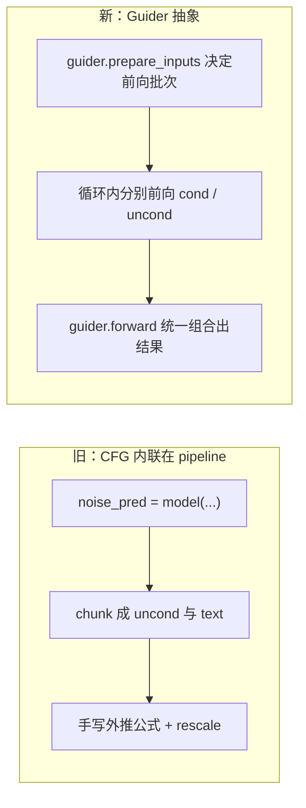
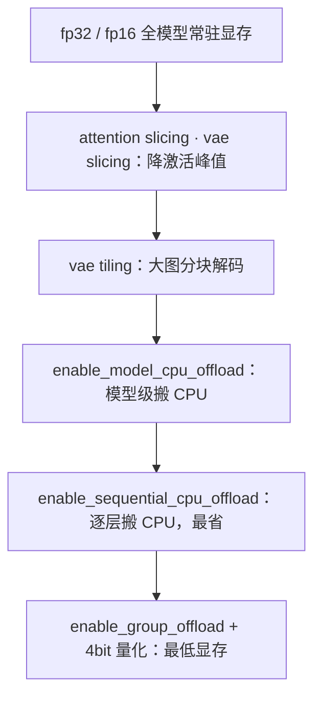
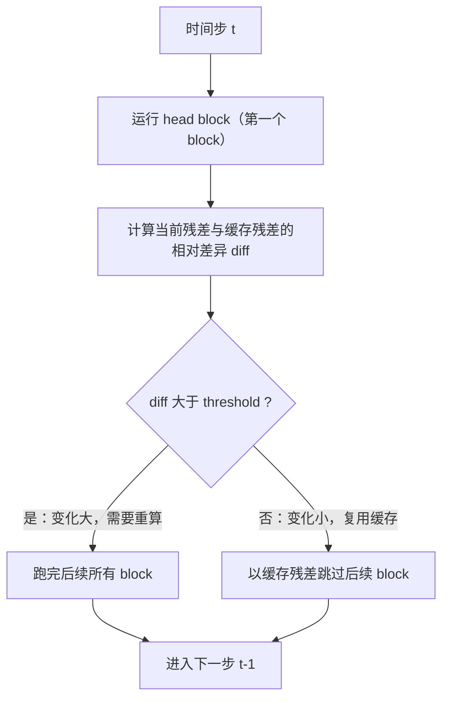
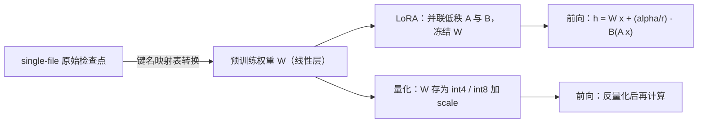
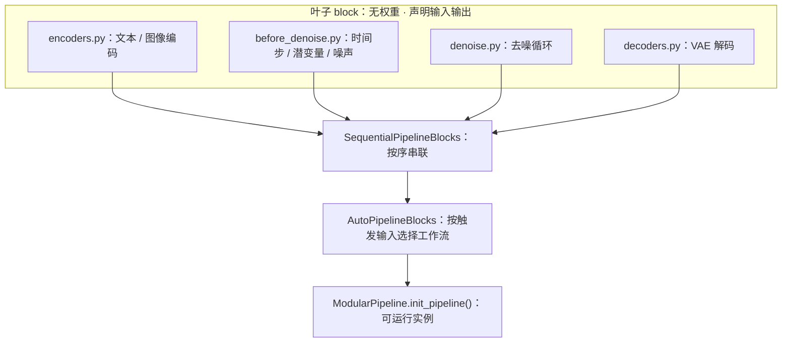

# 🤗 Diffusers 代码深度解读 · 第二篇：具体观 —— 算法与实现剖析

> **导读**｜第一篇给了我们一张"项目认知地图"：Diffusers 是"四个正交部件 + 一个引导策略"的积木工具箱。
> 但地图不等于地形。本篇是第二观，要**潜入水下**，把那些积木一个个拆开，回答"**它究竟怎么算、怎么实现**"。
> 我们沿两条线索推进：**线索一·算法主线**（从概率扩散到流匹配的演进），**线索二·关键工程**（注意力、引导、内存、速度、轻量化、可组合范式）。
> 每个技术点都遵循同一个节奏：**原理（配论文）→ 代码实现（配真实片段）→ 具体例子**。
> 读完本篇，你会明白：Diffusers 的每一行"看起来朴实"的代码背后，都站着一段可考证的数学与工程。

---

## 〇、总：本篇要深入的两条线索

在第一篇里我们说过，Diffusers 的核心契约是极简的：**模型预测一个量，调度器据此走一步**。本篇要做的，就是把这句话彻底展开——"预测什么量"、"走哪一步"、"如何让这一步算得又快又省"，正是全部技术含量的所在。

我们先走**算法主线**，它是一部"如何让采样更快更稳"的演进史：

- **DDPM / DDIM**：概率扩散的起点，确立"前向加噪、反向去噪"的范式，并首次尝试确定性加速；
- **DPM-Solver / UniPC / EDM**：把反向过程当作 ODE，用高阶积分器把上千步压缩到十几步；
- **LDM / Stable Diffusion**：把扩散搬进 VAE 潜空间，用 8 倍下采样换来算力的数量级下降；
- **DiT / Flow Matching / Rectified Flow**：用 Transformer 取代 UNet，用"直线路径"进一步逼近一步生成；
- **LCM / 一致性模型**：用蒸馏把多步彻底压到 1–4 步。

这条线索是"**时间维度上的逐层递进**"：越往后，路径越直、步数越少、对工程的要求越高。

然后走**关键工程**，它是"**从算法到部署的逐层递进**"：

- **注意力**（算力热点，需要多后端统一分发）；
- **引导**（从内联 CFG 到可插拔 Guider）；
- **内存工程**（offload / 分层 cast / 切片，把大模型塞进小显卡）；
- **速度工程**（特征缓存 / torch.compile / 并行）；
- **轻量化**（量化 / LoRA / 单文件加载）；
- **可组合范式**（模块化 block 与状态流转）。

两条线索合起来，构成本篇的"具体观"。

---

# 第一部分 · 算法主线

## 一、概率扩散的起点：DDPM 与 DDIM

### 1.1 原理

扩散模型的思想可以一句话概括：**把"生成"变成"去噪"**。它定义两个过程：

- **前向过程** `q`：对真实图像 `x_0` **逐步**加入高斯噪声，经过 `T` 步（通常 `T=1000`）后变成近似纯噪声 `x_T`。这一步是**固定的、无需学习的**：
  `x_t = sqrt(α̅_t) · x_0 + sqrt(1 − α̅_t) · ε`，其中 `ε ~ N(0, I)`，`α̅_t` 是 `α_i = 1 − β_i` 的连乘。
- **反向过程** `p`：训练一个神经网络，学会**从 `x_t` 预测 `x_{t-1}`**（等价地，预测噪声 `ε`）。生成时从噪声出发，反复调用它，逐步"去噪"回图像。

DDPM 用变分下界（ELBO）推导出训练目标——**简化为一个"预测噪声的 MSE 损失"**，这正是它简单又强大的原因。DDIM 则发现：反向过程的方差可以取 0（完全确定），且可以跳步采样，从而用远少于 `T` 的步数（如 50 步）完成采样。二者的关系是：**DDIM 是 DDPM 的一个"确定性、可跳步"的特例**。

- 论文：[Denoising Diffusion Probabilistic Models](https://arxiv.org/abs/2006.11239) — 提出用去噪匹配训练目标把扩散模型训练得简单而稳定，奠定了现代扩散模型的基础。
- 论文：[Denoising Diffusion Implicit Models](https://arxiv.org/abs/2010.02502) — 提出非马尔可夫、确定性的隐式采样，用更少步数获得可比质量。

**图 2-1｜扩散的前向与反向过程**：左半是无须学习、固定加噪的前向过程，右半是需要神经网络学习的反向去噪过程。这张图是理解后面所有调度器的地基。



### 1.2 代码实现：DDIM 的 `step` 到底算了什么

在 Diffusers 里，上面所有数学都被压进 `DDIMScheduler.step()` 这一个函数。它的核心（[scheduling_ddim.py#L444-L491](file:///workspace/src/diffusers/schedulers/scheduling_ddim.py#L444-L491)）如下：

```python
# 1. 求上一步的索引（DDIM 允许跳步）
prev_timestep = timestep - self.config.num_train_timesteps // self.num_inference_steps

# 2. 取 alpha 连乘
alpha_prod_t = self.alphas_cumprod[timestep]
alpha_prod_t_prev = self.alphas_cumprod[prev_timestep] if prev_timestep >= 0 else self.final_alpha_cumprod
beta_prod_t = 1 - alpha_prod_t

# 3. 由"预测噪声"反推"预测的干净样本 x_0"（DDIM 论文公式 12）
if self.config.prediction_type == "epsilon":
    pred_original_sample = (sample - beta_prod_t ** 0.5 * model_output) / alpha_prod_t ** 0.5
    pred_epsilon = model_output

# 5. 计算方差（DDIM 取 eta=0 时完全确定）
variance = self._get_variance(timestep, prev_timestep)
std_dev_t = eta * variance ** 0.5

# 6-7. 组合出 x_{t-1}
pred_sample_direction = (1 - alpha_prod_t_prev - std_dev_t**2) ** 0.5 * pred_epsilon
prev_sample = alpha_prod_t_prev ** 0.5 * pred_original_sample + pred_sample_direction
```

**逐行读法**：模型只给了 `model_output`（预测的噪声 `ε`）；第 3 步用代数把它反解成"预测的干净图像 `x_0`"；第 7 步再把 `x_0` 与"指向 `x_t` 的方向"按 `α̅` 加权组合，得到上一步的样本。**这十行，就是"从噪声走一步"的全部**。

### 1.3 三个 `prediction_type` 的例子

`step` 里有个分支值得单独说：模型"预测的量"可以不同（[L455-L468](file:///workspace/src/diffusers/schedulers/scheduling_ddim.py#L455-L468)）：

| `prediction_type` | 模型预测什么 | `pred_original_sample` 的公式 |
|-------------------|-------------|------------------------------|
| `epsilon` | 噪声 `ε` | `(x_t − √(1−α̅_t)·ε) / √α̅_t` |
| `sample` | 干净样本 `x_0` | 直接就是 `model_output`（如部分 EDM/LDM 实现） |
| `v_prediction` | 速度 `v = √α̅·ε − √(1−α̅)·x_0` | `√α̅_t·x_t − √(1−α̅_t)·v` |

**同一个调度器，换个 `prediction_type`，就能适配不同训练目标的模型**——这正是"预测目标"与"求解器"解耦的红利，也为后面 EDM、Flow Matching 的登场铺好了路。

### 1.4 求解器的"步数-轨迹"演进

**图 2-2｜采样求解器的演进主线**：从 DDPM 的上千步，到 DDIM 的数十步，再到高阶 ODE 求解器的十几步、流匹配的少步、蒸馏的 1–4 步。这张图给出整条算法主线的"地图坐标"。



---

## 二、高阶求解器：DPM-Solver / UniPC / EDM

### 2.1 原理

DDIM 的本质是把反向过程当作一个 ODE 来离散求解，但它用的是**最简单的一阶显式欧拉法**——步长不够小就会累积误差。DPM-Solver 的洞见是：扩散 ODE 具有特殊的"**半线性**"结构，可以先用变量替换把它化简为一个"**指数加权的积分**"，再套用数值分析里的**指数积分器（exponential integrator）**。这样能在保证收敛阶数（order 2/3）的前提下，把函数评估次数（NFE）压到 **10–20 次**。UniPC 进一步统一了预测-校正框架；EDM 则系统性地梳理了"噪声日程、预处理、求解器"的设计空间，提出 Karras 日程。

- 论文：[DPM-Solver: A Fast ODE Solver for Diffusion Probabilistic Model Sampling in Around 10 Steps](https://arxiv.org/abs/2206.00927) — 用指数积分器为扩散 ODE 设计专用高阶求解器，约 10 步即可出高质量样本。
- 论文：[Elucidating the Design Space of Diffusion-Based Generative Models](https://arxiv.org/abs/2206.00364) — 系统解构扩散模型的训练与采样设计空间，提出 EDM 框架与 Karras 噪声日程。

### 2.2 代码实现

Diffusers 把这些求解器逐一实现为独立调度器：`scheduling_dpmsolver_multistep.py`（DPM-Solver++）、`scheduling_unipc_multistep.py`（UniPC）、`scheduling_edm_euler.py`（EDM + Karras 日程）、`scheduling_deis_multistep.py`（DEIS）等。它们都实现了同一个 `SchedulerMixin` 接口，因此**可以像换灯泡一样互换**。

### 2.3 例子：50 步 DDIM vs 20 步 DPM-Solver++ 的质量-速度权衡

```python
from diffusers import StableDiffusionPipeline, DPMSolverMultistepScheduler
import torch

pipe = StableDiffusionPipeline.from_pretrained(
    "stable-diffusion-v1-5/stable-diffusion-v1-5", torch_dtype=torch.float16
).to("cuda")

# 路线 A：默认 PNDM，50 步（慢）
img_a = pipe("a scenic landscape", num_inference_steps=50, guidance_scale=7.5).images[0]

# 路线 B：换 DPM-Solver++，20 步（快，质量相当）
pipe.scheduler = DPMSolverMultistepScheduler.from_config(pipe.scheduler.config)
img_b = pipe("a scenic landscape", num_inference_steps=20, guidance_scale=7.5).images[0]
```

**观察**：路线 B 把函数评估次数降到约 40%（20 步 × 2 次前向），图像质量却肉眼难分伯仲。这就是"求解器升级"带来的**免费加速**——不需要重新训练，只换一个数学更好的积分器。

---

## 三、潜空间扩散：LDM / Stable Diffusion 与 VAE

### 3.1 原理

DDPM 在**像素空间**做扩散，512×512×3 的图像每个时间步都要卷一遍，算力开销巨大。Latent Diffusion（LDM）的关键一步是：先用一个 **VAE 把图像压缩到低维潜空间**（典型 8 倍空间下采样，`512×512×3 → 64×64×4`），**在这个小得多的空间里做扩散**，生成后再解码回像素。文本条件则通过 **cross-attention（交叉注意力）**注入去噪主干。

这一改动把扩散的算力需求降低了约一个数量级，也是"Stable Diffusion"能在大众显卡上跑起来的根本原因。

- 论文：[High-Resolution Image Synthesis with Latent Diffusion Models](https://arxiv.org/abs/2112.10752) — 提出在预训练自编码器的潜空间做扩散，大幅降低高分辨率生成的算力成本。

**图 2-3｜潜空间扩散的数据管道**：文本经编码器成为条件，像素经 VAE 编码器压成潜变量；扩散在潜空间里循环，最后经 VAE 解码器还原成图像。请特别注意"去噪循环"发生在低维潜空间，而非像素空间。



### 3.2 代码实现

- VAE 侧：`models/autoencoders/autoencoder_kl.py` 提供 `encode`/`decode`，并用 `scaling_factor`（约 0.18215）把潜变量缩放到合适量级；
- 条件注入侧：`models/unets/unet_2d_condition.py` 里的 `Transformer2DModel` 含 cross-attention 层，把 `encoder_hidden_states`（即 `prompt_embeds`）作为 K/V 融入；
- 组装侧：[pipeline_stable_diffusion.py](file:///workspace/src/diffusers/pipelines/stable_diffusion/pipeline_stable_diffusion.py) 的 `prepare_latents` 决定潜变量形状（`height // vae_scale_factor`），循环结束后 `vae.decode` 还原。

### 3.3 例子：潜空间到底省了多少

以 512×512 图像、8 倍下采样为例：像素空间张量元素数约 `512×512×3 ≈ 78.6 万`，潜空间约 `64×64×4 ≈ 1.6 万`——**约 48 倍**的元素数量差距。由于注意力的复杂度对 token 数近乎二次增长，压缩到潜空间带来的实际加速比这更可观。**这就是"为什么要在潜空间扩散"最直观的回答**。

---

## 四、Transformer 化：DiT 与 Flow Matching / Rectified Flow

### 4.1 原理

两次架构层面的范式转变：

- **DiT（Diffusion Transformer）**：用**标准 Transformer** 取代 UNet 作为去噪主干。把图像切成 patch（潜空间 patch），当作 token 序列送进 Transformer，并继承 ViT 的可扩展性——**模型越大，效果越好**。
- **Flow Matching / Rectified Flow**：重新审视"噪声→数据"的概率路径。扩散走的是**弯曲**的随机路径，而流匹配直接训练一个**速度场** `v_θ`，让路径尽量**笔直**。路径越直，用欧拉法离散步进的误差越小——**理论上完全笔直的路径，一步欧拉即可精确求解**。这为后面的少步/一步生成打开了大门。

- 论文：[Scalable Diffusion Models with Transformers (DiT)](https://arxiv.org/abs/2212.09748) — 证明用 Transformer 替换 UNet 并放大规模，能持续提升生成质量。
- 论文：[Flow Matching for Generative Modeling](https://arxiv.org/abs/2210.02747) — 提出免模拟的连续归一化流训练范式，用回归条件概率路径的向量场训练生成模型。
- 论文：[Flow Straight and Fast: Learning to Generate and Transfer Data with Rectified Flow](https://arxiv.org/abs/2209.03003) — 提出 Rectified Flow，通过"拉直"轨迹降低离散步进误差，使少步乃至一步生成成为可能。

**图 2-4｜从扩散到流匹配：路径被"拉直"了**：左侧扩散的路径是弯曲的，需要多步逼近；右侧流匹配让路径近似直线，少数几步即可到达。这张图解释了"为什么流匹配天然更快"。



### 4.2 代码实现：Flow-Match Euler 的一步

Flux / SD3 系使用的 `FlowMatchEulerDiscreteScheduler.step()`（[scheduling_flow_match_euler_discrete.py#L500-L514](file:///workspace/src/diffusers/schedulers/scheduling_flow_match_euler_discrete.py#L500-L514)）短得惊人：

```python
sigma_idx = self.step_index
sigma = self.sigmas[sigma_idx]
sigma_next = self.sigmas[sigma_idx + 1]
current_sigma = sigma
next_sigma = sigma_next
dt = sigma_next - sigma                       # 步长（在 sigma 域）

if self.config.stochastic_sampling:
    x0 = sample - current_sigma * model_output
    noise = randn_tensor(sample.shape, generator=generator, device=sample.device, dtype=sample.dtype)
    prev_sample = (1.0 - next_sigma) * x0 + next_sigma * noise
else:
    prev_sample = sample + dt * model_output   # ← 一行欧拉更新！
```

**核心就是最后一行**：`prev_sample = sample + dt * model_output`——即"**位置 += 步长 × 速度**"，这正是常微分方程 `dx/dt = v(x, t)` 的一步欧拉离散。模型输出的 `model_output` 就是速度场 `v`。**对比 DDIM 的十余行代数，流匹配的"一步"朴素到只有一行**——因为它把复杂度前移到了"训练出笔直路径"上。

### 4.3 例子：为什么"直"就意味着"快"

设想两条从 A 到 B 的路径：一条是弯曲的山路（扩散），一条是笔直的高速（流匹配）。用"每 10 公里停一次、再决定下一步方向"的离散走法，走山路很容易偏离，需要密集地停（多步）；走高速几乎不用修正，少数几站即可到达。**Rectified Flow 的"reflow"过程就是在反复训练中把山路修直**——这是"少步生成"背后的几何直觉。

---

## 五、少步生成：LCM 与一致性模型

### 5.1 原理

即便路径变直，扩散模型仍需若干步。**一致性模型（Consistency Models）**提出：直接学习一个"**一步跳到终点**"的映射——只要保证同一个路径上任意时刻的点都能映射到同一个终点（自一致性），推理时就能从任意时刻一跳到位。**Latent Consistency Models（LCM）**把这一思想搬进潜空间，并对预训练的 Stable Diffusion 做**蒸馏**，从而在 **1–4 步**内生成高质量图像。

- 论文：[Latent Consistency Models: Synthesizing High-Resolution Images with Few-Step Inference](https://arxiv.org/abs/2310.04378) — 在潜空间学习一致性映射并蒸馏预训练 LDM，实现 1–4 步高质量生成。

### 5.2 代码与例子

Diffusers 提供 `scheduling_lcm.py` 调度器与 `pipeline_latent_consistency_text2img.py` 流水线，配合社区/官方的 LCM-LoRA 权重即可：

```python
from diffusers import DiffusionPipeline, LCMScheduler
import torch

pipe = DiffusionPipeline.from_pretrained(
    "stable-diffusion-v1-5/stable-diffusion-v1-5", torch_dtype=torch.float16
).to("cuda")
pipe.scheduler = LCMScheduler.from_config(pipe.scheduler.config)   # 换成一致性调度器
pipe.load_lora_weights("latent-consistency/lcm-lora-sdv1-5")       # 挂上 LCM-LoRA

image = pipe("a futuristic city at sunset", num_inference_steps=4, guidance_scale=1.0).images[0]
```

**观察**：`num_inference_steps=4`，且 `guidance_scale=1.0`（LCM 蒸馏时内置了引导，不再需要外挂 CFG）。相比 20–50 步的常规路径，这是又一次数量级的提速。

---

# 第二部分 · 关键工程

> 算法回答了"**怎么算**"，工程回答"**怎么在真实硬件上算得起**"。以下逐点：问题 → 机制 → 代码 → 收益。

## 六、注意力：Processor 模式 + 多后端统一分发

### 6.1 问题

注意力是扩散模型的**算力与显存热点**（复杂度对序列长度近二次），同时**不同硬件/精度下最优的注意力 kernel 各不相同**（NVIDIA 上 FlashAttention 快，训练时要 FlexAttention，老环境可能只有 xFormers）。既要性能，又要可移植。

### 6.2 机制

Diffusers 用两级设计解决：

1. **Processor 模式**：`Attention` 类只负责"持有 `to_q`/`to_k`/`to_v`/`to_out` 等模块"，**真正的计算被交给一个可插拔的 processor**。想换算法，只需 `set_attn_processor`；想注入新方法（如 PAG），写个 processor 即可。
2. **多后端统一分发**：`dispatch_attention_fn()` 作为唯一入口，按 `backend`/硬件/已安装依赖，选择具体的注意力实现。

在 `.ai/models.md` 中，这被固化为**必须遵守的规约**：新模型的 attention 及其 processor 必须定义在模型文件内，processor 的 `__call__` 必须调用 `dispatch_attention_fn`，而不是直接调 `F.scaled_dot_product_attention`。

- 论文：[FlashAttention: Fast and Memory-Efficient Exact Attention with IO-Awareness](https://arxiv.org/abs/2205.14135) — 通过 IO 感知的 tiling 与重计算，在不牺牲精度的前提下大幅加速注意力并降低显存。

**图 2-5｜注意力的多后端统一分发**：所有请求都先进 `dispatch_attention_fn()`，再由它按后端能力路由到 FlashAttention、FlexAttention、xFormers、SDPA 或 NPU 专用实现。这张图说明了"一次编写、处处加速"是如何做到的。



### 6.3 代码

一个最小 processor 的骨架（`AttnProcessor2_0`，[attention_processor.py#L2742-L2769](file:///workspace/src/diffusers/models/attention_processor.py#L2742-L2769)）：

```python
query = attn.to_q(hidden_states)
if encoder_hidden_states is None:
    encoder_hidden_states = hidden_states
key = attn.to_k(encoder_hidden_states)
value = attn.to_v(encoder_hidden_states)

# reshape 成 (batch, heads, seq, head_dim)，必要时应用 norm_q / norm_k
query = query.view(batch_size, -1, attn.heads, head_dim).transpose(1, 2)
key = key.view(batch_size, -1, attn.heads, head_dim).transpose(1, 2)
value = value.view(batch_size, -1, attn.heads, head_dim).transpose(1, 2)

hidden_states = F.scaled_dot_product_attention(      # 新版模型改为：
    query, key, value, attn_mask=attention_mask, dropout_p=0.0, is_causal=False
)                                                     # dispatch_attention_fn(query, key, value, ...)
```

### 6.4 例子：切换后端 / 注入自定义 processor

```python
from diffusers.models.attention_processor import AttnProcessor2_0  # 或第三方 processor

# 用 processor 模式把某个模块的注意力替换为自定义实现
unet.set_attn_processor(AttnProcessor2_0())
```

PAG（Perturbed-Attention Guidance）流水线就是这一机制的典型应用：它在去噪循环开始时**保存原始 processor**，装入 PAG processor，循环结束后再恢复——**既注入了新行为，又不污染共享组件**（参见 [.ai/pipelines.md](file:///workspace/.ai/pipelines.md) 第 7 条 gotcha）。

---

## 七、引导（Guidance）：从内联 CFG 到 Guider 抽象

### 7.1 原理

**Classifier-Free Guidance（CFG）**是让生成贴合提示词的关键技巧：同一模型在训练时**同时**学"有条件"和"无条件"两种预测，推理时把两者的差放大：

`ε = ε_uncond + s · (ε_cond − ε_uncond)`

`s` 越大，越贴合提示但可能过度饱和；越小，越多样但可能跑题。Diffusers 还提供了 CFG++、APG（自适应投影引导）、PAG（扰动注意力引导）等变体，各有不同的引导策略。

- 论文：[Classifier-Free Diffusion Guidance](https://arxiv.org/abs/2207.12598) — 提出无需单独分类器的引导方式，联合训练条件与无条件模型并在推理时外推，成为文本生成图像的标准做法。

### 7.2 代码：旧的内联写法

在经典 pipeline 里，CFG 是**直接内联在去噪循环里**的（[pipeline_stable_diffusion.py#L1052-L1059](file:///workspace/src/diffusers/pipelines/stable_diffusion/pipeline_stable_diffusion.py#L1052-L1059)）：

```python
if self.do_classifier_free_guidance:
    noise_pred_uncond, noise_pred_text = noise_pred.chunk(2)
    noise_pred = noise_pred_uncond + self.guidance_scale * (noise_pred_text - noise_pred_uncond)

if self.do_classifier_free_guidance and self.guidance_rescale > 0.0:
    noise_pred = rescale_noise_cfg(noise_pred, noise_pred_text, guidance_rescale=self.guidance_rescale)
```

简单直接，但**把引导策略硬编码进了每个 pipeline**。想换成 APG？得改每个 pipeline 的循环。

### 7.3 机制：Guider 抽象

新版把引导抽成独立的 `guiders/` 模块。以 `ClassifierFreeGuidance` 为例（[classifier_free_guidance.py#L78-L120](file:///workspace/src/diffusers/guiders/classifier_free_guidance.py#L78-L120)）：

```python
class ClassifierFreeGuidance(BaseGuidance):
    _input_predictions = ["pred_cond", "pred_uncond"]

    @register_to_config
    def __init__(self, guidance_scale=7.5, guidance_rescale=0.0,
                 use_original_formulation=False, start=0.0, stop=1.0, enabled=True):
        ...

    def prepare_inputs(self, data):        # 决定要跑哪些前向（cond / uncond）
        ...
    def forward(self, pred_cond, pred_uncond=None):   # 统一执行引导外推
        ...
```

配套接口还包括 `prepare_models` / `cleanup_models`——**它负责告诉循环该跑几次模型、如何组合结果**。于是去噪循环不再关心"CFG 怎么算"，只关心"把 guider 要的输入喂给它，取回最终预测"。

**图 2-6｜CFG 内联 vs Guider 抽象**：左侧是旧写法（引导逻辑写死在 pipeline 里），右侧是新写法（引导被抽成可替换的 guider，循环只调用统一接口）。这张图展示了"关注点分离"如何让引导策略变得可插拔。



### 7.4 例子：换一个引导策略，只换一个对象

```python
from diffusers import ClassifierFreeGuidance, AdaptiveProjectedGuidance

components.guider = ClassifierFreeGuidance(guidance_scale=7.5)   # 默认
# 换成 APG：只替换 guider 对象，去噪循环与模型代码一行不动
components.guider = AdaptiveProjectedGuidance(guidance_scale=7.5)
```

在模块化范式里，引导甚至不再是 pipeline 的形参，而是**独立的组件**——这是"关注点分离"的直接收益。

---

## 八、极致内存工程：Offload / 分层 Cast / 切片

### 8.1 问题

大模型（如 SDXL、Flux）全精度常驻显存动辄十几 GB，消费级显卡装不下。Diffusers 提供了一整套"**用时间换空间**"的手段，且全部是**用户按需开启**的（呼应第一篇的"可用优先"理念）。

### 8.2 机制与代码

| 手段 | 调用 | 原理 | 代价 |
|------|------|------|------|
| Attention Slicing | `pipe.enable_attention_slicing()` | 把注意力分块计算，降低激活峰值 | 略微变慢 |
| VAE Slicing / Tiling | `pipe.enable_vae_slicing()` / `enable_vae_tiling()` | 分块解码，避免一次性解大图 | 大图/大 batch 需要 |
| 模型级 CPU Offload | `pipe.enable_model_cpu_offload()` | 不用的组件放 CPU，用时再搬 GPU | 有明显搬运开销 |
| 顺序 CPU Offload | `pipe.enable_sequential_cpu_offload()` | **逐层**搬运，显存占用最低 | 最慢 |
| 分组 Offload | `pipe.enable_group_offload(...)` | 以 block 为单位分组搬运（[group_offloading.py#L99-L180](file:///workspace/src/diffusers/hooks/group_offloading.py#L99-L180)），支持 pinned memory 与非阻塞传输 | 可精细调优 |
| 分层 Cast | `model.enable_layerwise_casting(storage_dtype=..., compute_dtype=...)` | 权重以低精度存储、计算时临时升精度（[modeling_utils.py#L435-L518](file:///workspace/src/diffusers/models/modeling_utils.py#L435-L518)） | 少量转换开销 |

**图 2-7｜显存优化的"阶梯"**：从上到下显存占用逐步降低、代价逐步提高。这张图给出"我的显卡能装下哪个级别"的决策坐标。



### 8.3 例子：显存占用对比

```python
import torch
from diffusers import DiffusionPipeline

pipe = DiffusionPipeline.from_pretrained("stabilityai/stable-diffusion-xl-base-1.0", torch_dtype=torch.float16)

# 档位 1：全部常驻 GPU（最费显存，最快）
pipe.to("cuda")

# 档位 2：模型级 offload（把当前用不到的组件放 CPU）
pipe.enable_model_cpu_offload()

# 档位 3：顺序 offload（逐层搬运，最省显存）
pipe.enable_sequential_cpu_offload()
```

**经验法则**：能全放 GPU 就全放（最快）；差一点就开 `model_cpu_offload`；实在装不下才用 `sequential_cpu_offload`（因为它最慢）。**没有"免费午餐"——省显存必然慢一些**，这正是"可用优先、优化按需"理念在内存维度上的体现。

---

## 九、极致速度工程：特征缓存 + torch.compile + 并行

### 9.1 原理与机制

**特征缓存（Feature Caching）**的核心观察是：**相邻去噪步的中间特征高度相似**，没必要每步都完整算一遍。First-Block Cache 的具体做法（[first_block_cache.py#L32-L142](file:///workspace/src/diffusers/hooks/first_block_cache.py#L32-L142)）：

1. 总是运行**第一个 block**（head），拿到它的残差；
2. 比较"当前残差"与"缓存残差"的**相对差异**（`absmean` 比值）；
3. 若差异**小于阈值** `threshold`（默认 0.05），判定"变化不大"，**跳过后续所有 block**，直接用缓存残差补上；
4. 否则正常跑完，并更新缓存。

这是一种**动态、内容自适应**的加速：图像变化剧烈时重算，平稳时跳块。

- 论文：[DeepCache: Accelerating Diffusion Models for Free](https://arxiv.org/abs/2312.00858) — 利用去噪过程相邻步的特征冗余，免训练地复用缓存特征以加速推理。

**图 2-8｜First-Block Cache 的跳块机制**：head block 始终运行，据其残差变化判断是否"值得"重算后续 block。这张图揭示了"动态缓存"如何在几乎不掉质量的前提下省算力。



**区域编译（torch.compile）**：与其编译整个模型（编译慢、易断裂），不如只编译**重复出现的 block**——`compile_repeated_blocks()` 遍历子模块，只编译名字匹配 `_repeated_blocks` 的层（如 `FluxTransformerBlock`）。这正是 `.ai/models.md` 要求每个 transformer 声明 `_repeated_blocks` 的原因。**上下文并行（Context Parallel）**则通过 `hooks/context_parallel.py` 把序列切分到多卡，配合模型的 `_cp_plan` 实现长序列并行。

### 9.2 例子

```python
import torch

pipe = DiffusionPipeline.from_pretrained("black-forest-labs/FLUX.1-dev", torch_dtype=torch.bfloat16).to("cuda")

pipe.transformer.compile_repeated_blocks(fullgraph=True)   # 只编译重复的 transformer block
image = pipe("a cat", num_inference_steps=28).images[0]
```

配合 First-Block Cache，实测可在**几乎不影响观感**的前提下获得可观的端到端加速——这类"免训练的工程加速"，是 Diffusers 把前沿优化快速带给用户的方式。

---

## 十、模型轻量化：量化 + LoRA/PEFT + 单文件加载

### 10.1 原理与机制

三种"变小/改造模型"的手段，服务不同目的：

- **量化（Quantization）**：把权重从 fp16 压到 int8/int4，**减小显存与带宽**。Diffusers 的 `quantizers/` 支持 **bitsandbytes、GGUF、quanto、torchao、modelopt** 等后端，通过统一的 `DiffusersQuantizer` 接口接入，用户可在 `from_pretrained` 时指定量化配置；
- **LoRA（Low-Rank Adaptation）**：**冻结原权重**，只训练一对低秩矩阵 `A, B`，把更新量 `ΔW = B·A` 注入目标层。参数少、易分发、可热插拔；
- **单文件加载（Single-File）**：很多社区检查点是"原始格式"（一个 `.safetensors`、键名各异）。`loaders/single_file_utils.py` 通过**键名映射表**把原始权重一一对应到 Diffusers 模型的参数名，实现"一个文件直接加载"。

- 论文：[LoRA: Low-Rank Adaptation of Large Language Models](https://arxiv.org/abs/2106.09685) — 提出用低秩分解注入可训练增量，冻结主干即可低成本微调大模型。
- 论文：[QLoRA: Efficient Finetuning of Quantized LLMs](https://arxiv.org/abs/2305.14314) — 在 4bit 量化模型上做 LoRA 微调，显著降低显存需求。

**图 2-9｜LoRA 与量化的注入点**：LoRA 在 `W` 旁"并联"一个低秩增量，量化则改变 `W` 的存储精度，二者的前向计算方式不同，但都作用于同一批线性层。这张图说明二者可以叠加使用。



### 10.2 例子：三者叠加

```python
import torch
from diffusers import FluxPipeline

# 1. 量化加载（以 bitsandbytes 4bit 为例，显存显著下降）
pipe = FluxPipeline.from_pretrained(
    "black-forest-labs/FLUX.1-dev", torch_dtype=torch.bfloat16
).to("cuda")

# 2. 挂 LoRA（轻量、可热插拔）
pipe.load_lora_weights("some-org/flux-lora-style", weight_name="pytorch_lora_weights.safetensors")
pipe.fuse_lora(lora_scale=0.8)   # 融合进权重，推理时零额外开销

# 3. 单文件加载（社区 .safetensors 检查点）
# pipe = StableDiffusionPipeline.from_single_file("path/to/model.safetensors")
image = pipe("a watercolor fox").images[0]
```

**要点**：LoRA 可"热插拔"（`load_lora_weights`）也可"融合"（`fuse_lora`，推理更快）；量化降低显存；单文件加载打通社区权重生态。三者各解决一个问题，可组合使用。

---

## 十一、可组合范式：模块化 Block 与状态流转

### 11.1 机制

第一篇提到的"模块化 Diffusers"，其内部机制值得细看。核心是三层：

1. **`ModularPipelineBlocks`（block 基类）**：每个 block 声明自己的 `expected_components`（依赖哪些组件）、`inputs`（需要哪些输入）、`intermediate_outputs`（产出哪些中间量）——**它是纯定义、无权重、不可自运行**（[modular_pipeline.py#L307-L385](file:///workspace/src/diffusers/modular_pipelines/modular_pipeline.py#L307-L385)）。
2. **`PipelineState`（状态容器）**：在 block 之间传递数据，内部是 `values` 字典 + `kwargs_mapping`（[modular_pipeline.py#L145-L232](file:///workspace/src/diffusers/modular_pipelines/modular_pipeline.py#L145-L232)）。
3. **`get_block_state` / `set_block_state`（状态流转）**：运行一个 block 时，先从状态里收集它的输入，跑完后把它的 `intermediate_outputs` **写回状态**，供下游 block 读取（[modular_pipeline.py#L495-L550](file:///workspace/src/diffusers/modular_pipelines/modular_pipeline.py#L495-L550)）。

**四类容器**负责组装（决策树见 [.ai/modular.md](file:///workspace/.ai/modular.md)）：

- 单个操作 → `ModularPipelineBlocks`（叶子）；
- 顺序执行多个 block → `SequentialPipelineBlocks`；
- 需要循环（如按时间步迭代）→ `LoopSequentialPipelineBlocks`；
- 按输入选择一条分支 → `AutoPipelineBlocks`（触发映射）/ `ConditionalPipelineBlocks`（自定义选择逻辑）。

**图 2-10｜模块化 block 的组装与状态流转**：叶子 block 声明输入输出，先被 `SequentialPipelineBlocks` 串联，再由 `AutoPipelineBlocks` 按输入选择工作流，最终由 `ModularPipeline.init_pipeline()` 变成可运行对象。这张图揭示了"定义（block）"与"运行（pipeline）"如何被彻底分离。



### 11.2 例子：取出单个 block 单独运行

模块化最大的价值之一是**block 可独立运行、输出可复用**。例如只跑文本编码 block，缓存 `prompt_embeds`，之后用不同参数复用于多次去噪：

```python
from diffusers import ModularPipeline

pipe = ModularPipeline.from_pretrained("black-forest-labs/FLUX.1-dev")
pipe.load_components(torch_dtype=torch.bfloat16)

# 只运行编码部分，拿到 prompt_embeds（可缓存、可复用）
encoder_block = pipe.get_block("text_encoder")
state = encoder_block(prompt="a cat")
prompt_embeds = state.get("prompt_embeds")

# 之后把缓存的 embeds 喂给去噪流程，无需重新编码
# （具体 block 名称以对应模型的 modular_blocks_<model>.py 为准）
```

**这正是第一篇文章所埋的伏笔**：block 拆分的意义不只是"好看"，而是**让流水线的每一段都能被单独拿出来、单独缓存、单独替换**——这在"重编码很贵、需要反复实验采样参数"的场景下能省下大量时间。

---

# 第三部分 · 使用指南 & 实践案例

> 本篇的使用指南聚焦"**优化与定制**"：如何根据硬件与需求，组合上面这些技术。

## 12.1 换采样器：免费的加速与质量提升

```python
from diffusers import DPMSolverMultistepScheduler, EulerDiscreteScheduler

# 质量优先、步数少：DPM-Solver++
pipe.scheduler = DPMSolverMultistepScheduler.from_config(pipe.scheduler.config)

# 追求速度：Euler（配合 LCM 可到 4 步）
pipe.scheduler = EulerDiscreteScheduler.from_config(pipe.scheduler.config)
```

## 12.2 内存不够：按阶梯逐级降显存

```python
pipe.enable_attention_slicing()        # 先降激活峰值
pipe.enable_vae_tiling()               # 大图必开
pipe.enable_model_cpu_offload()        # 还不行，模型级搬运
# pipe.enable_sequential_cpu_offload() # 极限省显存，最慢
pipe.enable_layerwise_casting(storage_dtype=torch.float16, compute_dtype=torch.bfloat16)
```

## 12.3 追求速度：缓存 + 编译

```python
pipe.transformer.compile_repeated_blocks(fullgraph=True)   # 区域编译
# 配合 First-Block Cache（通过 hooks 开启）进一步跳块加速
```

## 12.4 量化部署

```python
from diffusers import BitsAndBytesConfig as DiffusersBitsAndBytesConfig

quant_config = DiffusersBitsAndBytesConfig(load_in_4bit=True)
pipe = DiffusionPipeline.from_pretrained("black-forest-labs/FLUX.1-dev", quantization_config=quant_config)
```

## 12.5 LoRA：训练/加载/融合的完整链路

```python
pipe.load_lora_weights("org/repo", weight_name="pytorch_lora_weights.safetensors")
pipe.fuse_lora(lora_scale=0.9)     # 推理更快；如需切换风格可 unfuse_lora() 后重新加载
```

## 12.6 模块化：组合自己的工作流

```python
from diffusers import ModularPipeline

pipe = ModularPipeline.from_pretrained("black-forest-labs/FLUX.1-dev")
pipe.load_components(torch_dtype=torch.bfloat16)
images = pipe(prompt="a serene lake", num_inference_steps=28).images
# 或：取出单个 block 独立运行 / 缓存中间结果 / 替换某个 block 实现
```

---

# 第四部分 · 总：这些技术如何共同支撑项目目标

回看整篇，我们能清楚地看到两条线索如何汇合：

- **算法主线**（DDPM → DDIM → 高阶求解器 → 潜空间 → Transformer/流匹配 → 少步蒸馏）回答了"**怎样生成得又好又快地数学正确**"；
- **关键工程**（注意力分发 → 引导抽象 → 内存阶梯 → 速度缓存 → 量化/LoRA → 模块化）回答了"**怎样在真实硬件与真实需求下算得起、改得动、传得开**"。

它们共同服务于 Diffusers 的目标：**让最前沿的扩散研究，以最低的门槛、最小的改动成本，跑到每个人的机器上**。而更值得注意的是——这两条线索**不是彼此独立的**。注意贯穿其中的同一种手法：

> **把"变化的部分"从"稳定的部分"里剥离出来。**
> 求解器从模型里剥离 → 于是能换调度器；
> 引导从循环里剥离 → 于是能换 guider；
> 计算从注意力模块里剥离 → 于是能换后端；
> 组件从流水线里剥离 → 于是有了模块化 block。

第一篇说它是"积木工具箱"，第二篇看清了每块积木的里子——而"**为什么它总能拆**"这个更深的问题，正是**第三篇·深刻不忘观**要回答的。