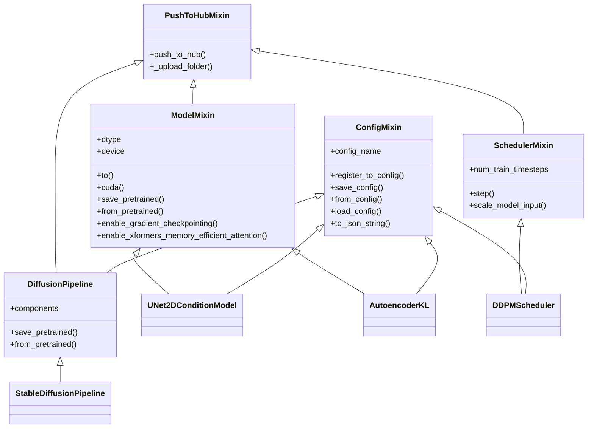
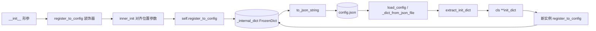
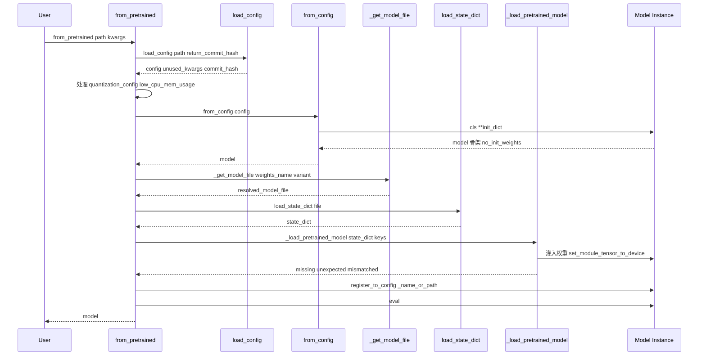

# 02 核心基座 - ConfigMixin 与 ModelMixin

> 基于 diffusers 0.39.0.dev0 版本

Diffusers 把"配置序列化"、"模型生命周期管理"、"统一加载接口"这三件最容易写散的事情，统一沉淀到两个 Mixin 基类里：[ConfigMixin](file:///workspace/src/diffusers/configuration_utils.py) 与 [ModelMixin](file:///workspace/src/diffusers/models/modeling_utils.py)。所有模型、调度器、管道都直接或间接复用这套能力，从而获得 `save_pretrained` / `from_pretrained` 这样一致的接口。本文是【分】论篇的第一篇，剖析这两个基座的实现细节、数据流和典型用法。

---

## 1. 总起：模块概览

### 1.1 ConfigMixin 与 ModelMixin 的定位

- **ConfigMixin**：所有"配置类"的基类，负责把 `__init__` 参数捕获为不可变的 `FrozenDict`，再序列化为 JSON 文件（默认 `config.json`），并提供反向的 `from_config` 实例化能力。它本身不持有任何张量，纯做配置管理。
- **ModelMixin**：所有"模型类"的基类，继承自 `torch.nn.Module` 与 `PushToHubMixin`，提供 dtype/device 属性、`to`/`cuda` 的安全重写、各种 `enable_*` 性能开关、权重分片加载与 `save_pretrained` / `from_pretrained`。
- **SchedulerMixin**：调度器基类（位于 [scheduling_utils.py](file:///workspace/src/diffusers/schedulers/scheduling_utils.py)），只继承 `PushToHubMixin`，不含 nn.Module，配置能力仍来自 ConfigMixin。
- **DiffusionPipeline**：管道基类（位于 [pipeline_utils.py](file:///workspace/src/diffusers/pipelines/pipeline_utils.py)），继承自 `ConfigMixin, PushToHubMixin`，进一步把多个子组件组装成可一键保存/加载的整体。

值得注意的一点：ModelMixin **并不直接继承** ConfigMixin。典型模型子类（如 [UNet2DConditionModel](file:///workspace/src/diffusers/models/unets/unet_2d_condition.py#L76-L78)、[AutoencoderKL](file:///workspace/src/diffusers/models/autoencoders/autoencoder_kl.py#L36-L38)）通过多重继承同时获得两者能力：`class UNet2DConditionModel(ModelMixin, AttentionMixin, ConfigMixin, FromOriginalModelMixin, ...)`。这种"组合优于继承"的设计，让无参数的纯调度器、纯管道也能复用 ConfigMixin 而无需引入 nn.Module。

### 1.2 设计理念

| 理念 | 落地方式 |
|------|----------|
| 统一配置序列化 | `register_to_config` 装饰器自动捕获 `__init__` 形参 → `FrozenDict` → JSON |
| 统一模型生命周期 | `ModelMixin.__init__` 仅设 `_gradient_checkpointing_func=None`，把权重初始化交给 `no_init_weights` 上下文，把 dtype/device 暴露为只读 property |
| 统一加载接口 | `from_pretrained(pretrained_model_name_or_path, **kwargs)` 同时支持本地目录、Hub repo id、单文件，对模型/调度器/管道三种组件形态透明 |
| 序列化可逆性 | `save_pretrained` 与 `from_pretrained` 互为逆操作，`config.json` 中保留 `_class_name`、`_diffusers_version`，必要时还能做类名重映射（`LegacyConfigMixin` / `LegacyModelMixin`） |

### 1.3 基座架构图

**图 2-1：ConfigMixin / ModelMixin / SchedulerMixin / DiffusionPipeline 继承关系**



图 2-1 说明：`PushToHubMixin` 是横切关注点，被三大基类同时复用；`ConfigMixin` 单独存在，模型/调度器/管道各自多重继承它；`ModelMixin` 与 `SchedulerMixin` 互为兄弟而非父子关系；典型子类通过 `<|--`（继承）组合出完整能力栈。

---

## 2. 分述：核心实现

### 2.1 ConfigMixin 详解

ConfigMixin 完整实现见 [configuration_utils.py](file:///workspace/src/diffusers/configuration_utils.py#L88-L687)。核心要点如下。

#### 2.1.1 `register_to_config` 装饰器原理

`register_to_config` 是一个函数装饰器（[configuration_utils.py:690-737](file:///workspace/src/diffusers/configuration_utils.py#L690-L737)），用 `functools.wraps` 包装 `__init__`，在真正调用用户 `__init__` 之前，先把位置参数对齐到形参名，再把所有非下划线 kwargs 合并，最后调用 `self.register_to_config(**new_kwargs)` 把它们写入 `self._internal_dict`。关键片段：

```python
@functools.wraps(init)
def inner_init(self, *args, **kwargs):
    init_kwargs = {k: v for k, v in kwargs.items() if not k.startswith("_")}
    config_init_kwargs = {k: v for k, v in kwargs.items() if k.startswith("_")}
    ...
    signature = inspect.signature(init)
    parameters = {
        name: p.default for i, (name, p) in enumerate(signature.parameters.items())
        if i > 0 and name not in ignore
    }
    for arg, name in zip(args, parameters.keys()):
        new_kwargs[name] = arg
    new_kwargs.update({k: init_kwargs.get(k, default) for k, default in parameters.items() ...})
    if len(set(new_kwargs.keys()) - set(init_kwargs)) > 0:
        new_kwargs["_use_default_values"] = list(set(new_kwargs.keys()) - set(init_kwargs))
    getattr(self, "register_to_config")(**new_kwargs)
    init(self, *args, **init_kwargs)
```

注意三点细节：

1. **位置参数对齐**：装饰器通过 `inspect.signature` 拿到形参名，把 `args` 按顺序映射成 kwargs，保证 `_internal_dict` 里始终是"形参名 → 值"的形式，与位置传参习惯无关。
2. **私有参数过滤**：以 `_` 开头的 kwargs 被剥离到 `config_init_kwargs`，只参与 `register_to_config`，不传给真正的 `init`，避免子类 `__init__` 还要处理这些"内部"参数。
3. **默认值标记**：未被显式传入的形参会被记入 `_use_default_values` 列表，序列化时这些键会被剔除（见 [extract_init_dict](file:///workspace/src/diffusers/configuration_utils.py#L498-L595) 第 501-502 行），从而保证 config.json 干净，不写入默认值。

#### 2.1.2 `register_to_config` 实例方法与 `_internal_dict`

实例方法 [register_to_config](file:///workspace/src/diffusers/configuration_utils.py#L143-L158) 负责把 kwargs 合并并冻结：

```python
def register_to_config(self, **kwargs):
    if self.config_name is None:
        raise NotImplementedError(...)
    kwargs.pop("kwargs", None)
    if not hasattr(self, "_internal_dict"):
        internal_dict = kwargs
    else:
        previous_dict = dict(self._internal_dict)
        internal_dict = {**self._internal_dict, **kwargs}
    self._internal_dict = FrozenDict(internal_dict)
```

`FrozenDict`（[configuration_utils.py:56-85](file:///workspace/src/diffusers/configuration_utils.py#L56-L85)）继承自 `OrderedDict`，初始化时把每个键 setattr 到自身（方便 `obj.config.key` 访问），随后冻结，禁止 `__setitem__` / `pop` / `update`。这样配置一旦写入就不可变，避免运行时被误改。

#### 2.1.3 `save_config` / `from_config`

- [save_config](file:///workspace/src/diffusers/configuration_utils.py#L178-L220)：建目录 → 拼 `output_config_file = os.path.join(save_directory, self.config_name)` → 调 `to_json_file` 写入。`config_name` 由子类指定（ModelMixin 默认为 `CONFIG_NAME = "config.json"`）。
- [from_config](file:///workspace/src/diffusers/configuration_utils.py#L222-L312)：核心入口，流程是 `extract_init_dict(config, **kwargs)` → 处理 `dtype`、`_deprecated_kwargs` → `cls(**init_dict)` → `model.register_to_config(**hidden_dict)` 把"兼容类隐藏参数"重新登记。

`extract_init_dict` 做的事比较精细：先剔除 `_use_default_values` 标记的键；用 `inspect.signature` 取出当前类 `__init__` 的形参集合 `expected_keys`；再剔除 `ignore_for_config`、兼容类专属参数、私有参数、`quantization_config`；最后让显式 kwargs 覆盖 config dict 中的同名键。第 575-580 行还会对 config 中存在但 `__init__` 不接受的键发出 warning。

#### 2.1.4 `save_pretrained` / `from_pretrained` 在 ConfigMixin 中的角色

ConfigMixin 本身**没有** `save_pretrained` / `from_pretrained`——这两个名字属于 ModelMixin、DiffusionPipeline。ConfigMixin 提供的是更底层的 `save_config` / `from_config` / `load_config`。上层基类把"权重保存"与"配置保存"组合起来，例如 [ModelMixin.save_pretrained](file:///workspace/src/diffusers/models/modeling_utils.py#L669-L860) 在第 762 行调用 `model_to_save.save_config(save_directory)` 完成配置落地。

#### 2.1.5 `_internal_dict` vs `config`

`config` 是一个只读 property（[configuration_utils.py:609-617](file:///workspace/src/diffusers/configuration_utils.py#L609-L617)），直接返回 `self._internal_dict`。`_internal_dict` 是真实存储，`config` 是对外门面。`__getattr__` 被重写（第 160-176 行）以兼容旧式 `obj.some_key` 的访问方式——当某属性在 `__dict__` 中找不到但存在于 `_internal_dict` 时，给出 deprecation 警告并返回值，引导用户改用 `obj.config.some_key`。

#### 2.1.6 `_dict_to_json`（实际为 `to_json_string` / `to_json_file`）

代码中没有 `_dict_to_json` 这个名字，对应实现是 [to_json_string](file:///workspace/src/diffusers/configuration_utils.py#L619-L662) 与 [to_json_file](file:///workspace/src/diffusers/configuration_utils.py#L664-L673)。它会在序列化前补上 `_class_name` 与 `_diffusers_version`，把 `np.ndarray` 转 list、`Path` 转 posix 字符串、嵌套 list 递归处理，并弹出 `_ignore_files`、`_use_default_values`、`_pre_quantization_dtype` 等不可序列化或运行时键。若注册了 `_auto_class`，还会写入 `auto_map` 字段供 `AutoModel` 使用。

#### 2.1.7 `_maybe_deprecate_internal_names`

源码中并没有名为 `_maybe_deprecate_internal_names` 的方法，对应行为由 [ConfigMixin.__getattr__](file:///workspace/src/diffusers/configuration_utils.py#L160-L176) 与 [ModelMixin.__getattr__](file:///workspace/src/diffusers/models/modeling_utils.py#L260-L276) 共同实现：当用户直接 `obj.attr` 访问配置项时，触发 `deprecate("direct config name access", "1.0.0", ...)` 警告，引导改走 `obj.config.attr`。

### 2.2 ModelMixin 详解

ModelMixin 完整实现见 [modeling_utils.py](file:///workspace/src/diffusers/models/modeling_utils.py#L232-L2098)。

#### 2.2.1 类定义与继承

```python
class ModelMixin(torch.nn.Module, PushToHubMixin):
    config_name = CONFIG_NAME
    _supports_gradient_checkpointing = False
    _keys_to_ignore_on_load_unexpected = None
    _no_split_modules = None
    _keep_in_fp32_modules = None
    _skip_layerwise_casting_patterns = None
    _supports_group_offloading = True
    ...
```

注意它继承的是 `torch.nn.Module` 和 `PushToHubMixin`，**不直接继承 ConfigMixin**。但 `config_name = CONFIG_NAME`（`"config.json"`）让 ConfigMixin 的方法（通过子类的多重继承）能正确找到配置文件名。`__init__` 极简，只调 `super().__init__()` 并设 `_gradient_checkpointing_func = None`。

#### 2.2.2 `dtype` / `device` / `disable_gradients`

- [device](file:///workspace/src/diffusers/models/modeling_utils.py#L1934-L1940)：委托给模块级函数 `get_parameter_device`，先尝试 group offload 的 onload device，再回退到第一个参数/buffer 的 device。
- [dtype](file:///workspace/src/diffusers/models/modeling_utils.py#L1942-L1947)：委托给 `get_parameter_dtype`，先检查 layerwise casting hook，再扫描第一个浮点参数/buffer，处理 `_keep_in_fp32_modules` 跳过逻辑。
- `disable_gradient_checkpointing` 见 [modeling_utils.py:315-321](file:///workspace/src/diffusers/models/modeling_utils.py#L315-L321)，反向操作由 `enable_gradient_checkpointing` 完成（第 285-313 行），需要子类 `_supports_gradient_checkpointing=True`。

#### 2.2.3 `enable_model_cpu_offload` / `enable_xformers_memory_efficient_attention` / `enable_attention_slicing`

- `enable_xformers_memory_efficient_attention` 见 [modeling_utils.py:397-427](file:///workspace/src/diffusers/models/modeling_utils.py#L397-L427)，递归遍历所有子模块，对实现了 `set_use_memory_efficient_attention_xformers` 的模块（即 Attention 层）打标。
- `enable_layerwise_casting`（第 435-518 行）与 `enable_group_offload`（第 520-586 行）是 0.39 版本的新特性，分别把权重低精度存储+高精度计算、按 block 分组在 CPU/GPU 间换入换出。
- `enable_model_cpu_offload` 实际不在 ModelMixin 里，而是 DiffusionPipeline 的方法（依赖 `accelerate` 的 `cpu_offload`），这是常见误记——ModelMixin 提供的是更细粒度的 `enable_group_offload`。

#### 2.2.4 `_get_model_file` / `_load_state_dict` 加载流程

- `_get_model_file` 从 `diffusers.utils` 导入（[modeling_utils.py:54](file:///workspace/src/diffusers/models/modeling_utils.py#L54)），负责"本地路径 / Hub repo id / DDUF entry"三种来源的统一解析，返回磁盘上的实际文件路径。
- `load_state_dict` 在 [model_loading_utils.py:155-210](file:///workspace/src/diffusers/models/model_loading_utils.py#L155-L210)，按文件后缀分发：`.safetensors` 走 `safetensors.torch.load_file`，`.gguf` 走 `load_gguf_checkpoint`，其他走 `torch.load`（含 `weights_only=True`、可选 `mmap=True`）。
- 真正把权重灌入模型的是 [ModelMixin._load_pretrained_model](file:///workspace/src/diffusers/models/modeling_utils.py#L1706-L1866)，它计算 `expected_keys / missing_keys / unexpected_keys / mismatched_keys`，处理 disk offload、caching allocator warmup，最终通过 `_load_shard_file` 或 `_load_shard_files_with_threadpool`（多线程并行加载）完成灌入。

#### 2.2.5 `from_single_file` 单文件加载

`from_single_file` 不在 ModelMixin 中，而在 [FromOriginalModelMixin](file:///workspace/src/diffusers/loaders/single_file_model.py#L251-L320)（位于 `loaders/single_file_model.py`）。它专门用于从原始 `.ckpt` / `.safetensors` 单文件加载权重，需要配合 `config` 参数（指向 diffusers 格式的 config 目录或 repo id）才能正确实例化。典型模型类同时继承 `ModelMixin, ConfigMixin, FromOriginalModelMixin` 三者，从而同时具备 `from_pretrained`（diffusers 格式）与 `from_single_file`（原始格式）两种加载入口。

#### 2.2.6 `no_init_weights` 上下文

[no_init_weights](file:///workspace/src/diffusers/models/modeling_utils.py#L212-L229) 是一个上下文管理器，进入时把 `torch.nn.init` 下的 `uniform_` / `normal_` / `xavier_uniform_` 等一系列初始化函数临时替换为 `_skip_init`（什么都不做），退出时还原。配合 `accelerate.init_empty_weights()` 可以用 meta device 创建模型骨架，再把权重直接灌入，避免大模型加载时被随机初始化浪费一次内存带宽与时间。`from_pretrained` 在 [第 1327-1333 行](file:///workspace/src/diffusers/models/modeling_utils.py#L1327-L1333) 用 `ContextManagers([no_init_weights(), accelerate.init_empty_weights()])` 包住 `cls.from_config(config)` 来实现这点。

#### 2.2.7 `save_pretrained`

[save_pretrained](file:///workspace/src/diffusers/models/modeling_utils.py#L669-L860) 的核心流程：

1. 校验量化模型可序列化（第 718-733 行）；
2. 决定权重文件名：`use_flashpack` → `FLASHPACK_WEIGHTS_NAME`；`safe_serialization` → `SAFETENSORS_WEIGHTS_NAME`；否则 `WEIGHTS_NAME`，并用 `_add_variant` 加 variant 后缀；
3. 主进程调 `save_config` 写 `config.json`（第 762 行）；
4. 取 `state_dict`，若有 `hf_quantizer` 则取量化后的 state_dict 与 metadata；
5. `split_torch_state_dict_into_shards` 按分片大小切分，逐分片用 `safetensors.torch.save_file` 或 `torch.save` 落盘；
6. 若分片，写 `model.safetensors.index.json`；清理旧分片文件。

### 2.3 配置序列化数据流图

**图 2-2：`__init__` 参数到 `config.json` 的双向数据流**



图 2-2 说明：左侧是"保存"方向，`__init__` 形参被装饰器捕获，最终序列化为 `config.json`；右侧是"加载"方向，`config.json` 被解析回 dict，经过 `extract_init_dict` 清洗后传入 `cls(**init_dict)` 实例化，再次走一遍 `register_to_config` 形成 `_internal_dict`，闭环可逆。

### 2.4 加载流程时序图

**图 2-3：`ModelMixin.from_pretrained` 关键步骤时序**



图 2-3 说明：`from_pretrained` 先用 `load_config` 拿到配置字典，再走 ConfigMixin 的 `from_config` 实例化模型骨架（此时权重未初始化），随后解析权重文件、加载 state_dict，最后通过 `_load_pretrained_model` 把权重按 device_map 灌入对应张量，并切到 eval 模式返回。

---

## 3. 使用指南

### 3.1 API 速查

**ConfigMixin**：

| 方法 | 作用 |
|------|------|
| `save_config(save_directory, push_to_hub=False, **kwargs)` | 仅写 `config.json` |
| `from_config(config, return_unused_kwargs=False, **kwargs)` | 从 dict 实例化 |
| `load_config(path, return_unused_kwargs=False, return_commit_hash=False, **kwargs)` | 读 `config.json` 为 dict |
| `to_json_string()` / `to_json_file(path)` | 序列化为字符串 / 文件 |
| `register_for_auto_class("AutoModel")` | 注册到 AutoModel |

**ModelMixin**：

| 方法 / 属性 | 作用 |
|------|------|
| `save_pretrained(save_directory, safe_serialization=True, variant=None, max_shard_size="10GB", **kwargs)` | 保存 config + 权重 |
| `from_pretrained(pretrained_model_name_or_path, **kwargs)` | 加载 config + 权重 |
| `dtype` / `device` | 只读 property |
| `to(*args, **kwargs)` / `cuda()` | 安全重写，感知量化与 group offload |
| `enable_gradient_checkpointing()` / `disable_gradient_checkpointing()` | 梯度检查点 |
| `enable_xformers_memory_efficient_attention(attention_op=None)` | xFormers |
| `enable_layerwise_casting(...)` | FP8 存储 + 高精度计算 |
| `enable_group_offload(onload_device, offload_device, ...)` | 分组 CPU offload |
| `num_parameters(only_trainable=False, exclude_embeddings=False)` | 参数计数 |
| `get_memory_footprint(return_buffers=True)` | 内存占用（字节） |

### 3.2 最小示例：自定义 ModelMixin 子类

```python
import torch
from torch import nn
from diffusers import ModelMixin, ConfigMixin
from diffusers.configuration_utils import register_to_config


class TinyMLP(ModelMixin, ConfigMixin):
    @register_to_config
    def __init__(self, in_features: int = 8, hidden: int = 32, out_features: int = 4):
        super().__init__()
        self.net = nn.Sequential(
            nn.Linear(in_features, hidden),
            nn.GELU(),
            nn.Linear(hidden, out_features),
        )

    def forward(self, x):
        return self.net(x)


model = TinyMLP(in_features=8, hidden=32, out_features=4)
model.save_pretrained("./tiny_mlp")          # 生成 config.json + model.safetensors
loaded = TinyMLP.from_pretrained("./tiny_mlp")  # 一行加载回来
```

只需 (1) 双重继承 `ModelMixin, ConfigMixin`；(2) 给 `__init__` 加 `@register_to_config`；(3) 在 `__init__` 里 `super().__init__()`，就能免费获得完整的保存/加载、dtype/device、Hub 推送能力。

### 3.3 常用参数

| 参数 | 适用方法 | 含义 |
|------|----------|------|
| `torch_dtype` | `from_pretrained` / `from_single_file` | 覆盖加载 dtype，例如 `torch.float16`、`torch.bfloat16`；量化模型受 `hf_quantizer.update_torch_dtype` 约束 |
| `variant` | `from_pretrained` / `save_pretrained` | 选权重变体，如 `"fp16"` / `"ema"`，文件名变成 `model.fp16.safetensors` |
| `use_safetensors` | `from_pretrained` | `None` 自动选；`True` 强制 safetensors；`False` 走 pickle |
| `low_cpu_mem_usage` | `from_pretrained` | 默认 `True`（torch>=1.9），用 meta device + `no_init_weights` 加速加载 |
| `device_map` | `from_pretrained` | 支持 `"auto"` / `"balanced"` / `int` / `torch.device` / `dict`，依赖 accelerate |
| `subfolder` | `from_pretrained` | 在 Hub repo 内的子目录定位组件 |
| `force_download` / `local_files_only` / `revision` / `token` | `from_pretrained` | Hub 下载控制 |

---

## 4. 实战案例

### 4.1 案例 1：自定义 MLP 完整保存加载

```python
import os
import torch
from torch import nn
from diffusers import ModelMixin, ConfigMixin
from diffusers.configuration_utils import register_to_config


class TinyMLP(ModelMixin, ConfigMixin):
    @register_to_config
    def __init__(self, in_features: int = 8, hidden: int = 32, out_features: int = 4):
        super().__init__()
        self.net = nn.Sequential(
            nn.Linear(in_features, hidden),
            nn.GELU(),
            nn.Linear(hidden, out_features),
        )

    def forward(self, x):
        return self.net(x)


# 1) 构造并保存
model = TinyMLP(in_features=8, hidden=32, out_features=4)
model.save_pretrained("./tiny_mlp", safe_serialization=True, max_shard_size="100MB")
print(os.listdir("./tiny_mlp"))   # ['config.json', 'model.safetensors']

# 2) 重新加载并验证一致性
loaded = TinyMLP.from_pretrained("./tiny_mlp", torch_dtype=torch.float32)
x = torch.randn(2, 8)
assert torch.allclose(model(x), loaded(x), atol=1e-6)

# 3) 查看 config
print(loaded.config)   # FrozenDict({'in_features': 8, 'hidden': 32, 'out_features': 4, '_class_name': 'TinyMLP', '_diffusers_version': '0.39.0.dev0'})
```

保存后的 `config.json` 大致长这样：

```json
{
  "_class_name": "TinyMLP",
  "_diffusers_version": "0.39.0.dev0",
  "hidden": 32,
  "in_features": 8,
  "out_features": 4
}
```

注意 `_use_default_values` 在 `extract_init_dict` 第 501-502 行被剔除，所以 `config.json` 不会出现这个内部键。

### 4.2 案例 2：加载预训练 AutoencoderKL 并切换 dtype/device

```python
import torch
from diffusers import AutoencoderKL

# 加载 fp16 权重并直接放到 GPU
vae = AutoencoderKL.from_pretrained(
    "stabilityai/sd-x2-latent-upscaler",
    subfolder="vae",
    torch_dtype=torch.float16,
    variant="fp16",
    use_safetensors=True,
    low_cpu_mem_usage=True,
)
print(vae.dtype, vae.device)   # torch.float16 cuda:0 / cpu

# 安全切换 dtype/device（受 _keep_in_fp32_modules 警告保护）
vae = vae.to("cuda")
vae.enable_xformers_memory_efficient_attention()
vae.enable_group_offload(
    onload_device=torch.device("cuda"),
    offload_device=torch.device("cpu"),
    offload_type="block_level",
)

# 持久化（默认 safetensors，按 10GB 分片）
vae.save_pretrained("./my_vae", safe_serialization=True)
```

几个要点：

- `variant="fp16"` 会让 `_get_model_file` 优先找 `diffusion_pytorch_model.fp16.safetensors`；
- `torch_dtype` 在 [from_pretrained 第 1320-1325 行](file:///workspace/src/diffusers/models/modeling_utils.py#L1320-L1325) 通过 `_set_default_torch_dtype` 把全局默认 dtype 临时改成 fp16，再用 `no_init_weights` + `init_empty_weights` 创建骨架，避免 fp32 中转；
- `vae.to("cuda")` 走的是 [ModelMixin.to](file:///workspace/src/diffusers/models/modeling_utils.py#L1508-L1562)，它会在量化或 group offload 启用时给出明确错误/警告，而不是默默失效。

---

## 5. 总结

### 5.1 要点回顾

- **ConfigMixin** 统一了"配置捕获 → 冻结 → JSON 序列化 → 反向实例化"的完整链路，核心机制是 `@register_to_config` 装饰器 + `FrozenDict`。
- **ModelMixin** 统一了"模型生命周期"：dtype/device 暴露、安全的 `to/cuda/half/float` 重写、`enable_*` 性能开关、`save_pretrained` / `from_pretrained` 的分片加载与量化兼容。
- 两者**通过多重继承组合**而非父子继承协作；调度器、管道同样复用 ConfigMixin 但不引入 nn.Module。
- 加载链路的关键加速点：`no_init_weights` + `accelerate.init_empty_weights()` 跳过随机初始化，`_caching_allocator_warmup` 预热显存分配器，`_load_shard_files_with_threadpool` 多线程并行加载分片。

### 5.2 与其他模块的关系

- 所有 [`models/`](file:///workspace/src/diffusers/models) 下的网络（UNet、VAE、Transformer）都通过 `ModelMixin + ConfigMixin + FromOriginalModelMixin` 组合获得能力。
- 所有 [`schedulers/`](file:///workspace/src/diffusers/schedulers) 下的调度器（DDPM、DDIM、Euler、FlowMatch）通过 `SchedulerMixin + ConfigMixin` 组合，因此能 `DDIMScheduler.from_config(ddpm.config)` 一键替换。
- 所有 [`pipelines/`](file:///workspace/src/diffusers/pipelines) 下的管道通过 `DiffusionPipeline(ConfigMixin, PushToHubMixin)` 把多个组件 + 自身参数一起序列化，加载时按 `_class_name` 反射实例化。
- 量化（[`quantizers/`](file:///workspace/src/diffusers/quantizers)）、Hooks（[`hooks/`](file:///workspace/src/diffusers/hooks)）、单文件加载（[`loaders/single_file_model.py`](file:///workspace/src/diffusers/loaders/single_file_model.py)）都以 ModelMixin/ConfigMixin 为挂载点。

### 5.3 适用场景与边界

**适用**：

- 需要可复现地保存/加载扩散模型组件；
- 需要在 Hub 上发布/分享模型；
- 需要在大模型 + 有限显存下做推理（low_cpu_mem_usage、device_map、group offload、layerwise casting）；
- 需要把原始 `.ckpt` 单文件迁移到 diffusers 格式（`from_single_file`）。

**边界**：

- ConfigMixin **不保存权重**，仅写 `config.json`；权重由 ModelMixin/DiffusionPipeline 的 `save_pretrained` 负责。
- ModelMixin **不直接继承** ConfigMixin，子类必须显式多重继承两者，否则 `save_config` / `from_config` 不可用。
- `enable_model_cpu_offload` 是 DiffusionPipeline 的方法，不是 ModelMixin 的；ModelMixin 提供的是更细粒度的 `enable_group_offload`。
- 量化模型的 `to` / `cuda` / `half` 会受限甚至抛错，dtype 切换应通过 `from_pretrained(torch_dtype=...)` 完成。
- `register_to_config` 装饰器会丢弃以 `_` 开头的 kwargs（不传给真正的 `__init__`），子类设计 `__init__` 形参时需注意命名约定。
