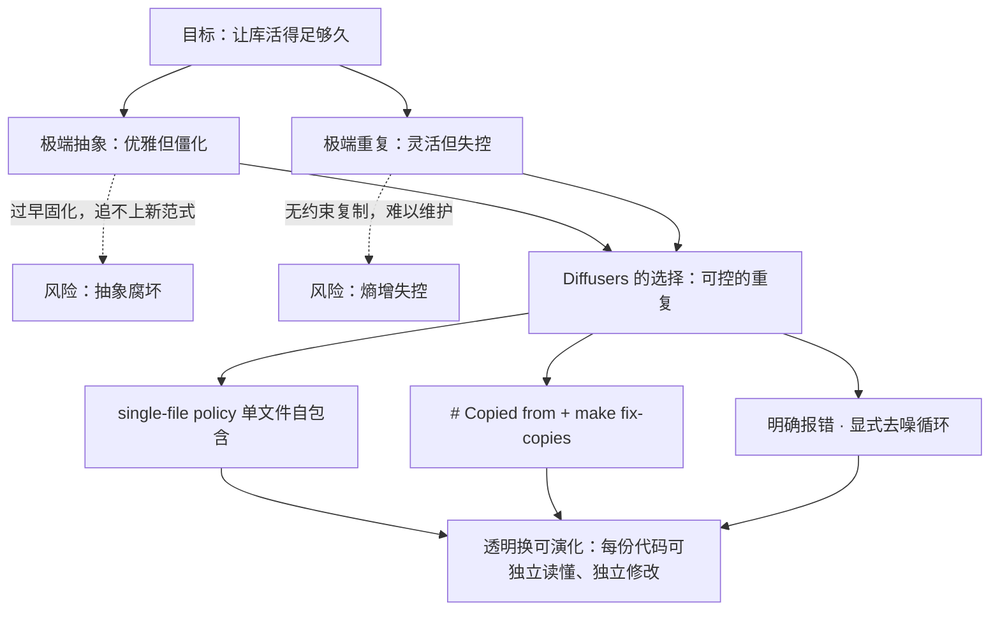
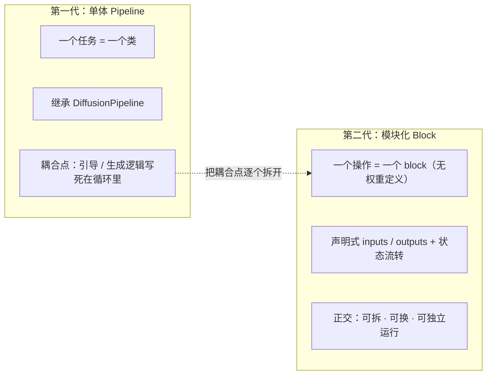
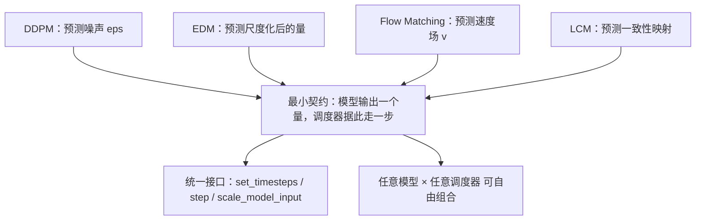

# 🤗 Diffusers 代码深度解读 · 第三篇：深刻不忘观 —— 哲学与升华

> **导读**｜前两篇，我们**看见**了 Diffusers 的全貌（一张认知地图），又**看懂**了它的细节（算法主线与关键工程）。
> 本篇是第三观，也是整个 trilogy 的收束：我们要**看透**——不再问"它是什么、怎么实现的"，而是问"**它为什么会长成这样？它做了哪些根本性的取舍？这些取舍对今天的工程意味着什么？**"。
> 我们将从**设计哲学**（取舍）→ **框架思想**（结构）→ **算法思想**（抽象）三层逐级上升，最后凝练为 2–3 句可以带走的洞见。

---

## 〇、总：从"怎么实现"到"为什么这样"

第二篇结尾留下了一个悬念：我们数出了 Diffusers 里的同一种手法反复出现——

- 求解器从模型里剥离；
- 引导从循环里剥离；
- 计算从注意力模块里剥离；
- 组件从流水线里剥离。

这四种"剥离"看似是不同层面的工程选择，却指向同一个深层动机。本篇的任务，就是把这个动机说清楚：**Diffusers 不是一个"模型库"，而是一套关于"如何组织不断变化的软件"的哲学的一件具体作品**。理解了这套哲学，你不仅读懂了这个库，也读懂了这一代机器学习基础设施的共同灵魂。

下面三层，层层递进：先看它**怎么权衡**（设计哲学），再看它**怎么组织**（框架思想），最后看它**怎么抽象**（算法思想）。

---

## 一、设计哲学层：把"约束"当"资产"

### 1.1 一个反直觉的起点

大多数工程师的直觉是：**抽象是美德**。见到重复代码，"消除重复（DRY）"几乎是本能。而 Diffusers 官方文档却主动宣称：它**偏好复制粘贴而非抽象**——这就是著名的 **single-file policy（单文件策略）**。这在第一眼看上去像是"设计缺陷"，但它的理由极其清醒：

> 机器学习领域**变化的速度快于抽象的能力**。你今天精心设计的抽象，半年后可能就被新范式证伪；而**被复制了成百上千份的代码**，却正是"过早抽象"最惨烈的坟场。

于是 Diffusers 选择了另一条路：**让每份代码都自包含、可独立读懂**，宁可重复，也不跨文件强耦合。重复带来的"熵增"风险，则用配套机制约束住：

- **`# Copied from`**：明确标注"这段复制自哪里"；
- **`make fix-copies`**：源变更后**一键同步**到所有副本，防止副本悄悄漂移；
- **清晰一致的约定**：`register_to_config`/`register_modules`、`model_index.json`、统一的 `__call__` 命名——让"复制出来的东西"仍然遵循同一套规则。

### 1.2 三条原则，同一种计较

回到官方那三条原则，我们会发现它们都在算同一笔账——**用"当下的效率"换取"长期的演化能力"**：

- **可用优先于性能**：牺牲默认性能（默认 CPU/float32），换取**跨平台、零配置可跑**；
- **简单优先于省事**：牺牲"一行出图"的便利，换取用户**完全可调试、可控制**；
- **可改性优先于抽象**：牺牲代码的"优雅简洁"，换取**领域剧变时库还能活下去**。

**图 3-1｜透明 vs 抽象：Diffusers 站在哪里**：下图把"极端抽象"与"极端重复"两种风险摆在两端，展示 Diffusers 如何用"可控的重复"走中间道路。这张图解释了那条最反直觉的设计决策背后的权衡逻辑。



### 1.3 升华：约束即资产

Diffusers 的深刻之处在于，它**把"不能做什么"当成"资产"来经营**。禁止跨文件强耦合，看似是约束；但正是这个约束，保证了"**任何一块代码被改坏，都不会殃及其他功能**"，从而让**社区敢于并行地贡献**。约束换来了信任，信任换来了生态——这是"库能活很久"的真正秘密。

---

## 二、框架思想层：正交分解与"组合优于继承"

### 2.1 第一代：单体 Pipeline 的耦合之痛

最初的 `DiffusionPipeline` 是**单体式**的：一个任务对应一个类，类继承 `DiffusionPipeline`，`__call__` 里从头到尾写完"编码 → 准备 → 去噪循环 → 解码"。它清晰、易读，但有个隐患：**引导、生成逻辑都被硬编码在循环里**。想换一种引导策略？你得改**每一个** pipeline 的循环（第二篇里"CFG 内联"就是这个痛点的活标本）。

### 2.2 第二代：模块化 Block 的正交分解

**模块化 Diffusers** 是对这个痛点的系统回应。它把流水线拆成**正交的 block**：编码、准备、去噪、解码各司其职；每个 block **只声明"我要什么输入、我给什么输出、我依赖哪些组件"，不含权重、不能自运行**。然后用 `SequentialPipelineBlocks`/`AutoPipelineBlocks` 把它们组装成工作流，再由 `ModularPipeline` 提供可运行的实例。

这里的"正交"是关键：**每个 block 解决且只解决一个问题**。于是"改引导"不再需要动循环，只需替换一个 guider 对象；"换生成模式"不再需要新写一个类，只需提供不同的触发输入（`AutoPipelineBlocks` 自动选路）。

**图 3-2｜从单体 Pipeline 到模块化 Block 的范式迁移**：左是"一任务一类"的单体式（耦合），右是"一操作一 block"的组合式（正交）。这张图揭示了 Diffusers 架构演进的方向——不是把系统做得更复杂，而是把耦合点一个个拆开。



### 2.3 升华：这是"组合优于继承"在 AI 基础设施上的重演

"单体 → 组合"的迁移，并非 Diffusers 首创。它是软件工程里一条古老原则——**Composition over Inheritance（组合优于继承）**——在生成式 AI 时代的重演。继承树表达的是"**是一种**"（is-a），一旦确定就难以更改；组合表达的是"**有一个**"（has-a），可以随时替换零件。生成式 AI 的组件（编码器、主干、调度器、引导）变化太快，继承树必然僵化，而**组合天然可演化**。

Diffusers 把这条原则推到了架构层面：**它不再"继承"能力，而是"组合"零件**。这也是为什么它能同时容纳 91 个 pipeline、57 个调度器、63 个模型而不失控——因为它从结构上就不依赖"统一的父类"，而依赖"统一的契约"。

---

## 三、算法思想层：殊途同归的最小接口

### 3.1 从"支持多少模型"到"找到多少共识"

如果一个库把"支持 N 个模型"当作 KPI，它会越做越臃肿。Diffusers 的选择恰恰相反：**它去寻找所有模型共有的最小接口**。回头看第二篇的算法主线，你会发现一件惊人的事——

- **DDPM** 预测的是**噪声** `ε`；
- **EDM** 预测的是**尺度化后的量**；
- **Flow Matching** 预测的是**速度场** `v`；
- **LCM** 预测的是**一致性映射**。

它们的数学形式各不相同，却全部被归约到同一句契约上：

> **模型输出一个量 → 调度器据此走一步。**

这句话在代码里就是 `SchedulerMixin` 的三个方法：`set_timesteps()`（决定走哪些步）、`scale_model_input()`（把输入按当前时刻缩放）、`step()`（走一步）。**无论底层是 SDE 还是 ODE、是噪声预测还是速度预测，都被这同一个接口吸收**。第二篇里我们甚至看到：连 DDIM 的 `prediction_type` 分支，都是在为"不同的预测目标"做适配——这正是"最小接口"能容纳最多算法的证明。

**图 3-3｜殊途同归：不同算法归约到同一个最小接口**：左侧四种截然不同的预测目标，右侧收敛到同一个契约与接口。这张图是整个 trilogy 的"认知结晶图"——它回答了本篇的核心问题：**通用性从何而来**。



### 3.2 升华：真正的通用性来自"共识"而非"覆盖"

这是本篇最想留给读者的一句话级洞见：**一个基础设施的通用性，不来自它覆盖了多少个东西，而来自它找到了这些东西之间最小的那一层共识**。Diffusers 之所以能"什么模型都能进来"，不是因为它为每个模型都写了适配层，而是因为它**把适配层降到了最薄、最本质**——薄到只剩下"预测一个量、走一步"。

这个思想可以迁移到任何工程领域：**当你在为层出不穷的变化做集成时，与其为每一种情况写一个分支，不如去寻找它们共享的最小契约**。找到了，你得到的是一个开放系统；找不到，你得到的永远是一堆脆弱的适配代码。

---

## 四、使用指南 & 实践案例（升华向）

> 本篇的指南面向"**复现这套哲学**"：怎样按 Diffusers 的方式去扩展它、贡献它，以及怎样把它的思想用于自己的项目。

### 4.1 如何贡献一个新模型（按单文件策略落地）

综合第一篇的"约定"与第二篇的"接口"，一个新模型的落地清单是：

1. **新建自包含文件**：`models/transformers/transformer_<name>.py`，把注意力（`Attention` 类与其 processor）、block、RoPE 等**全部写在这一个文件里**；
2. **遵循注意力规约**：processor 的 `__call__` 必须调用 `dispatch_attention_fn`，而非直接调 `F.scaled_dot_product_attention`（见 [.ai/models.md](file:///workspace/.ai/models.md)）；
3. **声明模型级属性**：`_no_split_modules`（支持 `device_map="auto"`）、`_repeated_blocks`（支持区域编译）、`_keep_in_fp32_modules`（精度敏感层保 fp32）；
4. **注册导入**：在子包 `__init__.py` 与顶层 `src/diffusers/__init__.py` 的懒加载结构中登记；
5. **加载只走标准路径**：`from_pretrained` / `from_single_file`，绝不"带外"抓取权重；
6. **跑 `make style` / `make fix-copies`**，再做自检（见 `skills/self-review`）。

### 4.2 如何把一个研究仓库"接"进 Diffusers

Diffusers 的 `scripts/` 里有一百多个 `convert_*_to_diffusers.py` 转换脚本——**它们就是"入海口"**。把一个原始检查点接进来的标准做法是：

1. 读原始仓库的**权重结构**与**配置**；
2. 在新模型文件里定义与之一一对应的 `ModelMixin` 类；
3. 写一个转换脚本，用**键名映射**把原始 `state_dict` 映射到新类参数名（`single_file_utils.py` 是通用参考）；
4. 用**相同随机种子**对比"原始实现 vs Diffusers 实现"的输出，确保 1:1 对齐；
5. 补齐 pipeline（标准或模块化）与测试。

**这条链路的意义**：它把"接入成本"从"重写整个系统"降到了"写一个映射表 + 一个新模型文件"——**这正是"最小接口 + 单文件策略"在真实协作中的威力**。

### 4.3 如何自定义模块化工作流

```python
from diffusers import ModularPipeline

pipe = ModularPipeline.from_pretrained("black-forest-labs/FLUX.1-dev")
pipe.load_components(torch_dtype=torch.bfloat16)

# 替换引导策略：只换一个对象，不动循环
from diffusers import AdaptiveProjectedGuidance
pipe.components.guider = AdaptiveProjectedGuidance(guidance_scale=7.5)

# 取出单个 block 独立运行、缓存中间结果（见第二篇 11.2）
```

**哲学的落地**：模块化让你"**改一个零件，而不动整台机器**"——这就是"正交分解"带给使用者的实际红利。

### 4.4 反面思考：什么时候"该复制"，什么时候"该抽象"

Diffusers 的哲学不是"永远别抽象"，而是"**知道何时不该抽象**"。一条实用的判断线：

- **快变的、实验性的东西 → 复制**：正在快速迭代的新模型、新 pipeline，用单文件策略，改坏不殃及池鱼；
- **稳定的、被所有模型共用的东西 → 抽象**：如 `normalization.py`、`embeddings.py`、`attention_dispatch.py`——它们几乎不变，抽取共享层反而降低总成本。

**分界线是"变化的速度"**：越慢变，越值得抽象；越快变，越应该复制。Diffusers 的目录里，这两种选择并存且各得其所——**它不是一个"反抽象"的库，而是一个"懂得让抽象慢一点"的库**。

---

## 五、总：两三句话，带走的洞见

三篇到此收束。第一篇给了地图，第二篇给了地形，本篇给了坐标。如果只能带走几句话，那应该是这三句：

> **第一句：Diffusers 把整个扩散生成世界，拆成"条件编码 × 去噪主干 × 采样调度 × 潜空间编解码 × 引导策略"五个可自由替换的积木。**

> **第二句：它宁可不厌其烦地复制、也要坚持每个文件自解释——因为在以月为单位迭代的领域里，可读、可改、可贡献，比优雅的抽象更长寿。**

> **第三句：它的通用性不在于支持了多少模型，而在于找到了所有扩散模型共有的那一行契约——模型预测一个量，调度器据此走一步。**

这三句话，一句讲**结构**（正交分解），一句讲**哲学**（透明换可演化），一句讲**本质**（共识即通用）。合在一起，就是 Diffusers 之所以是 Diffusers 的全部秘密——也是这一代机器学习基础设施最值得铭记的设计信条。