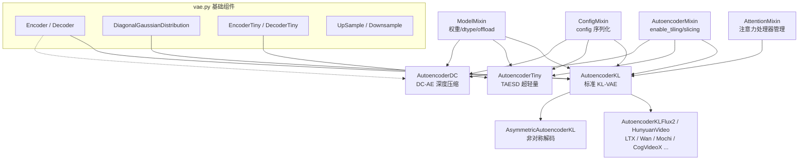

# 03 模型层 - VAE 家族

> 基于 diffusers 0.39.0.dev0 版本

## 1. 总起：模块概览

### 1.1 VAE 在扩散模型中的角色

在潜在扩散模型（Latent Diffusion Models, LDM）中，直接在像素空间进行扩散计算成本极高。以一张 512×512 的 RGB 图像为例，其张量形状为 `(3, 512, 512)`，元素数量达 786 432；若在该空间迭代数十步去噪，显存与算力开销惊人。变分自编码器（Variational Autoencoder, VAE）正是为此而引入的"空间压缩器"：

- **编码（encode）**：将像素空间图像压缩到低维潜在空间（latent space），例如 SD1.5 将 `(3, 512, 512)` 压缩为 `(4, 64, 64)`，元素数量降至 16 384，压缩比约 48 倍。
- **解码（decode）**：将扩散模型去噪后的 latent 还原为像素图像。
- **规范化**：通过 `scaling_factor`（与可选的 `shift_factor`）将 latent 缩放至近似单位方差，使扩散模型的去噪目标分布稳定。

这样一来，扩散主网络（UNet/DiT）只需在紧凑的 latent 空间运算，显存占用与计算量大幅下降，成为现代文生图/视频模型的标配组件。

### 1.2 家族全景

diffusers 在 [src/diffusers/models/autoencoders/](file:///workspace/src/diffusers/models/autoencoders/) 下提供了庞大的 VAE 家族，可归为三大代表范式与一批模型专属变体：

| 类别 | 代表类 | 文件 | 适用场景 |
|------|--------|------|----------|
| 标准 KL-VAE | `AutoencoderKL` | [autoencoder_kl.py](file:///workspace/src/diffusers/models/autoencoders/autoencoder_kl.py) | SD1.5 / SDXL / Flux 默认 VAE |
| 超轻量 VAE | `AutoencoderTiny` | [autoencoder_tiny.py](file:///workspace/src/diffusers/models/autoencoders/autoencoder_tiny.py) | TAESD，实时 latent 预览 |
| 深度压缩 VAE | `AutoencoderDC` | [autoencoder_dc.py](file:///workspace/src/diffusers/models/autoencoders/autoencoder_dc.py) | DC-AE / SANA，高分辨率生成 |
| 模型专属 VAE | `AutoencoderKLFlux2`、`AutoencoderKLHunyuanVideo`、`AutoencoderKLLTXVideo`、`AutoencoderKLWan`、`AutoencoderKLMochi`、`AutoencoderKLCogVideoX` 等 | autoencoder_kl_*.py | 各视频/图像模型定制 |
| 其他变体 | `AsymmetricAutoencoderKL`、`VQModel`、`ConsistencyDecoderVAE`、`AutoencoderRAE`、`AutoencoderVidTok` | 各自文件 | 非对称编解码、VQ 量化、一致性解码、RAE 等 |

完整导出列表见 [autoencoders/__init__.py](file:///workspace/src/diffusers/models/autoencoders/__init__.py)。

### 1.3 设计理念

整个 VAE 家族遵循三个统一约定：

1. **统一的 `encode` / `decode` 接口**：所有 VAE 都接受图像张量 `x` 并返回 latent，接受 latent `z` 并返回图像，参数命名（`return_dict`、`generator`）一致，使它们在 pipeline 中可互换。
2. **`AutoencoderMixin` 提供公共能力**：[vae.py](file:///workspace/src/diffusers/models/autoencoders/vae.py) 中的 `AutoencoderMixin` 统一提供 `enable_tiling` / `disable_tiling`（分块编解码以省显存）与 `enable_slicing` / `disable_slicing`（按 batch 切片），子类只需声明 `self.use_tiling` / `self.use_slicing` 标志位。
3. **继承自 `ModelMixin` + `ConfigMixin`**：所有 VAE 都获得 `from_pretrained` / `save_pretrained`、dtype 管理、`offload` 等通用能力，配置参数通过 `@register_to_config` 自动序列化。

### 1.4 VAE 家族架构图

**图 3-1：VAE 家族类继承与代表实现关系**



图 3-1 说明：`ModelMixin`、`ConfigMixin`、`AutoencoderMixin` 是所有 VAE 的公共基类，`AutoencoderKL` 额外混入 `AttentionMixin` 与 `FromOriginalModelMixin` 以支持单文件加载和注意力处理器管理。基础组件 `Encoder`/`Decoder`/`DiagonalGaussianDistribution` 定义在 [vae.py](file:///workspace/src/diffusers/models/autoencoders/vae.py)，被多个 VAE 复用；`AutoencoderDC` 则在其本文件内自定义了基于 `pixel_unshuffle` 的 `Encoder`/`Decoder`，不复用 vae.py 的卷积栈。

---

## 2. 分述：核心实现

### 2.1 AutoencoderKL 详解（autoencoder_kl.py）

`AutoencoderKL` 是 Stable Diffusion 1.5 / 2.x / SDXL / Flux 的默认 VAE，采用 KL 散度正则化的变分自编码器，将图像编码为对角高斯分布的均值与 logvar。

#### `__init__` 配置参数

完整签名见 [autoencoder_kl.py 第 78-98 行](file:///workspace/src/diffusers/models/autoencoders/autoencoder_kl.py)：

```python
@register_to_config
def __init__(
    self,
    in_channels: int = 3,
    out_channels: int = 3,
    down_block_types: tuple[str] = ("DownEncoderBlock2D",),
    up_block_types: tuple[str] = ("UpDecoderBlock2D",),
    block_out_channels: tuple[int] = (64,),
    layers_per_block: int = 1,
    act_fn: str = "silu",
    latent_channels: int = 4,
    norm_num_groups: int = 32,
    sample_size: int = 32,
    scaling_factor: float = 0.18215,
    shift_factor: float | None = None,
    latents_mean: tuple[float] | None = None,
    latents_std: tuple[float] | None = None,
    force_upcast: bool = True,
    use_quant_conv: bool = True,
    use_post_quant_conv: bool = True,
    mid_block_add_attention: bool = True,
):
```

关键参数说明：

- `block_out_channels`：各下采样阶段的通道数，长度决定下采样倍数。SDXL 取 `(128, 256, 512, 512)`，对应 8 倍空间下采样；SD1.5 取 `(128, 256, 512, 512)` 同样 8 倍。
- `latent_channels`：潜在通道数，SD/SDXL 均为 4，Flux 为 16。
- `scaling_factor`：latent 缩放系数，SD1.5 为 `0.18215`，SDXL 为 `0.13025`，用于将 latent 标准化到单位方差。注意该缩放发生在 pipeline 层而非 VAE 内部。
- `shift_factor`：Flux 等新模型引入的偏移项，配合 `scaling_factor` 做仿射变换。
- `force_upcast`：高分辨率下强制转 fp32 计算，避免 fp16 数值溢出（SDXL 默认开启）。
- `use_quant_conv` / `use_post_quant_conv`：是否在 encoder 输出后接 1×1 `quant_conv`、在 decoder 输入前接 1×1 `post_quant_conv`。新版模型（如 SDXL fp16-fix）可关闭以省参数。
- `mid_block_add_attention`：mid_block 是否插入注意力，关闭后只剩 ResnetBlock。

构造体内部组装 `self.encoder`、`self.decoder`、`self.quant_conv`、`self.post_quant_conv`，并初始化 tiling/slicing 相关尺寸（`tile_sample_min_size`、`tile_latent_min_size`、`tile_overlap_factor=0.25`）。

#### `encode` 方法

```python
@apply_forward_hook
def encode(self, x: torch.Tensor, return_dict: bool = True) -> AutoencoderKLOutput | tuple[DiagonalGaussianDistribution]:
    if self.use_slicing and x.shape[0] > 1:
        encoded_slices = [self._encode(x_slice) for x_slice in x.split(1)]
        h = torch.cat(encoded_slices)
    else:
        h = self._encode(x)
    posterior = DiagonalGaussianDistribution(h)
    if not return_dict:
        return (posterior,)
    return AutoencoderKLOutput(latent_dist=posterior)
```

流程：`image → encoder → quant_conv → DiagonalGaussianDistribution`，返回的是分布对象（含 `mean`/`logvar`），调用方需进一步 `.sample()` 或 `.mode()` 才得到 latent 张量。`@apply_forward_hook` 装饰器用于在推理时挂载钩子（如隐藏态捕获）。`_encode` 内部会判断是否启用 tiling，对超大图分块编码后 blend。

#### `decode` 方法

```python
@apply_forward_hook
def decode(self, z, return_dict=True, generator=None) -> DecoderOutput | torch.FloatTensor:
    if self.use_slicing and z.shape[0] > 1:
        decoded_slices = [self._decode(z_slice).sample for z_slice in z.split(1)]
        decoded = torch.cat(decoded_slices)
    else:
        decoded = self._decode(z).sample
    ...
```

流程：`latent → post_quant_conv → decoder → image`。`_decode` 同样支持 tiling，超大 latent 分块解码。注意 VAE 内部不做 `scaling_factor` 的反缩放——那是 pipeline 的职责。

#### `forward` 方法

```python
def forward(self, sample, sample_posterior=False, return_dict=True, generator=None):
    x = sample
    posterior = self.encode(x).latent_dist
    if sample_posterior:
        z = posterior.sample(generator=generator)
    else:
        z = posterior.mode()
    dec = self.decode(z).sample
    ...
```

`forward` 把 encode + decode 串成完整自编码循环，`sample_posterior=True` 时从后验采样（训练用），`False` 时取众数 `mode()`（确定性编码，重建评估用）。该签名常被用作训练 loss 计算。

#### Tiling 与 Slicing

- **Slicing**：沿 batch 维切分，每次只处理一张图，降低峰值显存，代价是吞吐下降。
- **Tiling**：将大图切成 `tile_sample_min_size`（默认 512）的重叠小块分别编解码，再用 `blend_v` / `blend_h` 在重叠区做线性混合，避免接缝。代码见 [autoencoder_kl.py 第 254-411 行](file:///workspace/src/diffusers/models/autoencoders/autoencoder_kl.py)。

### 2.2 AutoencoderTiny 详解（autoencoder_tiny.py）

`AutoencoderTiny` 是 [TAESD](https://github.com/madebyollin/taesd) 的封装，目标是用极小参数量实现"latent → 图像"的快速预览，常用于推理过程中实时观察 latent。其结构见 [autoencoder_tiny.py 第 96-154 行](file:///workspace/src/diffusers/models/autoencoders/autoencoder_tiny.py)：

```python
@register_to_config
def __init__(
    self,
    in_channels: int = 3,
    out_channels: int = 3,
    encoder_block_out_channels: tuple[int, ...] = (64, 64, 64, 64),
    decoder_block_out_channels: tuple[int, ...] = (64, 64, 64, 64),
    act_fn: str = "relu",
    upsample_fn: str = "nearest",
    latent_channels: int = 4,
    upsampling_scaling_factor: int = 2,
    num_encoder_blocks: tuple[int, ...] = (1, 3, 3, 3),
    num_decoder_blocks: tuple[int, ...] = (3, 3, 3, 1),
    latent_magnitude: int = 3,
    latent_shift: float = 0.5,
    force_upcast: bool = False,
    scaling_factor: float = 1.0,
    shift_factor: float = 0.0,
):
```

设计要点：

- **超轻量**：仅 4 个 stage、每 stage 几层 `AutoencoderTinyBlock`（3 层 3×3 卷积 + ReLU），总参数约 1M，远小于 KL-VAE 的数十 M。
- **确定性编解码**：不走高斯分布，`encode` 直接返回 latent 张量（`AutoencoderTinyOutput.latents`），`decode` 直接返回图像，无 `sample_posterior` 概念。
- **latent 仿射规范化**：通过 `scale_latents` / `unscale_latents` 在 raw latent 与 `[0,1]` 之间做仿射：`x.div(2*latent_magnitude).add(latent_shift)`，方便将 latent 当作 RGBA uint8 图像存储预览。
- **接口差异**：`encode` 返回 `AutoencoderTinyOutput(latents=...)` 而非 `AutoencoderKLOutput(latent_dist=...)`；`forward` 还额外做了一轮 uint8 量化-反量化以模拟存储损失。
- **空间缩放因子**：`spatial_scale_factor = 2**out_channels = 16`，即 TAESD 默认 16 倍空间压缩（与 SDXL VAE 的 8 倍不同，使用时需对齐）。

### 2.3 AutoencoderDC 详解（autoencoder_dc.py）

`AutoencoderDC` 实现 [DC-AE](https://huggingface.co/papers/2410.10733)（Deep Compression Autoencoder），用于 [SANA](https://huggingface.co/papers/2410.10629) 等高分辨率扩散模型，主打 32 倍以上空间压缩。其结构见 [autoencoder_dc.py 第 432-504 行](file:///workspace/src/diffusers/models/autoencoders/autoencoder_dc.py)：

```python
@register_to_config
def __init__(
    self,
    in_channels: int = 3,
    latent_channels: int = 32,
    attention_head_dim: int = 32,
    encoder_block_types: str | tuple[str] = "ResBlock",
    decoder_block_types: str | tuple[str] = "ResBlock",
    encoder_block_out_channels: tuple[int, ...] = (128, 256, 512, 512, 1024, 1024),
    decoder_block_out_channels: tuple[int, ...] = (128, 256, 512, 512, 1024, 1024),
    encoder_layers_per_block: tuple[int, ...] = (2, 2, 2, 3, 3, 3),
    decoder_layers_per_block: tuple[int, ...] = (3, 3, 3, 3, 3, 3),
    encoder_qkv_multiscales: tuple[tuple[int, ...], ...] = ((), (), (), (5,), (5,), (5,)),
    upsample_block_type: str = "pixel_shuffle",
    downsample_block_type: str = "pixel_unshuffle",
    decoder_norm_types: str | tuple[str] = "rms_norm",
    decoder_act_fns: str | tuple[str] = "silu",
    encoder_out_shortcut: bool = True,
    decoder_in_shortcut: bool = True,
    decoder_conv_act_fn: str = "relu",
    scaling_factor: float = 1.0,
):
```

设计要点：

- **深度压缩**：6 个 stage，`spatial_compression_ratio = 2**(6-1) = 32`，即 1024×1024 图像压缩到 32×32×32 latent，压缩比远高于 KL-VAE 的 8 倍。
- **`pixel_unshuffle` / `pixel_shuffle` 替代卷积下采样**：`DCDownBlock2d` 用 stride 卷积 + `F.pixel_unshuffle` 把空间信息打包进通道，`DCUpBlock2d` 用 `F.pixel_shuffle` 反向操作，比转置卷积更省参数、更稳定。
- **EfficientViTBlock 注意力**：在深层 stage 引入 `SanaMultiscaleLinearAttention`（多尺度 QKV）+ `GLUMBConv`，提升表达力。
- **shortcut 残差**：encoder 末端 `out_shortcut`、decoder 起始 `in_shortcut` 用均值池化/复制构造残差，缓解深层压缩的信息损失。
- **确定性编解码**：与 TAESD 类似，`encode` 返回 `EncoderOutput(latent=...)`，不走高斯分布。
- **不支持 gradient checkpointing**：`_supports_gradient_checkpointing = False`。

### 2.4 基础组件（vae.py）

[vae.py](file:///workspace/src/diffusers/models/autoencoders/vae.py) 是整个家族的基石，定义了以下组件：

#### Encoder（第 59-177 行）

标准卷积编码器：`conv_in → down_blocks（DownEncoderBlock2D 链）→ mid_block（UNetMidBlock2D，含可选 attention）→ GroupNorm + SiLU + conv_out`。当 `double_z=True` 时 `conv_out` 输出通道翻倍（一份 mean、一份 logvar）。支持 `gradient_checkpointing`。

#### Decoder（第 180-311 行）

标准卷积解码器：`conv_in → mid_block（含可选 attention）→ up_blocks（UpDecoderBlock2D 链）→ GroupNorm + SiLU + conv_out`。支持 `norm_type="spatial"`（条件归一化，配合 `latent_embeds`）与 `"group"` 两种归一化。

#### DiagonalGaussianDistribution（第 687-740 行）

对角高斯分布，是 KL-VAE 的核心概率封装：

```python
class DiagonalGaussianDistribution(object):
    def __init__(self, parameters, deterministic=False):
        self.parameters = parameters
        self.mean, self.logvar = torch.chunk(parameters, 2, dim=1)
        self.logvar = torch.clamp(self.logvar, -30.0, 20.0)
        self.std = torch.exp(0.5 * self.logvar)
        self.var = torch.exp(self.logvar)
        ...

    def sample(self, generator=None):
        sample = randn_tensor(self.mean.shape, generator=generator, ...)
        x = self.mean + self.std * sample
        return x

    def kl(self, other=None):
        # KL(N(mean,var) || N(0,1)) 或 KL(N(mean,var) || N(other.mean,other.var))
        ...

    def nll(self, sample, dims=[1, 2, 3]):
        # 负对数似然
        ...

    def mode(self):
        return self.mean
```

要点：`logvar` 被 clamp 到 `[-30, 20]` 防止数值爆炸；`sample` 用重参数化技巧 `mean + std * eps`；`kl` 计算与标准正态的 KL 散度（训练损失）；`mode` 返回均值用于确定性推理。

#### UpSample / Downsample

- `UpSample`（第 314-339 行）：`ReLU + ConvTranspose2d(kernel=4, stride=2, padding=1)`，转置卷积上采样。
- 下采样由 `DownEncoderBlock2D` 内部的 `Downsample2D`（在 unet_2d_blocks 中）完成，使用 stride 卷积。

#### AutoencoderMixin（第 895-927 行）

提供四个公共方法：`enable_tiling` / `disable_tiling` / `enable_slicing` / `disable_slicing`，子类只需声明 `self.use_tiling` / `self.use_slicing` 标志位即可继承该能力。

#### 输出 dataclass

- `EncoderOutput(latent)`、`DecoderOutput(sample, commit_loss=None)`、`AutoencoderKLOutput(latent_dist)` 分别封装各类 VAE 的返回值。

### 2.5 VAE 结构原理图

**图 3-2：KL-VAE 编解码结构原理（以 SD1.5 配置为例）**

```mermaid
flowchart LR
    IMG["image<br/>(3, 512, 512)"] --> CONV_IN["conv_in<br/>3→128, 3x3"]
    CONV_IN --> DOWN1["DownBlock 0<br/>128ch, 下采样 2x"]
    DOWN1 --> DOWN2["DownBlock 1<br/>256ch, 下采样 2x"]
    DOWN2 --> DOWN3["DownBlock 2<br/>512ch, 下采样 2x"]
    DOWN3 --> DOWN4["DownBlock 3<br/>512ch, 不下采样"]
    DOWN4 --> MID_E["MidBlock<br/>Resnet+Attn, 512ch"]
    MID_E --> NORM_E["GroupNorm+SiLU"]
    NORM_E --> CONV_OUT_E["conv_out<br/>512→8, double_z=True"]
    CONV_OUT_E --> QC["quant_conv<br/>8→8, 1x1"]
    QC --> DGD["DiagonalGaussianDistribution<br/>chunk 成 mean(4) + logvar(4)"]
    DGD --> LATENT["latent z<br/>(4, 64, 64)"]
    LATENT --> PQC["post_quant_conv<br/>4→4, 1x1"]
    PQC --> CONV_IN_D["conv_in<br/>4→512"]
    CONV_IN_D --> MID_D["MidBlock<br/>Resnet+Attn, 512ch"]
    MID_D --> UP1["UpBlock 0<br/>512ch, 上采样 2x"]
    UP1 --> UP2["UpBlock 1<br/>512ch, 上采样 2x"]
    UP2 --> UP3["UpBlock 2<br/>256ch, 上采样 2x"]
    UP3 --> UP4["UpBlock 3<br/>128ch, 不上采样"]
    UP4 --> NORM_D["GroupNorm+SiLU"]
    NORM_D --> CONV_OUT_D["conv_out<br/>128→3"]
    CONV_OUT_D --> OUT["image<br/>(3, 512, 512)"]
```



图 3-2 说明：SD1.5 的 KL-VAE 采用 4 级下采样（`block_out_channels=(128,256,512,512)`），空间压缩 8 倍（512→64），latent 通道 4。`double_z=True` 使 encoder 的 `conv_out` 输出 8 通道，由 `DiagonalGaussianDistribution` 切分为 mean 和 logvar 各 4 通道，再经重参数化采样得到最终 latent。decoder 镜像上采样还原。

### 2.6 数据流图

**图 3-3：KL-VAE encode/decode 张量形状变化（SDXL 配置，输入 1024×1024）**

```mermaid
flowchart LR
    subgraph ENCODE["encode 流程"]
        E0["input x<br/>(B, 3, 1024, 1024)"]
        E1["after conv_in<br/>(B, 128, 1024, 1024)"]
        E2["after down_block 0<br/>(B, 128, 512, 512)"]
        E3["after down_block 1<br/>(B, 256, 256, 256)"]
        E4["after down_block 2<br/>(B, 512, 128, 128)"]
        E5["after down_block 3<br/>(B, 512, 128, 128)"]
        E6["after mid_block<br/>(B, 512, 128, 128)"]
        E7["after conv_out<br/>(B, 8, 128, 128)"]
        E8["after quant_conv<br/>(B, 8, 128, 128)"]
        E9["DiagonalGaussianDistribution<br/>mean+logvar 各 (B,4,128,128)"]
        E10["posterior.sample()<br/>z = (B, 4, 128, 128)"]
        E0 --> E1 --> E2 --> E3 --> E4 --> E5 --> E6 --> E7 --> E8 --> E9 --> E10
    end

    subgraph SCALE["pipeline 仿射（在 VAE 外）"]
        S1["z_scaled = z * scaling_factor<br/>(0.13025 for SDXL)"]
        S2["送入 UNet/DiT 去噪"]
        S3["z_dec = z_denoised / scaling_factor"]
        E10 --> S1 --> S2 --> S3
    end

    subgraph DECODE["decode 流程"]
        D0["z_dec<br/>(B, 4, 128, 128)"]
        D1["after post_quant_conv<br/>(B, 4, 128, 128)"]
        D2["after conv_in<br/>(B, 512, 128, 128)"]
        D3["after mid_block<br/>(B, 512, 128, 128)"]
        D4["after up_block 0<br/>(B, 512, 256, 256)"]
        D5["after up_block 1<br/>(B, 512, 512, 512)"]
        D6["after up_block 2<br/>(B, 256, 1024, 1024)"]
        D7["after up_block 3<br/>(B, 128, 1024, 1024)"]
        D8["after conv_out<br/>(B, 3, 1024, 1024)"]
        S3 --> D0 --> D1 --> D2 --> D3 --> D4 --> D5 --> D6 --> D7 --> D8
    end
```



图 3-3 说明：SDXL 配置 `block_out_channels=(128,256,512,512)`，输入 1024×1024 经 3 次下采样（最后一级不下采样）到 128×128 latent，压缩比 8×8×3/4 = 48 倍。注意 `scaling_factor` 仿射由 pipeline 完成，VAE 内部不感知缩放。`quant_conv` 与 `post_quant_conv` 都是 1×1 卷积，不改变空间尺寸。

---

## 3. 使用指南

### 3.1 API 速查

| 方法/属性 | 说明 | 适用类 |
|-----------|------|--------|
| `AutoencoderKL.from_pretrained(repo_id, ...)` | 从 HF Hub 或本地加载 VAE 权重与配置 | 所有 VAE |
| `vae.encode(x, return_dict=True)` | 图像→latent 分布/张量 | KL 返回 `AutoencoderKLOutput(latent_dist)`；Tiny/DC 返回 latent 张量 |
| `vae.decode(z, return_dict=True, generator=None)` | latent→图像，返回 `DecoderOutput(sample)` | 所有 VAE |
| `vae.forward(sample, sample_posterior=False, generator=None)` | 完整自编码循环 | 主要用于 KL |
| `vae.config.scaling_factor` / `shift_factor` | latent 仿射系数（pipeline 使用） | 所有 VAE |
| `vae.enable_tiling()` / `disable_tiling()` | 开关分块编解码（省显存） | 继承 AutoencoderMixin |
| `vae.enable_slicing()` / `disable_slicing()` | 开关按 batch 切片 | 继承 AutoencoderMixin |
| `posterior = vae.encode(x).latent_dist`<br/>`z = posterior.sample(generator=g)` | KL-VAE 从后验采样 latent | KL 类 |
| `posterior.mode()` | KL-VAE 取均值（确定性） | KL 类 |
| `posterior.kl(other=None)` | 计算 KL 散度（训练用） | KL 类 |

### 3.2 最小示例：单独加载 SDXL VAE 编解码一张图像

```python
import torch
from diffusers import AutoencoderKL
from PIL import Image
from torchvision import transforms

# 1. 加载 SDXL VAE
vae = AutoencoderKL.from_pretrained(
    "madebyollin/sdxl-vae-fp16-fix", torch_dtype=torch.float16
).to("cuda")
vae.eval()

# 2. 读图并预处理到 [-1, 1]，shape (1, 3, 1024, 1024)
img = Image.open("input.jpg").convert("RGB").resize((1024, 1024))
x = transforms.ToTensor()(img).unsqueeze(0).to("cuda", dtype=torch.float16)
x = x * 2 - 1  # [0,1] -> [-1,1]

# 3. encode: 得到对角高斯分布，采样 latent
with torch.no_grad():
    posterior = vae.encode(x).latent_dist
    z = posterior.sample()  # (1, 4, 128, 128)

# 4. pipeline 中会做 z = z * vae.config.scaling_factor 后送入 UNet
#    decode 前再 z = z / vae.config.scaling_factor
#    这里直接演示 decode
with torch.no_grad():
    dec = vae.decode(z).sample  # (1, 3, 1024, 1024)
    dec = (dec.clamp(-1, 1) + 1) / 2  # [-1,1] -> [0,1]

out = transforms.ToPILImage()(dec[0].cpu().float())
out.save("reconstructed.jpg")
```

### 3.3 在 pipeline 中替换 VAE

VAE 在 pipeline 中可互换，只需保证 `latent_channels` 与压缩比匹配。常见用法：

```python
from diffusers import StableDiffusionXLPipeline, AutoencoderKL

# 用 fp16-fix 版 VAE 替换默认 VAE
vae = AutoencoderKL.from_pretrained(
    "madebyollin/sdxl-vae-fp16-fix", torch_dtype=torch.float16
)
pipe = StableDiffusionXLPipeline.from_pretrained(
    "stabilityai/stable-diffusion-xl-base-1.0",
    vae=vae,                       # 注入自定义 VAE
    torch_dtype=torch.float16,
).to("cuda")

# 高分辨率生成时开启 tiling 防爆显存
pipe.vae.enable_tiling()
pipe.vae.enable_slicing()
```

注意：替换 VAE 时，`scaling_factor` / `shift_factor` 必须与训练时一致，否则 latent 数值范围错配会导致生成质量崩溃。这些值由 `vae.config` 自动从权重仓库的 `config.json` 读取，无需手动设置。

---

## 4. 实战案例

### 4.1 案例 1：用 SDXL VAE 将图像压缩到 latent 再还原

下面演示完整的"图像 → latent → 重建图像"闭环，并打印每步张量形状，便于理解压缩比：

```python
import torch
from diffusers import AutoencoderKL
from PIL import Image
from torchvision import transforms

vae = AutoencoderKL.from_pretrained(
    "stabilityai/sdxl-vae", torch_dtype=torch.float32
).to("cuda").eval()

img = Image.open("photo.jpg").convert("RGB").resize((1024, 1024))
x = transforms.ToTensor()(img).unsqueeze(0).to("cuda")
x = x * 2 - 1
print("input  image:", tuple(x.shape))          # (1, 3, 1024, 1024)

with torch.no_grad():
    posterior = vae.encode(x).latent_dist
    z = posterior.mode()                         # 确定性编码，取均值
print("latent shape:", tuple(z.shape))           # (1, 4, 128, 128)
print("compression ratio:",
      x.numel() / z.numel())                     # 约 48.0

# 模拟 pipeline 中的缩放
sf = vae.config.scaling_factor                  # 0.13025 for SDXL
z_scaled = z * sf

# 反缩放后解码
with torch.no_grad():
    dec = vae.decode(z_scaled / sf).sample
    dec = (dec.clamp(-1, 1) + 1) / 2
print("output image:", tuple(dec.shape))         # (1, 3, 1024, 1024)

transforms.ToPILImage()(dec[0].cpu()).save("photo_recon.jpg")
```

若要评估重建质量（PSNR），可用 `torchvision` 的 `mse_loss` 反推：`psnr = 10 * log10(1 / mse)`。

### 4.2 案例 2：用 TAESD 在推理过程中实时预览 latent

TAESD 的核心用途是在扩散去噪的每一步把当前 latent 解码成低质量图像用于监控。diffusers 在许多 pipeline 中已内置 `vae_scale_factor` 与 TAESD 钩子，下面是手动集成示例：

```python
import torch
from diffusers import StableDiffusionPipeline, AutoencoderTiny

# 主 pipeline 用标准 SD1.5
pipe = StableDiffusionPipeline.from_pretrained(
    "runwayml/stable-diffusion-v1-5", torch_dtype=torch.float16
).to("cuda")

# 加载 TAESD（与 SD1.5 VAE 同为 8x 空间压缩、4 通道 latent）
taesd = AutoencoderTiny.from_pretrained(
    "madebyollin/taesd", torch_dtype=torch.float16
).to("cuda").eval()

# 在每一步去噪回调中用 TAESD 预览 latent
def preview_callback(step, timestep, latents):
    with torch.no_grad():
        # latents 已含 scaling_factor 缩放，TAESD 直接吃 raw latent 需先反缩放
        z = latents / pipe.vae.config.scaling_factor
        preview = taesd.decode(z).sample           # (B, 3, 64, 64) -> 上采样到 512
        preview = (preview.clamp(-1, 1) + 1) / 2
        # 这里可写盘或推到 UI；TAESD 解码极快，不影响主流程
        print(f"step {step}: preview {tuple(preview.shape)}")

image = pipe(
    "a cyberpunk cat, neon lights",
    num_inference_steps=30,
    callback=preview_callback,
    callback_steps=5,
).images[0]
image.save("cat.png")
```

要点：

- TAESD 与主 VAE 必须共享相同的 `latent_channels` 与空间压缩比，否则 latent 形状不匹配。
- TAESD 的 `decode` 是确定性的、参数量极小（约 1M），在 GPU 上解码一张 64×64 latent 仅需毫秒级，适合高频回调。
- `scaling_factor` 反缩放不可省略——pipeline 中的 latent 已被缩放，TAESD 期望 raw latent 范围。

---

## 5. 总结

### 5.1 要点回顾：三种 VAE 范式对比

| 维度 | AutoencoderKL | AutoencoderTiny | AutoencoderDC |
|------|---------------|-----------------|---------------|
| 论文 | LDM (SD) | TAESD | DC-AE / SANA |
| 概率模型 | 对角高斯（KL 正则） | 确定性（无分布） | 确定性（无分布） |
| 典型空间压缩 | 8× | 16×（与 SDXL VAE 对齐时 8×） | 32× |
| latent 通道 | 4 (SD/SDXL) / 16 (Flux) | 4 | 32 |
| 参数量 | 数十 M | ~1 M | 中等（含 attention） |
| 重建质量 | 高（生产级） | 低（预览级） | 高（高分辨率优） |
| 主要用途 | 训练 + 推理主 VAE | 实时 latent 预览 | 高分辨率生成（SANA） |
| `encode` 返回 | `AutoencoderKLOutput(latent_dist)` | `AutoencoderTinyOutput(latents)` | `EncoderOutput(latent)` |
| gradient checkpointing | 支持 | 支持 | 不支持 |
| tiling / slicing | 支持 | 支持 | 支持（自实现） |

### 5.2 与其他模块的关系

- **Pipeline 调用 VAE**：`StableDiffusionPipeline` 等在 `prepare_latents` 中调用 `vae.encode(image).latent_dist.sample()` 得到初始 latent（图生图/ControlNet），在 `__call__` 末尾调用 `vae.decode(latents / scaling_factor).sample` 还原图像。`scaling_factor` / `shift_factor` 仿射完全由 pipeline 管理，VAE 内部不感知。
- **Scheduler 不直接交互 VAE**：scheduler 仅在 latent 空间操作 UNet 输出，与 VAE 解耦。
- **UNet/DiT 与 VAE 通过 `latent_channels` 对齐**：UNet 的 `in_channels` 必须等于 VAE 的 `latent_channels`，这是替换 VAE 时的硬约束。
- **`vae_scale_factor`**：pipeline 用 `2 ** (len(block_out_channels) - 1)` 推导空间压缩比，用于计算 `image_embeddings`、control 图等的下采样尺寸。

### 5.3 选型指南

- **默认生产场景（SD/SDXL/Flux 文生图）**：直接用对应模型仓库自带的 `AutoencoderKL`，无需替换。高分辨率（>1024）务必 `enable_tiling()`。
- **需要 fp16 稳定性**：SDXL 用 `madebyollin/sdxl-vae-fp16-fix`（`force_upcast=False`），避免 fp16 黑图。
- **实时预览/调试**：挂载 `AutoencoderTiny` (TAESD) 作为旁路解码器，主 VAE 不动。
- **高分辨率高效生成（如 1024+ 起 SANA）**：用 `AutoencoderDC`，32× 压缩使扩散主网络在极小 latent 空间运算。
- **视频模型**：用对应专属 VAE（`AutoencoderKLWan` / `AutoencoderKLHunyuanVideo` / `AutoencoderKLLTXVideo` 等），它们在 KL-VAE 基础上加入时序下采样，不可与图像 VAE 互换。
- **图生图/inpainting 需要非对称解码**：用 `AsymmetricAutoencoderKL`，其 `MaskConditionDecoder` 支持掩码条件输入。
- **学术研究/量化需求**：`VQModel`（VQ-VAE）、`AutoencoderRAE`（正则化 AE）、`ConsistencyDecoderVAE` 提供不同概率建模选择。

总体原则：**优先选模型仓库配套的 VAE**，只在确知压缩比/通道匹配的前提下才替换；替换后务必核验 `scaling_factor` 与 `latent_channels` 一致。
