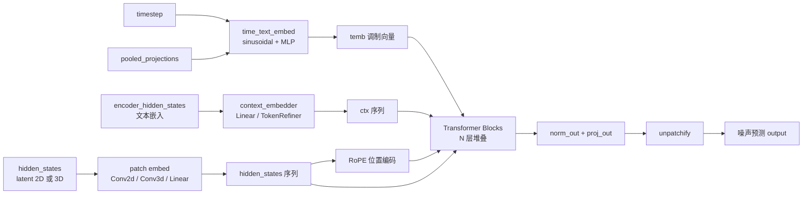
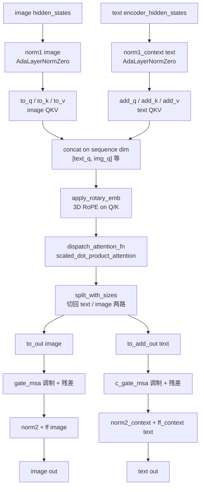
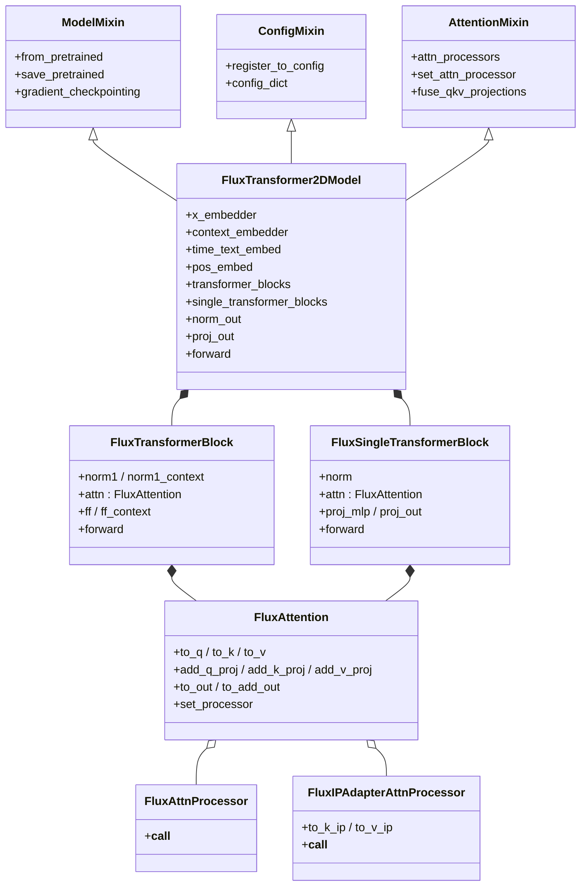

# 04 模型层 - Transformer 家族

> 基于 diffusers 0.39.0.dev0 版本

本文是【分】论篇的第四篇,聚焦 Transformer 家族——也就是 DiT(Diffusion Transformer)范式下的全部模型实现。我们将从家族全景入手,逐步深入到 Flux、SD3、Wan、HunyuanVideo 四个代表性实现的源码细节,最后给出使用指南与选型建议。

---

## 1. 总起:模块概览

### 1.1 Transformer 在现代扩散模型中的核心地位

早期扩散模型(SD1.x/SD2.x)的核心去噪网络是 UNet,它通过卷积下采样—上采样结构+skip connection 完成噪声预测。但 2023 年后,DiT 范式逐步成为新主流:Sora、Stable Diffusion 3、Flux、Wan、HunyuanVideo、CogVideoX 等几乎所有新发布的旗舰模型都改用 Transformer 作为 backbone。原因有三:

- **可扩展性更强**:Transformer 结构对大模型、长序列更友好,layer 堆叠和 head 数量增加不会破坏结构;
- **多模态融合更自然**:文本/图像/视频 token 可以直接拼接进同一序列参与注意力,无须额外 cross-attention 适配;
- **训练—推理一致性更好**:DiT 与 LLM 的训练栈高度对齐,FSDP/序列并行/上下文并行可以直接复用。

在 diffusers 中,Transformer 家族就是这一新范式的代码载体,负责接收 latent、timestep、文本嵌入,输出下一步预测的噪声/速度/flow。

### 1.2 家族全景:60 个文件

通过 `ls /workspace/src/diffusers/models/transformers/` 可以看到约 60 个 `transformer_*.py` 文件,涵盖图像、视频、音频三大模态:

- **图像 DiT**:flux、sd3、pixart、dit、sana、auraflow、lumina_nextdit2d、cogview4、ideogram4、chroma、qwenimage、helios、bria、omnigen、z_image、glm_image、ernie_image、joyimage、hidream_image、hunyuanimage、ovis_image、nucleusmoe_image、longcat_image、krea2、prx 等;
- **视频 DiT**:wan、hunyuan_video、hunyuan_video15、hunyuan_video_framepack、cogvideox、latte、mochi、ltx、ltx2、cosmos3、sana_video、allegro、easyanimate、consisid、chronoedit、motif_video、skyreels_v2、wan_animate、wan_vace 等;
- **音频 DiT**:stable_audio、longcat_audio_dit、ace_step 等;
- **特殊用途**:prior_transformer(Kandinsky/Imagen 先验)、t5_film_transformer、temporal、dual_transformer_2d、anyflow/anyflow_far(统一流模型)、transformer_2d(通用基础类)等。

### 1.3 设计理念:单文件策略 + ModelMixin + attention dispatch

阅读这一目录最直观的感受是三条统一约定:

1. **单文件策略**:每个模型一个 `transformer_<name>.py`,把 patch embed、block、attention processor、norm、forward 全部写在一个文件里,而不是分散到 layers/attention 子目录。这让"读完一个文件就懂一个模型"成为可能,极大降低了跨文件跳转成本。
2. **ModelMixin 基类**:所有 transformer 都继承 `ModelMixin`(提供 `from_pretrained`、`save_pretrained`、`gradient_checkpointing`、dtype/device 管理等基础能力),搭配 `ConfigMixin`(`@register_to_config` 自动序列化 `__init__` 参数)。多数还混入 `PeftAdapterMixin`(LoRA)、`FromOriginalModelMixin`(从原版 checkpoint 加载)、`CacheMixin`(推理缓存)、`AttentionMixin`(批量管理 attention processor)。
3. **attention dispatch 模式**:核心注意力计算通过 `dispatch_attention_fn(query, key, value, ...)` 统一分发,而不是直接调 `F.scaled_dot_product_attention`。这样可以根据后端(SDPA/Flash/分组并行)与 `_parallel_config` 在运行时切换实现,Flux/Wan/HunyuanVideo 全部使用这一模式。

### 1.4 Transformer 家族架构图

**图 4-1:Transformer 家族架构图**

```mermaid
flowchart TD
    ModelMixin["ModelMixin<br/>from_pretrained / save / dtype / device"]
    ConfigMixin["ConfigMixin<br/>register_to_config"]
    PeftAdapterMixin["PeftAdapterMixin<br/>LoRA / PEFT 适配"]
    FromOriginalMixin["FromOriginalModelMixin<br/>原版权重加载"]
    CacheMixin["CacheMixin<br/>推理缓存"]
    AttentionMixin["AttentionMixin<br/>attn_processors / set_attn_processor"]

    Flux["FluxTransformer2DModel<br/>MMDiT 双流 + 单流"]
    SD3["SD3Transformer2DModel<br/>JointTransformerBlock"]
    Wan["WanTransformer3DModel<br/>视频 DiT, 自+交叉注意力"]
    HyVideo["HunyuanVideoTransformer3DModel<br/>双流 + 单流, 3D patch"]
    QwenImg["QwenImageTransformer2DModel"]
    LTX["LTXVideoTransformer3DModel"]
    Chroma["ChromaTransformer2DModel"]
    Sana["SanaTransformer2DModel"]
    PixArt["PixArtTransformer2DModel"]
    DiT["DiTTransformer2DModel"]

    ModelMixin --> Flux
    ModelMixin --> SD3
    ModelMixin --> Wan
    ModelMixin --> HyVideo
    ModelMixin --> QwenImg
    ModelMixin --> LTX
    ModelMixin --> Chroma
    ModelMixin --> Sana
    ModelMixin --> PixArt
    ModelMixin --> DiT

    ConfigMixin -.-> Flux
    ConfigMixin -.-> SD3
    ConfigMixin -.-> Wan
    ConfigMixin -.-> HyVideo

    PeftAdapterMixin -.-> Flux
    PeftAdapterMixin -.-> SD3
    PeftAdapterMixin -.-> Wan

    AttentionMixin -.-> Flux
    AttentionMixin -.-> SD3
    AttentionMixin -.-> Wan
    AttentionMixin -.-> HyVideo
```



图 4-1 说明:实线表示直接继承,虚线表示 mixin 多重继承。`ModelMixin` 是所有 transformer 的根基类,提供加载/保存/dtype 管理;`ConfigMixin` 通过 `@register_to_config` 装饰 `__init__` 把全部超参写进 `config.json`;`AttentionMixin` 暴露 `attn_processors` 字典与 `set_attn_processor` 方法,允许用户为每个 attention 层替换处理器(如换 Flash / 拼接 IP-Adapter / ControlNet 处理器)。

---

## 2. 分述:核心实现

### 2.1 FluxTransformer2DModel 详解

源文件 [transformer_flux.py](file:///workspace/src/diffusers/models/transformers/transformer_flux.py)。Flux 是 Black Forest Labs 的 MMDiT(Multi-Modal DiT)代表,采用**双流 + 单流**混合架构:前 19 层是双流 `FluxTransformerBlock`,后 38 层是单流 `FluxSingleTransformerBlock`,两者共享同一个 `FluxAttention` 但配置不同。

#### 类签名与默认超参

`FluxTransformer2DModel` 默认 `patch_size=1`、`in_channels=64`(VAE 通道数)、`num_layers=19`(双流)、`num_single_layers=38`(单流)、`attention_head_dim=128`、`num_attention_heads=24`、`joint_attention_dim=4096`(T5 文本维度)、`axes_dims_rope=(16, 56, 56)`(RoPE 在三个轴上的切分)。注意 Flux 的 patch_size=1 是因为它在已被 VAE 压缩的 16× 下采样 latent 上工作,不需要再下采样。

#### FluxSingleTransformerBlock:图像流单流块

代码位于 [transformer_flux.py:355-406](file:///workspace/src/diffusers/models/transformers/transformer_flux.py)。这是单流块,把 image 与 text token **拼接**成一条序列后做单次 self-attention:

```python
def forward(self, hidden_states, encoder_hidden_states, temb, image_rotary_emb=None, ...):
    text_seq_len = encoder_hidden_states.shape[1]
    hidden_states = torch.cat([encoder_hidden_states, hidden_states], dim=1)  # 拼接 text+image
    residual = hidden_states
    norm_hidden_states, gate = self.norm(hidden_states, emb=temb)  # AdaLayerNormZeroSingle
    mlp_hidden_states = self.act_mlp(self.proj_mlp(norm_hidden_states))
    attn_output = self.attn(hidden_states=norm_hidden_states, image_rotary_emb=image_rotary_emb, ...)
    hidden_states = torch.cat([attn_output, mlp_hidden_states], dim=2)  # attn+mlp 在 channel 维拼接
    hidden_states = gate.unsqueeze(1) * self.proj_out(hidden_states)
    hidden_states = residual + hidden_states
    encoder_hidden_states, hidden_states = hidden_states[:, :text_seq_len], hidden_states[:, text_seq_len:]
    return encoder_hidden_states, hidden_states
```

它的 `FluxAttention` 配置 `pre_only=True`,即只输出 hidden 自身的 out projection(没有 `to_add_out`),因为 text 与 image 已被拼接成一条序列,共享同一套 QKV proj。

#### FluxTransformerBlock:双流块

代码位于 [transformer_flux.py:409-491](file:///workspace/src/diffusers/models/transformers/transformer_flux.py)。这是 MMDiT 真正的"双流"所在:image 与 text 各有独立的 `norm1` / `norm1_context`、`norm2` / `norm2_context`、`ff` / `ff_context`,但**共享一个注意力层**(`added_kv_proj_dim=dim`),让两路 QKV 拼接后一起做 attention 再切回去:

```python
def forward(self, hidden_states, encoder_hidden_states, temb, image_rotary_emb=None, ...):
    norm_hidden_states, gate_msa, shift_mlp, scale_mlp, gate_mlp = self.norm1(hidden_states, emb=temb)
    norm_encoder_hidden_states, c_gate_msa, c_shift_mlp, c_scale_mlp, c_gate_mlp = self.norm1_context(encoder_hidden_states, emb=temb)
    attn_output, context_attn_output = self.attn(
        hidden_states=norm_hidden_states,
        encoder_hidden_states=norm_encoder_hidden_states,
        image_rotary_emb=image_rotary_emb, ...)
    # image 流
    hidden_states = hidden_states + gate_msa.unsqueeze(1) * attn_output
    hidden_states = hidden_states + gate_mlp.unsqueeze(1) * self.ff(self.norm2(hidden_states) * (1 + scale_mlp[:, None]) + shift_mlp[:, None])
    # text 流
    encoder_hidden_states = encoder_hidden_states + c_gate_msa.unsqueeze(1) * context_attn_output
    encoder_hidden_states = encoder_hidden_states + c_gate_mlp.unsqueeze(1) * self.ff_context(...)
    return encoder_hidden_states, hidden_states
```

其中 `self.attn` 是 `FluxAttention(added_kv_proj_dim=dim, context_pre_only=False)`,对应 `FluxAttnProcessor` 内部把 `query/key/value`(image)与 `encoder_query/encoder_key/encoder_value`(text)分别投影后 **concat 在 sequence 维**做联合 attention,再 `split_with_sizes` 切回两路。这就是"双流"二字的物理含义。

#### FluxAttention 与 attention dispatch

[transformer_flux.py:275-352](file:///workspace/src/diffusers/models/transformers/transformer_flux.py) 中的 `FluxAttention` 同时支持未融合 QKV(`_get_projections`)和融合 QKV(`_get_fused_projections`,`attn.to_qkv` 一次调用产出 Q/K/V),由 `attn.fused_projections` 决定。最终注意力由 `dispatch_attention_fn(query, key, value, attn_mask=..., backend=self._attention_backend, parallel_config=self._parallel_config)` 完成分发:

- `backend` 决定走 SDPA / Flash / 其他自定义后端;
- `parallel_config` 携带上下文并行(Sequence Parallel / CP)的拓扑信息,开启时 attention 会在多卡间做 ring all-gather。

`apply_rotary_emb(query, image_rotary_emb, sequence_dim=1)` 在 SDPA 之前对 Q/K 应用 3D RoPE(由 `FluxPosEmbed` 根据 `img_ids`、`txt_ids` 生成,`axes_dims_rope=(16,56,56)` 把每个 head 的 128 维切成 t=16、h=56、w=56 三段)。

#### forward 主流程

[transformer_flux.py:636-786](file:///workspace/src/diffusers/models/transformers/transformer_flux.py) 的 `forward` 参数:`hidden_states`、`encoder_hidden_states`、`pooled_projections`、`timestep`、`img_ids`、`txt_ids`、`guidance`、`joint_attention_kwargs`、`controlnet_block_samples`、`controlnet_single_block_samples`、`return_dict`、`controlnet_blocks_repeat`。流程为:

1. `hidden_states = self.x_embedder(hidden_states)`:latent 投影到 inner_dim;
2. `timestep * 1000` 归一化后,`temb = self.time_text_embed(timestep, [guidance,] pooled_projections)`,`guidance` 可选(只在 `guidance_embeds=True` 时启用);
3. `encoder_hidden_states = self.context_embedder(encoder_hidden_states)`:T5 输出投影到 inner_dim;
4. `ids = torch.cat((txt_ids, img_ids), dim=0)`,`image_rotary_emb = self.pos_embed(ids)`;
5. 依次跑 19 个 `FluxTransformerBlock` + 38 个 `FluxSingleTransformerBlock`,每个 block 都可选注入 controlnet 残差(`controlnet_block_samples` / `controlnet_single_block_samples`);
6. `norm_out` + `proj_out` 把 token 投回 `patch_size * patch_size * out_channels`(因为 patch_size=1,实际就是 `out_channels`);
7. 返回 `Transformer2DModelOutput(sample=output)` 或裸 tuple。

注意 Flux 的 forward **没有显式 unpatchify**:由于 `patch_size=1` 且输入已经是 `(B, seq, in_channels)` 而非 `(B, C, H, W)`,pipeline 层负责 reshape。这是它与 SD3/Wan/HunyuanVideo 的关键差异之一。

### 2.2 SD3Transformer2DModel 详解

源文件 [transformer_sd3.py](file:///workspace/src/diffusers/models/transformers/transformer_sd3.py)。SD3 是 Stability AI 的多模态 DiT,与 Flux 同属 MMDiT 思路但实现差异显著。

#### 关键差异:PatchEmbed 与位置嵌入

SD3 用 `PatchEmbed`([transformer_sd3.py:142-149](file:///workspace/src/diffusers/models/transformers/transformer_sd3.py))一步完成 patch + 位置嵌入:`patch_size=2` 把 latent 切成 2×2 patch 后做线性投影并加上学习的 2D positional embedding(`pos_embed_max_size=96`),输出直接是 `(B, seq, inner_dim)`。而 Flux 是用 RoPE 在 attention 内部加位置信息,不学习位置嵌入。

#### JointTransformerBlock

SD3 不复用 Flux 的 `FluxAttention`,而是用通用 `Attention` 类 + `JointAttnProcessor2_0`/`FusedJointAttnProcessor2_0`(来自 `attention_processor.py`)。block 的核心特点:

- `context_pre_only=i == num_layers - 1`:**只有最后一层禁用 text 流的输出投影**,这意味着前 N-1 层 text token 会被更新,但最后一层只更新 image token——这是为了输出阶段只保留 image 流;
- `use_dual_attention=True if i in dual_attention_layers else False`:SD3.5 在前 12 层启用"dual attention"(两次 joint attention),SD3.0 默认空 tuple 不启用;
- 提供 `fuse_qkv_projections()` / `unfuse_qkv_projections()` 在推理时把 Q/K/V 三个 Linear 合并成一次大 matmul。

#### forward 流程

[transformer_sd3.py:249-345](file:///workspace/src/diffusers/models/transformers/transformer_sd3.py) 的关键步骤:

1. `hidden_states = self.pos_embed(hidden_states)`(输入是 `(B, C, H, W)`);
2. `temb = self.time_text_embed(timestep, pooled_projections)`;
3. `encoder_hidden_states = self.context_embedder(encoder_hidden_states)`;
4. 循环 18 个 `JointTransformerBlock`,可选注入 `block_controlnet_hidden_states` 与跳层 `skip_layers`(层跳过,用于加速推理);
5. `norm_out` + `proj_out` + **显式 unpatchify**:`einsum("nhwpqc->nchpwq")` 把 `(B, H, W, p, p, C)` 还原成 `(B, C, H*p, W*p)`。

与 Flux 对比:SD3 输入是 4D `(B,C,H,W)`,Flux 是 3D `(B,seq,C)`;SD3 用学习式 2D pos embed,Flux 用 RoPE;SD3 单 block 类型 + dual_attention_layers 切换,Flux 双 block 类型分离。

### 2.3 WanTransformer3DModel 详解

源文件 [transformer_wan.py](file:///workspace/src/diffusers/models/transformers/transformer_wan.py)。Wan 是阿里达摩院的视频 DiT,从 2.1 文本生视频到 2.2 图生视频、ti2v(time-indexed 视频)都有覆盖。

#### 3D patch embed 与 3D RoPE

`patch_size=(1, 2, 2)` 意味着时间维度不切(每帧独立 patch),空间维度切 2×2。`self.patch_embedding = nn.Conv3d(in_channels, inner_dim, kernel_size=patch_size, stride=patch_size)`([transformer_wan.py:598](file:///workspace/src/diffusers/models/transformers/transformer_wan.py))直接做 3D 卷积式 patch。

`WanRotaryPosEmbed`([transformer_wan.py:354-416](file:///workspace/src/diffusers/models/transformers/transformer_wan.py))按 `attention_head_dim // 6` 切出 `t_dim`、`h_dim`、`w_dim` 三段 RoPE 维度,预先算好 `freqs_cos` / `freqs_sin` 缓存,前向时按当前 `(F, H, W)` 切片+广播+拼接,得到 `(1, F*H*W, 1, head_dim)` 的 RoPE 表。这与 Flux 的 `FluxPosEmbed`(按 ids 计算)思路不同,Wan 把"形状"硬编码进 RoPE 生成逻辑。

#### WanTransformerBlock:自注意力 + 交叉注意力 + FFN

与 Flux/SD3 的"联合 attention"不同,Wan 走经典 DiT 路线:**每层先做自注意力(只看 video token),再做交叉注意力(看 text token),最后 FFN**。代码见 [transformer_wan.py:419-504](file:///workspace/src/diffusers/models/transformers/transformer_wan.py):

```python
# 1. Self-attention (video only, RoPE)
norm_hidden_states = self.norm1(hidden_states.float()) * (1 + scale_msa) + shift_msa
attn_output = self.attn1(norm_hidden_states, None, None, rotary_emb)
hidden_states = hidden_states + attn_output * gate_msa

# 2. Cross-attention (query=video, kv=text)
norm_hidden_states = self.norm2(hidden_states.float())
attn_output = self.attn2(norm_hidden_states, encoder_hidden_states, None, None)
hidden_states = hidden_states + attn_output

# 3. Feed-forward
norm_hidden_states = self.norm3(hidden_states.float()) * (1 + c_scale_msa) + c_shift_msa
hidden_states = hidden_states + self.ffn(norm_hidden_states) * c_gate_msa
```

其中 `attn1` 是 self-attention(无 `added_kv_proj_dim`),`attn2` 是 cross-attention(`cross_attention_dim_head` 不为 None)。`scale_shift_table` 是 `(1, 6, dim)` 的可学习参数,与 `temb` 相加后切出 6 路调制信号(shift_msa, scale_msa, gate_msa, c_shift_msa, c_scale_msa, c_gate_msa)。

#### I2V 图像条件注入

`WanAttention.attn2` 在 I2V 模型里配置 `added_kv_proj_dim`,此时 `encoder_hidden_states` 拼接了 `encoder_hidden_states_image`(图像 CLIP/DINO 嵌入,默认 257 token)在前 + 文本嵌入(512 token)在后。`WanAttnProcessor` 在 [transformer_wan.py:78-162](file:///workspace/src/diffusers/models/transformers/transformer_wan.py) 中:

1. 从 `encoder_hidden_states` 切出 `encoder_hidden_states_img` 与文本部分;
2. cross-attention 用文本部分做 K/V;
3. **额外**用 `add_k_proj` / `add_v_proj` 对图像嵌入做 K/V,与文本结果相加。

#### forward 流程与 context parallel

[transformer_wan.py:629-732](file:///workspace/src/diffusers/models/transformers/transformer_wan.py):输入 `(B, C, F, H, W)`,经 patch_embedding 后 flatten 成 `(B, seq, inner_dim)`,跑 40 个 block,最后 `norm_out` + `proj_out` + 3D unpatchify(`permute(0,7,1,4,2,5,3,6)` + 多次 `flatten`)还原成 `(B, C_out, F, H, W)`。

`_cp_plan` 字段定义了上下文并行的切分策略:`hidden_states` 在 dim=1(序列维)切,`proj_out` 在 dim=1 gather,文本 `encoder_hidden_states` 因为 769=512+257 不可整除而**不切**。这是视频模型在大规模训练/推理时跨卡拆序列的关键基础设施。

### 2.4 通用 forward 数据流

把四个模型抽象到统一视角,DiT 的 forward 都是同一条数据流:

**图 4-2:DiT 通用 forward 数据流**



图 4-2 说明:三条输入(timestep、文本、latent)各自经 embedder 后汇入 transformer blocks。`temb` 是 timestep + pooled text 的合成调制向量,通过 AdaLayerNormZero 在每个 block 内生成 shift/scale/gate;`RoPE` 为序列提供位置感知(Flux/SD3 走 joint attention,Wan 走 self+cross,HunyuanVideo 走 joint+single 两段)。最终 `unpatchify` 把 token 序列还原成 latent 形状交给 scheduler.step。

### 2.5 MMDiT 双流注意力原理图

Flux 的 `FluxTransformerBlock` 是 MMDiT 的范本,其双流交互细节如下:

**图 4-3:Flux MMDiT 双流注意力原理图**



图 4-3 说明:双流的精髓在于 norm 与 FFN 各自独立(text 有 `ff_context`、image 有 `ff`),但 **attention 共享**——两路 QKV 在 sequence 维拼接后做一次 SDPA,再切回去分别走 out projection。这等价于"text 与 image 互为可读的 KV cache",比纯 cross-attention 信息流更对称,也是 MMDiT 在文生图质量上超越 SD1.x 的关键结构创新。

### 2.6 类继承与组合关系图

**图 4-4:FluxTransformer2DModel 类继承与组合关系**



图 4-4 说明:`<|--` 表示继承,`*--` 表示组合(block 是 transformer 的成员,生命周期同步),`o--` 表示关联(Attention 持有 processor 引用但可运行时替换)。`FluxTransformer2DModel` 通过 mixin 多继承获得加载/配置/注意力管理三类能力;两个 block 类各自组合一个 `FluxAttention`(配置不同:`FluxTransformerBlock` 用 `added_kv_proj_dim=dim`、`context_pre_only=False`,`FluxSingleTransformerBlock` 用 `pre_only=True`);`FluxAttention` 关联一个 processor,默认是 `FluxAttnProcessor`,可替换为 `FluxIPAdapterAttnProcessor` 启用 IP-Adapter。SD3/Wan/HunyuanVideo 的类结构同构,只是 block 与 attention 类换成各自实现。

---

## 3. 使用指南

### 3.1 API 速查

所有 transformer 共享 `ModelMixin` + `ConfigMixin` 接口,常用方法:

| 方法 | 说明 |
|---|---|
| `from_pretrained(path, **kwargs)` | 从 HF Hub 或本地加载权重与 config |
| `save_pretrained(path)` | 保存权重与 config |
| `set_attn_processor(processor_dict)` | 替换部分或全部 attention processor |
| `attn_processors` | 返回 `{name: processor}` 字典 |
| `fuse_qkv_projections()` / `unfuse_qkv_projections()` | 推理时融合 QKV 加速 |
| `enable_gradient_checkpointing()` / `disable_gradient_checkpointing()` | 训练时省显存 |
| `enable_forward_chunking(chunk_size, dim)` | FFN 分块(类似 gradient checkpointing) |
| `forward(...)` | 噪声预测主入口 |

forward 的 `return_dict=True` 默认返回 `Transformer2DModelOutput(sample=...)`,设为 `False` 返回裸 tuple `(sample,)`,方便 pipeline 内部直接解包。

`guidance` 参数仅对 `guidance_embeds=True` 的模型(Flux Schnell/Dev distill 版本、HunyuanVideo)生效,用于把引导强度作为额外条件嵌入。

### 3.2 最小示例:单独加载 Flux transformer 前向

```python
import torch
from diffusers import FluxTransformer2DModel

# 从 Hub 加载,自动读取 config.json
transformer = FluxTransformer2DModel.from_pretrained(
    "black-forest-labs/FLUX.1-dev", subfolder="transformer", torch_dtype=torch.bfloat16
)
transformer = transformer.to("cuda")

# 构造最小输入(Flux 输入已是 patch 后序列)
B, seq_len = 1, 64 * 64  # 假设 64x64 个 patch
hidden_states = torch.randn(B, seq_len, 64, device="cuda", dtype=torch.bfloat16)  # in_channels=64
encoder_hidden_states = torch.randn(B, 256, 4096, device="cuda", dtype=torch.bfloat16)  # T5 输出
pooled_projections = torch.randn(B, 768, device="cuda", dtype=torch.bfloat16)
timestep = torch.tensor([1000], device="cuda")
img_ids = torch.zeros(seq_len, 3, device="cuda", dtype=torch.bfloat16)
txt_ids = torch.zeros(256, 3, device="cuda", dtype=torch.bfloat16)

with torch.no_grad():
    output = transformer(
        hidden_states=hidden_states,
        encoder_hidden_states=encoder_hidden_states,
        pooled_projections=pooled_projections,
        timestep=timestep,
        img_ids=img_ids,
        txt_ids=txt_ids,
        return_dict=True,
    )

print(output.sample.shape)  # (1, 4096, 64) — 与输入对齐
```

实际生产中无须手写这些参数,pipeline 会自动准备 `img_ids` / `txt_ids` / `pooled_projections`。

### 3.3 配置 attention processor

替换 attention processor 是最常用的定制手段,例如给 Flux 接 IP-Adapter:

```python
from diffusers.models.transformers.transformer_flux import FluxIPAdapterAttnProcessor

# 给 transformer_blocks 中所有 attn 替换 processor
for name, attn in transformer.attn_processors.items():
    if "attn" in name:  # 仅双流块的 attention 支持 IP-Adapter
        transformer.set_attn_processor(
            {name: FluxIPAdapterAttnProcessor(hidden_size=3072, cross_attention_dim=4096, num_tokens=(4,))}
        )

# 加载 IP-Adapter 权重
transformer.load_ip_adapter("xlabs/flux-ip-adapter", subfolder="models")
```

`AttentionMixin` 还提供 `fuse_qkv_projections()` 一键融合所有 Q/K/V 投影,推理时减少 kernel launch 开销,通常带来 5-10% 加速。

---

## 4. 实战案例

### 4.1 案例 1:Flux 推理

直接走 `DiffusionPipeline` 是推荐方式,内部自动处理 transformer 调用:

```python
import torch
from diffusers import FluxPipeline

pipe = FluxPipeline.from_pretrained("black-forest-labs/FLUX.1-dev", torch_dtype=torch.bfloat16)
pipe.to("cuda")

# 4 步出图(Schnell 模型);Dev 模型用 28-50 步
image = pipe(
    prompt="a cyberpunk city at night, neon reflections in puddles, cinematic",
    num_inference_steps=28,
    guidance_scale=3.5,
    height=1024,
    width=1024,
).images[0]
image.save("flux_demo.png")
```

如果只关心 transformer 单步前向(例如做研究、调试中间激活),可以绕开 pipeline:

```python
# 在去噪循环中手动调用 transformer
latents = torch.randn((1, 64, 64, 64), device="cuda", dtype=torch.bfloat16)  # Flux latent 形状
for t in pipe.scheduler.timesteps:
    noise_pred = pipe.transformer(
        hidden_states=latents,
        encoder_hidden_states=prompt_embeds,       # 由 pipe.encode_prompt 得到
        pooled_projections=pooled_prompt_embeds,
        timestep=t.unsqueeze(0),
        img_ids=pipe._prepare_latent_image_ids(1, 64, 64, ...),
        txt_ids=torch.zeros(prompt_embeds.shape[1], 3, device="cuda"),
        guidance=torch.tensor([3.5], device="cuda", dtype=torch.bfloat16) * 1000,
        return_dict=False,
    )[0]
    latents = pipe.scheduler.step(noise_pred, t, latents).prev_sample
```

### 4.2 案例 2:Wan 视频生成

Wan 的视频 latent 是 5D `(B, C, F, H, W)`,pipeline 自动处理 3D patch 与 unpatchify:

```python
import torch
from diffusers import WanPipeline, AutoencoderKLWan

# 文本生视频(Wan2.1-T2V-14B)
pipe = WanPipeline.from_pretrained("Wan-AI/Wan2.1-T2V-14B-Diffusers", torch_dtype=torch.bfloat16)
pipe.to("cuda")

video = pipe(
    prompt="a panda surfing on a giant wave at sunset, slow motion, hyperrealistic",
    num_frames=81,         # 视频帧数
    height=720,
    width=1280,
    num_inference_steps=40,
    guidance_scale=5.0,
).frames[0]  # (F, H, W, 3) numpy 数组

# 导出 mp4
from diffusers.utils import export_to_video
export_to_video(video, "wan_demo.mp4", fps=16)
```

若想从外部传入 latent 直接调 transformer:

```python
# 5D latent: (B=1, C=16, F=81//1, H=720//8//2, W=1280//8//2) 等 VAE patch 后
latent = torch.randn(1, 16, 81, 45, 80, device="cuda", dtype=torch.bfloat16)
encoder_hidden_states = torch.randn(1, 512, 4096, device="cuda", dtype=torch.bfloat16)  # 文本

noise_pred = pipe.transformer(
    hidden_states=latent,
    timestep=torch.tensor([1000], device="cuda"),
    encoder_hidden_states=encoder_hidden_states,
    return_dict=True,
).sample  # (1, 16, 81, 45, 80)
```

注意 Wan2.1 I2V 还需传 `encoder_hidden_states_image`(CLIP 图像嵌入),它在 transformer 内部被拼到文本嵌入前(共 769 token)。

---

## 5. 总结

### 5.1 要点回顾:统一性与差异性

整个 Transformer 家族在结构上高度统一,可以抽象成三段式:

1. **patchify**:把 latent 切成 patch 序列(Flux 用 Linear patch_size=1,SD3 用 2D Conv patch_size=2,Wan/HunyuanVideo 用 3D Conv `(t,h,w)`);
2. **transformer blocks**:堆叠 N 层 transformer block,内部由 timestep 调制(AdaLayerNorm 系列)、attention、FFN 组成;
3. **unpatchify**:把 token 序列还原成 latent 形状(Flux 因 patch_size=1 简化为 reshape,SD3/Wan/HunyuanVideo 显式 einsum/permute)。

差异主要体现在四个维度:

| 维度 | Flux | SD3 | Wan | HunyuanVideo |
|---|---|---|---|---|
| 数据形状 | 2D,序列输入 | 2D,`BCHW` 输入 | 3D 视频 | 3D 视频 |
| attention 模式 | joint 双流 + single | joint(dual 可选) | self + cross | joint + single |
| 位置编码 | RoPE(ids 计算) | 学习式 2D pos | RoPE(预计算缓存) | RoPE(meshgrid) |
| 文本精化 | Linear 投影 | Linear 投影 | PixArt 投影 | TokenRefiner 多层 |
| 层数(默认) | 19+38 | 18 | 40 | 20+40 |

### 5.2 与其他模块的关系

Transformer 是 pipeline 去噪循环的核心调用对象,但不是孤立模块:

- **pipeline**(`FluxPipeline` / `WanPipeline` 等)负责 prompt 编码、latent 初始化、scheduler 配置,在循环中调用 `transformer.forward(...)` 拿到 noise_pred;
- **scheduler**(`FlowMatchEulerDiscreteScheduler` 等)接收 transformer 输出,执行 `step` 计算上一步 latent;
- **VAE**(`AutoencoderKL`)负责 latent↔pixel 转换,transformer 只在 latent 空间工作;
- **attention_dispatch** 模块是所有 transformer 的统一注意力入口,可根据后端/并行配置切换实现;
- **loaders**(`PeftAdapterMixin` / `FluxTransformer2DLoadersMixin` 等)让 transformer 支持 LoRA、IP-Adapter、ControlNet 等扩展。

### 5.3 选型指南

- **追求图像质量上限 + 文本还原度**:Flux 系列(Dev 版本),双流 MMDiT 结构在长文本和复杂场景上表现最强;
- **追求可控性 + 社区生态**:SD3.5,支持 dual attention、qk_norm 可选,与 ControlNet/IP-Adapter 兼容度更高;
- **视频生成,显存充裕**:Wan2.1/2.2(14B,40 层,self+cross 经典结构)或 HunyuanVideo(13B,双流+单流,文本 TokenRefiner 更强);
- **视频生成,显存紧张**:Wan2.1 5B 或 LTX-Video(轻量、可流式推理);
- **音频生成**:stable_audio 系列;
- **自定义研究**:从 `transformer_2d.py`(通用基础类)起步,继承 `ModelMixin`+`ConfigMixin`+`AttentionMixin`,按需抄 Flux/SD3 的 block 实现。

理解了 Transformer 家族的设计哲学——单文件自包含、ModelMixin 统一接口、attention dispatch 解耦后端——之后,阅读这 60 个文件中的任何一个都能在半小时内把握其主干,这也是 diffusers 在工程层面最大的优雅之处。
