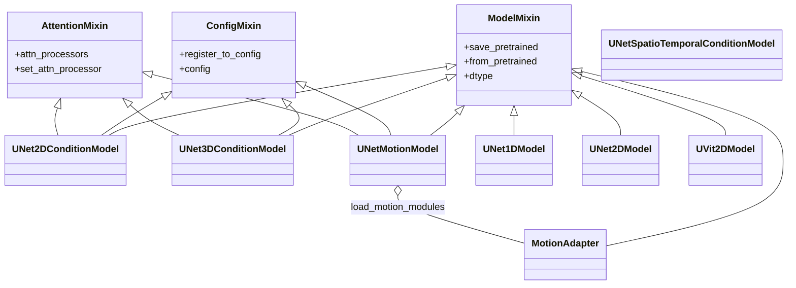
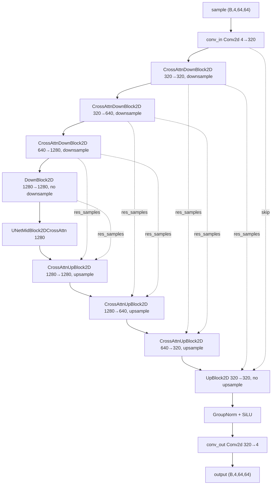
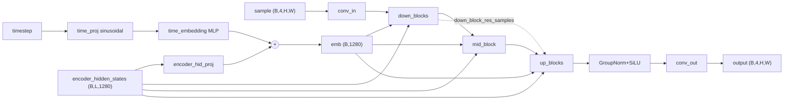
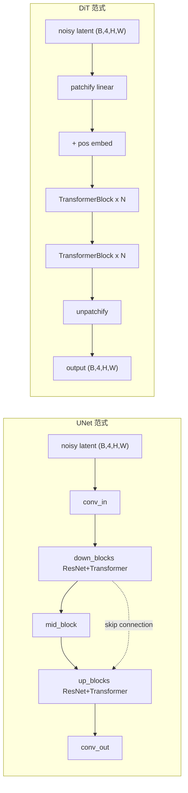

# 05 模型层 - UNet 家族

> 基于 diffusers 0.39.0.dev0 版本

## 1. 总起：模块概览

### 1.1 UNet 在早期扩散模型的地位

在扩散模型（Diffusion Models）的发展历程中，UNet 几乎是去噪网络的事实标准。从 OpenAI 的 IDDPM、Stability AI 的 Stable Diffusion 1.5 / 2.x，到 SDXL、AnimateDiff、ModelScope 文本到视频，去噪主干网络都采用了 U-Net 结构：一个对称的 encoder-decoder，配合跨层残差连接（skip connection），让网络在去噪过程中同时保留低层细节与高层语义。

Stable Diffusion 1.5 的 UNet 在 512×512 latent 空间上推理，参数量约 860M，是整个生成管线的核心计算负担。SDXL 将其扩展到约 2.6B 参数，仍然采用 UNet 架构。可以说，"扩散模型 = VAE + UNet + Scheduler + 文本编码器"这一公式在 2022-2023 年几乎是不言自明的。

### 1.2 与 DiT Transformer 的对比

随着 Sora、PixArt、SD3、Flux 等模型相继发布，Diffusion Transformer（DiT）开始接管顶配生成模型的位置。DiT 用纯 Transformer block 代替卷积 UNet，具有更好的可扩展性（scaling law）和更易并行化的结构。然而，UNet 并没有被淘汰：

- 生态成熟：SD1.5/SDXL 社区中存在海量基于 UNet 的 LoRA、ControlNet、IP-Adapter；
- 显存友好：UNet 的卷积主干在同等参数量下通常比纯 Transformer 更省显存；
- 视频时序建模：AnimateDiff 等方法在 UNet 内插入时序 motion module，工程上易于与已有 SD checkpoint 复用。

因此，DiT 与 UNet 在当前 diffusers 中并存：`models/unets/` 保留 UNet 家族，`models/transformers/` 承载 DiT/Transformer 主干。本篇聚焦前者。

### 1.3 家族全景

执行 `LS /workspace/src/diffusers/models/unets/` 可见 17 个 UNet 相关源文件（不含 `__init__.py`）：

| 文件 | 主要类 | 用途 |
| --- | --- | --- |
| `unet_1d.py` / `unet_1d_blocks.py` | `UNet1DModel` | 一维时序去噪（如 PLMS/DDPM 时间序列） |
| `unet_2d.py` / `unet_2d_blocks.py` | `UNet2DModel`、`CrossAttnDownBlock2D` 等 | 无条件 2D UNet 与 block 组件库 |
| `unet_2d_condition.py` | `UNet2DConditionModel` | SD1.5/SD2/SDXL 系列条件 UNet |
| `unet_3d_condition.py` / `unet_3d_blocks.py` | `UNet3DConditionModel` | ModelScope 视频生成 3D UNet |
| `unet_motion_model.py` | `UNetMotionModel`、`MotionAdapter` | AnimateDiff Motion UNet |
| `unet_spatio_temporal_condition.py` | `UNetSpatioTemporalConditionModel` | Stable Video Diffusion 时空条件 UNet |
| `unet_i2vgen_xl.py` | `UNetI2VGenXLModel` | I2VGen-XL 图生视频 UNet |
| `unet_stable_cascade.py` | `UNet2DConditionModel` (Stage C/B) | Stable Cascade 级联 UNet |
| `unet_kandinsky3.py` | `Kandinsky3UNet` | Kandinsky 3.0 UNet |
| `unet_dreamlite.py` | `DreamLiteUNet` | DreamLite 轻量化 UNet |
| `uvit_2d.py` | `UVit2DModel` | U-ViT（UNet 与 Transformer 折中结构） |
| `unet_2d_condition_flax.py` / `unet_2d_blocks_flax.py` | Flax 版本 | TPU/JAX 后端 |

### 1.4 UNet 家族架构图

**图 5-1：UNet 家族类继承关系**



图 5-1 说明：`ModelMixin` 提供权重加载/保存、dtype 推断等通用能力；`ConfigMixin` 通过 `@register_to_config` 装饰器把 `__init__` 入参持久化为 `config` 字典；`AttentionMixin` 暴露统一的 `attn_processors` / `set_attn_processor` 接口，让外部能够替换注意力实现（含 xformers、sdpa、PyATTN 等）。`UNet2DConditionModel` 是绝对主角，其他视频/时序 UNet 大多借鉴其结构。

## 2. 分述：核心实现

### 2.1 UNet2DConditionModel 详解

文件：[unet_2d_condition.py](file:///workspace/src/diffusers/models/unets/unet_2d_condition.py)

#### 2.1.1 类声明与基类

```python
class UNet2DConditionModel(
    ModelMixin, AttentionMixin, ConfigMixin, FromOriginalModelMixin, UNet2DConditionLoadersMixin, PeftAdapterMixin
):
```

六个基类分别承担：原始 checkpoint 转换（`FromOriginalModelMixin`）、UNet 专属权重加载（`UNet2DConditionLoadersMixin`，主要为 LoRA）、PEFT 适配器管理（`PeftAdapterMixin`，支持更通用的 LoRA/QLoRA）。

#### 2.1.2 `__init__` 关键配置参数

完整签名见 [unet_2d_condition.py:177-238](file:///workspace/src/diffusers/models/unets/unet_2d_condition.py)。默认值即对应 SD1.5 配置：

- `sample_size`：输入 latent 边长，SD1.5 为 64（对应 512×512 图像）。
- `in_channels` / `out_channels`：默认 4，匹配 SD VAE 的 4 通道 latent。
- `block_out_channels=(320, 640, 1280, 1280)`：四级下采样通道数。
- `layers_per_block=2`：每个 down/up block 内 ResnetBlock2D 的层数。
- `down_block_types=("CrossAttnDownBlock2D",) * 3 + ("DownBlock2D",)`：前三级带 cross-attention，最后一级纯 ResNet。
- `up_block_types=("UpBlock2D",) + ("CrossAttnUpBlock2D",) * 3`：对称结构。
- `mid_block_type="UNetMidBlock2DCrossAttn"`：中间块带 cross-attention。
- `cross_attention_dim=1280`：与 CLIP 文本编码器输出维度对齐。
- `transformer_layers_per_block=1`：每个 cross-attn block 内的 `BasicTransformerBlock` 数量。SDXL 中此值在中间块为 10，用以增强文本对齐能力。
- `attention_head_dim=8` / `num_attention_heads`：注意力头数（注意源码注释：因历史命名问题，`num_attention_heads` 实际从 `attention_head_dim` 取值）。
- `class_embed_type` / `addition_embed_type`：类别条件 / 附加条件（如 SDXL 的 `text_time`）嵌入方式。
- `time_embedding_type="positional"`：时间步嵌入类型，可选 `"fourier"`。

`__init__` 体核心构造（[行 270-494](file:///workspace/src/diffusers/models/unets/unet_2d_condition.py)）按以下顺序构建子模块：

1. `self.conv_in = nn.Conv2d(in_channels, block_out_channels[0], ...)`：输入卷积。
2. `self.time_proj` + `self.time_embedding`：时间步嵌入，先 sinusoidal 投影再 MLP。
3. `self._set_encoder_hid_proj(...)` / `self._set_class_embedding(...)` / `self._set_add_embedding(...)`：条件嵌入。
4. `self.down_blocks = nn.ModuleList([...])`：通过 `get_down_block` 工厂创建。
5. `self.mid_block = get_mid_block(...)`：中间块。
6. `self.up_blocks = nn.ModuleList([...])`：通过 `get_up_block` 工厂创建。
7. `self.conv_norm_out` (GroupNorm) + `self.conv_act` (SiLU) + `self.conv_out` (Conv2d)：输出后处理。

构造 down/up block 时通道变化逻辑：

```python
output_channel = block_out_channels[0]
for i, down_block_type in enumerate(down_block_types):
    input_channel = output_channel
    output_channel = block_out_channels[i]
    is_final_block = i == len(block_out_channels) - 1
    down_block = get_down_block(..., add_downsample=not is_final_block, ...)
```

注意 `add_downsample=not is_final_block`：最后一级不再下采样，因此 SD1.5 UNet 实际下采样 3 次（64→32→16→8）。

#### 2.1.3 `forward` 方法核心流程

完整签名见 [行 979-994](file:///workspace/src/diffusers/models/unets/unet_2d_condition.py)：

```python
def forward(
    self,
    sample: torch.Tensor,                       # (batch, 4, H, W)
    timestep: torch.Tensor | float | int,
    encoder_hidden_states: torch.Tensor,        # (batch, seq_len, 1280)
    class_labels=None,
    timestep_cond=None,
    attention_mask=None,
    cross_attention_kwargs=None,
    added_cond_kwargs=None,                     # SDXL 的 text_embeds/time_ids
    down_block_additional_residuals=None,       # ControlNet 注入点
    mid_block_additional_residual=None,         # ControlNet 注入点
    down_intrablock_additional_residuals=None,  # T2I-Adapter 注入点
    encoder_attention_mask=None,
    return_dict: bool = True,
) -> UNet2DConditionOutput | tuple:
```

forward 体（[行 1039-1235](file:///workspace/src/diffusers/models/unets/unet_2d_condition.py)）可拆为 6 步：

```python
# 1. time
t_emb = self.get_time_embed(sample=sample, timestep=timestep)
emb = self.time_embedding(t_emb, timestep_cond)
class_emb = self.get_class_embed(sample=sample, class_labels=class_labels)
aug_emb = self.get_aug_embed(emb=emb, encoder_hidden_states=encoder_hidden_states,
                             added_cond_kwargs=added_cond_kwargs)
emb = emb + aug_emb if aug_emb is not None else emb

# 2. pre-process
sample = self.conv_in(sample)

# 3. down —— 残差收集
down_block_res_samples = (sample,)
for downsample_block in self.down_blocks:
    if hasattr(downsample_block, "has_cross_attention") and downsample_block.has_cross_attention:
        sample, res_samples = downsample_block(
            hidden_states=sample, temb=emb,
            encoder_hidden_states=encoder_hidden_states,
            attention_mask=attention_mask,
            cross_attention_kwargs=cross_attention_kwargs,
            encoder_attention_mask=encoder_attention_mask,
            **additional_residuals,
        )
    else:
        sample, res_samples = downsample_block(hidden_states=sample, temb=emb)
    down_block_res_samples += res_samples

# ControlNet 注入：把额外残差加到对应 skip tensor 上
if is_controlnet:
    new_down_block_res_samples = ()
    for down_block_res_sample, down_block_additional_residual in zip(
        down_block_res_samples, down_block_additional_residuals
    ):
        down_block_res_sample = down_block_res_sample + down_block_additional_residual
        new_down_block_res_samples += (down_block_res_sample,)
    down_block_res_samples = new_down_block_res_samples

# 4. mid
if self.mid_block is not None:
    sample = self.mid_block(sample, emb, encoder_hidden_states=encoder_hidden_states, ...)
if is_controlnet:
    sample = sample + mid_block_additional_residual

# 5. up —— 残差消费
for i, upsample_block in enumerate(self.up_blocks):
    res_samples = down_block_res_samples[-len(upsample_block.resnets):]
    down_block_res_samples = down_block_res_samples[:-len(upsample_block.resnets)]
    sample = upsample_block(
        hidden_states=sample, temb=emb,
        res_hidden_states_tuple=res_samples,
        encoder_hidden_states=encoder_hidden_states, ...
    )

# 6. post-process
if self.conv_norm_out:
    sample = self.conv_norm_out(sample)
    sample = self.conv_act(sample)
sample = self.conv_out(sample)
return UNet2DConditionOutput(sample=sample) if return_dict else (sample,)
```

要点：

- **`down_block_res_samples` 是贯穿 UNet 的关键状态变量**：以 `(sample,)` 起头，每经过一个 down block 就把内部每个 ResnetBlock 输出 `+=` 进去，最后形成一个长 tuple。up block 逆序弹出。
- **ControlNet 注入点**：`down_block_additional_residuals` 和 `mid_block_additional_residual` 是 ControlNet side-network 的输出，被加到对应分辨率的 skip tensor 上。这是 ControlNet 与 UNet 解耦的核心机制。
- **T2I-Adapter 注入点**：`down_intrablock_additional_residuals` 在 down block 内部（每个 resnet 之后）就加进去，与 ControlNet 在 skip 拼接处加不同。
- `is_controlnet` 判定：`mid_block_additional_residual is not None and down_block_additional_residuals is not None`，二者必须同时给出。

### 2.2 UNet3DConditionModel 详解

文件：[unet_3d_condition.py](file:///workspace/src/diffusers/models/unets/unet_3d_condition.py)

`UNet3DConditionModel` 是 ModelScope 文本到视频模型对应的去噪网络。其默认配置：

```python
down_block_types = ("CrossAttnDownBlock3D", "CrossAttnDownBlock3D", "CrossAttnDownBlock3D", "DownBlock3D")
up_block_types   = ("UpBlock3D", "CrossAttnUpBlock3D", "CrossAttnUpBlock3D", "CrossAttnUpBlock3D")
cross_attention_dim = 1024
attention_head_dim  = 64
```

关键差异（[行 161-187](file:///workspace/src/diffusers/models/unets/unet_3d_condition.py)）：

- `self.conv_in` 仍是 2D 卷积。输入 `sample` 形状为 `(batch, channel, num_frames, height, width)`，在 forward 中先 `permute(0, 2, 1, 3, 4).reshape((batch*num_frames, -1, h, w))` 把帧维度折叠进 batch，复用 2D 卷积。
- 多了一个 `self.transformer_in = TransformerTemporalModel(...)`：在 conv_in 之后立即做一次时序注意力，让帧间信息早期就交互。
- `time_embedding` 和 `encoder_hidden_states` 都通过 `repeat_interleave(num_frames, dim=0)` 在 batch 维度复制，使每帧共享同一时间步/文本条件。
- down/mid/up block 来自 [unet_3d_blocks.py](file:///workspace/src/diffusers/models/unets/unet_3d_blocks.py)，内部 ResnetBlock 为 3D 残差块，注意力为时空注意力。
- forward 末尾 `sample[None, :].reshape((-1, num_frames) + ...).permute(0, 2, 1, 3, 4)` 把帧维度还原回 channel 之后，输出 `(batch, channel, num_frames, height, width)`。

forward 流程与 2D 版本几乎一致：time → conv_in → transformer_in → down → mid → up → conv_out，并保留 `down_block_res_samples` 残差收集与 ControlNet 注入接口。

### 2.3 UNetMotionModel 详解

文件：[unet_motion_model.py](file:///workspace/src/diffusers/models/unets/unet_motion_model.py)

`UNetMotionModel` 是 AnimateDiff 的去噪网络。设计哲学：**复用 SD1.5/SDXL 的 UNet2DConditionModel 权重，仅在 ResnetBlock 与 Transformer2D 之间插入时序 motion module**，从而把文生图 checkpoint 升级为文生视频。

类签名：

```python
class UNetMotionModel(ModelMixin, AttentionMixin, ConfigMixin, UNet2DConditionLoadersMixin, PeftAdapterMixin):
```

默认 block 类型变为 Motion 专用：

```python
down_block_types = ("CrossAttnDownBlockMotion",) * 3 + ("DownBlockMotion",)
up_block_types   = ("UpBlockMotion",) + ("CrossAttnUpBlockMotion",) * 3
motion_max_seq_length = 32
```

每个 Motion block（如 [CrossAttnDownBlockMotion](file:///workspace/src/diffusers/models/unets/unet_motion_model.py)，行 342）在普通 `resnets` / `attentions` 之外，额外维护一个 `self.motion_modules = nn.ModuleList(...)`，元素是 `AnimateDiffTransformer3D`（[行 63](file:///workspace/src/diffusers/models/unets/unet_motion_model.py)），其 forward 接受 `num_frames` 参数，把 `(batch*num_frames, c, h, w)` reshape 为 `(batch, h, w, num_frames, c)` 后在时间维度做自注意力。

`UNetMotionModel.forward`（[行 1883](file:///workspace/src/diffusers/models/unets/unet_motion_model.py)）关键步骤：

1. 计算 `emb`，再 `repeat_interleave(num_frames)` 复制到帧维度；
2. `sample` 同样 `permute+reshape` 把帧折叠进 batch；
3. `down_blocks` 中每个 block 同时调用 `resnets` / `attentions` / `motion_modules`；
4. `up_blocks` 消费残差；
5. 输出前 reshape 回 `(batch, channel, num_frames, height, width)`。

辅助类 `MotionAdapter`（[行 1060](file:///workspace/src/diffusers/models/unets/unet_motion_model.py)）独立存放所有 motion module 权重，可作为单独 checkpoint 加载——这正是 AnimateDiff "在 SD 基础上外挂 motion" 的实现方式。`UNetMotionModel.from_unet2d(...)` 把普通 `UNet2DConditionModel` 的 backbone 权重拷贝过来，再通过 `load_motion_modules(motion_adapter)` 注入时序模块。

### 2.4 UNet Block 组件

文件：[unet_2d_blocks.py](file:///workspace/src/diffusers/models/unets/unet_2d_blocks.py)

该文件定义了所有 2D UNet block 类与三个工厂函数：

- `get_down_block(down_block_type, ...)`：[行 43](file:///workspace/src/diffusers/models/unets/unet_2d_blocks.py)，根据字符串名分发到 `DownBlock2D` / `CrossAttnDownBlock2D` / `ResnetDownsampleBlock2D` / `AttnDownBlock2D` / `KDownBlock2D` 等。
- `get_mid_block(mid_block_type, ...)`：[行 252](file:///workspace/src/diffusers/models/unets/unet_2d_blocks.py)，分发到 `UNetMidBlock2D` / `UNetMidBlock2DCrossAttn` / `UNetMidBlock2DSimpleCrossAttn`。
- `get_up_block(up_block_type, ...)`：[行 327](file:///workspace/src/diffusers/models/unets/unet_2d_blocks.py)，对称分发。

核心 block 详解：

**`DownBlock2D`**（[行 1294](file:///workspace/src/diffusers/models/unets/unet_2d_blocks.py)）：最朴素的下采样块。仅由 `num_layers` 个 `ResnetBlock2D` 串联，可选末尾 `Downsample2D`。无 cross attention。`forward` 返回 `(hidden_states, output_states)`，`output_states` 是每个 resnet 输出的 tuple，供 up block 取用。

**`CrossAttnDownBlock2D`**（[行 1147](file:///workspace/src/diffusers/models/unets/unet_2d_blocks.py)）：SD1.5 前 3 级 down block 用的就是它。

```python
class CrossAttnDownBlock2D(nn.Module):
    def __init__(self, ...):
        self.has_cross_attention = True
        self.num_attention_heads = num_attention_heads
        for i in range(num_layers):
            resnets.append(ResnetBlock2D(...))
            attentions.append(Transformer2DModel(
                num_attention_heads,
                out_channels // num_attention_heads,
                in_channels=out_channels,
                num_layers=transformer_layers_per_block[i],
                cross_attention_dim=cross_attention_dim,
                use_linear_projection=use_linear_projection,
                ...
            ))
        self.attentions = nn.ModuleList(attentions)
        self.resnets = nn.ModuleList(resnets)
        if add_downsample:
            self.downsamplers = nn.ModuleList([Downsample2D(...)])
```

forward 中 `blocks = list(zip(self.resnets, self.attentions))`，逐对调用 `resnet` → `attn`，把每次的中间输出累加到 `output_states`，作为 skip connection。

**`UNetMidBlock2DCrossAttn`**（[行 751](file:///workspace/src/diffusers/models/unets/unet_2d_blocks.py)）：SD1.5 中间块。结构为 `Resnet → Transformer2D → Resnet`（默认 `num_layers=1`），`has_cross_attention=True`，是 UNet 最深、文本条件最强烈融合的位置。

**`UpBlock2D`** / **`CrossAttnUpBlock2D`**：与 down 版本对称，区别是接受 `res_hidden_state_tuple`，把对应 down block 的 skip tensor 在 channel 维度 `cat` 进 hidden_states，再走 Resnet。`CrossAttnUpBlock2D` 的 `num_layers = layers_per_block + 1`，比 down block 多一层 ResNet，用以融合多出的 skip 通道。

### 2.5 UNet 结构图

**图 5-2：UNet2DConditionModel 内部结构（SD1.5 配置）**



图 5-2 说明：实线为前向数据流，虚线为 `down_block_res_samples` 残差跨越路径。每个 down block 内部 `layers_per_block=2`，故每级产生 2 个 resnet 输出 + 1 个 downsample 输出（末级除外）；up block 通过 `res_hidden_states_tuple` 在 channel 维 `cat` 这些 skip。最后一级 `DownBlock2D` 不下采样，因此 SD1.5 的 latent 在 UNet 内部分辨率为 64→32→16→8，最深层 8×8×1280。

### 2.6 数据流图

**图 5-3：UNet2DConditionModel 数据流**



图 5-3 说明：三条主线进入 down/mid/up block——`sample`（隐状态）、`emb`（融合了时间、类别、附加条件）、`encoder_hidden_states`（文本特征，cross-attention 的 K/V）。`down_block_res_samples` 跨越 down→up，是 U-Net 拼接的核心。SDXL 等模型还会把 `added_cond_kwargs`（`text_embeds`、`time_ids`）通过 `add_embedding` 一起并入 `emb`。

### 2.7 UNet vs Transformer 对比图

**图 5-4：UNet 与 DiT Transformer 范式对比**



图 5-4 说明：UNet 通过卷积下采样得到多尺度特征金字塔，并依赖 skip 连接保留细节；DiT 把 latent 切成 patch 序列，统一为纯 token 流，靠注意力全局建模。UNet 显存占用更线性、易与 ControlNet 对齐多尺度特征；DiT 在 scaling 上更优，适合超大模型。SD3 / Flux 已迁移到 DiT 路线，但 SD1.5 / SDXL / AnimateDiff 仍坚守 UNet。

## 3. 使用指南

### 3.1 API 速查

`UNet2DConditionModel` 继承 `ModelMixin`，故常用方法：

- `UNet2DConditionModel.from_pretrained("runwayml/stable-diffusion-v1-5", subfolder="unet")`：从 Hub 加载。
- `unet.save_pretrained("./unet")`：保存到本地。
- `unet.config`：返回 `FrozenDict` 风格的配置字典。
- `unet.attn_processors` / `unet.set_attn_processor(...)`：替换注意力实现。
- `unet.fuse_qkv_projections()` / `unet.unfuse_qkv_projections()`：QKV 融合推理加速。
- `unet.enable_freeu(s1, s2, b1, b2)` / `unet.disable_freeu()`：FreeU 增强。
- `unet.enable_gradient_checkpointing()`：训练时省显存。
- `unet.load_attn_procs(...)`：加载 LoRA 权重（来自 `UNet2DConditionLoadersMixin`）。

`forward` 入参语义见 2.1.3。`return_dict=True` 返回 `UNet2DConditionOutput(sample=...)`，`False` 返回裸 tuple `(sample,)`。

### 3.2 最小示例

```python
import torch
from diffusers import UNet2DConditionModel

unet = UNet2DConditionModel.from_pretrained(
    "runwayml/stable-diffusion-v1-5", subfolder="unet", torch_dtype=torch.float16
).to("cuda")

sample = torch.randn(1, 4, 64, 64, device="cuda", dtype=torch.float16)
timestep = torch.tensor([50], device="cuda")
encoder_hidden_states = torch.randn(1, 77, 768, device="cuda", dtype=torch.float16)

with torch.no_grad():
    out = unet(sample, timestep, encoder_hidden_states, return_dict=False)

print(out[0].shape)  # torch.Size([1, 4, 64, 64])
```

### 3.3 常用配置

| 配置项 | SD1.5 | SD2.1 | SDXL |
| --- | --- | --- | --- |
| `in_channels` / `out_channels` | 4 | 4 | 4 |
| `block_out_channels` | (320, 640, 1280, 1280) | (320, 640, 1280, 1280) | (320, 640, 1280) |
| `cross_attention_dim` | 768 | 1024 | 2048 |
| `transformer_layers_per_block` | 1 | 1 | [1,2,10] |
| `addition_embed_type` | None | None | `text_time` |
| `sample_size` | 64 | 64 | 128 |

## 4. 实战案例

### 4.1 案例 1：SD1.5 UNet 前向推理（手动调用 forward）

```python
import torch
from diffusers import UNet2DConditionModel

unet = UNet2DConditionModel.from_pretrained(
    "runwayml/stable-diffusion-v1-5", subfolder="unet", torch_dtype=torch.float16
).to("cuda").eval()

B, H, W = 1, 64, 64
sample = torch.randn(B, 4, H, W, device="cuda", dtype=torch.float16)
timestep = torch.tensor([751], device="cuda")
encoder_hidden_states = torch.randn(B, 77, 768, device="cuda", dtype=torch.float16)

# 手动模拟 scheduler 单步：直接调用 forward
with torch.no_grad():
    output = unet(
        sample=sample,
        timestep=timestep,
        encoder_hidden_states=encoder_hidden_states,
        return_dict=True,
    )

noise_pred = output.sample  # (1, 4, 64, 64)
# 等价于 scheduler.step(noise_pred, timestep, sample) 输入
```

如果想观察残差收集过程，可手动展开 down_blocks 循环：

```python
emb = unet.time_embedding(unet.time_proj(timestep.expand(B).to(unet.device)))
hidden = unet.conv_in(sample)

res_samples = (hidden,)
for block in unet.down_blocks:
    if hasattr(block, "has_cross_attention") and block.has_cross_attention:
        hidden, rs = block(hidden_states=hidden, temb=emb,
                           encoder_hidden_states=encoder_hidden_states)
    else:
        hidden, rs = block(hidden_states=hidden, temb=emb)
    res_samples += rs
    print(f"after {type(block).__name__}: hidden={tuple(hidden.shape)}, "
          f"len(res_samples)={len(res_samples)}")
# 可看到 res_samples 长度逐步增长，对应图 5-2 的 skip 数量
```

### 4.2 案例 2：AnimateDiff 视频生成

```python
import torch
from diffusers import AnimateDiffPipeline, MotionAdapter, DDIMScheduler
from diffusers.utils import export_to_gif

adapter = MotionAdapter.from_pretrained(
    "guoyww/animatediff-motion-adapter-v1-5-2", torch_dtype=torch.float16
)
pipe = AnimateDiffPipeline.from_pretrained(
    "emilianJR/epiCRealism", motion_adapter=adapter, torch_dtype=torch.float16
).to("cuda")
pipe.scheduler = DDIMScheduler.from_config(pipe.scheduler.config)

# UNetMotionModel.forward 接受 (B, C, num_frames, H, W) 的 sample
output = pipe(
    prompt="a panda eating bamboo, cinematic",
    num_frames=16,
    num_inference_steps=25,
    guidance_scale=7.5,
)
frames = output.frames[0]
export_to_gif(frames, "panda.gif")
```

底层等价于：`pipe.unet` 是 `UNetMotionModel` 实例；pipeline 把 `sample` reshape 为 `(B, C, num_frames, H, W)`，调用 `unet.forward(sample, timestep, encoder_hidden_states, ...)`，得到 `(B, C, num_frames, H, W)` 形状的噪声预测。Motion module 在每个 block 内做时间维自注意力，让 16 帧之间保持时序连贯。

## 5. 总结

### 5.1 要点回顾

- UNet 家族以 `ModelMixin + ConfigMixin + AttentionMixin` 为基，`UNet2DConditionModel` 是核心，3D / Motion / Spatio-Temporal / I2VGen 等都是其变体。
- 内部结构严格遵守 encoder-decoder 对称：`conv_in → down_blocks → mid_block → up_blocks → conv_out`，`down_block_res_samples` 跨越连接是 U-Net 拼接的灵魂。
- 每个 down/up block 由 `ResnetBlock2D` 与可选 `Transformer2DModel`（带 cross-attention）组成；block 类型通过字符串 + `get_down_block` / `get_mid_block` / `get_up_block` 工厂分发。
- `forward` 三条主线：`sample`（隐状态）、`emb`（时间+类别+附加条件融合后嵌入）、`encoder_hidden_states`（文本特征）。ControlNet / T2I-Adapter 通过 `down_block_additional_residuals` / `mid_block_additional_residual` / `down_intrablock_additional_residuals` 注入。
- `UNet3DConditionModel` 把帧维度折叠进 batch，并加入 `transformer_in` 与 3D block；`UNetMotionModel` 复用 SD UNet backbone，额外插入 `AnimateDiffTransformer3D` motion module，由独立 `MotionAdapter` 加载。

### 5.2 与其他模块的关系

- **ControlNet**：side-network 接收与 UNet 同样的 `sample`、`timestep`、`encoder_hidden_states`，输出与 UNet 各 down block 同形状的残差 tuple，通过 `down_block_additional_residuals` / `mid_block_additional_residual` 注入 UNet forward。
- **T2I-Adapter**：更轻量，仅产生 down 分辨率特征，通过 `down_intrablock_additional_residuals` 在 down block 内部 resnet 之后注入。
- **Scheduler**：消费 UNet forward 的 `noise_pred`（`output.sample`），按 DDIM / PNDM / Euler 等算法更新 `sample`；UNet 不关心 scheduler 类型。
- **VAE**：UNet 在 VAE latent 空间工作，`in_channels=4` 对应 SD VAE 的 4 通道 latent；最终 VAE decoder 把 UNet 输出还原为像素。
- **文本编码器**：CLIP / OpenCLIP 输出 `encoder_hidden_states`，维度需与 `cross_attention_dim` 匹配；SDXL 因双文本编码器需 `encoder_hid_proj` 投影。
- **LoRA / PEFT**：`UNet2DConditionLoadersMixin` 与 `PeftAdapterMixin` 提供注入接口，注意力 `to_q/to_k/to_v/to_out` 是 LoRA 主要挂载点。

### 5.3 UNet 的历史价值与向 DiT 迁移的路径

UNet 在 2022-2024 年承担了几乎所有开源扩散模型的主干。其优势在于：成熟的多尺度特征金字塔、与 ControlNet/Adapter 的天然对齐、社区生态的厚重积累。劣势在于：卷积主干的 scaling law 不如 Transformer 清晰，且 block 类型组合复杂（`unet_2d_blocks.py` 单文件近 4000 行，包含 30+ block 类）。

向 DiT 迁移的路径在 diffusers 中已经打开：`models/transformers/` 目录下的 `Transformer2DModel`、`DiTTransformer2DModel`、`PixArtTransformer2DModel`、`SD3Transformer2DModel`、`FluxTransformer2DModel` 等承担新模型主干；SD3 / FLUX / PixArt-α / Hunyuan-DiT 等已不再使用 `models/unets/` 下的类。但短期内，UNet 仍是 SD1.5/SDXL 生态、AnimateDiff 视频、Stable Cascade 等模型的主力，理解其内部结构对于维护和扩展这些生态至关重要。
