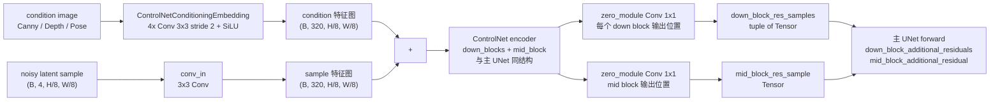
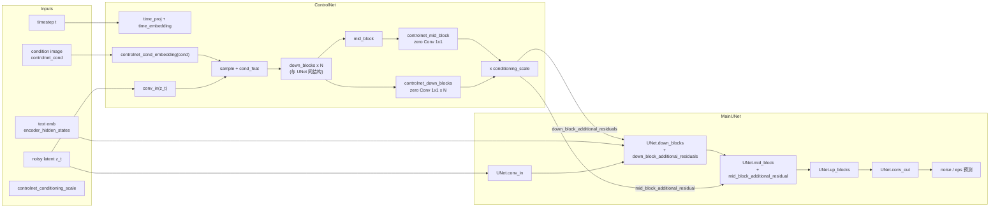
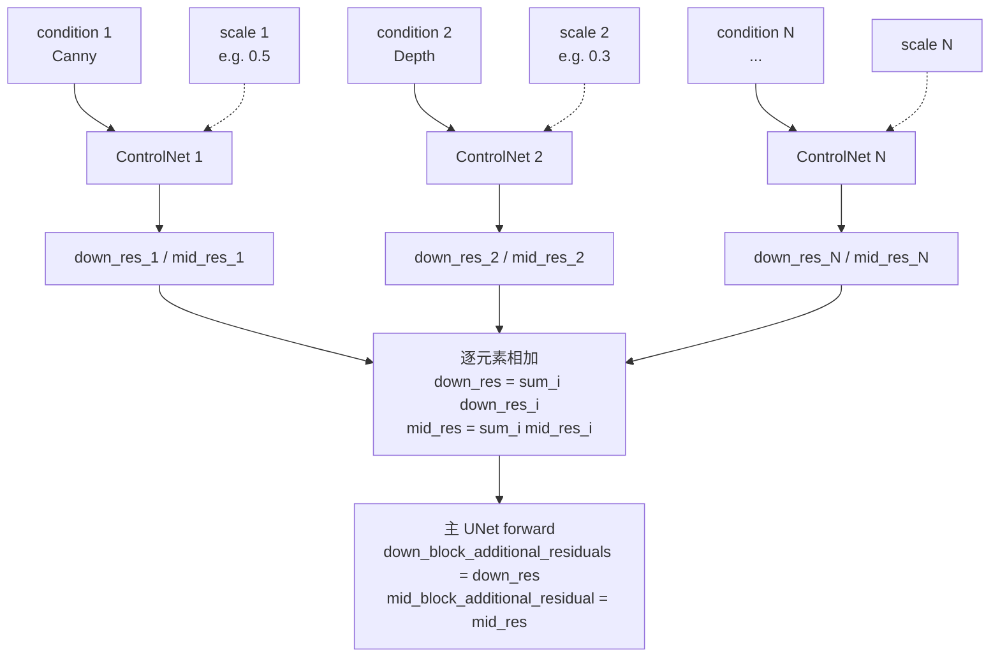

# 06 模型层 - ControlNet 家族

> 基于 diffusers 0.39.0.dev0 版本

本文是【分】论篇的第六篇,聚焦 ControlNet 家族——可控生成的核心机制。我们将从家族全景入手,逐步深入到标准 ControlNet、FluxControlNet、ControlNetUnion、MultiControlNet 四个代表性实现的源码细节,并辅以原理图、数据流图与实战示例,讲清"复制 encoder + 残差注入"这一贯穿全家族的范式。

---

## 1. 总起:模块概览

### 1.1 ControlNet 的核心思想:可控生成

纯文本到图像扩散模型(SD1.5/SDXL/Flux 等)生成结果受 prompt 影响很大,但很难精确控制构图、姿态、边缘、深度等结构信息。ControlNet 通过引入**条件注入**机制,把外部 condition(Canny 边缘、Depth 深度图、OpenPose 骨架、Mask 等)作为额外约束,引导主扩散模型按 condition 的结构去生成,从而把"凭空想象"变成"按图索骥"。

ControlNet 论文(Lvmin Zhang 等,2023)的核心洞察是:扩散主模型的 encoder 部分本身就是一个强大的特征提取器,只要复制一份并冻结主模型权重,在复制出来的副本上微调,就能把 condition 信息注入到主模型的对应层。这样既保留了主模型的生成能力,又能精确控制结构,且训练成本远低于从零训练一个新模型。

### 1.2 家族全景:15 个文件

通过 `ls /workspace/src/diffusers/models/controlnets/` 可以看到约 15 个 `controlnet*.py` 文件,覆盖了从 SD1.x 到 Flux、SD3、Hunyuan、Sana、Qwen-Image、Cosmos 等几乎所有现代扩散模型的可控生成需求。在 [__init__.py](file:///workspace/src/diffusers/models/controlnets/__init__.py) 中可以一眼看清导出关系:

- **标准 UNet 系列**:[controlnet.py](file:///workspace/src/diffusers/models/controlnets/controlnet.py) 提供 `ControlNetModel`,适配 SD1.5/SD2.x/SDXL 等 UNet2DConditionModel 主模型;[controlnet_union.py](file:///workspace/src/diffusers/models/controlnets/controlnet_union.py) 在此基础上扩展为 `ControlNetUnionModel`,单网络处理多种 condition 类型;[controlnet_sparsectrl.py](file:///workspace/src/diffusers/models/controlnets/controlnet_sparsectrl.py) 是为视频/动画设计的 `SparseControlNetModel`;[controlnet_xs.py](file:///workspace/src/diffusers/models/controlnets/controlnet_xs.py) 是轻量化变体 `UNetControlNetXSModel`,与主模型交错耦合而非外加残差;[controlnet_flax.py](file:///workspace/src/diffusers/models/controlnets/controlnet_flax.py) 是 JAX/Flax 实现 `FlaxControlNetModel`。
- **DiT 系列**:[controlnet_flux.py](file:///workspace/src/diffusers/models/controlnets/controlnet_flux.py) 适配 Flux 的 `FluxControlNetModel`;[controlnet_sd3.py](file:///workspace/src/diffusers/models/controlnets/controlnet_sd3.py) 适配 SD3 的 `SD3ControlNetModel`;[controlnet_hunyuan.py](file:///workspace/src/diffusers/models/controlnets/controlnet_hunyuan.py) 适配 HunyuanDiT;[controlnet_sana.py](file:///workspace/src/diffusers/models/controlnets/controlnet_sana.py) 适配 Sana;[controlnet_qwenimage.py](file:///workspace/src/diffusers/models/controlnets/controlnet_qwenimage.py) 适配 Qwen-Image;[controlnet_cosmos.py](file:///workspace/src/diffusers/models/controlnets/controlnet_cosmos.py) 适配 Cosmos;[controlnet_z_image.py](file:///workspace/src/diffusers/models/controlnets/controlnet_z_image.py) 适配 Z-Image。
- **组合包装器**:[multicontrolnet.py](file:///workspace/src/diffusers/models/controlnets/multicontrolnet.py) 提供 `MultiControlNetModel`,把多个 `ControlNetModel` 组合起来并行注入;[multicontrolnet_union.py](file:///workspace/src/diffusers/models/controlnets/multicontrolnet_union.py) 提供 `MultiControlNetUnionModel`,组合多个 Union 版本。

### 1.3 设计理念:复制 encoder + 残差注入

整个家族都遵循 ControlNet 论文提出的"trainable copy + zero convolution"范式,但具体形态因主模型结构不同而分两支:

- **UNet 系**(SD1.5/SDXL):主模型是 UNet2DConditionModel,encoder 由若干 `CrossAttnDownBlock2D`/`DownBlock2D` + `UNetMidBlock2DCrossAttn` 组成。ControlNet 复制这些 block,并在每个 block 输出后接一个 `zero_module(nn.Conv2d(..., kernel_size=1))`(零初始化的 1×1 卷积),把残差送到主模型对应的 `down_block_additional_residuals` / `mid_block_additional_residual` 接口。零初始化保证训练初期 ControlNet 输出为 0,主模型行为不变,然后逐步学习 condition 注入。
- **DiT 系**(Flux/SD3):主模型是 Transformer,没有 down/mid 概念。ControlNet 复制一部分 transformer block,把每个 block 输出经 `zero_module(nn.Linear(...))` 后作为残差,加到主模型对应 block 的隐藏状态上。

无论哪种形态,ControlNet 都不直接预测噪声,只输出"残差",因此可以和主模型解耦,即插即用。

### 1.4 ControlNet 家族架构图

**图 6-1:ControlNet 家族架构图**

```mermaid
flowchart TD
    ModelMixin["ModelMixin<br/>from_pretrained / save / dtype"]
    ConfigMixin["ConfigMixin<br/>register_to_config"]
    AttentionMixin["AttentionMixin<br/>attn_processors / set_attn_processor"]
    PeftAdapterMixin["PeftAdapterMixin<br/>LoRA 适配"]

    CN["ControlNetModel<br/>标准 UNet ControlNet<br/>SD1.5 / SDXL"]
    CNUnion["ControlNetUnionModel<br/>多模态单网络"]
    CNSparse["SparseControlNetModel<br/>视频稀疏控制"]
    CNXS["UNetControlNetXSModel<br/>轻量交错耦合"]
    CNFlax["FlaxControlNetModel<br/>JAX 实现"]

    CNFlux["FluxControlNetModel<br/>Flux DiT ControlNet"]
    CNSD3["SD3ControlNetModel<br/>SD3 DiT ControlNet"]
    CNHy["HunyuanDiT2DControlNetModel"]
    CNSana["SanaControlNetModel"]
    CNQwen["QwenImageControlNetModel"]
    CNCosmos["CosmosControlNetModel"]
    CNZ["ZImageControlNetModel"]

    MultiCN["MultiControlNetModel<br/>多 ControlNet 组合"]
    MultiCNU["MultiControlNetUnionModel<br/>多 Union 组合"]

    ModelMixin --> CN
    ModelMixin --> CNUnion
    ModelMixin --> CNSparse
    ModelMixin --> CNXS
    ModelMixin --> CNFlux
    ModelMixin --> CNSD3
    ModelMixin --> CNHy
    ModelMixin --> MultiCN
    ModelMixin --> MultiCNU

    ConfigMixin -.-> CN
    ConfigMixin -.-> CNUnion
    ConfigMixin -.-> CNFlux
    ConfigMixin -.-> CNSD3

    AttentionMixin -.-> CN
    AttentionMixin -.-> CNUnion
    AttentionMixin -.-> CNFlux

    PeftAdapterMixin -.-> CN
    PeftAdapterMixin -.-> CNFlux

    CN -->|"组合"| MultiCN
    CNUnion -->|"组合"| MultiCNU
    CNFlux -->|"内置包装"| FluxMulti["FluxMultiControlNetModel"]
    CNHy -->|"内置包装"| HyMulti["HunyuanDiT2DMultiControlNetModel"]
    CNSD3 -->|"内置包装"| SD3Multi["SD3MultiControlNetModel"]
    CNQwen -->|"内置包装"| QwenMulti["QwenImageMultiControlNetModel"]
```



图 6-1 说明:ControlNet 家族以 `ModelMixin`+`ConfigMixin` 为基座,沿"UNet 系"和"DiT 系"两条路径演化。UNet 系以 `ControlNetModel` 为根,衍生出 Union、SparseCtrl、XS、Flax 等变体;DiT 系按主模型分别实现(Flux/SD3/Hunyuan/Sana/Qwen/Cosmos/Z-Image)。组合层(`MultiControlNetModel` 及各 DiT 自带的 Multi 版本)负责把多个 ControlNet 的输出叠加后注入主模型。

---

## 2. 分述:核心实现

### 2.1 ControlNetModel 详解(controlnet.py)

#### 2.1.1 类继承与输出结构

[ControlNetModel](file:///workspace/src/diffusers/models/controlnets/controlnet.py) 继承自 `ModelMixin`、`AttentionMixin`、`ConfigMixin`、`FromOriginalModelMixin`、`PeftAdapterMixin`,具备完整的预训练加载、LoRA 适配、attention processor 切换能力。其输出通过 `ControlNetOutput` 数据类暴露:

```python
@dataclass
class ControlNetOutput(BaseOutput):
    down_block_res_samples: tuple[torch.Tensor]  # 每个 down block 的残差
    mid_block_res_sample: torch.Tensor           # mid block 的残差
```

这两个字段会原样喂给主模型 UNet 的 `down_block_additional_residuals` 和 `mid_block_additional_residual` 参数,完成 condition 注入。

#### 2.1.2 `__init__` 关键参数

`@register_to_config` 装饰的 `__init__` 接收约 30 个参数,核心如下:

- `in_channels: int = 4`:latent 通道数(SD1.5 latent 是 4 通道)。
- `conditioning_channels: int = 3`:condition 图像的通道数(RGB)。
- `down_block_types` / `block_out_channels` / `layers_per_block`:与主 UNet 完全对齐,默认 `(320, 640, 1280, 1280)`、`CrossAttnDownBlock2D`×3 + `DownBlock2D`、`layers_per_block=2`。
- `cross_attention_dim: int = 1280`:文本嵌入维度,用于 cross-attention。
- `transformer_layers_per_block`:每个 cross-attn block 内 transformer 层数(SDXL 为 1/2/10)。
- `conditioning_embedding_out_channels: tuple = (16, 32, 96, 256)`:`ControlNetConditioningEmbedding` 内部卷积通道,把 condition 图像压成与 latent 同尺度的特征图。
- `controlnet_conditioning_channel_order: str = "rgb"`:condition 通道顺序,部分老权重用 `"bgr"`,会在 forward 中 `torch.flip`。
- `class_embed_type` / `addition_embed_type`:类别/附加条件嵌入类型,SDXL 用 `text_time`。
- `mid_block_type: str = "UNetMidBlock2DCrossAttn"`:mid block 类型。

#### 2.1.3 `__init__` 内部组件构造

`__init__` 内顺序构造如下模块:

1. `self.conv_in`:3×3 卷积把 `in_channels` 映射到 `block_out_channels[0]`,与 UNet 完全一致(便于 `from_unet` 拷贝权重)。
2. `self.time_proj` + `self.time_embedding`:时间步嵌入。
3. `self.class_embedding` / `self.add_embedding`:可选的类别/附加嵌入。
4. `self.controlnet_cond_embedding`:condition 图像编码器,即 `ControlNetConditioningEmbedding`——一个由 4 层 3×3 卷积(stride=2)+ SiLU + 零初始化输出卷积组成的小网络,把 `(B, 3, H, W)` 的 condition 图压成 `(B, 320, H/8, W/8)` 的特征图(论文中的 E(·))。
5. `self.down_blocks`:与 UNet 完全相同的 down block 链(`CrossAttnDownBlock2D` / `DownBlock2D`),用于对带 condition 的 sample 做下采样。
6. `self.controlnet_down_blocks`:每个 down block 输出位置都接一个 `zero_module(nn.Conv2d(C, C, kernel_size=1))`,把残差投到主模型对应层的形状。
7. `self.mid_block`:`UNetMidBlock2DCrossAttn`,与 UNet mid 一致。
8. `self.controlnet_mid_block`:`zero_module(nn.Conv2d(C_mid, C_mid, kernel_size=1))`,mid 残差投影。

注意 `zero_module` 把所有参数初始化为 0,这是 ControlNet 训练稳定性的关键:训练初期残差为 0,主模型行为不变,梯度只流向 ControlNet 自身。

#### 2.1.4 `from_unet`:从主 UNet 克隆

`from_unet` 是构造 ControlNet 的标准入口,逻辑非常直白:从 `unet.config` 提取所有参数,实例化一个相同结构的 ControlNet,然后逐个 `load_state_dict` 拷贝 `conv_in`、`time_proj`、`time_embedding`、`class_embedding`、`add_embedding`、`down_blocks`、`mid_block`(因为 ControlNet 复制了 UNet 的 encoder 部分)。`controlnet_cond_embedding` 和所有 `controlnet_*_block` 保持零初始化,从头训练。

#### 2.1.5 `forward` 方法核心流程

`forward` 是整个家族最关键的代码,我们对照 [controlnet.py 第 603-801 行](file:///workspace/src/diffusers/models/controlnets/controlnet.py) 分步骤看:

```python
@apply_lora_scale("cross_attention_kwargs")
def forward(self, sample, timestep, encoder_hidden_states, controlnet_cond,
            conditioning_scale=1.0, ..., guess_mode=False, return_dict=True):
    # 1. 通道顺序处理 (rgb / bgr)
    if channel_order == "bgr":
        controlnet_cond = torch.flip(controlnet_cond, dims=[1])

    # 2. 时间步嵌入
    t_emb = self.time_proj(timesteps)
    emb  = self.time_embedding(t_emb, timestep_cond)
    # 可选: class_embedding + addition_embed_type (text / text_time)

    # 3. 预处理: sample 与 condition 各自编码后相加
    sample = self.conv_in(sample)
    controlnet_cond = self.controlnet_cond_embedding(controlnet_cond)
    sample = sample + controlnet_cond                      # ← condition 注入到 sample

    # 4. down blocks: 与 UNet 完全相同的下采样流程, 收集所有 res_samples
    down_block_res_samples = (sample,)
    for downsample_block in self.down_blocks:
        sample, res_samples = downsample_block(sample, temb=emb, encoder_hidden_states=...)
        down_block_res_samples += res_samples

    # 5. mid block
    sample = self.mid_block(sample, emb, encoder_hidden_states=...)

    # 6. controlnet 投影: 对每个 res_sample 过零初始化 1x1 卷积
    controlnet_down_block_res_samples = ()
    for down_block_res_sample, controlnet_block in zip(down_block_res_samples, self.controlnet_down_blocks):
        controlnet_down_block_res_samples += (controlnet_block(down_block_res_sample),)
    down_block_res_samples = controlnet_down_block_res_samples
    mid_block_res_sample = self.controlnet_mid_block(sample)

    # 7. scaling: 按 conditioning_scale 缩放残差
    if guess_mode and not self.config.global_pool_conditions:
        scales = torch.logspace(-1, 0, len(down_block_res_samples) + 1, device=sample.device)
        scales = scales * conditioning_scale
        down_block_res_samples = [s * scale for s, scale in zip(down_block_res_samples, scales)]
        mid_block_res_sample   = mid_block_res_sample * scales[-1]
    else:
        down_block_res_samples = [s * conditioning_scale for s in down_block_res_samples]
        mid_block_res_sample   = mid_block_res_sample * conditioning_scale

    return ControlNetOutput(down_block_res_samples=down_block_res_samples,
                            mid_block_res_sample=mid_block_res_sample)
```

要点解析:

- **condition 注入位置**:`sample = sample + controlnet_cond`,即 condition 特征与 latent 在 `conv_in` 之后、`down_blocks` 之前相加。这是 ControlNet 的核心——condition 不是 cross-attention 注入,而是直接加到主路径的特征图上。
- **down/mid 输出形状**:`down_block_res_samples` 是一个长度为 `1 + layers_per_block * num_blocks + (num_blocks - 1)` 的 tuple(对应 conv_in 输出 + 每个 ResnetBlock 输出 + 每个 Downsample 输出),与主 UNet 的 `down_block_additional_residuals` 顺序、形状完全一致。
- **guess_mode**:猜图模式下,残差按 `logspace(0.1, 1.0)` 由浅到深递增加权——浅层控制弱、深层控制强,鼓励模型自行识别 condition 内容而非依赖 prompt。
- **conditioning_scale**:全局缩放因子,等价于"控制强度",Pipeline 层的 `controlnet_conditioning_scale` 直接传到这里。
- **global_pool_conditions**:对残差做全局平均池化,某些条件(如 segmentation)用这种"全局信号"更稳定。

### 2.2 FluxControlNet 详解(controlnet_flux.py)

[FluxControlNetModel](file:///workspace/src/diffusers/models/controlnets/controlnet_flux.py) 适配 Flux 这一双流 DiT 模型。与 UNet 系的最大区别是:主模型不再有 down/mid 概念,而是 `transformer_blocks`(双流)+ `single_transformer_blocks`(单流)的堆叠,因此 ControlNet 的输出也变成两段:`controlnet_block_samples` 和 `controlnet_single_block_samples`。

#### 2.2.1 `__init__` 结构

```python
@register_to_config
def __init__(self, patch_size=1, in_channels=64, num_layers=19, num_single_layers=38,
             attention_head_dim=128, num_attention_heads=24, joint_attention_dim=4096,
             pooled_projection_dim=768, guidance_embeds=False,
             axes_dims_rope=[16, 56, 56], num_mode=None, conditioning_embedding_channels=None):
    ...
    self.x_embedder = nn.Linear(in_channels, self.inner_dim)
    self.transformer_blocks       = nn.ModuleList([FluxTransformerBlock(...) for _ in range(num_layers)])
    self.single_transformer_blocks = nn.ModuleList([FluxSingleTransformerBlock(...) for _ in range(num_single_layers)])

    # 每个双流 block 后接一个零初始化 Linear
    self.controlnet_blocks = nn.ModuleList([
        zero_module(nn.Linear(self.inner_dim, self.inner_dim)) for _ in range(num_layers)
    ])
    # 每个单流 block 后接一个零初始化 Linear
    self.controlnet_single_blocks = nn.ModuleList([
        zero_module(nn.Linear(self.inner_dim, self.inner_dim)) for _ in range(num_single_layers)
    ])

    # Union 模式: 多模态控制
    self.union = num_mode is not None
    if self.union:
        self.controlnet_mode_embedder = nn.Embedding(num_mode, self.inner_dim)

    # condition 编码: 复用 ControlNetConditioningEmbedding
    if conditioning_embedding_channels is not None:
        self.input_hint_block = ControlNetConditioningEmbedding(...)
        self.controlnet_x_embedder = nn.Linear(in_channels, self.inner_dim)
    else:
        self.input_hint_block = None
        self.controlnet_x_embedder = zero_module(nn.Linear(in_channels, self.inner_dim))
```

注意三个细节:

1. Flux 的 ControlNet 直接复用了 UNet 系的 `ControlNetConditioningEmbedding`(从 `controlnet.py` 导入),证明家族间是高度复用的。
2. `num_mode` 不为 None 时启用 Union 模式,即单网络处理多种 condition 类型,通过 `controlnet_mode_embedder` 把模式 ID 嵌入并拼到 `encoder_hidden_states` 前面。
3. `from_transformer` 类方法支持从主 Flux Transformer 拷贝权重,与 `from_unet` 思路一致。

#### 2.2.2 `forward` 关键流程

```python
hidden_states = self.x_embedder(hidden_states)
if self.input_hint_block is not None:
    controlnet_cond = self.input_hint_block(controlnet_cond)
    # 把 (B, C, H, W) reshape 成 (B, H*W, C) 的 token 序列
    controlnet_cond = controlnet_cond.reshape(B, C, H, P, W, P).permute(0, 2, 4, 1, 3, 5).reshape(B, H*W, -1)
hidden_states = hidden_states + self.controlnet_x_embedder(controlnet_cond)   # condition 注入

temb = self.time_text_embed(timestep, pooled_projections)        # 时间 + 文本 pooled 嵌入
encoder_hidden_states = self.context_embedder(encoder_hidden_states)

if self.union:
    controlnet_mode_emb = self.controlnet_mode_embedder(controlnet_mode)
    encoder_hidden_states = torch.cat([controlnet_mode_emb, encoder_hidden_states], dim=1)

# 走 num_layers 个双流 block, 收集每层 hidden_states
block_samples = ()
for block in self.transformer_blocks:
    encoder_hidden_states, hidden_states = block(hidden_states, encoder_hidden_states, temb, ...)
    block_samples += (hidden_states,)

# 走 num_single_layers 个单流 block, 同样收集
single_block_samples = ()
for block in self.single_transformer_blocks:
    encoder_hidden_states, hidden_states = block(...)
    single_block_samples += (hidden_states,)

# 每层输出过零初始化 Linear, 再乘 conditioning_scale
controlnet_block_samples       = tuple(blk(s) for s, blk in zip(block_samples, self.controlnet_blocks))
controlnet_single_block_samples = tuple(blk(s) for s, blk in zip(single_block_samples, self.controlnet_single_blocks))

controlnet_block_samples       = [s * conditioning_scale for s in controlnet_block_samples]
controlnet_single_block_samples = [s * conditioning_scale for s in controlnet_single_block_samples]

return FluxControlNetOutput(controlnet_block_samples, controlnet_single_block_samples)
```

可以看到 Flux 版本的范式与 UNet 版本完全同构:**condition 注入到 hidden_states → 走主模型同结构 block → 每层输出过零初始化投影 → 乘 scale**,只是把"down/mid 残差"换成了"双流/单流 block 残差"。

### 2.3 ControlNetUnion 详解(controlnet_union.py)

[ControlNetUnionModel](file:///workspace/src/diffusers/models/controlnets/controlnet_union.py) 是为 SDXL 设计的多模态 ControlNet:用**一个**网络同时处理 Canny、Depth、OpenPose、Sketch、Mask 等多种 condition 类型,而非为每种类型训练一个独立 ControlNet。

#### 2.3.1 与标准 ControlNet 的差异

`__init__` 主体结构与 `ControlNetModel` 几乎一致(同样有 `conv_in`、`controlnet_cond_embedding`、`down_blocks`、`controlnet_down_blocks`、`mid_block`、`controlnet_mid_block`),差异在于多出四组模块:

```python
# 任务嵌入: num_control_type 种 condition 类型, 每种一个 task token
task_scale_factor = num_trans_channel ** 0.5
self.task_embedding = nn.Parameter(task_scale_factor * torch.randn(num_control_type, num_trans_channel))

# 一个轻量 transformer 用来融合多模态 condition 的特征序列
self.transformer_layes = nn.ModuleList([
    ResidualAttentionBlock(num_trans_channel, num_trans_head) for _ in range(num_trans_layer)
])
self.spatial_ch_projs = zero_module(nn.Linear(num_trans_channel, num_proj_channel))

# control_type 标记位 (one-hot) 的嵌入, 加到 time embedding 上
self.control_type_proj = Timesteps(addition_time_embed_dim, flip_sin_to_cos, freq_shift)
self.control_add_embedding = TimestepEmbedding(addition_time_embed_dim * num_control_type, time_embed_dim)
```

`num_control_type` 默认为 6(对应 6 种 condition 类型)。`control_type` 是 `(B, num_control_type)` 的 0/1 张量,标记本次输入启用了哪些 condition 类型;`control_type_idx` 是一个 list,指明 `controlnet_cond` list 中每个 condition 对应的类型下标。

#### 2.3.2 `forward` 多模态融合逻辑

核心差异在 `forward` 第 2 步(condition 注入),不再是单个 condition 直接相加,而是:

```python
# 1. 把每个 condition 编码, 取全局平均得到 (B, 1, C) 的 task token, 加上对应类型的 task_embedding
inputs, condition_list = [], []
for cond, control_idx, scale in zip(controlnet_cond, control_type_idx, conditioning_scale):
    condition = self.controlnet_cond_embedding(cond)            # (B, C, H, W)
    feat_seq  = torch.mean(condition, dim=(2, 3))               # (B, C)  全局池化
    feat_seq  = feat_seq + self.task_embedding[control_idx]     # 加 task type 嵌入
    inputs.append(feat_seq.unsqueeze(1) * scale)
    condition_list.append(condition * scale)

# 2. 把 sample 自己也作为一个 token 拼到序列末尾, 走 transformer 融合
feat_seq = torch.mean(sample, dim=(2, 3)).unsqueeze(1)
inputs.append(feat_seq); condition_list.append(sample)
x = torch.cat(inputs, dim=1)                                    # (B, num_cond+1, C)
for layer in self.transformer_layes:
    x = layer(x)

# 3. 用 transformer 输出作为空间投影系数 alpha, 与原始 condition 相加, 得到融合后的 fuser
controlnet_cond_fuser = sample * 0.0
for (idx, condition), scale in zip(enumerate(condition_list[:-1]), conditioning_scale):
    alpha = self.spatial_ch_projs(x[:, idx]).unsqueeze(-1).unsqueeze(-1)
    controlnet_cond_fuser += condition + alpha * scale

sample = sample + controlnet_cond_fuser                         # 融合后的 condition 注入
```

后续 `down_blocks` → `mid_block` → `controlnet_down_blocks` / `controlnet_mid_block` → `scaling` 与标准 ControlNet 完全一致。也就是说,Union 版本只是把"condition 注入"这一步换成了基于 transformer 的多模态融合,后续的"复制 encoder + 残差投影"骨架不变。

### 2.4 MultiControlNet 详解(multicontrolnet.py)

[MultiControlNetModel](file:///workspace/src/diffusers/models/controlnets/multicontrolnet.py) 是最简单的组合器,本质是一个 `nn.ModuleList` 包装器:`__init__` 接收一个 `ControlNetModel` 列表,`forward` 接收 `controlnet_cond: list[Tensor]` 和 `conditioning_scale: list[float]`,逐个调用每个子 ControlNet,然后把它们的 down/mid 残差**逐元素相加**:

```python
def forward(self, sample, timestep, encoder_hidden_states,
            controlnet_cond, conditioning_scale, ...):
    for i, (image, scale, controlnet) in enumerate(zip(controlnet_cond, conditioning_scale, self.nets)):
        down_samples, mid_sample = controlnet(
            sample=sample, timestep=timestep, encoder_hidden_states=encoder_hidden_states,
            controlnet_cond=image, conditioning_scale=scale, ...
        )
        if i == 0:
            down_block_res_samples, mid_block_res_sample = down_samples, mid_sample
        else:
            down_block_res_samples = [p + c for p, c in zip(down_block_res_samples, down_samples)]
            mid_block_res_sample += mid_sample
    return down_block_res_samples, mid_block_res_sample
```

要点:

- **叠加而非拼接**:多个 ControlNet 的残差是逐元素相加,而不是在 channel 维拼接。这意味着每个 ControlNet 独立产生自己的控制信号,主模型看到的只是叠加后的总残差。
- **独立 scale**:每个 ControlNet 有自己的 `conditioning_scale`,可以分别调节控制强度(如 Canny 0.5 + Depth 0.3)。
- **加载/保存**:`save_pretrained` 把每个子网络存到 `dir/`、`dir_1/`、`dir_2/`...,`from_pretrained` 反向遍历加载,目录约定即"controlnet 后缀 `_1`/`_2`"。
- **DiT 系的 Multi 版本**:`FluxMultiControlNetModel`、`SD3MultiControlNetModel`、`HunyuanDiT2DMultiControlNetModel`、`QwenImageMultiControlNetModel` 都直接定义在各自文件里(而非走 `MultiControlNetModel`),因为 DiT 的输出是 block_samples 而非 down/mid 残差,合并逻辑需要按 `controlnet_block_samples` 列表逐元素相加。`FluxMultiControlNetModel` 还做了优化:当只有一个 Union ControlNet 时,只加载一个网络到显存,循环内部多次调用同一网络处理多个 condition。

### 2.5 ControlNet 原理图

**图 6-2:ControlNet 原理图(复制 encoder + 残差注入)**



图 6-2 说明:ControlNet 的核心是 condition 图经 `ControlNetConditioningEmbedding` 压成 latent 尺度的特征图,与主 latent 的 `conv_in` 输出相加,然后送入"与主 UNet 同结构"的 encoder。encoder 每层的输出经零初始化 1×1 卷积投影成残差,作为 `down_block_res_samples` 和 `mid_block_res_sample` 喂给主 UNet 的 `down_block_additional_residuals` / `mid_block_additional_residual` 接口。

### 2.6 数据流图

**图 6-3:ControlNet 完整数据流图**



图 6-3 说明:Pipeline 在每个去噪步先调用 `controlnet(z_t, t, cond, scale)` 得到残差元组,再以 `down_block_additional_residuals` 和 `mid_block_additional_residual` 形式传给 UNet 的 forward。UNet 在执行 `down_blocks[i]` 时把对应残差加到该层输出上,`mid_block` 同理。这样 ControlNet 的控制信号就在 UNet 的每一层都参与了特征塑造,而无需修改 UNet 的权重。

### 2.7 多 ControlNet 组合图

**图 6-4:MultiControlNet 组合注入图**



图 6-4 说明:MultiControlNet 把 N 个 ControlNet 的输出按对应 scale 缩放后逐元素相加,得到一组统一的 down/mid 残差,再注入主 UNet。每个 ControlNet 独立处理自己的 condition,scale 决定该 condition 的控制强度。

---

## 3. 使用指南

### 3.1 API 速查

ControlNet 在 Pipeline 层的接入主要通过三个 API:

| API | 说明 |
| --- | --- |
| `ControlNetModel.from_pretrained(path, torch_dtype=...)` | 加载预训练 ControlNet 权重,与普通 ModelMixin 一致 |
| `ControlNetModel.from_unet(unet, conditioning_channels=3)` | 从主 UNet 克隆出 ControlNet(训练初始化用) |
| `controlnet(sample, timestep, encoder_hidden_states, controlnet_cond, conditioning_scale, ...)` | forward 调用,返回 `ControlNetOutput(down_block_res_samples, mid_block_res_sample)` |
| `MultiControlNetModel([cn1, cn2])` | 构造多 ControlNet 组合 |
| `AutoPipelineForText2Image.from_pretrained(..., controlnet=controlnet)` | Pipeline 加载时传入 ControlNet |

Pipeline 调用时,通过 `controlnet_conditioning_scale`、`control_guidance_start`、`control_guidance_end` 三个参数控制:

- `controlnet_conditioning_scale`:float 或 list(多 ControlNet 时),控制残差强度。
- `control_guidance_start` / `control_guidance_end`:0~1 之间,ControlNet 只在 `[start, end]` 这个去噪区间生效(早期步结构控制、晚期步自由生成)。

### 3.2 最小示例:加载 SD1.5 + ControlNet,Canny 边缘引导

```python
import torch
from diffusers import StableDiffusionControlNetPipeline, ControlNetModel, UniPCMultistepScheduler
from diffusers.utils import load_image
from transformers import pipeline as hf_pipeline
import numpy as np
from PIL import Image

# 1. 加载 ControlNet (Canny 专用权重) 与 SD1.5 主模型
controlnet = ControlNetModel.from_pretrained(
    "lllyasviel/sd-controlnet-canny", torch_dtype=torch.float16
)
pipe = StableDiffusionControlNetPipeline.from_pretrained(
    "runwayml/stable-diffusion-v1-5", controlnet=controlnet, torch_dtype=torch.float16
)
pipe.scheduler = UniPCMultistepScheduler.from_config(pipe.scheduler.config)
pipe.to("cuda")

# 2. 准备 condition: Canny 边缘图
image = load_image("https://huggingface.co/datasets/hf-internal-testing/diffusers-images/resolve/main/sd_controlnet/hf-logo.png")
image = np.array(image)
canny = hf_pipeline("edge-detection", model="lllyasviel/Annotators")
image = canny(image)["denoised"]
cond_image = Image.fromarray(image)

# 3. 推理: controlnet_conditioning_scale 控制强度
output = pipe(
    "aerial view, a wasteland, broken buildings, dusty atmosphere",
    image=cond_image,
    num_inference_steps=20,
    controlnet_conditioning_scale=1.0,
    generator=torch.Generator("cuda").manual_seed(0),
)
output.images[0].save("canny_controlnet.png")
```

### 3.3 常用参数

| 参数 | 默认 | 作用 |
| --- | --- | --- |
| `controlnet_conditioning_scale` | 1.0 | 残差缩放,越大控制越强(典型 0.5~1.5) |
| `control_guidance_start` | 0.0 | ControlNet 生效起点(归一化去噪进度) |
| `control_guidance_end` | 1.0 | ControlNet 生效终点(常用 0.5~0.8,后期让模型自由生成) |
| `guidance_scale` | 7.5 | CFG 文本引导强度,与 ControlNet 协同 |
| `guess_mode` | False | 不需要 prompt 也尽力按 condition 生成,推荐 guidance_scale 3~5 |
| `conditioning_embedding_out_channels` | (16,32,96,256) | condition 编码器内部通道,新训练时可调 |

---

## 4. 实战案例

### 4.1 案例 1:Canny 边缘引导生成

完整流程包含 condition preprocessing 与推理两步。注意 diffusers 自带的 `StableDiffusionControlNetPipeline` 在内部会自动调用 `controlnet` 并把残差传给 UNet,用户只需提供 condition 图像和 `controlnet_conditioning_scale`:

```python
import torch
import cv2
import numpy as np
from PIL import Image
from diffusers import StableDiffusionControlNetPipeline, ControlNetModel, UniPCMultistepScheduler

controlnet = ControlNetModel.from_pretrained("lllyasviel/sd-controlnet-canny", torch_dtype=torch.float16)
pipe = StableDiffusionControlNetPipeline.from_pretrained(
    "runwayml/stable-diffusion-v1-5", controlnet=controlnet, torch_dtype=torch.float16
)
pipe.scheduler = UniPCMultistepScheduler.from_config(pipe.scheduler.config)
pipe.enable_model_cpu_offload()

# Canny 预处理
image = Image.open("input.png").convert("RGB").resize((512, 512))
image_np = np.array(image)
low_threshold, high_threshold = 100, 200
edges = cv2.Canny(image_np, low_threshold, high_threshold)
edges = np.stack([edges, edges, edges], axis=2)            # 转三通道
cond_image = Image.fromarray(edges)

# 推理: scale=1.0 + 30 步, 前 80% 步骤启用 ControlNet
output = pipe(
    prompt="a futuristic city skyline at sunset, cyberpunk style",
    image=cond_image,
    num_inference_steps=30,
    controlnet_conditioning_scale=1.0,
    control_guidance_start=0.0,
    control_guidance_end=0.8,
    guidance_scale=7.5,
    generator=torch.Generator("cuda").manual_seed(42),
)
output.images[0].save("city_canny.png")
```

### 4.2 案例 2:多 ControlNet 组合(Canny + Depth)

```python
import torch
from diffusers import StableDiffusionControlNetPipeline, ControlNetModel, UniPCMultistepScheduler
from diffusers.utils import load_image
from controlnet_aux import CannyDetector, MidasDetector

# 1. 加载两个 ControlNet
controlnet_canny  = ControlNetModel.from_pretrained("lllyasviel/sd-controlnet-canny",  torch_dtype=torch.float16)
controlnet_depth  = ControlNetModel.from_pretrained("lllyasviel/sd-controlnet-depth", torch_dtype=torch.float16)

# 2. 把它们组合成 MultiControlNet
from diffusers import MultiControlNetModel
controlnet = MultiControlNetModel([controlnet_canny, controlnet_depth])

# 3. 加载 Pipeline (controlnet 传入一个 list)
pipe = StableDiffusionControlNetPipeline.from_pretrained(
    "runwayml/stable-diffusion-v1-5", controlnet=controlnet, torch_dtype=torch.float16
)
pipe.scheduler = UniPCMultistepScheduler.from_config(pipe.scheduler.config)
pipe.to("cuda")

# 4. 准备两份 condition
raw = load_image("input.png").resize((512, 512))
canny_img = CannyDetector()(raw)                              # 边缘图
depth_img = MidasDetector()(raw)                              # 深度图

# 5. 推理: image 和 scale 都是 list, 顺序与 ControlNet 对应
output = pipe(
    prompt="a photorealistic portrait, studio lighting",
    image=[canny_img, depth_img],
    num_inference_steps=30,
    controlnet_conditioning_scale=[0.5, 0.7],                 # Canny 弱, Depth 强
    guidance_scale=7.5,
    generator=torch.Generator("cuda").manual_seed(0),
)
output.images[0].save("multi_controlnet.png")
```

MultiControlNet 内部会按 [multicontrolnet.py 第 80-106 行](file:///workspace/src/diffusers/models/controlnets/multicontrolnet.py) 的逻辑,先调用 `controlnet_canny(sample, ..., scale=0.5)` 得到 `down_res_1, mid_res_1`,再调用 `controlnet_depth(sample, ..., scale=0.7)` 得到 `down_res_2, mid_res_2`,然后逐元素相加,把合并后的残差一次性注入主 UNet。这样 Canny 控制边缘结构、Depth 控制景深,两路信号协同工作。

---

## 5. 总结

### 5.1 要点回顾

ControlNet 家族的全部秘密可以浓缩为一句话:**"复制主模型的 encoder,在每层输出位置接零初始化投影,把残差注入主模型对应层"**。具体形态分两支:

- **UNet 系**(`ControlNetModel` / `ControlNetUnionModel` / `SparseControlNetModel`):复制 `down_blocks` + `mid_block`,输出 `down_block_res_samples` + `mid_block_res_sample`,通过 `down_block_additional_residuals` / `mid_block_additional_residual` 注入。
- **DiT 系**(`FluxControlNetModel` / `SD3ControlNetModel` / `HunyuanControlNet` / `SanaControlNetModel` / `QwenImageControlNetModel` / `CosmosControlNetModel` / `ZImageControlNetModel`):复制 `transformer_blocks` + `single_transformer_blocks`(或对应 DiT 的 block 序列),输出 `controlnet_block_samples` 元组,通过加到对应 block 的 hidden_states 上注入。

无论哪一支,`zero_module` 都是关键:零初始化保证训练初期 ControlNet"不存在",主模型行为不变,然后逐步学习 condition 信号。`conditioning_scale` 是全局残差缩放因子,Pipeline 层暴露给用户作为"控制强度"旋钮。`MultiControlNetModel` 则是最简单的组合器——逐元素相加多路残差。

### 5.2 与其他模块的关系

ControlNet 在 diffusers 中与下列模块紧密协作:

- **主 UNet/Transformer**:`UNet2DConditionModel.forward` 接受 `down_block_additional_residuals` 和 `mid_block_additional_residual` 参数,在 `down_blocks[i]` 内部把残差加到 ResnetBlock 输出上;Flux/SD3 等 DiT 在 transformer block 内部把 `controlnet_block_samples[j]` 加到 hidden_states 上。这是 ControlNet 注入的"接口对齐"。
- **Pipeline**:`*ControlNetPipeline` 在每个去噪步先调 `controlnet(...)`,再把结果作为 kwargs 传给 `unet(...)`,并按 `control_guidance_start/end` 决定是否启用 ControlNet。
- **Schedulers**:与 ControlNet 无直接交互,但 `control_guidance_start/end` 的"区间生效"逻辑由 Pipeline 内部基于 scheduler 的 `timesteps` 数组判断。
- **Processors**:外部库(`controlnet_aux`、`transformers` 的 image-classification pipeline)负责把原图转成 Canny/Depth/Pose 等 condition 图,CotrolNet 只接受已经预处理好的张量。

### 5.3 适用场景

- **结构精确控制**:Canny/HED/SoftEdge 边缘引导,适合保持构图与轮廓的图生图、风格迁移。
- **空间结构控制**:Depth/Mesh/Normal 引导,适合保留景深关系的重绘。
- **姿态控制**:OpenPose 引导,适合人物姿态重绘、舞蹈动作迁移。
- **多条件组合**:MultiControlNet 同时使用 2~3 种 condition,如 Canny + Depth 协同控制边缘与景深。
- **多模态单网络**:ControlNetUnion 用一个网络处理多种 condition 类型,减少显存占用与切换成本。
- **视频/动画**:SparseControlNet 在关键帧上施加条件,中间帧自由生成。
- **DiT 模型**:Flux/SD3 等新一代 DiT 模型使用对应 `FluxControlNetModel` / `SD3ControlNetModel`,范式与 UNet 系完全一致,只是输出从 down/mid 残差变成 block_samples 元组。

ControlNet 家族是 diffusers 可控生成的核心模块,理解了"复制 encoder + 零卷积投影 + 残差注入"这一范式,就能快速上手家族中任意一个变体。
