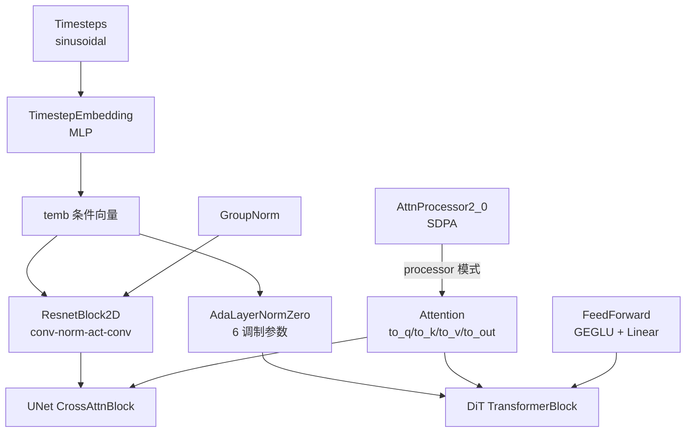
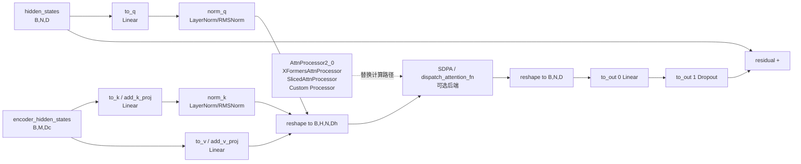
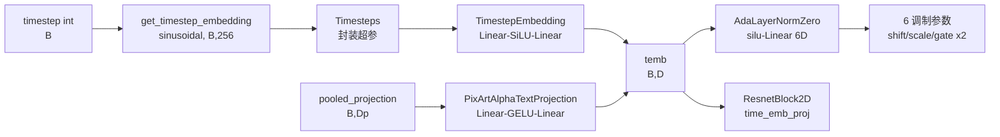
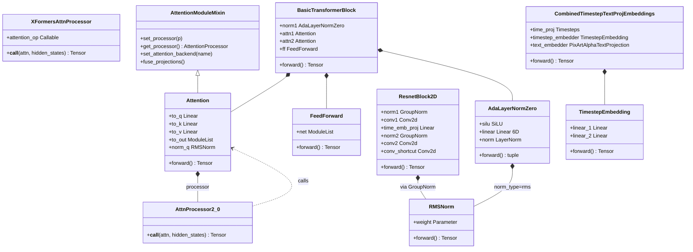

# 07 模型构建块 - Attention 与基础组件

> 基于 diffusers 0.39.0.dev0 版本

本文是【分】论篇的第七篇,聚焦构建 VAE / UNet / Transformer 的"原子积木"——Attention、embeddings、resnet、normalization 四类基础组件。前面几篇我们看到 Flux、SD3、UNet 等模型已经具备完整的去噪能力,但若把它们继续拆解,会发现它们的内部 block 都是由这四类组件拼装而成。理解这些原子组件的接口与设计模式,是后续自定义模型、改写 attention kernel、注入条件信号的前置条件。

---

## 1. 总起:模块概览

### 1.1 这些组件是构建 VAE/UNet/Transformer 的原子积木

diffusers 的模型层在代码组织上呈现出清晰的"两层结构":上层是各类完整模型(`transformer_flux.py`、`unet_2d_condition.py`、`vae.py` 等),下层是共享的原子组件(`attention.py`、`attention_processor.py`、`embeddings.py`、`resnet.py`、`normalization.py` 等)。上层模型通过组合这些原子组件搭建出 block,再由 block 堆叠出完整的去噪网络。

这种"积木式"设计的好处是显而易见的:同一套 `ResnetBlock2D` 既被 SD1.5 UNet 使用,也被 VAE 的 encoder/decoder 使用;同一个 `Attention` 类既出现在 UNet 的 cross-attention 里,也出现在 Transformer 的 self-attention 里;`AdaLayerNormZero` 同时服务于 DiT、SD3、PixArt。组件的复用极大降低了维护成本,也让新模型的接入变得"按图索骥"。

### 1.2 组件全景:四类原子组件

| 组件类 | 文件 | 代表类 | 核心职责 |
|---|---|---|---|
| attention | [attention.py](file:///workspace/src/diffusers/models/attention.py)、[attention_processor.py](file:///workspace/src/diffusers/models/attention_processor.py) | `Attention`、`BasicTransformerBlock`、`FeedForward`、`AttnProcessor2_0` | Q/K/V 投影与注意力计算,可替换 processor |
| attention dispatch | [attention_dispatch.py](file:///workspace/src/diffusers/models/attention_dispatch.py) | `dispatch_attention_fn`、`AttentionBackendName` | 统一调度 Flash/SDPA/Sage/xFormers 等后端 |
| embeddings | [embeddings.py](file:///workspace/src/diffusers/models/embeddings.py) | `Timesteps`、`TimestepEmbedding`、`CombinedTimestepTextProjEmbeddings`、`PixArtAlphaTextProjection` | 时间步/文本/类别条件的嵌入生成 |
| resnet | [resnet.py](file:///workspace/src/diffusers/models/resnet.py) | `ResnetBlock2D`、`Downsample2D`、`Upsample2D`、`TemporalResnetBlock` | 卷积残差块(含时间步注入)与上下采样 |
| normalization | [normalization.py](file:///workspace/src/diffusers/models/normalization.py) | `RMSNorm`、`AdaLayerNorm`、`AdaLayerNormZero`、`AdaLayerNormContinuous` | 归一化与条件归一化(AdaLN) |

### 1.3 设计理念:处理器可替换模式 + dispatch_attention_fn 统一调度

Attention 是这些组件中最复杂、也是设计最考究的一个。它采用了**处理器可替换模式(Processor Pattern)**:

- `Attention` 类只负责"持有权重"——`to_q`、`to_k`、`to_v`、`to_out` 这些线性投影,以及 `group_norm`、`spatial_norm`、`norm_q`/`norm_k` 等归一化层;
- 真正的注意力计算由 `processor` 完成,`Attention.forward` 只有一行实质逻辑:`return self.processor(self, hidden_states, ...)`;
- 通过 `set_processor` 可以在不重建权重的前提下切换计算路径(`AttnProcessor2_0` / `XFormersAttnProcessor` / `SlicedAttnProcessor` / `IPAdapterAttnProcessor2_0` / `JointAttnProcessor2_0` / 自定义 processor ……)。

在 0.39 版本中,attention 的设计进一步演化为**双层调度**:旧的 processor(如 `AttnProcessor2_0`)直接调用 `F.scaled_dot_product_attention`;而新增的 `attention_dispatch.py` 提供 `dispatch_attention_fn` 作为统一入口,根据 `AttentionBackendName`(NATIVE / FLASH / FLASH_3 / SAGE / FLEX / XFORMERS / AITER / NPU / XLA ……)在运行时选择具体 kernel。`.ai/models.md` 明确规定:**新模型的 processor 必须走 `dispatch_attention_fn`,不能直接调用 `F.scaled_dot_product_attention`**。这是为了支持 Flash-Attention 3、SageAttention、上下文并行等高级特性。

### 1.4 组件全景图

**图 7-1:四类原子组件组合进 UNet/Transformer block**



图 7-1 说明:时间步经 `Timesteps` → `TimestepEmbedding` 得到条件向量 `temb`,它一方面注入 `ResnetBlock2D`(经 `time_emb_proj`),另一方面注入 `AdaLayerNormZero` 生成 6 个调制参数。`Attention` 通过 processor 模式挂载 `AttnProcessor2_0`。UNet block 由 `ResnetBlock2D` + `Attention` 拼装,Transformer block 由 `AdaLayerNormZero` + `Attention` + `FeedForward` 拼装。

---

## 2. 分述:核心实现

### 2.1 Attention 模块详解

#### 2.1.1 Attention 类设计

`Attention` 类定义在 [attention_processor.py](file:///workspace/src/diffusers/models/attention_processor.py) 第 52 行,是 diffusers 中所有 attention 计算的统一容器。它的 `__init__` 参数众多,但可以归为四组:

**第一组:维度与头数**
- `query_dim`:查询向量维度(即输入 hidden_states 的通道数)。
- `cross_attention_dim`:交叉注意力的 key/value 来源维度;若为 `None` 则为自注意力。
- `heads=8`、`dim_head=64`、`kv_heads=None`:多头设置。`inner_dim = out_dim or dim_head*heads`,`inner_kv_dim = dim_head*kv_heads`(支持 GQA/MQA)。
- `out_dim`、`out_context_dim`:输出维度,用于 joint attention(SD3/Flux 双流)。

**第二组:投影与归一化**
- `bias`、`out_bias`、`added_proj_bias`:各 Linear 是否带 bias。
- `norm_num_groups`:若不为 `None`,构建 `self.group_norm = nn.GroupNorm(...)`(用于 UNet 中的图像 attention)。
- `spatial_norm_dim`:若不为 `None`,构建 `self.spatial_norm = SpatialNorm(...)`(条件空间归一化)。
- `qk_norm`:Q/K 头内归一化,支持 `None / "layer_norm" / "fp32_layer_norm" / "layer_norm_across_heads" / "rms_norm" / "rms_norm_across_heads" / "l2"`,现代 DiT 普遍启用此项。
- `cross_attention_norm`:对 encoder_hidden_states 的预归一化(`None / "layer_norm" / "group_norm"`)。

**第三组:Added KV(双流/joint)**
- `added_kv_proj_dim`:若不为 `None`,额外构建 `add_q_proj` / `add_k_proj` / `add_v_proj`,用于 SD3/Flux 的 joint attention 或 IP-Adapter。
- `only_cross_attention`:只使用 added KV,不再从 hidden_states 投影 K/V。
- `context_pre_only`:控制是否为 context 流计算输出投影(`to_add_out`)。
- `pre_only`:若为 `True`,不构建 `to_out`(只做调制前归一化)。

**第四组:行为开关**
- `scale_qk=True`:`scale = dim_head ** -0.5`。
- `upcast_attention` / `upcast_softmax`:在 fp32 下做 score / softmax。
- `residual_connection`:输出 `+ residual`。
- `rescale_output_factor`:输出除以该因子。
- `dropout`、`eps`、`is_causal`、`processor`。

#### 2.1.2 Q/K/V 投影

核心投影层构造(第 245–276 行):

```python
self.to_q = nn.Linear(query_dim, self.inner_dim, bias=bias)
if not self.only_cross_attention:
    self.to_k = nn.Linear(self.cross_attention_dim, self.inner_kv_dim, bias=bias)
    self.to_v = nn.Linear(self.cross_attention_dim, self.inner_kv_dim, bias=bias)
else:
    self.to_k = None
    self.to_v = None

if self.added_kv_proj_dim is not None:
    self.add_k_proj = nn.Linear(added_kv_proj_dim, self.inner_kv_dim, bias=added_proj_bias)
    self.add_v_proj = nn.Linear(added_kv_proj_dim, self.inner_kv_dim, bias=added_proj_bias)
    if self.context_pre_only is not None:
        self.add_q_proj = nn.Linear(added_kv_proj_dim, self.inner_dim, bias=added_proj_bias)

if not self.pre_only:
    self.to_out = nn.ModuleList([nn.Linear(self.inner_dim, self.out_dim, bias=out_bias), nn.Dropout(dropout)])
```

可以看到,当 `cross_attention_dim` 与 `query_dim` 不同(典型交叉注意力:query 来自图像 token,key/value 来自文本 token)时,`to_q` 与 `to_k`/`to_v` 的输入维度是不同的——这就是"双套投影"。而 `add_q_proj` 等是 SD3/Flux joint attention 中为 context 流准备的第二套投影。

#### 2.1.3 set_processor / get_processor 处理器替换机制

处理器替换由 `AttentionModuleMixin`(定义在 [attention.py](file:///workspace/src/diffusers/models/attention.py) 第 121 行)提供:

```python
def set_processor(self, processor: AttentionProcessor) -> None:
    if (hasattr(self, "processor") and isinstance(self.processor, torch.nn.Module)
            and not isinstance(processor, torch.nn.Module)):
        logger.info(f"You are removing possibly trained weights of {self.processor} with {processor}")
        self._modules.pop("processor")
    self.processor = processor

def get_processor(self, return_deprecated_lora: bool = False) -> "AttentionProcessor":
    if not return_deprecated_lora:
        return self.processor
```

`Attention.forward`(第 569 行)实质上只做参数过滤,然后把所有计算委托给 processor:

```python
attn_parameters = set(inspect.signature(self.processor.__call__).parameters.keys())
quiet_attn_parameters = {"ip_adapter_masks", "ip_hidden_states"}
unused_kwargs = [k for k, _ in cross_attention_kwargs.items()
                 if k not in attn_parameters and k not in quiet_attn_parameters]
if len(unused_kwargs) > 0:
    logger.warning(f"cross_attention_kwargs {unused_kwargs} are not expected by "
                   f"{self.processor.__class__.__name__} and will be ignored.")
cross_attention_kwargs = {k: w for k, w in cross_attention_kwargs.items() if k in attn_parameters}
return self.processor(self, hidden_states, encoder_hidden_states, attention_mask, temb, **cross_attention_kwargs)
```

这种"参数自适应过滤"让不同签名(如 `IPAdapterAttnProcessor2_0` 多了 `ip_hidden_states`)的 processor 可以共存于同一模型。

模型级别的批量管理由 `AttentionMixin`(第 39 行)的 `attn_processors` 属性与 `set_attn_processor` 方法完成:它们递归遍历所有子模块,收集/替换具有 `get_processor` / `set_processor` 属性的层。

#### 2.1.4 Processor 模式:AttnProcessor2_0 / XFormersAttnProcessor / AttnAddedKVProcessor

`AttnProcessor2_0`(第 2696 行)是 PyTorch 2.0+ 的默认 processor,核心计算直接调用 SDPA:

```python
query = attn.to_q(hidden_states)
# ... 处理 encoder_hidden_states、group_norm、norm_q/norm_k ...
query = query.view(batch_size, -1, attn.heads, head_dim).transpose(1, 2)
key   = key.view(batch_size, -1, attn.heads, head_dim).transpose(1, 2)
value = value.view(batch_size, -1, attn.heads, head_dim).transpose(1, 2)
if attn.norm_q is not None: query = attn.norm_q(query)
if attn.norm_k is not None: key   = attn.norm_k(key)

hidden_states = F.scaled_dot_product_attention(
    query, key, value, attn_mask=attention_mask, dropout_p=0.0, is_causal=False)
hidden_states = hidden_states.transpose(1, 2).reshape(batch_size, -1, attn.heads * head_dim)
hidden_states = attn.to_out[0](hidden_states)
hidden_states = attn.to_out[1](hidden_states)
```

`AttnProcessor`(第 1103 行)是 PyTorch < 2.0 的回退实现,用 `attn.get_attention_scores`(显式 `baddbmm` + softmax)与 `torch.bmm` 完成计算——这是"显式 materialize attention weights"的旧路径,也是自定义 processor 想要取出 attention weights 时的参考写法。

`XFormersAttnProcessor`(第 2488 行)调用 `xformers.ops.memory_efficient_attention(query, key, value, attn_bias=attention_mask, op=self.attention_op, scale=attn.scale)`,适合显存受限场景。

`AttnAddedKVProcessor`(第 1279 行)用于 SD1.5/SD2 UNet 中带 `added_kv_proj_dim` 的 attention:它把 `add_k_proj(encoder_hidden_states)` 与 `to_k(hidden_states)` 拼接成更长的 key 序列,再走显式 softmax + bmm。

需要特别说明的是:**本版本中没有 `SFAttnProcessor2_0`(Sparse Flash Attention Processor)这一类**。稀疏/Flash-Attention 3/Sage 等高级后端的统一入口已迁移到 `attention_dispatch.py` 的 `dispatch_attention_fn`,通过 `AttentionBackendName` 枚举与 `attention_backend` 上下文管理器切换,而不再为每种后端单独写一个 processor 类。这是 0.39 版本相对旧版的重要变化。

#### 2.1.5 dispatch_attention_fn:统一调度机制

[attention_dispatch.py](file:///workspace/src/diffusers/models/attention_dispatch.py) 是 0.39 版本 attention 子系统的"调度中枢"。`AttentionBackendName`(第 224 行)枚举了全部后端:

```python
class AttentionBackendName(str, Enum):
    FLASH = "flash"; FLASH_HUB = "flash_hub"; FLASH_VARLEN = "flash_varlen"
    _FLASH_3 = "_flash_3"; _FLASH_3_HUB = "_flash_3_hub"
    AITER = "aiter"
    FLEX = "flex"; NATIVE = "native"
    _NATIVE_CUDNN = "_native_cudnn"; _NATIVE_EFFICIENT = "_native_efficient"
    _NATIVE_FLASH = "_native_flash"; _NATIVE_MATH = "_native_math"
    _NATIVE_NPU = "_native_npu"; _NATIVE_XLA = "_native_xla"
    SAGE = "sage"; SAGE_HUB = "sage_hub"; SAGE_VARLEN = "sage_varlen"
    _SAGE_QK_INT8_PV_FP8_CUDA = "_sage_qk_int8_pv_fp8_cuda"
    XFORMERS = "xformers"
    # ...
```

`_AttentionBackendRegistry`(第 267 行)用装饰器注册每个后端的实现函数,并记录其 `constraints`(运行前检查)与 `_supported_arg_names`(参数过滤)。`dispatch_attention_fn`(第 393 行)是统一入口:

```python
def dispatch_attention_fn(query, key, value, attn_mask=None, dropout_p=0.0,
                          is_causal=False, scale=None, enable_gqa=False,
                          attention_kwargs=None, *, backend=None, parallel_config=None):
    if backend is None:
        backend_name, backend_fn = _AttentionBackendRegistry.get_active_backend()
    else:
        backend_name = AttentionBackendName(backend)
        backend_fn = _AttentionBackendRegistry._backends.get(backend_name)
    kwargs = {"query": query, "key": key, "value": value, "attn_mask": attn_mask,
              "dropout_p": dropout_p, "is_causal": is_causal, "scale": scale,
              **attention_kwargs, "_parallel_config": parallel_config}
    if _CAN_USE_FLEX_ATTN:
        kwargs["enable_gqa"] = enable_gqa
    if _AttentionBackendRegistry._checks_enabled:
        for check in _AttentionBackendRegistry._constraints.get(backend_name):
            check(**kwargs)
    kwargs = {k: v for k, v in kwargs.items()
              if k in _AttentionBackendRegistry._supported_arg_names[backend_name]}
    return backend_fn(**kwargs)
```

`.ai/models.md` 给出的新模型 processor 模板正遵循这一约定:

```python
class MyModelAttnProcessor:
    _attention_backend = None
    _parallel_config = None
    def __call__(self, attn, hidden_states, attention_mask=None, ...):
        query = attn.to_q(hidden_states); key = attn.to_k(hidden_states); value = attn.to_v(hidden_states)
        hidden_states = dispatch_attention_fn(query, key, value, attn_mask=attention_mask,
                                              backend=self._attention_backend,
                                              parallel_config=self._parallel_config)
        return attn.to_out[0](hidden_states)
```

`attention_backend(name)` 上下文管理器(第 372 行)可在推理时临时切换全局后端:`with attention_backend("_flash_3"): model(...)`,无需修改 processor。

#### 2.1.6 BasicTransformerBlock 与 FeedForward

`BasicTransformerBlock`([attention.py](file:///workspace/src/diffusers/models/attention.py) 第 752 行)是 diffusers 通用 Transformer block,SD1.5/SD2 的 UNet 内部 attention、PixArt、DiT 等都直接或间接使用它。它的结构是经典的 `norm1 → attn1(self) → norm2 → attn2(cross) → norm3 → ff`,但通过 `norm_type` 参数支持六种归一化变体:

- `"layer_norm"`:标准 `nn.LayerNorm`;
- `"ada_norm"`:`AdaLayerNorm`,条件为 `num_embeds_ada_norm`(timestep embedding);
- `"ada_norm_zero"`:`AdaLayerNormZero`,返回 6 个调制参数 `(shift_msa, scale_msa, gate_msa, shift_mlp, scale_mlp, gate_mlp)`;
- `"ada_norm_single"`:`AdaLayerNormSingle` + `scale_shift_table`(PixArt-Alpha 专用);
- `"ada_norm_continuous"`:`AdaLayerNormContinuous`,条件为 `pooled_text_emb`;
- `"layer_norm_i2vgen"`:i2vgen 特殊变体。

`FeedForward`(第 1682 行)是简洁的两层 MLP:`act_fn → Dropout → Linear`,其中 `act_fn` 通过 `activation_fn` 参数选择 `gelu / gelu-approximate / geglu / geglu-approximate / swiglu / linear-silu`(GEGLU 等门控激活定义在 `activations.py`)。

### 2.2 Embeddings 模块详解

[embeddings.py](file:///workspace/src/diffusers/models/embeddings.py) 是条件信号的"入口转换器",把整型时间步、类别标签、pooled 文本向量等转换为模型可用的条件嵌入。

#### 2.2.1 get_timestep_embedding:Timestep → Sinusoidal

`get_timestep_embedding`(第 27 行)实现 DDPM 论文的正弦时间步嵌入:

```python
half_dim = embedding_dim // 2
exponent = -math.log(max_period) * torch.arange(start=0, end=half_dim, dtype=torch.float32, device=timesteps.device)
exponent = exponent / (half_dim - downscale_freq_shift)
emb = torch.exp(exponent)
emb = timesteps[:, None].float() * emb[None, :]
emb = scale * emb
emb = torch.cat([torch.sin(emb), torch.cos(emb)], dim=-1)
if flip_sin_to_cos:
    emb = torch.cat([emb[:, half_dim:], emb[:, :half_dim]], dim=-1)
if embedding_dim % 2 == 1:
    emb = torch.nn.functional.pad(emb, (0, 1, 0, 0))
return emb
```

`max_period=10000` 控制最大频率,`downscale_freq_shift` 控制频率分布偏移(SD 系列用 `0`,传统 DDPM 用 `1`),`flip_sin_to_cos` 决定 sin/cos 顺序。

#### 2.2.2 Timesteps 与 TimestepEmbedding

`Timesteps`(第 1310 行)是对 `get_timestep_embedding` 的薄封装,持有 `num_channels`、`flip_sin_to_cos`、`downscale_freq_shift`、`scale` 四个超参。

`TimestepEmbedding`(第 1262 行)是把正弦嵌入投影到模型维度的两层 MLP:

```python
self.linear_1 = nn.Linear(in_channels, time_embed_dim, sample_proj_bias)
self.act = get_activation(act_fn)  # 默认 "silu"
self.linear_2 = nn.Linear(time_embed_dim, time_embed_dim_out, sample_proj_bias)
# 可选 cond_proj(条件投影,用于 class condition)、post_act_fn
```

`forward`:可选 `sample = sample + self.cond_proj(condition)`,然后 `linear_1 → act → linear_2`,最后可选 `post_act`。这是所有时间步 MLP 的标准形态。

#### 2.2.3 CombinedTimestepTextProjEmbeddings:Flux/SD3 的组合嵌入

Flux、SD3 等模型需要把时间步与 pooled 文本向量融合为单一条件向量。`CombinedTimestepTextProjEmbeddings`(第 1585 行)的实现非常清晰:

```python
class CombinedTimestepTextProjEmbeddings(nn.Module):
    def __init__(self, embedding_dim, pooled_projection_dim):
        super().__init__()
        self.time_proj = Timesteps(num_channels=256, flip_sin_to_cos=True, downscale_freq_shift=0)
        self.timestep_embedder = TimestepEmbedding(in_channels=256, time_embed_dim=embedding_dim)
        self.text_embedder = PixArtAlphaTextProjection(pooled_projection_dim, embedding_dim, act_fn="silu")

    def forward(self, timestep, pooled_projection):
        timesteps_proj = self.time_proj(timestep)
        timesteps_emb = self.timestep_embedder(timesteps_proj.to(dtype=pooled_projection.dtype))
        pooled_projections = self.text_embedder(pooled_projection)
        conditioning = timesteps_emb + pooled_projections
        return conditioning
```

时间步经 256 维正弦嵌入 → MLP 投影到 `embedding_dim`,pooled 文本经 `PixArtAlphaTextProjection` 投影到同维度,二者相加得到最终条件向量。这个向量随后会送入 `AdaLayerNormZero` 生成 6 个调制参数。变体 `CombinedTimestepGuidanceTextProjEmbeddings`(第 1604 行)额外加入 guidance 嵌入,用于支持 Flux 的引导蒸馏。

#### 2.2.4 PixArtAlphaTextProjection

`PixArtAlphaTextProjection`(第 2192 行)是 PixArt-Alpha 提出的文本投影头:`linear_1 → act(gelu_tanh/silu/silu_fp32) → linear_2`,同时承担 classifier-free guidance 的 dropout 处理。它比 `TimestepEmbedding` 更简单,但支持 `gelu_tanh` 这一 PixArt 专用激活。

### 2.3 ResNet 模块详解

[resnet.py](file:///workspace/src/diffusers/models/resnet.py) 提供卷积路径上的残差块,主要用于 UNet 和 VAE。

#### 2.3.1 ResnetBlock2D

`ResnetBlock2D`(第 188 行)是标准 2D 残差块,前向流程为:

```
input_tensor
  → norm1(GroupNorm) → nonlinearity(SiLU) → [upsample/downsample if up/down]
  → conv1(3x3)
  → time_emb_proj 注入(temb 经 SiLU + Linear 后加到 feature map)
  → norm2(GroupNorm) → nonlinearity → dropout → conv2(3x3)
  → conv_shortcut(1x1, 仅当 in/out 通道不等)
  → (input_tensor + hidden_states) / output_scale_factor
```

时间步注入有两种模式,由 `time_embedding_norm` 控制:

- `"default"`(第 347 行):`temb = SiLU(temb) → time_emb_proj → [:, :, None, None]`,`hidden_states = hidden_states + temb`(在 norm2 之前加),即"加性偏置";
- `"scale_shift"`(第 351 行):`time_emb_proj` 输出 2 倍通道,chunk 成 `(time_scale, time_shift)`,`hidden_states = norm2(hidden_states) * (1 + time_scale) + time_shift`,即"仿射调制"。

`conv_shortcut` 仅在 `in_channels != conv_2d_out_channels` 时构建,用 1x1 卷积对齐 skip connection 的通道数。`up` / `down` 参数让 resnet block 内置上下采样(委托给 `Upsample2D` / `Downsample2D`,或 `fir` / `sde_vp` kernel)。

#### 2.3.2 Downsample2D / Upsample2D

`Downsample2D` 与 `Upsample2D` 实际定义在 `downsampling.py` / `upsampling.py` 中,在 `resnet.py` 顶部通过 `from .downsampling import ...` 引入(第 25–40 行)。`Downsample2D` 默认用 `stride=2` 的 3x3 卷积下采样,`Upsample2D` 默认用 nearest 插值 + 3x3 卷积上采样。`ResnetBlock2D` 还支持 `kernel="fir"`(FIR 抗锯齿滤波)与 `kernel="sde_vp"`(VP-SDE 风格的 avg_pool / interpolate)两种变体。

此外 `resnet.py` 还提供 `ResnetBlockCondNorm2D`(用 `AdaGroupNorm` / `SpatialNorm` 替代 GroupNorm 的条件归一化变体)、`TemporalResnetBlock`(用 Conv3d 处理视频时间维)、`SpatioTemporalResBlock`(空间 + 时间双 resnet + `AlphaBlender` 混合)等扩展。

### 2.4 Normalization 模块详解

[normalization.py](file:///workspace/src/diffusers/models/normalization.py) 是条件归一化的核心,DiT 系列的"自适应层归一化(AdaLN)"全部在此实现。

#### 2.4.1 RMSNorm

`RMSNorm`(第 510 行)实现 Root Mean Square Normalization(论文 1910.07467):

```python
input_dtype = hidden_states.dtype
variance = hidden_states.to(torch.float32).pow(2).mean(-1, keepdim=True)
hidden_states = hidden_states * torch.rsqrt(variance + self.eps)
if self.weight is not None:
    hidden_states = hidden_states * self.weight
    if self.bias is not None:
        hidden_states = hidden_states + self.bias
```

相比 LayerNorm,RMSNorm 不减均值、不除方差(只用 RMS),计算更轻量,且在 NPU 上有 `torch_npu.npu_rms_norm` 加速路径。它被 `qk_norm="rms_norm"`、`AdaLayerNormContinuous(norm_type="rms_norm")`、Lumina 等广泛使用。

#### 2.4.2 AdaLayerNorm(条件归一化)

`AdaLayerNorm`(第 27 行)是最朴素的 AdaLN:把条件向量(时间步或类别)经 `silu → linear`(输出 2 倍通道)后 chunk 出 `(scale, shift)`,再做 `norm(x) * (1 + scale) + shift`。可选 `nn.Embedding(num_embeddings, embedding_dim)` 把类别标签转成条件向量。`chunk_dim=1` 分支用于 CogVideoX / OmniGen(顺序为 shift, scale;默认分支为 scale, shift)。

#### 2.4.3 AdaLayerNormZero(DiT 用,6 个调制参数)

`AdaLayerNormZero`(第 130 行)是 DiT 论文的核心归一化层,被 SD3、DiT、PixArt 等使用:

```python
class AdaLayerNormZero(nn.Module):
    def __init__(self, embedding_dim, num_embeddings=None, norm_type="layer_norm", bias=True):
        super().__init__()
        if num_embeddings is not None:
            self.emb = CombinedTimestepLabelEmbeddings(num_embeddings, embedding_dim)
        else:
            self.emb = None
        self.silu = nn.SiLU()
        self.linear = nn.Linear(embedding_dim, 6 * embedding_dim, bias=bias)
        if norm_type == "layer_norm":
            self.norm = nn.LayerNorm(embedding_dim, elementwise_affine=False, eps=1e-6)
        elif norm_type == "fp32_layer_norm":
            self.norm = FP32LayerNorm(embedding_dim, elementwise_affine=False, bias=False)
        # ...

    def forward(self, x, timestep=None, class_labels=None, hidden_dtype=None, emb=None):
        if self.emb is not None:
            emb = self.emb(timestep, class_labels, hidden_dtype=hidden_dtype)
        emb = self.linear(self.silu(emb))
        shift_msa, scale_msa, gate_msa, shift_mlp, scale_mlp, gate_mlp = emb.chunk(6, dim=1)
        x = self.norm(x) * (1 + scale_msa[:, None]) + shift_msa[:, None]
        return x, gate_msa, shift_mlp, scale_mlp, gate_mlp
```

关键设计:`nn.Linear(embedding_dim, 6 * embedding_dim)` 一次性输出 6 个调制参数——`shift_msa / scale_msa / gate_msa` 用于 self-attention,`shift_mlp / scale_mlp / gate_mlp` 用于 feed-forward。`gate_*` 是"门控残差":`attn_output = gate_msa.unsqueeze(1) * attn_output`,`ff_output = gate_mlp.unsqueeze(1) * ff_output`。`linear` 的权重初始化为零(由 `nn.Linear` 默认初始化 + DiT 训练时零初始化约定),保证训练初期 AdaLN 等价于恒等映射,这是 DiT 训练稳定性的关键。

变体 `AdaLayerNormZeroSingle`(第 173 行)只输出 3 个参数(`shift_msa, scale_msa, gate_msa`),用于 PixArt 的 single stream;`SD35AdaLayerNormZeroX`(第 96 行)输出 9 个参数,支持 SD3.5 的双注意力流;`CogVideoXLayerNormZero`(第 448 行)同时调制 hidden_states 与 encoder_hidden_states,输出 6 个调制参数。

#### 2.4.4 AdaLayerNormContinuous

`AdaLayerNormContinuous`(第 307 行)用于 HunyuanDiT 等"连续条件"场景:条件向量是预投影好的 `conditioning_embedding`(而非时间步+类别),经 `silu → linear(embedding_dim*2)` 得到 `(scale, shift)`,再做 `norm(x) * (1 + scale)[:, None, :] + shift[:, None, :]`。它支持 `norm_type="layer_norm"` 或 `"rms_norm"`,比 `AdaLayerNormZero` 更轻量(不输出 gate,不做零初始化)。

需要补充说明的是,任务描述中提到的 `DiagonalGaussianDistribution` 实际定义在 [autoencoders/vae.py](file:///workspace/src/diffusers/models/autoencoders/vae.py) 中(用于 VAE 的重参数化采样),而非 `normalization.py`。`normalization.py` 末尾的 `get_normalization`(第 632 行)是一个工厂函数,根据 `norm_type` 字符串(`"rms_norm" / "layer_norm" / "batch_norm"`)返回对应的归一化层,统一了模型构建时归一化层的创建逻辑。

### 2.5 Attention 原理图

**图 7-2:Attention 计算流程与 processor 替换点**



图 7-2 说明:`hidden_states` 与 `encoder_hidden_states` 分别经 `to_q` 与 `to_k`/`to_v`(或 `add_k_proj`/`add_v_proj`)投影,经 `norm_q`/`norm_k` 头内归一化后 reshape 为多头张量,送入 SDPA 或 `dispatch_attention_fn` 计算注意力,再 reshape 回原维度,经 `to_out[0]`(Linear)+ `to_out[1]`(Dropout)输出。虚线表示 processor 是可替换的——同一套权重可以挂载不同 processor 实现不同计算路径。

### 2.6 时间步嵌入数据流图

**图 7-3:时间步嵌入数据流**



图 7-3 说明:整型时间步经 `get_timestep_embedding` 生成 256 维正弦嵌入,经 `Timesteps` 封装后送入 `TimestepEmbedding`(两层 MLP)得到 `temb`;对于 Flux/SD3,`pooled_projection` 经 `PixArtAlphaTextProjection` 投影后与 `temb` 相加。`temb` 一方面送入 `AdaLayerNormZero` 生成 6 个调制参数(供 Transformer block 使用),另一方面送入 `ResnetBlock2D` 的 `time_emb_proj`(供 UNet 卷积块使用)。

### 2.7 组件组合关系图

**图 7-4:四类组件的组合关系**



图 7-4 说明:`Attention` 继承 `AttentionModuleMixin`,通过组合关系持有一个 processor(`AttnProcessor2_0` 或 `XFormersAttnProcessor`),processor 反过来调用 `attn` 的权重。`BasicTransformerBlock` 组合了 `Attention`(attn1/attn2)、`FeedForward`、`AdaLayerNormZero`。`ResnetBlock2D` 内部使用 `GroupNorm`(`AdaLayerNormZero` 也可能使用 `RMSNorm`)。`CombinedTimestepTextProjEmbeddings` 组合 `TimestepEmbedding` 与 `PixArtAlphaTextProjection`。

---

## 3. 使用指南

### 3.1 API 速查

```python
from diffusers.models.attention_processor import Attention, AttnProcessor2_0, XFormersAttnProcessor
from diffusers.models.attention import BasicTransformerBlock, FeedForward
from diffusers.models.embeddings import Timesteps, TimestepEmbedding, CombinedTimestepTextProjEmbeddings
from diffusers.models.normalization import AdaLayerNormZero, AdaLayerNormContinuous, RMSNorm
from diffusers.models.resnet import ResnetBlock2D
from diffusers.models.attention_dispatch import dispatch_attention_fn, attention_backend, AttentionBackendName

# 1. Attention:自注意力
attn = Attention(query_dim=320, heads=8, dim_head=40, cross_attention_dim=None)
out = attn(torch.randn(2, 64, 320))

# 2. Attention:交叉注意力(文本→图像)
cross_attn = Attention(query_dim=320, cross_attention_dim=768, heads=8, dim_head=40)
out = cross_attn(torch.randn(2, 64, 320), encoder_hidden_states=torch.randn(2, 77, 768))

# 3. 切换 processor
attn.set_processor(XFormersAttnProcessor())
print(type(attn.get_processor()).__name__)  # XFormersAttnProcessor

# 4. 模型级批量替换
unet.set_attn_processor({name: AttnProcessor2_0() for name in unet.attn_processors})

# 5. 时间步嵌入
time_proj = Timesteps(num_channels=320, flip_sin_to_cos=True, downscale_freq_shift=0)
temb = TimestepEmbedding(in_channels=320, time_embed_dim=1280, act_fn="silu")
t = torch.tensor([50, 100])
emb = temb(time_proj(t))

# 6. AdaLayerNormZero
adalnz = AdaLayerNormZero(embedding_dim=1152)
x_norm, gate_msa, shift_mlp, scale_mlp, gate_mlp = adalnz(x, emb=temb)

# 7. dispatch_attention_fn 直接调用
out = dispatch_attention_fn(query, key, value, attn_mask=None, backend=AttentionBackendName.NATIVE)

# 8. 上下文管理器切换后端
with attention_backend("_flash_3"):
    model(sample)
```

### 3.2 最小示例:构造 Attention 并前向

```python
import torch
from diffusers.models.attention_processor import Attention

# 一个 8 头、每头 64 维的自注意力,带 group_norm 和 residual
attn = Attention(
    query_dim=512, heads=8, dim_head=64,
    norm_num_groups=32,          # 启用 group_norm(用于图像 token)
    residual_connection=True,
    qk_norm="rms_norm",          # 启用 Q/K 头内 RMSNorm
)
hidden = torch.randn(2, 256, 512)  # (batch, seq_len, dim)
out = attn(hidden)
print(out.shape)  # torch.Size([2, 256, 512])
print(type(attn.get_processor()).__name__)  # AttnProcessor2_0
```

### 3.3 在模型中替换 processor

```python
from diffusers.models.attention_processor import SlicedAttnProcessor, AttnProcessor2_0

# 把所有 attention 切到分片版本以节省显存(适合大图)
slice_size = 128
unet.set_attn_processor(SlicedAttnProcessor(slice_size))

# 还原为默认
unet.set_attn_processor(AttnProcessor2_0())

# 只替换某一层
for name, module in unet.named_modules():
    if name == "down_blocks.0.attentions.0.transformer_blocks.0.attn2":
        module.set_processor(SlicedAttnProcessor(slice_size))
```

---

## 4. 实战案例

### 4.1 案例 1:实现一个打印 attention weights 的自定义 AttnProcessor

调试或可视化时,我们常需要拿到 attention weights 矩阵。`AttnProcessor2_0` 用 SDPA 不返回 weights,这时可以参考 `AttnProcessor` 的显式写法自定义 processor:

```python
import torch
import torch.nn.functional as F
from diffusers.models.attention_processor import Attention


class DebugAttnProcessor:
    """打印 attention weights 形状与范数的 processor。"""

    def __init__(self, name: str = ""):
        self.name = name

    def __call__(self, attn: Attention, hidden_states, encoder_hidden_states=None,
                 attention_mask=None, temb=None, *args, **kwargs):
        residual = hidden_states
        if attn.spatial_norm is not None:
            hidden_states = attn.spatial_norm(hidden_states, temb)

        input_ndim = hidden_states.ndim
        if input_ndim == 4:
            b, c, h, w = hidden_states.shape
            hidden_states = hidden_states.view(b, c, h * w).transpose(1, 2)

        batch_size, sequence_length, _ = (
            hidden_states.shape if encoder_hidden_states is None else encoder_hidden_states.shape
        )
        attention_mask = attn.prepare_attention_mask(attention_mask, sequence_length, batch_size)
        if attn.group_norm is not None:
            hidden_states = attn.group_norm(hidden_states.transpose(1, 2)).transpose(1, 2)

        query = attn.to_q(hidden_states)
        if encoder_hidden_states is None:
            encoder_hidden_states = hidden_states
        key = attn.to_k(encoder_hidden_states)
        value = attn.to_v(encoder_hidden_states)

        query = attn.head_to_batch_dim(query)
        key = attn.head_to_batch_dim(key)
        value = attn.head_to_batch_dim(value)

        # 显式计算 attention probabilities,可以拿到 weights
        attention_probs = attn.get_attention_scores(query, key, attention_mask)
        print(f"[{self.name}] attn probs shape={tuple(attention_probs.shape)}, "
              f"mean={attention_probs.mean().item():.4f}, "
              f"max={attention_probs.max().item():.4f}")

        hidden_states = torch.bmm(attention_probs, value)
        hidden_states = attn.batch_to_head_dim(hidden_states)
        hidden_states = attn.to_out[0](hidden_states)
        hidden_states = attn.to_out[1](hidden_states)

        if input_ndim == 4:
            hidden_states = hidden_states.transpose(-1, -2).reshape(b, c, h, w)
        if attn.residual_connection:
            hidden_states = hidden_states + residual
        return hidden_states / attn.rescale_output_factor


# 使用:挂到 UNet 的某层
unet.down_blocks[0].attentions[0].transformer_blocks[0].attn2.set_processor(
    DebugAttnProcessor(name="down0.attn2")
)
with torch.no_grad():
    _ = unet(sample, timesteps=torch.tensor([50]), encoder_hidden_states=text_emb)
```

注意:显式 materialize attention weights 的内存开销是 O(seq_len²),对长序列(如高分辨率 latent)会爆显存。生产环境应优先用 `dispatch_attention_fn` + flash 后端,只在调试时切到显式 processor。

### 4.2 案例 2:用 AdaLayerNormZero 做条件归一化

下面演示一个完整的"条件 Transformer block"最小实现,展示 `AdaLayerNormZero` 的 6 个调制参数如何与 attention / feed-forward 配合:

```python
import torch
import torch.nn as nn
from diffusers.models.attention_processor import Attention
from diffusers.models.attention import FeedForward
from diffusers.models.normalization import AdaLayerNormZero
from diffusers.models.embeddings import Timesteps, TimestepEmbedding


class MiniDiTBlock(nn.Module):
    """最小化的 DiT 风格 Transformer block,演示 AdaLayerNormZero 调制。"""

    def __init__(self, dim=512, num_heads=8, time_embed_dim=256):
        super().__init__()
        # 条件嵌入:时间步 -> 256 维正弦 -> MLP 投影到 dim
        self.time_proj = Timesteps(num_channels=time_embed_dim, flip_sin_to_cos=True, downscale_freq_shift=0)
        self.time_embedder = TimestepEmbedding(in_channels=time_embed_dim, time_embed_dim=dim)

        # AdaLayerNormZero:dim -> 6*dim,输出 6 个调制参数
        self.norm1 = AdaLayerNormZero(embedding_dim=dim)
        self.attn = Attention(query_dim=dim, heads=num_heads, dim_head=dim // num_heads)
        self.norm2 = nn.LayerNorm(dim, elementwise_affine=False, eps=1e-6)
        self.ff = FeedForward(dim, activation_fn="geglu")

    def forward(self, x, timestep):
        # 1. 时间步 -> 条件向量 temb
        temb = self.time_embedder(self.time_proj(timestep).to(x.dtype))  # (B, dim)

        # 2. AdaLN-Zero 调制 self-attention
        norm_x, gate_msa, shift_mlp, scale_mlp, gate_mlp = self.norm1(x, emb=temb)
        attn_out = self.attn(norm_x)
        x = x + gate_msa.unsqueeze(1) * attn_out          # gate_msa 控制 attn 残差强度

        # 3. AdaLN-Zero 调制 feed-forward(norm2 用 norm1 返回的 shift/scale_mlp)
        norm_x = self.norm2(x) * (1 + scale_mlp[:, None]) + shift_mlp[:, None]
        ff_out = self.ff(norm_x)
        x = x + gate_mlp.unsqueeze(1) * ff_out             # gate_mlp 控制 ff 残差强度
        return x


block = MiniDiTBlock(dim=512, num_heads=8)
x = torch.randn(2, 64, 512)
t = torch.tensor([50, 100])
out = block(x, t)
print(out.shape)  # torch.Size([2, 64, 512])
```

可以看到,`AdaLayerNormZero` 一次 `forward` 返回 5 个值:调制后的 `x`(`norm(x)*(1+scale_msa)+shift_msa`)、attention 的门控 `gate_msa`、以及 feed-forward 的 `shift_mlp / scale_mlp / gate_mlp`。`gate_*` 在训练初期接近 0(因为 `linear` 权重零初始化),使 block 表现为恒等映射——这就是 DiT 论文中"adaLN-zero 提升训练稳定性"的实现机理。

---

## 5. 总结

### 5.1 要点回顾

本文剖析了 diffusers 的四类原子组件:

1. **Attention**([attention_processor.py](file:///workspace/src/diffusers/models/attention_processor.py)):采用"容器 + processor"双层设计,`Attention` 类只持有 Q/K/V/out 投影与归一化权重,真正的注意力计算委托给可替换的 `processor`。`AttentionModuleMixin` 提供 `set_processor` / `get_processor` / `set_attention_backend`,模型级 `AttentionMixin` 提供批量管理。
2. **dispatch_attention_fn**([attention_dispatch.py](file:///workspace/src/diffusers/models/attention_dispatch.py)):0.39 版本的调度中枢,通过 `AttentionBackendName` 枚举与 `_AttentionBackendRegistry` 注册表,统一管理 NATIVE / FLASH / FLASH_3 / SAGE / FLEX / XFORMERS / AITER / NPU / XLA 等十余种后端。`.ai/models.md` 规定新模型 processor 必须走 `dispatch_attention_fn`,这是支持 Flash-Attention 3、SageAttention、上下文并行的前提。
3. **Embeddings**([embeddings.py](file:///workspace/src/diffusers/models/embeddings.py)):`get_timestep_embedding` 生成正弦嵌入,`Timesteps` 封装超参,`TimestepEmbedding` 两层 MLP 投影,`CombinedTimestepTextProjEmbeddings` 融合时间步与 pooled 文本(Flux/SD3),`PixArtAlphaTextProjection` 投影文本条件。
4. **ResNet**([resnet.py](file:///workspace/src/diffusers/models/resnet.py)):`ResnetBlock2D` 的 `conv→norm→act→conv` + 时间步注入(`default` 加性 / `scale_shift` 仿射),`Downsample2D` / `Upsample2D` 提供上下采样。
5. **Normalization**([normalization.py](file:///workspace/src/diffusers/models/normalization.py)):`RMSNorm` 轻量归一化,`AdaLayerNorm` 基础 AdaLN,`AdaLayerNormZero` 输出 6 个调制参数(DiT 核心),`AdaLayerNormContinuous` 用于 HunyuanDiT 等连续条件场景。

### 5.2 与其他模块的关系

这四类组件是上层模型的"细胞":

- **UNet**(SD1.5/SD2):由 `ResnetBlock2D` + `Attention`(cross-attention)+ `Downsample2D`/`Upsample2D` 拼装成 `CrossAttnDownBlock2D` / `CrossAttnUpBlock2D` 等基本块,时间步经 `Timesteps` + `TimestepEmbedding` 注入;
- **DiT/SD3/Flux**:由 `AdaLayerNormZero` + `Attention` + `FeedForward` 拼装成 `BasicTransformerBlock` / `JointTransformerBlock`,时间步与文本经 `CombinedTimestepTextProjEmbeddings` 融合后驱动 AdaLN;
- **VAE**:encoder/decoder 由 `ResnetBlock2D` + `Downsample2D`/`Upsample2D` 堆叠,`DiagonalGaussianDistribution`(定义在 `autoencoders/vae.py`)负责重参数化采样。

理解了这些原子组件,再阅读 `transformer_flux.py`、`unet_2d_condition.py` 等上层模型时,只需关注"组件如何编排"而非"组件内部如何工作",代码量将大幅"瘦身"。

### 5.3 自定义扩展点

- **自定义 attention kernel**:实现一个新 processor,`__call__` 中走 `dispatch_attention_fn(query, key, value, backend=self._attention_backend, ...)`,通过 `_attention_backend` 属性指定后端,或用 `attention_backend(name)` 上下文管理器临时切换。这是接入新硬件(如新 NPU/TPU)或新 kernel(如稀疏注意力)的标准路径。
- **自定义条件信号**:在 `embeddings.py` 中实现新的 `Combined*Embeddings`,把额外的条件(如分辨率、长宽比、guidance scale)融入 `temb`,然后送入 `AdaLayerNormZero` 或 `AdaLayerNormContinuous`。`CombinedTimestepGuidanceTextProjEmbeddings` 就是加入 guidance 的范例。
- **自定义归一化**:在 `normalization.py` 中实现新的 AdaLN 变体(如输出更多调制参数支持双流 block),保持 `silu → linear → chunk → norm(x)*(1+scale)+shift` 的核心结构,并遵循"零初始化 linear"的 DiT 约定。
- **自定义 resnet 变体**:参考 `SpatioTemporalResBlock` 的组合模式,在 `ResnetBlock2D` 基础上叠加时间维 resnet + `AlphaBlender`,即可扩展到视频场景。

掌握这四类组件的接口与设计模式,就掌握了 diffusers 模型层的"基本词汇",后续无论是阅读、修改还是新增模型,都能在这一统一框架下顺畅进行。
