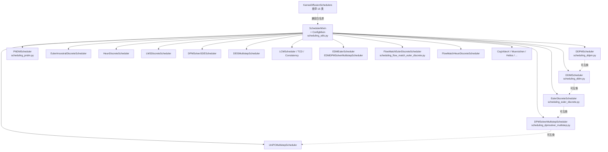
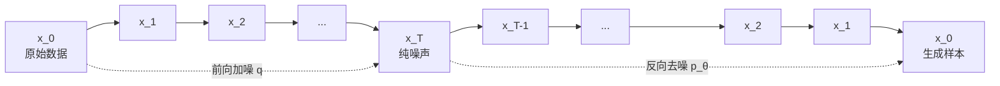
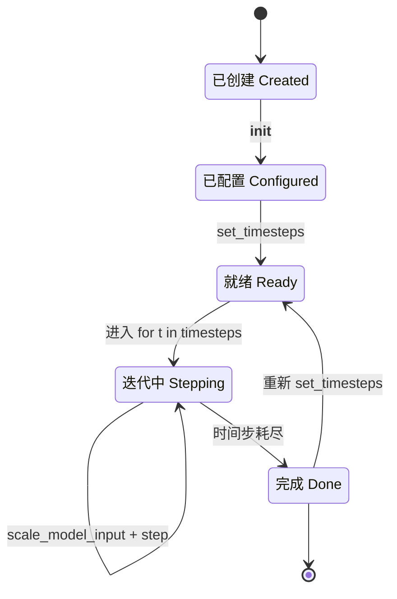
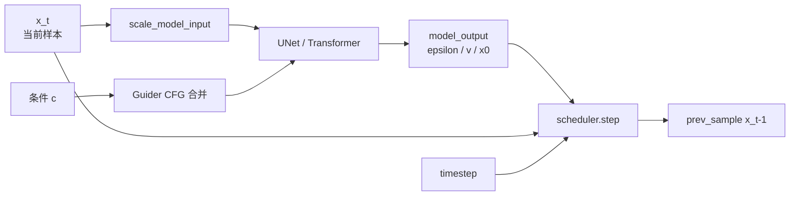
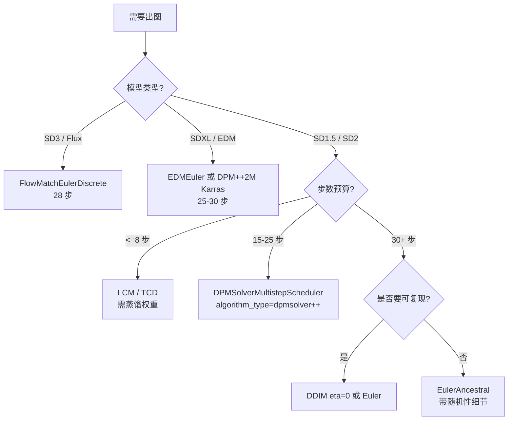

# 08 调度器 - Schedulers

> 基于 diffusers 0.39.0.dev0 版本

调度器（Scheduler）是扩散模型推理链路上最关键也最"数学化"的组件之一。它既决定了训练时的噪声如何注入（前向过程），也决定了推理时如何把一张纯噪声图逐步"雕刻"成图像（反向过程）。同一个 UNet/Transformer 主干，换一个调度器，往往就能在质量与速度之间走出截然不同的折中。本文以 `src/diffusers/schedulers/` 目录为蓝本，按"总—分—总"展开：先勾勒家族全景与统一接口，再逐一剖析 DDPM、DDIM、Euler Discrete、DPM-Solver Multistep、Flow Match Euler 五个代表实现，最后给出使用指南、实战案例与选型矩阵。

---

## 1. 总起：模块概览

### 1.1 调度器在扩散过程中的角色

扩散模型的核心方程是一条从数据 $x_0$ 到噪声 $x_T$ 的马尔可夫链（前向），以及一条从 $x_T$ 回到 $x_0$ 的逆向去噪链。调度器承担两件事：

1. **定义噪声调度（noise / beta schedule）**：给定训练步数 `num_train_timesteps`（通常 1000），生成一组 $\beta_1, \dots, \beta_T$，进而得到 $\alpha_t = 1-\beta_t$ 与累积乘积 $\bar{\alpha}_t = \prod_{s\le t}\alpha_s$。$\bar{\alpha}_t$ 决定了第 $t$ 步前向加噪时信号与噪声的比例。
2. **定义反向去噪步骤（step）**：给定模型在 $x_t$ 上的输出（噪声 $\epsilon$、样本 $x_0$、速度 $v$ 或流 velocity 之一），按某种数值格式计算 $x_{t-1}$。这里既有解析式（DDPM、DDIM、Euler），也有高阶 ODE/SDE 求解器（DPM-Solver、UniPC、Heun、LMS）。

简言之，调度器管的是"**如何去噪**"——给一帧带噪样本与模型预测，输出下一帧更干净的样本。

### 1.2 与引导器（guiders）的区别

Diffusers 0.39 起把无分类器引导（CFG）等逻辑抽离到独立的 `guiders` 模块。两者分工明确：

- **调度器**：在 *单条* 噪声轨道上推进时间步，关心的是数学格式（DDPM 解析式 / Euler ODE / DPM-Solver 高阶）。
- **引导器**：决定模型输出的 *方向*，例如 CFG 把条件与无条件两路预测按 `guidance_scale` 线性组合后再交给调度器 `step`。

也就是说，引导器在 *模型输出空间* 做加权，调度器在 *样本空间* 做时间推进。引导器的产物（合并后的 `model_output`）就是调度器 `step` 的入参。

### 1.3 家族全景

`src/diffusers/schedulers/` 目录下共 57 个 `.py` 文件（不含 `__init__.py` 与 README），可归为以下几族：

| 族 | 代表文件 | 特点 |
| --- | --- | --- |
| 经典离散马尔可夫 | `scheduling_ddpm.py` | 随机性最强，1000 步原生训练 |
| 非马尔可夫确定性 | `scheduling_ddim.py`、`scheduling_ddim_inverse.py` | DDIM $\eta=0$ 确定性采样 |
| ODE 一阶（Karras 系） | `scheduling_euler_discrete.py`、`scheduling_euler_ancestral_discrete.py`、`scheduling_heun_discrete.py`、`scheduling_lms_discrete.py`、`scheduling_k_dpm_2_*` | 工作在 $\sigma$ 空间，可换 Karras/exponential/beta sigmas |
| 高阶 ODE | `scheduling_dpmsolver_multistep.py`、`scheduling_dpmsolver_singlestep.py`、`scheduling_dpmsolver_sde.py`、`scheduling_unipc_multistep.py`、`scheduling_deis_multistep.py` | 一/二/三阶，少步数高质量 |
| PNDM | `scheduling_pndm.py`、`scheduling_ipndm.py` | 早期为 SD 设计的多步预测-校正 |
| Flow Matching | `scheduling_flow_match_euler_discrete.py`、`scheduling_flow_match_heun_discrete.py`、`scheduling_flow_match_lcm.py`、`scheduling_flow_map_euler_discrete.py` | SD3、Flux 主力，$\sigma$ 从 1 线性到 0 |
| 蒸馏/一致性 | `scheduling_lcm.py`、`scheduling_tcd.py`、`scheduling_consistency_models.py`、`scheduling_consistency_decoder.py`、`scheduling_scm.py` | 1–4 步极速 |
| EDM | `scheduling_edm_euler.py`、`scheduling_edm_dpmsolver_multistep.py`、`scheduling_karras_ve.py` | Karras 2022 论文统一预处理 |
| 视频/专用 | `scheduling_ddim_cogvideox.py`、`scheduling_dpm_cogvideox.py`、`scheduling_ddpm_wuerstchen.py`、`scheduling_ltx_euler_ancestral_rf.py`、`scheduling_block_refinement.py`、`scheduling_helios*.py`、`scheduling_amused.py`、`scheduling_unclip.py`、`scheduling_vq_diffusion.py`、`scheduling_repaint.py`、`scheduling_sasolver.py`、`scheduling_entropy_bound.py`、`scheduling_discrete_ddim.py` | 面向特定模型或任务 |
| Flax 版本 | `*_flax.py` | JAX 后端镜像实现 |
| deprecated | `scheduling_sde_vp.py`、`scheduling_karras_ve_flax.py` | 旧路径，保留兼容 |

枚举 `KarrasDiffusionSchedulers`（见 `scheduling_utils.py` 第 33–48 行）正式收录了 15 类"Karras 系"调度器，是 pipeline 在做兼容性检查时的白名单。

### 1.4 设计理念

调度器子系统的两条核心设计原则贯穿全部实现：

- **可互换（interchangeable）**：同一个 pipeline 实例可以在加载后通过 `pipe.scheduler = ...` 替换为任意同族调度器，模型权重无需改动。这得益于 `_compatibles` 列表（`scheduling_utils.py` 第 91 行）与 `from_config` 机制——只要配置参数兼容，`DDIMScheduler.from_config(ddpm_scheduler.config)` 就能无缝迁移。
- **统一接口（unified protocol）**：所有调度器都实现五个核心方法——`set_timesteps`、`step`、`scale_model_input`、`add_noise`，并暴露 `init_noise_sigma`、`timesteps` 属性。pipeline 主循环因此可以写成与具体调度器无关的形态。

调度器是**无状态可重建**的：它不持有模型权重，所有运行时状态（`self.timesteps`、`self.sigmas`、`self._step_index`、`self.model_outputs`）都可通过 `set_timesteps` 重置。这也是它能被序列化为一个 JSON 配置文件（`scheduler_config.json`）的原因。

### 1.5 调度器家族架构图

**图 8-1：调度器家族架构与继承关系**



图 8-1 说明：所有调度器都混入 `SchedulerMixin` 与 `ConfigMixin`，前者提供 `from_pretrained`/`save_pretrained`/`compatibles`，后者提供配置持久化与 `register_to_config`。虚线箭头表示通过 `from_config` 可在运行时互换，无需重训。`KarrasDiffusionSchedulers` 枚举为兼容性白名单。

---

## 2. 分述：核心实现

### 2.1 SchedulerMixin 基类

[`scheduling_utils.py`](file:///workspace/src/diffusers/schedulers/scheduling_utils.py) 是整个子系统的根。它定义了三个关键资产：

**`SchedulerMixin` 类**（第 74–189 行）继承 `PushToHubMixin`，提供：

- `from_pretrained(pretrained_model_name_or_path, subfolder=None, **kwargs)`（第 94–153 行）：先调用 `load_config` 从本地或 Hub 读取 `scheduler_config.json`，再交给 `from_config` 重建实例。`subfolder` 默认就是 `"scheduler"`，与 pipeline 的目录结构对齐。
- `save_pretrained(save_directory, push_to_hub=False, **kwargs)`（第 155–170 行）：仅保存配置 JSON，不涉及权重，体积极小。
- `compatibles` 属性 / `_get_compatibles()`（第 172–189 行）：返回 `_compatibles` 列表里实际可导入的调度器类。`_compatibles = [e.name for e in KarrasDiffusionSchedulers]` 这一行（出现在几乎每个调度器顶部）让每个 Karras 系调度器都能列出其余 14 个作为可替换项。

**`SchedulerOutput` dataclass**（第 60–71 行）：所有 `step` 方法的统一返回类型，至少含一个 `prev_sample` 字段。子类（如 `DDPMSchedulerOutput`）会扩展 `pred_original_sample` 用于调试或可视化。

**`KarrasDiffusionSchedulers` 枚举**（第 33–48 行）：把 15 个核心调度器名固化为枚举值。把它做成 `Enum` 而非 `Union` 是有意为之——文档渲染更清晰，且能在 `_compatibles` 内部循环引用时避免导入环。

文件里还预置了 `AysSchedules` 字典（第 51–57 行），收录了 SD1.5/SDXL/SDV 的"Alignment-Your-Step"最优时间步序列，可通过 `timesteps=` 参数直接喂给 `set_timesteps` 获得少步数下的最佳质量。

### 2.2 通用协议

无论数学形式如何，每个调度器都实现以下协议（方法签名以 DDPM/Euler 为准）：

| 方法 / 属性 | 作用 | 调用时机 |
| --- | --- | --- |
| `set_timesteps(num_inference_steps, device=None, timesteps=None, sigmas=None)` | 生成推理时间步序列 `self.timesteps` 与（如适用）`self.sigmas`，重置 `self._step_index` | 推理循环前一次 |
| `scale_model_input(sample, timestep)` | 把样本缩放到模型期望的输入尺度 | 每步 `unet` 调用前 |
| `step(model_output, timestep, sample, ...)` | 核心：根据模型输出与当前样本算 `prev_sample` | 每步 `unet` 调用后 |
| `add_noise(original_samples, noise, timesteps)` | 前向加噪 $x_t=\sqrt{\bar\alpha_t}x_0+\sqrt{1-\bar\alpha_t}\epsilon$ | 训练、img2img、调试 |
| `init_noise_sigma` 属性 | 初始噪声的标准差，pipeline 用它缩放 `latents = randn * init_noise_sigma` | 推理起始 |
| `timesteps` 属性 | 推理循环 `for t in scheduler.timesteps` 的迭代源 | 推理主循环 |
| `order` 类属性 | 单次 `step` 实际推进多少个时间步（multistep 调度器>1） | pipeline 决定去重逻辑 |

`scale_model_input` 的存在是为了 Sigma 系调度器：Euler 等需要把输入除以 $\sqrt{\sigma^2+1}$ 才能匹配模型训练时的输入分布；DDPM/DDIM 则直接 `return sample`，是个 no-op。

### 2.3 DDPMScheduler 详解

源码：[`scheduling_ddpm.py`](file:///workspace/src/diffusers/schedulers/scheduling_ddpm.py)，类 `DDPMScheduler`（第 137 行起）。

**`__init__` 关键参数**（第 186–211 行）：

- `num_train_timesteps=1000`：训练时间步数。
- `beta_start=0.0001`、`beta_end=0.02`：线性与 scaled_linear 调度的端点。
- `beta_schedule="linear"`：可选 `"linear"` / `"scaled_linear"` / `"squaredcos_cap_v2"` / `"sigmoid"` / `"laplace"`。`scaled_linear`（即 $\beta$ 取 $\sqrt{\beta}$ 的线性插值再平方）是 SD1.x/SD2 的默认，对潜空间更友好。
- `variance_type="fixed_small"`：反向采样的方差取法，决定随机性强度；`"learned"` / `"learned_range"` 用于模型同时输出方差的情形（如 Imagen）。
- `clip_sample=True`：把预测的 $x_0$ 截断到 $[-1,1]$ 提升数值稳定性。
- `prediction_type="epsilon"`：模型预测什么；`"v_prediction"` 走速度参数化。
- `timestep_spacing="leading"`：时间步取整策略，对应"Common Diffusion Noise Schedules are Flawed"论文表 2。
- `rescale_betas_zero_snr=False`：是否把 $\beta$ 重缩放到零终端 SNR。

`__init__` 主体（第 212–255 行）先按 `beta_schedule` 构造 `self.betas`，再算 `self.alphas = 1 - betas`、`self.alphas_cumprod = cumprod(alphas)`，并把 `init_noise_sigma = 1.0`。`alphas_cumprod` 是后续所有公式的基础查找表。

**`step` 方法**（第 461–567 行）是 DDPM 的灵魂，对应论文 (Ho et al. 2020) 公式 (7)。流程：

1. 取 `alpha_prod_t = alphas_cumprod[t]`，`alpha_prod_t_prev = alphas_cumprod[prev_t] if prev_t>=0 else 1.0`，并算出 `current_beta_t = 1 - alpha_prod_t/alpha_prod_t_prev`。
2. 由 `prediction_type` 还原 $x_0$。以 `epsilon` 为例（第 512–513 行）：
   $$\hat{x}_0 = \frac{x_t - \sqrt{1-\bar\alpha_t}\,\epsilon_\theta}{\sqrt{\bar\alpha_t}}$$
3. 可选地 `clip_sample` 或 `_threshold_sample`（动态阈值，Imagen 的做法）。
4. 计算均值系数（第 534–535 行）：
   $$\hat{x}_{t-1} = \underbrace{\frac{\sqrt{\bar\alpha_{t-1}}\,\beta_t}{1-\bar\alpha_t}}_{\text{coef of }x_0}\,\hat{x}_0 + \underbrace{\frac{\sqrt{\alpha_t}\,(1-\bar\alpha_{t-1})}{1-\bar\alpha_t}}_{\text{coef of }x_t}\,x_t$$
5. 当 $t>0$ 时加方差：`variance = sqrt(_get_variance(t)) * randn`，其中 `_get_variance`（第 348–416 行）实现 $\sigma_t^2 = \frac{1-\bar\alpha_{t-1}}{1-\bar\alpha_t}\beta_t$。

DDPM 是**完全随机**的——同样的初始噪声，不同的随机数生成器会得到不同的图。这也意味着它需要 ~1000 步才能收敛。

**`add_noise`**（第 569–609 行）实现前向闭式解 $x_t=\sqrt{\bar\alpha_t}x_0+\sqrt{1-\bar\alpha_t}\epsilon$，训练和 img2img 起点都用它。

### 2.4 DDIMScheduler 详解

源码：[`scheduling_ddim.py`](file:///workspace/src/diffusers/schedulers/scheduling_ddim.py)，类 `DDIMScheduler`（第 139 行起）。

DDIM（Song et al. 2020）的关键观察：DDPM 的前向马尔可夫链可以等价地用一组**非马尔可夫**的反向过程替代，且这条新链允许确定性采样。`__init__` 多了一个 `set_alpha_to_one=True`（第 202 行）——决定终点 $t=0$ 处的 $\bar\alpha_{-1}$ 取 1 还是 $\bar\alpha_0$，影响最后一步的系数。

**`step` 方法**（第 384–514 行）的核心是 $\eta$（eta）参数：

- `eta=0`（默认）：完全确定性，等价于 ODE 积分，同一噪声同一结果。
- `eta=1`：等价于 DDPM 的随机采样。
- 中间值：在两者间插值。

公式（对应论文公式 12、16）：

1. `prev_timestep = timestep - num_train_timesteps // num_inference_steps`（第 445 行）。
2. 还原 $\hat{x}_0$（与 DDPM 相同）。
3. `variance = _get_variance(timestep, prev_timestep)`（第 480 行）；`std_dev_t = eta * sqrt(variance)`。
4. 计算"指向 $x_t$ 的方向"（第 488 行）：
   $$\text{dir}_t = \sqrt{1-\bar\alpha_{t-1}-\sigma_t^2}\,\epsilon_\theta$$
5. 拼出 $x_{t-1}$（第 491 行）：
   $$x_{t-1} = \sqrt{\bar\alpha_{t-1}}\,\hat{x}_0 + \text{dir}_t$$
6. 若 `eta>0`，再加 `std_dev_t * variance_noise`。

DDIM 的意义在于把 DDPM 的 1000 步压缩到 20–50 步且几乎不损质量，是早期 SD 部署的主力。

### 2.5 EulerDiscreteScheduler 详解

源码：[`scheduling_euler_discrete.py`](file:///workspace/src/diffusers/schedulers/scheduling_euler_discrete.py)，类 `EulerDiscreteScheduler`（第 143 行起）。这是当前最常用的"快速调度器"。

它不再用 $\bar\alpha$ 而改用 **$\sigma$ 参数化**（Karras 2022 EDM 框架），$\sigma_t = \sqrt{(1-\bar\alpha_t)/\bar\alpha_t}$，并在 `__init__`（第 253 行）把 sigmas 翻转拼接一个 0 终点：`self.sigmas = torch.cat([sigmas, torch.zeros(1)])`。

`set_timesteps`（第 350 行起）支持四种 sigma 策略：

- 默认 `interpolation_type="linear"`：从训练 sigmas 插值。
- `use_karras_sigmas=True`：调用 `_convert_to_karras`（第 520–556 行），按 $\sigma_i=(\sigma_{\max}^{1/\rho}+ramp\cdot(\sigma_{\min}^{1/\rho}-\sigma_{\max}^{1/\rho}))^\rho$、$\rho=7$ 重排，使中段步长更密、端点更稀，少步数质量显著提升。
- `use_exponential_sigmas`、`use_beta_sigmas`：另两种非线性排布。

`scale_model_input`（第 326–348 行）实现 EDM 的输入归一化：
$$x \leftarrow \frac{x}{\sqrt{\sigma^2+1}}$$

**`step` 方法**（第 685–800 行）是欧拉法 ODE 积分：

1. 取 `sigma = sigmas[step_index]`，可选 `s_churn` 引入随机扰动 `sigma_hat = sigma*(1+gamma)` 并加噪 `sample += eps*sqrt(sigma_hat^2 - sigma^2)`（第 755–764 行）。这是 Karras 论文里的 churn 技巧，能在少步数下加入受控随机性。
2. 由 `prediction_type` 还原 $\hat{x}_0$。`epsilon` 时（第 772 行）：
   $$\hat{x}_0 = x_t - \sigma\,\epsilon_\theta$$
   `v_prediction` 时（第 775 行）：$\hat{x}_0 = \frac{x_t - \sigma v}{\sigma^2+1}$ 的变形。
3. 算 ODE 导数（第 782 行）：`derivative = (sample - pred_original_sample) / sigma_hat`。
4. 欧拉推进（第 784–786 行）：
   $$x_{t-1} = x_t + \text{derivative}\cdot(\sigma_{t+1} - \sigma_t)$$

整条公式就是 $\frac{dx}{d\sigma}=(x-\hat{x}_0)/\sigma$ 的一阶显式欧拉积分。简洁、稳定、20–30 步即可出图。

### 2.6 DPMSolverMultistepScheduler 详解

源码：[`scheduling_dpmsolver_multistep.py`](file:///workspace/src/diffusers/schedulers/scheduling_dpmsolver_multistep.py)，类 `DPMSolverMultistepScheduler`（第 123 行起）。这是高阶 ODE 求解器的代表，20 步质量优于 Euler，10 步仍可用。

关键 `__init__` 参数：

- `solver_order=2`：1/2/3 阶。引导采样推荐 2 阶，无条件采样可用 3 阶。
- `algorithm_type="dpmsolver++"`：可选 `"dpmsolver"` / `"dpmsolver++"` / `"sde-dpmsolver"` / `"sde-dpmsolver++"`。`++` 变体在 $x_0$ 参数化下推导，对 CFG 友好，是 SD 系列默认。
- `solver_type="midpoint"`：二阶求解的中点法 / Heun 法。
- `lower_order_final=True`：最后一步降到一阶以稳定数值。
- `euler_at_final=False`：最后一步改用 Euler。
- `use_karras_sigmas` / `use_lu_lambdas` / `use_flow_sigmas`：sigma 重排选项。

`step`（第 1190–1275 行）的核心思路是 **multistep**：维护长度为 `solver_order` 的环形缓冲 `self.model_outputs`（第 337 行 `self.model_outputs = [None]*solver_order`），每步把新输出推入队尾、旧输出前移（第 1243–1245 行），再按阶数选择更新公式：

- 1 阶 / 降阶情况：`dpm_solver_first_order_update`（第 844–916 行）。以 `dpmsolver++` 为例：
  $$x_t = \frac{\sigma_t}{\sigma_s}x_s - \alpha_t(e^{-h}-1)\cdot\hat{x}_0$$
  其中 $h=\lambda_t-\lambda_s$，$\lambda=\log\alpha-\log\sigma$。这等价于 DDIM。
- 2 阶：`multistep_dpm_solver_second_order_update`（第 918 行起）用 `D0=当前输出`、`D1=(D0-上一步输出)/h` 两个"导数"做中点/Heun 校正（第 990–991 行的 `dpmsolver++` midpoint 公式）：
  $$x_t = \frac{\sigma_t}{\sigma_{s_0}}e^{-h}x_{s_0} + \alpha_t(1-e^{-2h})D_0 + \tfrac{1}{2}\alpha_t(1-e^{-2h})D_1 + \text{noise}$$
- 3 阶：`multistep_dpm_solver_third_order_update`（第 1041 行起）用三阶历史。

`convert_model_output`（第 746 行起）负责把模型原始输出统一转换成 $\hat{x}_0$ 或 $\epsilon$（依 `algorithm_type`），是 multistep 流程的预处理。`lower_order_nums` 计数器在前几步逐步升阶，避免冷启动用高阶公式。

DPM-Solver 的意义：**用同样数量的模型调用拿到更高的有效阶数**——10 步 2 阶 DPM-Solver++ 的质量约等于 30 步 Euler。

### 2.7 FlowMatchEulerDiscreteScheduler 详解

源码：[`scheduling_flow_match_euler_discrete.py`](file:///workspace/src/diffusers/schedulers/scheduling_flow_match_euler_discrete.py)，类 `FlowMatchEulerDiscreteScheduler`（第 48 行起）。SD3、Flux 用的是 Flow Matching 范式，与 DDPM 的离散马尔可夫链不同。

Flow Matching 把生成过程视作从噪声分布 $x_1\sim\mathcal{N}(0,I)$ 到数据 $x_0$ 的一条连续流，模型直接预测速度 $v_\theta$，前向过程是线性插值：
$$x_t = (1-t)x_0 + t\,\epsilon,\quad t\in[0,1]$$

`__init__`（第 91–144 行）：

- `num_train_timesteps=1000`，timesteps 从 1000 线性到 1。
- `shift=1.0`：时间步重映射 `sigma = shift*sigma/(1+(shift-1)*sigma)`（第 133 行）。Flux 用动态 shift（`use_dynamic_shifting=True`），按图像分辨率序列长度在 `base_shift=0.5` 与 `max_shift=1.15` 之间插值。
- sigmas 直接等于 `timesteps / num_train_timesteps`，**从 1 线性到 0**——这是 Flow Matching 与 DDPM 在数值上最直观的差异。

`scale_noise`（第 188–236 行，前向加噪）实现 $x_t = \sigma\epsilon + (1-\sigma)x_0$，是 Flow Matching 的前向公式。

**`step` 方法**（第 426–525 行）异常简洁：

1. `sigma = sigmas[step_index]`、`sigma_next = sigmas[step_index+1]`、`dt = sigma_next - sigma`（第 501–507 行）。注意符号：sigma_next < sigma，所以 dt<0，沿"反向时间"积分。
2. 默认情况（第 514 行）就是一行欧拉积分：
   $$x_{t-1} = x_t + dt\cdot v_\theta(x_t, t)$$
3. 若 `stochastic_sampling=True`（第 509–512 行）则切换到 SDE 形式：先算 $x_0 = x_t - \sigma v$，再加噪 $x_{t-1}=(1-\sigma_{\text{next}})x_0 + \sigma_{\text{next}}\epsilon$。

`per_token_timesteps`（第 489–499 行）支持逐 token 时间步，用于 Diffusers 的 token 级注意力细化。`set_shift`、`set_begin_index` 等方法支持 pipeline 在推理前动态调整。

由于 Flow Matching 的 ODE 比 DDPM 的 SDE 数值上更"良性"，Flux 在 28 步、SD3 在 28 步即可出高质量图，配合 `shift` 还能在不同分辨率间迁移。

### 2.8 DDPM/DDIM 原理图

**图 8-2：扩散前向加噪与反向去噪链**



图 8-2 说明：上半部分为前向过程 $q(x_t|x_{t-1})$，由 `add_noise` 闭式计算；下半部分为反向过程 $p_\theta(x_{t-1}|x_t)$，由 `step` 迭代。DDPM 反向带随机性，DDIM 在 $\eta=0$ 时退化为确定性 ODE。

### 2.9 调度器状态转换图

**图 8-3：调度器在推理循环中的状态流转**



图 8-3 说明：调度器生命周期为 `__init__ → set_timesteps → 循环调用 step → 结束`。`set_timesteps` 可被反复调用以重置状态（如 batch 内不同步数）。`scale_model_input` 必须在 `step` 前调用，Euler 系调度器会通过 `is_scale_input_called` 标志发出警告。

### 2.10 数据流图

**图 8-4：单步去噪的数据流**



图 8-4 说明：模型输出经引导器合并后，连同当前样本与时间步一起进入 `scheduler.step`，输出 `prev_sample` 作为下一轮输入。整个 pipeline 的去噪主循环就是这条链路的反复执行。

---

## 3. 使用指南

### 3.1 API 速查

```python
from diffusers import DDPMScheduler, DDIMScheduler, EulerDiscreteScheduler

# 1. 构造（或从模型仓库加载）
scheduler = DDPMScheduler(num_train_timesteps=1000, beta_schedule="scaled_linear")
scheduler = DDIMScheduler.from_pretrained("runwayml/stable-diffusion-v1-5", subfolder="scheduler")

# 2. 配置推理步数
scheduler.set_timesteps(30, device="cuda")

# 3. 关键属性
scheduler.timesteps          # 推理时间步序列
scheduler.init_noise_sigma   # 初始噪声缩放因子
scheduler.config             # 训练时的全部配置 (DictConfig)

# 4. 主循环三件套
sample = sample * scheduler.init_noise_sigma
for t in scheduler.timesteps:
    scaled = scheduler.scale_model_input(sample, t)
    model_output = unet(scaled, t, encoder_hidden_states=...).sample
    sample = scheduler.step(model_output, t, sample).prev_sample
```

### 3.2 最小示例：手动 add_noise + step

```python
import torch
from diffusers import DDPMScheduler

scheduler = DDPMScheduler(num_train_timesteps=1000, beta_schedule="linear")
scheduler.set_timesteps(1000)

x0 = torch.randn(1, 3, 32, 32)            # 假装这是真实图像
noise = torch.randn_like(x0)
t = torch.tensor([500])                    # 加噪到第 500 步
xt = scheduler.add_noise(x0, noise, t)     # 前向加噪

# 假装模型预测出了真正的噪声
for t in scheduler.timesteps[:5]:          # 仅演示前 5 步
    eps_pred = noise                       # 实际应是 unet(xt, t).sample
    out = scheduler.step(eps_pred, t, xt)
    xt = out.prev_sample
    print(out.pred_original_sample.shape)  # 顺便拿到 x0 预测
```

### 3.3 在 pipeline 中替换 scheduler

```python
from diffusers import StableDiffusionPipeline, EulerDiscreteScheduler

pipe = StableDiffusionPipeline.from_pretrained("runwayml/stable-diffusion-v1-5")

# 直接换实例
pipe.scheduler = EulerDiscreteScheduler.from_config(
    pipe.scheduler.config, use_karras_sigmas=True
)
# 或用兼容性列表自动选择
print([c.__name__ for c in pipe.scheduler.compatibles])
```

`from_config` 会用旧调度器的 JSON 配置去实例化新类，缺失字段用新类默认值填补，多余字段保留——这正是 1.4 节"可互换"原则的落地。

---

## 4. 实战案例

### 4.1 案例 1：同一模型用 DDIM / Euler / DPM-Solver 对比

```python
import torch
from diffusers import StableDiffusionPipeline, DDIMScheduler, EulerDiscreteScheduler, DPMSolverMultistepScheduler

pipe = StableDiffusionPipeline.from_pretrained("runwayml/stable-diffusion-v1-5", torch_dtype=torch.float16).to("cuda")
prompt = "a cinematic photo of a fox in snow"

for name, Sch, kwargs, steps in [
    ("DDIM",     DDIMScheduler,                {"timestep_spacing": "trailing"}, 30),
    ("Euler-K",  EulerDiscreteScheduler,       {"use_karras_sigmas": True},      30),
    ("DPM++2M",  DPMSolverMultistepScheduler,  {"solver_order": 2, "algorithm_type": "dpmsolver++"}, 20),
]:
    pipe.scheduler = Sch.from_config(pipe.scheduler.config, **kwargs)
    g = torch.Generator("cuda").manual_seed(42)
    img = pipe(prompt, num_inference_steps=steps, generator=g).images[0]
    img.save(f"compare_{name}.png")
```

经验结论：DPM++2M 在 20 步质量已稳定优于 DDIM 30 步；Euler-K 偏锐利；DDIM 偏柔和但可复现。同一 `seed` 下，DDIM 与 Euler-K（eta=0）完全确定性，DPM++2M 也确定性。

### 4.2 案例 2：手动实现去噪循环（脱离 pipeline）

```python
import torch
from diffusers import UNet2DConditionModel, AutoencoderKL, CLIPTokenizer, CLIPTextModel
from diffusers import EulerDiscreteScheduler

# 假设各组件已加载：unet, vae, text_encoder, tokenizer
scheduler = EulerDiscreteScheduler.from_pretrained("runwayml/stable-diffusion-v1-5", subfolder="scheduler")
scheduler.set_timesteps(30, device="cuda")

# 1. 文本编码
tokens = tokenizer(["a photo of a cat"], padding="max_length", max_length=77, return_tensors="pt").to("cuda")
with torch.no_grad():
    emb = text_encoder(tokens.input_ids).last_hidden_state

# 2. 初始噪声 latent
latents = torch.randn((1, 4, 64, 64), device="cuda", dtype=torch.float16) * scheduler.init_noise_sigma

# 3. 去噪主循环
for t in scheduler.timesteps:
    scaled = scheduler.scale_model_input(latents, t)
    with torch.no_grad():
        eps = unet(scaled, t, encoder_hidden_states=emb).sample
    latents = scheduler.step(eps, t, latents).prev_sample

# 4. 解码回像素
image = vae.decode(latents / vae.config.scaling_factor).sample
```

这套写法揭示了 pipeline 在背后做的事：它只是把"编码 → 初始化噪声 → 循环 scale_model_input / unet / step → VAE 解码"打包好。理解了这一层，就能自由插入 ControlNet、自定义引导器或多步预测校正。

---

## 5. 总结

### 5.1 要点回顾

- 调度器 = **噪声调度（前向）+ 去噪格式（反向）** 两个职责的统一封装。
- 全家族共享 `SchedulerMixin` / `ConfigMixin`，通过 `from_config` / `_compatibles` 实现**运行时可互换**。
- 五个代表实现覆盖了三种数学范式：
  - DDPM/DDIM：$\bar\alpha$ 参数化的离散马尔可夫/非马尔可夫链；
  - Euler/DPM-Solver：$\sigma$ 参数化的 ODE（Karras EDM 框架），Euler 一阶显式，DPM-Solver 高阶 multistep；
  - Flow Match Euler：$t\in[0,1]$ 线性流的欧拉积分，SD3/Flux 主力。
- 统一接口 `set_timesteps / step / scale_model_input / add_noise` 让 pipeline 主循环与具体调度器解耦。

### 5.2 调度器选型矩阵

| 调度器 | 推荐步数 | 质量 | 速度 | 确定性 | 适用场景 |
| --- | --- | --- | --- | --- | --- |
| DDPMScheduler | 1000+ | 高 | 慢 | 否 | 学术复现、训练 |
| DDIMScheduler ($\eta=0$) | 20–50 | 中 | 快 | 是 | 早期 SD、需可复现 |
| EulerDiscreteScheduler | 20–30 | 中高 | 很快 | 是（$\eta=0$） | 通用快速出图 |
| EulerAncestralDiscrete | 20–30 | 高（有细节） | 很快 | 否 | 偏好随机性、艺术化 |
| DPMSolverMultistepScheduler | 15–25 | 高 | 快 | 是 | SD1.5/SD2 默认 |
| UniPCMultistepScheduler | 15–25 | 高 | 快 | 是 | 与 DPM-Solver 互为备选 |
| FlowMatchEulerDiscrete | 28 | 高 | 快 | 是 | SD3、Flux |
| LCMScheduler | 4–8 | 中 | 极快 | 否 | 蒸馏模型、实时 |
| EDMEulerScheduler | 30 | 高 | 快 | 是 | SDXL、EDM 训练的模型 |

**图 8-5：调度器选型决策图**



图 8-5 说明：先按模型范式分流（Flow Matching vs DDPM 系），再按步数预算与确定性需求选具体类。Karras sigmas 在少步数时普遍优于线性。

### 5.3 与 guiders / pipeline 的关系

调度器并非孤立存在，它在 pipeline 中与三个伙伴协作：

1. **引导器（guiders）**：CFG / PG / AppBar 等，把条件与无条件两路模型输出合并成单路 `model_output` 后才交给调度器。0.39 起这部分逻辑从 pipeline 内联代码迁移到独立 `guiders` 模块，调度器接口不变。
2. **主模型（UNet/Transformer）**：调度器只调用它的 `forward` 拿 `model_output`，不关心内部结构。
3. **pipeline**：负责调度器与上述组件的编排，以及 VAE 编解码、文本编码、scheduler 的加载/替换。pipeline 主循环的伪代码就是 2.10 节那张数据流图。

这种分层让"换调度器"成为一行代码的操作，也让"换引导器""换主干"彼此正交。理解了调度器，就理解了扩散推理链路上最数学化、也最影响最终质量与速度的那一环。
