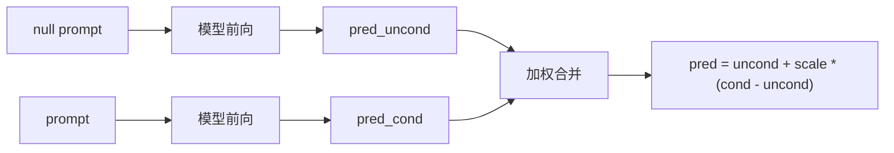
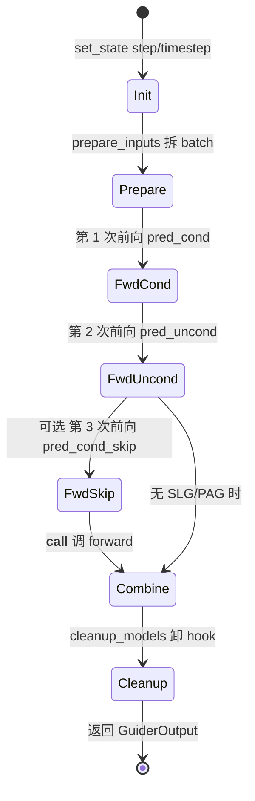
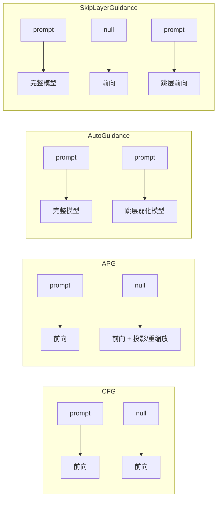

# 09 引导器 - Guiders

> 基于 diffusers 0.39.0.dev0 版本

引导器（Guider）是 diffusers 在 0.39.x 引入的实验性模块，它把"如何在每一步去噪后融合条件信息"从 pipeline 中抽离出来，形成一族可插拔的对象。本章按"总—分—总"结构剖析这一家族，重点讨论 [BaseGuidance](file:///workspace/src/diffusers/guiders/guider_utils.py) 协议、[ClassifierFreeGuidance](file:///workspace/src/diffusers/guiders/classifier_free_guidance.py) 的实现细节，以及 [AdaptiveProjectedGuidance](file:///workspace/src/diffusers/guiders/adaptive_projected_guidance.py)、[AutoGuidance](file:///workspace/src/diffusers/guiders/auto_guidance.py)、[SkipLayerGuidance](file:///workspace/src/diffusers/guiders/skip_layer_guidance.py) 三种进阶策略，最后给出使用指南与实战案例。

> 注：任务描述里提到的 `guiders_base.py` / `callbackwise_guidance.py` / `apg_guidance.py` 在当前版本中分别对应 `guider_utils.py` / `classifier_free_guidance.py` / `adaptive_projected_guidance.py`。同时，"APG"在代码里是 Adaptive Projected Guidance，而非 Attention Perturbation Guidance——后者对应 `PerturbedAttentionGuidance`（PAG）。本章按代码实际命名展开。

---

## 1. 总起：模块概览

### 1.1 引导器（Guidance）的角色

扩散模型的去噪过程本质是在分数函数上做积分，每一步给出 `noise_pred`（或 `x_pred`、`v_pred`）。但模型同时被训练在"有条件"与"无条件"两种分布上，因此每一步还需要决定：**用多大力度把无条件分布拉向条件分布**。这一决策就是 Guidance 的工作——它直接控制了"生成质量 vs. 多样性"的权衡。

- Guidance 强（scale 大）：图像更贴合 prompt、细节更锐利，但容易过曝、模式塌缩；
- Guidance 弱（scale 接近 1.0）：多样性高，但 prompt 相关性弱、画面可能发糊。

### 1.2 与调度器的区别

调度器（Scheduler，见第 8 章）解决的是"如何去噪"——给定当前 `sample` 与 `noise_pred`，按何种数值格式迭代到下一个 timestep；它决定的是**积分路径的几何形状**。引导器（Guider）解决的是"生成方向"——在拿到模型的原始输出后，如何把 conditional 与 unconditional（或扰动版本）合并；它决定的是**每一步实际喂给 scheduler 的那个 `noise_pred` 是什么**。

二者正交：你可以把同一个 Scheduler 配上 CFG、APG 或 SLG，得到的去噪轨迹完全不同。pipeline 的每一步通常是：先跑前向得到若干预测 → 交给 guider 合并 → 把合并后的预测交给 scheduler 走一步。

### 1.3 家族全景

[src/diffusers/guiders/](file:///workspace/src/diffusers/guiders/) 目录共 13 个文件，导出 11 个引导器类（外加 `BaseGuidance`、`GuiderOutput`、`rescale_noise_cfg` 等工具）：

| 文件 | 类 | 缩写 | 论文 / 出处 |
| --- | --- | --- | --- |
| [guider_utils.py](file:///workspace/src/diffusers/guiders/guider_utils.py) | `BaseGuidance` | — | 基类协议 |
| [classifier_free_guidance.py](file:///workspace/src/diffusers/guiders/classifier_free_guidance.py) | `ClassifierFreeGuidance` | CFG | 2207.12598 |
| [classifier_free_zero_star_guidance.py](file:///workspace/src/diffusers/guiders/classifier_free_zero_star_guidance.py) | `ClassifierFreeZeroStarGuidance` | CFG-Zero* | 2503.18886 |
| [tangential_classifier_free_guidance.py](file:///workspace/src/diffusers/guiders/tangential_classifier_free_guidance.py) | `TangentialClassifierFreeGuidance` | TCFG | 2503.18137 |
| [adaptive_projected_guidance.py](file:///workspace/src/diffusers/guiders/adaptive_projected_guidance.py) | `AdaptiveProjectedGuidance` | APG | 2410.02416 |
| [adaptive_projected_guidance_mix.py](file:///workspace/src/diffusers/guiders/adaptive_projected_guidance_mix.py) | `AdaptiveProjectedMixGuidance` | APG+CFG | HunyuanImage 2.1 |
| [frequency_decoupled_guidance.py](file:///workspace/src/diffusers/guiders/frequency_decoupled_guidance.py) | `FrequencyDecoupledGuidance` | FDG | 频域解耦 |
| [magnitude_aware_guidance.py](file:///workspace/src/diffusers/guiders/magnitude_aware_guidance.py) | `MagnitudeAwareGuidance` | MAMBO-G | 2508.03442 |
| [perturbed_attention_guidance.py](file:///workspace/src/diffusers/guiders/perturbed_attention_guidance.py) | `PerturbedAttentionGuidance` | PAG | 2403.17377 |
| [skip_layer_guidance.py](file:///workspace/src/diffusers/guiders/skip_layer_guidance.py) | `SkipLayerGuidance` | SLG | SD3.5 |
| [smoothed_energy_guidance.py](file:///workspace/src/diffusers/guiders/smoothed_energy_guidance.py) | `SmoothedEnergyGuidance` | SEG | 2408.00760 |
| [auto_guidance.py](file:///workspace/src/diffusers/guiders/auto_guidance.py) | `AutoGuidance` | AutoG | 2406.02507 |

### 1.4 设计理念：可插拔，与 pipeline 解耦

所有引导器继承自 `BaseGuidance`，并通过统一接口与 pipeline 交互：

- `prepare_inputs` / `prepare_inputs_from_block_state`：把 conditional/unconditional batch 切分出来，告诉 pipeline"接下来要跑几次前向"；
- `prepare_models` / `cleanup_models`：在多次前向之间临时挂/卸载 hook（如 SLG、PAG、AutoG 都靠 `LayerSkipConfig` + HookRegistry 实现"扰动一次模型"）；
- `__call__`：收集所有 `noise_pred`，调 `forward` 完成"加权合并"，返回 `GuiderOutput(pred, pred_cond, pred_uncond)`。

这种切分让 pipeline 不再写死 `noise_pred = uncond + scale * (cond - uncond)`，而是直接 `guider(...)`. 同一份 pipeline 代码可以无缝切换 CFG、APG、SLG——这正是 HunyuanImage 等新管线直接在构造函数里接收 `guider` 参数的原因。

### 1.5 引导器家族架构图

**图 9-1：引导器家族继承关系**

```mermaid
flowchart TD
    Base["BaseGuidance<br/>guider_utils.py"]
    CFG["ClassifierFreeGuidance<br/>CFG"]
    CFGZ["ClassifierFreeZeroStarGuidance<br/>CFG-Zero*"]
    TCFG["TangentialClassifierFreeGuidance<br/>TCFG"]
    APG["AdaptiveProjectedGuidance<br/>APG"]
    APGMix["AdaptiveProjectedMixGuidance<br/>APG+CFG"]
    FDG["FrequencyDecoupledGuidance<br/>FDG"]
    MAG["MagnitudeAwareGuidance<br/>MAMBO-G"]
    PAG["PerturbedAttentionGuidance<br/>PAG"]
    SLG["SkipLayerGuidance<br/>SLG"]
    SEG["SmoothedEnergyGuidance<br/>SEG"]
    AutoG["AutoGuidance<br/>AutoG"]

    Base --> CFG
    Base --> CFGZ
    Base --> TCFG
    Base --> APG
    Base --> APGMix
    Base --> FDG
    Base --> MAG
    Base --> PAG
    Base --> SLG
    Base --> SEG
    Base --> AutoG
```



图 9-1 说明：`BaseGuidance` 是唯一基类，11 个子类全部直接继承它，没有中间层。这种"扁平继承树"反映了引导策略之间多是"并列方案"而非"层层派生"的关系——它们解决的都是"如何合并多次前向预测"这同一件事，只是 baseline（无条件的对照样本）选取方式不同。

---

## 2. 分述：核心实现

### 2.1 Guider 基类协议（guider_utils.py）

[BaseGuidance](file:///workspace/src/diffusers/guiders/guider_utils.py) 同时继承 `ConfigMixin` 与 `PushToHubMixin`，因此每个 guider 都自带 `from_pretrained` / `save_pretrained` / `from_config` 能力，可以像 scheduler 一样以 JSON 形式持久化。其核心协议如下：

- `__init__(start, stop, enabled)`：所有引导器都有 `[start, stop)` 的"启用区间"（按总步数比例），以及总开关 `enabled`。基类校验 `0 <= start < stop <= 1`，并要求子类提供 `_input_predictions`（一个字符串列表，声明 forward 需要哪些预测，如 `["pred_cond", "pred_uncond"]`）。
- `set_state(step, num_inference_steps, timestep)`：pipeline 在每个去噪步前调用，把当前进度写入 guider，作为"是否在启用区间内"的判据。
- `prepare_inputs(data) -> list[BlockState]`：根据 `num_conditions` 把 batch 拆成 N 份，每份打上 `__guidance_identifier__` 标签（如 `"pred_cond"` / `"pred_uncond"`）。
- `prepare_models(denoiser)` / `cleanup_models(denoiser)`：默认仅自增 `_count_prepared` 计数器；子类可重写为挂/卸 hook。
- `__call__(data)`：检查每份 data 的 `noise_pred` 齐全，再按 identifier 调 `forward(...)`。
- `forward(...)`：抽象，由子类实现真正的合并公式。
- `is_conditional` / `num_conditions`：抽象属性。`is_conditional` 通常基于 `_count_prepared` 判断当前是第几次前向（conditional 总是第 1 次）。

注意一个细节：`__call__` 里通过 `getattr(d, self._identifier_key)` 取出每份 batch 的标签，再以关键字参数传给 `forward`。这就是为什么 `_input_predictions = ["pred_cond", "pred_uncond"]` 与 `forward(self, pred_cond, pred_uncond)` 的形参名必须严格一致——它是一种"反射式命名约定"。

### 2.2 CFG 详解（classifier_free_guidance.py）

[ClassifierFreeGuidance](file:///workspace/src/diffusers/guiders/classifier_free_guidance.py) 是最基础、最常用的引导器，论文 [2207.12598](https://huggingface.co/papers/2207.12598)。它声明 `_input_predictions = ["pred_cond", "pred_uncond"]`，需要 pipeline 跑两次前向：一次带 prompt、一次带 null prompt。

构造参数（节选）：

- `guidance_scale: float = 7.5`：CFG 强度，典型范围 1.0–20.0；`scale==1.0` 时等价于关闭。
- `guidance_rescale: float = 0.0`：来自 [2305.08891](https://huggingface.co/papers/2305.08891) 的"方差重缩放"，防止高 scale 时过曝。
- `use_original_formulation: bool = False`：切换两种公式。
- `start` / `stop` / `enabled`：从基类继承的区间与开关。

`forward` 的核心只有 4 行（见 [classifier_free_guidance.py:114-127](file:///workspace/src/diffusers/guiders/classifier_free_guidance.py)）：

```python
if not self._is_cfg_enabled():
    pred = pred_cond
else:
    shift = pred_cond - pred_uncond
    pred = pred_cond if self.use_original_formulation else pred_uncond
    pred = pred + self.guidance_scale * shift
```

它支持两种等价公式：

1. **原论文公式**（`use_original_formulation=True`）：`pred = pred_cond + scale * (pred_cond - pred_uncond)`，把条件预测推得"更远离"无条件预测；
2. **diffusers 默认（Imagen 风格）**：`pred = pred_uncond + scale * (pred_cond - pred_uncond)`，把无条件预测"拉向"条件预测，更直观地抑制"低质量、水印"等负向特征。

`_is_cfg_enabled()` 会综合判断：是否在 `[start, stop)` 区间内、`scale` 是否接近 1.0（默认公式）或 0.0（原公式）——任何一个不满足就降级为"只跑 conditional"，`num_conditions` 也随之变为 1，从而节省一次前向。

### 2.3 APG 详解（adaptive_projected_guidance.py）

[AdaptiveProjectedGuidance](file:///workspace/src/diffusers/guiders/adaptive_projected_guidance.py) 论文 [2410.02416](https://huggingface.co/papers/2410.02416)。APG 不改变 baseline 来源（仍是 cond + uncond 两次前向），但用"投影 + 自适应重缩放"替换了 CFG 的纯线性外推：

- `adaptive_projected_guidance_rescale: float = 15.0`：把 CFG 方向的更新按 `norm(pred_cond)` 重缩放，避免过度外推；
- `adaptive_projected_guidance_momentum: float | None`：可选动量缓冲 `MomentumBuffer`，平滑跨步的更新方向；
- `adaptive_projected_guidance_norm_dim`：指定计算范数的维度（默认所有非 batch 维）；
- `eta: float = 1.0`：与重缩放配合的混合系数。

`forward` 把计算委托给模块内函数 `normalized_guidance(...)`，后者会先把 `pred_cond - pred_uncond` 投影到与 `pred_cond` 平行/正交的两个分量，再分别施加 rescale 与 momentum。`AdaptiveProjectedMixGuidance`（[adaptive_projected_guidance_mix.py](file:///workspace/src/diffusers/guiders/adaptive_projected_guidance_mix.py)）是 APG+CFG 的混合体，被 HunyuanImage 2.1 用作默认 guider。

> 任务描述里提到的 "Attention Perturbation Guidance" 实际对应 `PerturbedAttentionGuidance`（PAG，[perturbed_attention_guidance.py](file:///workspace/src/diffusers/guiders/perturbed_attention_guidance.py)）。PAG 通过 hook 把选定 transformer 层的 attention scores 替换为 identity 矩阵，得到一个"自身更糟"的 baseline `pred_cond_skip`，然后做 CFG 风格的外推。其实现复用了 SLG 的代码骨架（多处 `# Copied from ... skip_layer_guidance`）。

### 2.4 Auto Guidance 详解（auto_guidance.py）

[AutoGuidance](file:///workspace/src/diffusers/guiders/auto_guidance.py) 论文 [2406.02507](https://huggingface.co/papers/2406.02507) "Guiding a Diffusion Model with a Bad Version of Itself"。它的核心思路：**不需要真正的 null prompt**，而是用"同一个模型跳过若干层后的输出"当作 baseline。

构造时必须提供 `auto_guidance_layers` 或 `auto_guidance_config`（`LayerSkipConfig` 列表）。在 `prepare_models` 中，当 `is_unconditional` 为真（即第 2 次前向）时，给 denoiser 挂上 `_apply_layer_skip_hook`；`cleanup_models` 负责卸载。这样第二次前向就变成"被跳层削弱的模型"，但仍接收真实的 prompt。`forward` 用与 CFG 完全相同的公式合并 `pred_cond` 与 `pred_uncond`——区别只在于 `pred_uncond` 的语义不再是"无条件"，而是"弱化模型下的条件"。

### 2.5 Skip Layer Guidance 详解（skip_layer_guidance.py）

[SkipLayerGuidance](file:///workspace/src/diffusers/guiders/skip_layer_guidance.py) 由 StabilityAI 在 SD3.5 中提出，旨在改善结构与解剖一致性。它在 CFG 之外**额外**引入第三次前向：跳过指定 transformer 层的 conditional 预测 `pred_cond_skip`，于是 `_input_predictions = ["pred_cond", "pred_uncond", "pred_cond_skip"]`。

关键参数（推荐值面向 SD3.5 Medium）：

- `skip_layer_guidance_scale: float = 2.8`：扰动分量的强度；
- `skip_layer_guidance_start / stop: 0.01 / 0.2`：仅在去噪早期一小段窗口启用 SLG；
- `skip_layer_guidance_layers`：如 `[7, 8, 9]`。

`forward` 会按 CFG/SLG 各自是否启用，组合出 4 个分支（见 [skip_layer_guidance.py:208-235](file:///workspace/src/diffusers/guiders/skip_layer_guidance.py)）。两者同时启用时的合并公式为：

```
pred = pred_uncond
     + guidance_scale * (pred_cond - pred_uncond)
     + skip_layer_guidance_scale * (pred_cond - pred_cond_skip)
```

PAG 的 forward 与之同构，只是 `pred_cond_skip` 的来源从"跳层"变成"扰动 attention scores"。SLG/PAG 还各自实现 `_is_cfg_enabled` / `_is_slg_enabled`，并支持"两者都关→只跑一次前向"的降级。

### 2.6 CFG 原理图

**图 9-2：CFG 数据流**



图 9-2 说明：null prompt 与真实 prompt 各跑一次前向，得到 `pred_uncond` 与 `pred_cond`；guider 的 `forward` 把二者按 `scale` 线性外推，输出最终交给 scheduler 的预测。`scale=1` 时退化为 `pred_cond` 本身，等价于关闭引导。

### 2.7 引导器状态图

**图 9-3：单步去噪中 guider 的生命周期**



图 9-3 说明：每一步去噪前 pipeline 先 `set_state` 同步进度；`prepare_inputs` 决定要跑几次前向（1/2/3 次，由 `num_conditions` 决定）；多次前向之间通过 `prepare_models` 临时改变模型（挂 hook）；最后 `__call__` 调 `forward` 完成合并，并在 `cleanup_models` 中卸载 hook，回到干净状态等待下一步。

### 2.8 引导策略对比图

**图 9-4：四种引导策略的 baseline 来源对比**



图 9-4 说明：CFG 与 APG 的 baseline 都是"null prompt 前向"，差别仅在合并公式（线性 vs. 投影+rescale）；AutoGuidance 把 baseline 换成"跳层后的弱模型"，仍带真实 prompt；SLG 则把"跳层弱模型"作为**第三路**前向叠加在 CFG 之上，所以最贵但信息最丰富。PAG 与 SLG 同构，只是"弱化"的方式从跳层变为扰动 attention scores。

---

## 3. 使用指南

### 3.1 API 速查

引导器是普通 Python 对象，可直接构造后传给支持 guider 的 pipeline：

```python
from diffusers import ClassifierFreeGuidance, FluxPipeline

guider = ClassifierFreeGuidance(guidance_scale=3.5)
pipe = FluxPipeline.from_pretrained("black-forest-labs/FLUX.1-dev")
# 把 guider 注入 pipeline（具体参数名以 pipeline 签名为准）
```

部分新版 pipeline（如 [HunyuanImagePipeline](file:///workspace/src/diffusers/pipelines/hunyuan_image/pipeline_hunyuanimage.py)）已在 `__init__` 中暴露 `guider` 形参，构造时直接传入即可；老式 pipeline 仍保留 `guidance_scale` 标量参数。可用方法：

- `guider.set_state(step, num_inference_steps, timestep)`：由 pipeline 自动调用，一般不手动调；
- `guider.enable()` / `guider.disable()`：运行时开关；
- `guider.new(**kwargs)`：基于当前配置复制一个新实例并覆盖部分参数；
- `guider.save_pretrained(dir)` / `BaseGuidance.from_pretrained(dir)`：持久化配置。

### 3.2 最小示例：Flux + CFG

```python
import torch
from diffusers import FluxPipeline, ClassifierFreeGuidance

pipe = FluxPipeline.from_pretrained("black-forest-labs/FLUX.1-dev", torch_dtype=torch.bfloat16).to("cuda")

# 调整 guidance_scale：增大→更贴合 prompt，但易过曝
guider = ClassifierFreeGuidance(
    guidance_scale=3.5,
    guidance_rescale=0.0,        # 出现过曝时调到 0.3~0.7
    start=0.0, stop=1.0,         # 全程启用
)
pipe.set_guider(guider)  # 若 pipeline 提供 setter；否则在构造时传入

image = pipe(prompt="a serene mountain lake at dawn", num_inference_steps=28).images[0]
image.save("lake.png")
```

### 3.3 常用参数

| 参数 | 含义 | 典型值 |
| --- | --- | --- |
| `guidance_scale` | CFG 主强度 | 1.0–20.0（Flux 常用 3.5；SD 常用 7.5） |
| `guidance_rescale` | 方差重缩放，防过曝 | 0.0–1.0 |
| `start` / `stop` | 启用区间（步数比例） | 0.0 / 1.0 |
| `enabled` | 总开关 | True |
| `use_original_formulation` | 用原论文公式（scale=0 关闭） | False |
| `skip_layer_guidance_scale` (SLG/PAG) | 扰动分量强度 | 2.8 |
| `skip_layer_guidance_layers` (SLG/PAG/AutoG) | 要跳/扰动的层号 | SD3.5: [7,8,9] |
| `adaptive_projected_guidance_rescale` (APG) | 投影后重缩放系数 | 15.0 |
| `alpha` (MAMBO-G) | magnitude 抑制强度 | 8.0 |

---

## 4. 实战案例

### 4.1 案例 1：Flux + APG 提升生成质量

```python
import torch
from diffusers import FluxPipeline, AdaptiveProjectedGuidance

pipe = FluxPipeline.from_pretrained("black-forest-labs/FLUX.1-dev", torch_dtype=torch.bfloat16).to("cuda")

guider = AdaptiveProjectedGuidance(
    guidance_scale=4.0,
    adaptive_projected_guidance_rescale=15.0,
    adaptive_projected_guidance_momentum=0.5,   # 启用动量平滑
    eta=1.0,
)
pipe.set_guider(guider)

image = pipe(
    prompt="a portrait of an old fisherman, ultra detailed, rim light",
    num_inference_steps=28,
).images[0]
```

要点：APG 在高 `guidance_scale` 下比纯 CFG 更稳定，不易过曝；`rescale` 越大越保守，可从默认 15.0 开始微调；启用 momentum 可让相邻步的更新方向更一致，常用于减少纹理闪烁。

### 4.2 案例 2：Skip Layer Guidance 风格控制

```python
import torch
from diffusers import FluxPipeline, SkipLayerGuidance

pipe = FluxPipeline.from_pretrained("black-forest-labs/FLUX.1-dev", torch_dtype=torch.bfloat16).to("cuda")

guider = SkipLayerGuidance(
    guidance_scale=3.5,                  # 主 CFG
    skip_layer_guidance_scale=2.8,       # SLG 强度
    skip_layer_guidance_layers=[7, 8, 9],
    skip_layer_guidance_start=0.01,
    skip_layer_guidance_stop=0.2,        # 仅在前 20% 步数启用
)
pipe.set_guider(guider)

image = pipe(
    prompt="a futuristic city skyline, cyberpunk, highly detailed",
    num_inference_steps=28,
).images[0]
```

要点：SLG 只在去噪早期生效（结构决定阶段），后期关闭以免影响细节；调高 `skip_layer_guidance_scale` 会强化结构与解剖一致性，但过高会发糊；层号需匹配所用的 transformer 索引方式，迁移到非 Flux 模型时建议先用 `auto` fqn 探测。

---

## 5. 总结

### 5.1 要点回顾

引导器是 diffusers 中"**生成方向控制器**"：它不参与积分路径的设计（那是 scheduler 的职责），只在每一步把多次前向预测合并成一个最终 `noise_pred`。`BaseGuidance` 通过 `_input_predictions`、`prepare_inputs`、`prepare_models`、`forward` 这套协议把"合并"与"前向编排"解耦，使 11 种策略共用同一套 pipeline 集成代码。

### 5.2 引导策略对比表

| 策略 | 前向次数 | baseline 来源 | 主要收益 | 速度 | 控制力 |
| --- | --- | --- | --- | --- | --- |
| CFG | 2 | null prompt | prompt 相关性、通用质量 | 中 | 中 |
| CFG-Zero* | 2 | null prompt（前几步置零） | 减少早期步误差 | 中 | 中 |
| TCFG | 2 | null prompt（切向分量） | 改善多样性 | 中 | 中 |
| APG | 2 | null prompt（投影+rescale） | 高 scale 下更稳定 | 中 | 中高 |
| APG+CFG Mix | 2 | null prompt | APG + CFG 混合 | 中 | 高 |
| MAMBO-G | 2 | null prompt（magnitude 自适应） | 自适应抑制大更新 | 中 | 中高 |
| FDG | 2 | 频域解耦 | 频段独立控制 | 中 | 高 |
| AutoGuidance | 2 | 跳层弱模型（仍带 prompt） | 无需 null，保留 prompt 信息 | 中 | 中 |
| SLG | 3 | 跳层弱模型作第三路 | 结构/解剖一致性 | 慢 | 高 |
| PAG | 3 | 扰动 attention 的弱模型 | 视觉结构质量 | 慢 | 高 |
| SEG | 1–2 | 平滑能量注意力 | 模型自身引导，免 null | 快-中 | 中 |

### 5.3 与 pipeline / scheduler / model 的关系

- **vs. pipeline**：pipeline 编排"前向几次、何时调 guider、何时调 scheduler"，guider 编排"这些前向结果如何合并"。新管线（HunyuanImage、Flux2 modular、Wan、LTX 等）已在构造函数直接接收 `guider`，老管线则把 `guidance_scale` 标量升级成可选的 `guider` 对象。
- **vs. scheduler**：scheduler 拿到 guider 合并后的 `noise_pred`，按既定数值格式（DDIM、Euler、DPM-Solver 等）走一步。二者完全正交。
- **vs. model**：guider 通过 `prepare_models` / `cleanup_models` 临时改变模型行为（挂 `LayerSkipConfig` hook、`SmoothedEnergyGuidanceConfig` hook 等），用完即卸，对模型本身无侵入。

最后提醒：模块顶部 `BaseGuidance.__init__` 会打印 "experimental feature ... API is subject to breaking changes" 警告，0.39.x 版本中 API 仍可能调整，请勿在生产环境硬编码参数签名。
