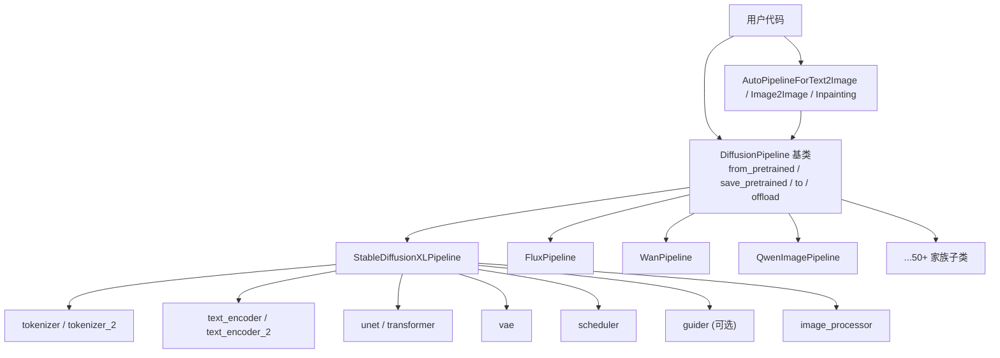
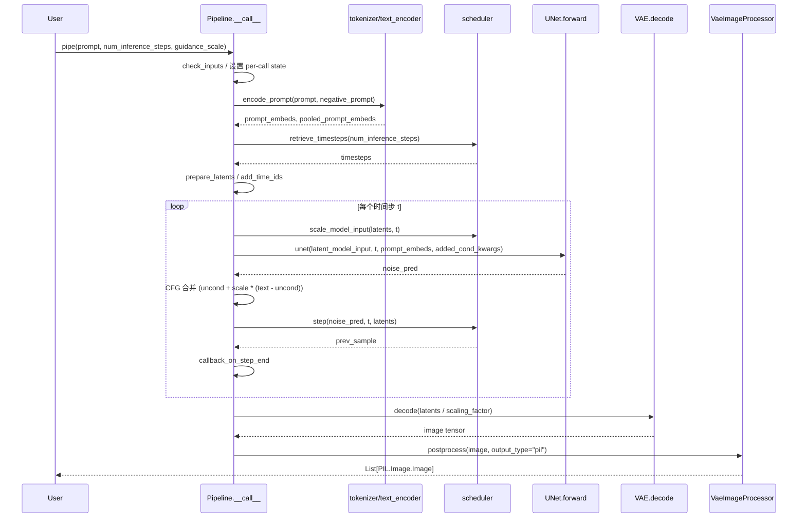
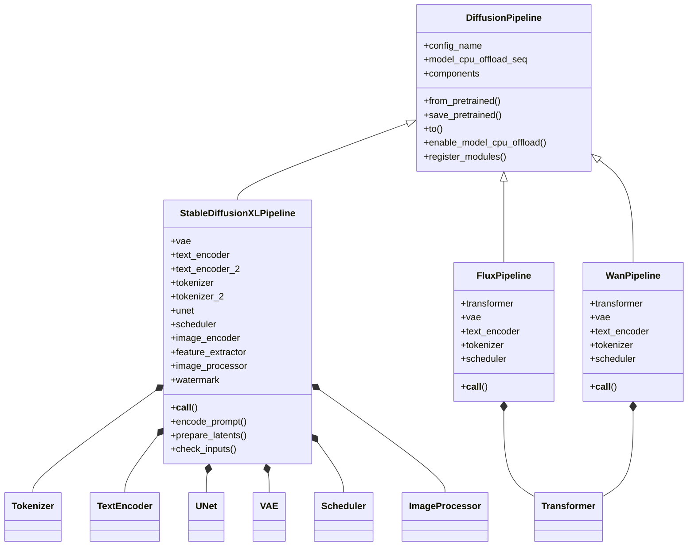
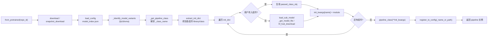
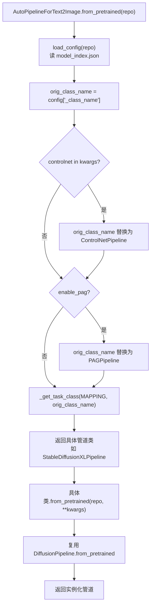

# 10 管道层 - DiffusionPipeline

> 基于 diffusers 0.39.0.dev0 版本

## 1. 总起：模块概览

### 1.1 DiffusionPipeline 是用户主入口

在 diffusers 的分层架构中，`DiffusionPipeline` 是面向用户的"总编排者"。它本身不实现任何扩散数学，而是把 tokenizer、text_encoder、unet/transformer、vae、scheduler、guider、image_processor 等独立组件按固定生命周期串联成一条完整推理流水线：文本编码 → 时间步准备 → latent 初始化 → 去噪循环 → VAE 解码 → 后处理。用户只需要 `pipe(prompt)` 一行调用即可得到图像，无需关心各组件之间的张量形状、dtype、device 对齐。

基类 [DiffusionPipeline](file:///workspace/src/diffusers/pipelines/pipeline_utils.py) 同时承担三大职责：

1. **加载与保存**：通过 `from_pretrained` / `save_pretrained` 把一个 HuggingFace Hub 仓库（含 `model_index.json` 与各子组件 subfolder）一键实例化为完整管道，反之亦可。
2. **设备/精度管理**：`to` / `enable_model_cpu_offload` / `enable_sequential_cpu_offload` / `enable_group_offload` 等方法统一调度所有子模块的 device 与 dtype。
3. **优化开关**：`enable_xformers_memory_efficient_attention`、`enable_attention_slicing`、`enable_vae_slicing`/`enable_vae_tiling`、`enable_freeu`、`fuse_qkv_projections` 等优化能力全部由基类提供，子类只关心 `__call__` 的具体流程。

### 1.2 家族全景

`src/diffusers/pipelines/` 顶层包含 50+ 个模型家族目录，每个家族下又分文生图（text2image）、图生图（img2img）、inpainting、controlnet、video 等多种变体。从 [LS /workspace/src/diffusers/pipelines](file:///workspace/src/diffusers/pipelines) 列举可见，覆盖范围极广：

- **图像**：`stable_diffusion` / `stable_diffusion_xl` / `stable_diffusion_3` / `flux` / `flux2` / `cogview3` / `cogview4` / `qwenimage` / `kolors` / `hunyuan_image` / `aura_flow` / `pixart_alpha` / `sana` / `lumina` / `lumina2` / `chroma` / `z_image` / `glm_image` / `helios` / `ideogram4` / `krea2` / `prx` / `longcat_image` / `ovis_image` / `bria` / `ernie_image` / `hidream_image` / `nucleusmoe_image` / `joyimage` / `lucy` / `diffusion_gemma` 等。
- **视频**：`cogvideo` / `wan` / `hunyuan_video` / `hunyuan_video1_5` / `ltx` / `ltx2` / `sana_video` / `mochi` / `latte` / `motif_video` / `skyreels_v2` / `cosmos` / `easyanimate` / `animatediff` / `stable_video_diffusion` / `chronoedit` 等。
- **音频**：`stable_audio` / `audioldm2` / `longcat_audio_dit` 等。
- **多模态/编辑**：`omnigen` / `visualcloze` / `dreamlite` / `anyflow` / `deepfloyd_if` / `kandinsky*` 等。
- **专用任务**：`marigold`（深度/法线/光照）、`shap_e`（3D）、`dit` / `ddpm` / `ddim`（学术基线）、`consistency_models` / `latent_consistency_models`（蒸馏）。
- **控制类**：`controlnet` / `controlnet_hunyuandit` / `controlnet_sd3` / `t2i_adapter` / `pag`（PAG 自引导）。
- **已弃用**：`deprecated/` 下保留 `alt_diffusion`、`wuerstchen`、`vq_diffusion`、`unclip`、`versatile_diffusion` 等历史实现。

每个家族目录通常遵循 [.ai/pipelines.md](file:///workspace/.ai/pipelines.md) 约定的文件结构：`__init__.py` 懒加载、`pipeline_<model>.py` 主管道、`pipeline_<model>_<variant>.py` 变体管道（img2img / inpaint / control 各占一个文件一个类）、`pipeline_output.py` 输出 dataclass、`image_processor.py` 可选的家族专属图像处理器。

### 1.3 `__call__` 标准形态

[.ai/pipelines.md](file:///workspace/.ai/pipelines.md) 第 10 行明确提出 diffusers 管道的"标准形态"：

> input validation → encode prompt → timesteps → latent prep → denoise loop → decode — `encode_prompt` / `prepare_latents` shape, `output_type` / `generator` / `progress_bar` plumbing, `@torch.no_grad()` on `__call__`

具体到代码层面，标准管道的 `__call__` 几乎都是同构的 9~12 步流程：参数 `check_inputs` → `encode_prompt` → `retrieve_timesteps` → `prepare_latents` → `prepare_extra_step_kwargs` → 构造 `added_cond_kwargs` → `with self.progress_bar(...)` 去噪循环（CFG 拼接 → `unet.forward` → CFG 合并 → `scheduler.step` → callback）→ VAE decode → `image_processor.postprocess` → `maybe_free_model_hooks` → 返回 `PipelineOutput`。SDXL 是该模板最典型的代表，下文 2.4 将逐步拆解。

### 1.4 管道层架构图

**图 10-1：管道层总体架构**



图 10-1 说明：用户既可直接调用具体家族子类（`StableDiffusionXLPipeline.from_pretrained(...)`），也可通过 `AutoPipelineForXxx` 由仓库的 `_class_name` 自动路由到对应子类。所有家族子类都继承自 `DiffusionPipeline` 基类，并按需组合 tokenizer / text_encoder / unet 或 transformer / vae / scheduler / guider / image_processor 等组件。基类提供加载、保存、device/dtype、优化开关等通用能力，子类只覆写 `__call__` 与 `check_inputs` / `encode_prompt` / `prepare_latents` 等生命周期方法。

## 2. 分述：核心实现

### 2.1 DiffusionPipeline 基类详解

`DiffusionPipeline` 定义于 [pipeline_utils.py](file:///workspace/src/diffusers/pipelines/pipeline_utils.py)，继承自 `ConfigMixin` 与 `PushToHubMixin`（见第 185 行）。关键类属性包括 `config_name = "model_index.json"`、`model_cpu_offload_seq = None`（子类覆盖，例如 SDXL 设为 `"text_encoder->text_encoder_2->image_encoder->unet->vae"`）、`_optional_components = []`、`_exclude_from_cpu_offload = []`。

#### register_modules 与 `__setattr__`

子类的 `__init__` 通过 `self.register_modules(vae=vae, unet=unet, ...)` 注册组件（[第 211 行](file:///workspace/src/diffusers/pipelines/pipeline_utils.py)）。该方法对每个组件调用 `_fetch_class_library_tuple(module)` 解析出 `(library, class_name)` 元组，先 `register_to_config` 写入 `model_index.json` 配置，再 `setattr(self, name, module)` 设为实例属性。配合重写的 `__setattr__`（[第 226 行](file:///workspace/src/diffusers/pipelines/pipeline_utils.py)），后续替换组件（如 `pipe.scheduler = new_scheduler`）会自动同步更新 config 中的类信息，从而保证 `save_pretrained` 时配置一致性。

#### from_pretrained

`from_pretrained` 是基类最复杂的方法，长达 500+ 行（[第 619 行](file:///workspace/src/diffusers/pipelines/pipeline_utils.py)），其主线流程为：

1. **下载/定位权重目录**（第 852~880 行）：若 `pretrained_model_name_or_path` 不是本地目录则调用 `cls.download(...)`（最终走 `snapshot_download`），支持 DDUF 单文件、`variant`、`use_safetensors`、`use_onnx`、`trust_remote_code` 等选项。
2. **读取 config_dict**：`cls.load_config(cached_folder, dduf_entries=...)` 解析 `model_index.json`。
3. **识别 variant**：`_identify_model_variants` 检查每个 subfolder 是否包含 `fp16` / `ema` 等变体文件，构建 `model_variants` 映射。
4. **解析管道类**：`_resolve_custom_pipeline_and_cls` + `_get_pipeline_class` 决定要实例化的具体类（支持 `custom_pipeline`、`load_connected_pipeline`、trust_remote_code 动态加载）。
5. **抽取 init_dict**：`pipeline_class.extract_init_dict(config_dict, **kwargs)` 得到每个组件的 `(library_name, class_name)`，并区分 `expected_modules` / `optional_kwargs`。
6. **device_map 委托**：若传入 `device_map="balanced"`，调用 `_get_final_device_map` 计算每个组件的归属设备。
7. **逐组件加载**（第 1022~1090 行）：用 `logging.tqdm` 进度条遍历 `init_dict`，对每个 `(name, (library_name, class_name))` 调用 `load_sub_model`，并把结果填入 `init_kwargs[name]`。如果用户在 kwargs 中显式传入了组件实例（`passed_class_obj`），则跳过下载直接复用——这是 `from_pipe` 与组件复用的核心机制。
8. **connected pipelines**：若 `_load_connected_pipes` 为真（如 Stable Cascade、Wuerstchen），通过 `_update_init_kwargs_with_connected_pipeline` 解析 README modelcard 中声明的关联管道（如 prior / decoder）。
9. **类型校验与实例化**：对 `init_kwargs` 做轻量类型检查后 `model = pipeline_class(**init_kwargs)` 完成实例化，最后 `register_to_config(_name_or_path=...)` 记录来源。

#### save_pretrained

`save_pretrained`（[第 241 行](file:///workspace/src/diffusers/pipelines/pipeline_utils.py)）的思路与加载对称：从 `self.config` 提取 `model_index_dict`，剔除 `_class_name` / `_diffusers_version` 等元字段，遍历可保存组件，在 `LOADABLE_CLASSES` 中查表找到对应的 `save_method_name`（如 `ModelMixin` → `save_pretrained`），再按需注入 `safe_serialization` / `variant` / `max_shard_size` / `use_flashpack` / `save_peft_format` 等参数。最后 `self.save_config(save_directory)` 写入 `model_index.json`，并可选 `push_to_hub`。

#### to / cuda / half / float

`to`（[第 384 行](file:///workspace/src/diffusers/pipelines/pipeline_utils.py)）解析位置/关键字参数得到 `dtype` 与 `device`，对每个 `torch.nn.Module` 子组件调用 `module.to(...)`。它内部会检测三种异常情形并给出明确报错：管道已启用 device_map（应先 `reset_device_map()`）、管道已 sequential offload（不能 `.to('cuda')`）、使用了 bnb 量化但 accelerate 版本过低。`device` 属性（[第 588 行](file:///workspace/src/diffusers/pipelines/pipeline_utils.py)）则返回首个 `torch.nn.Module` 子组件的设备，作为管道的"当前设备"。

#### enable_model_cpu_offload / enable_sequential_cpu_offload

- `enable_model_cpu_offload`（[第 1190 行](file:///workspace/src/diffusers/pipelines/pipeline_utils.py)）：基于 `accelerate.cpu_offload_with_hook`，按 `self.model_cpu_offload_seq` 链式为每个模型挂上 hook，前一个模型 forward 完成后自动把下一个模型 onload、自身 offload。优点是性能损失小（UNet 反复迭代时不会反复搬运），缺点是显存占用比 sequential 高。链外的模型（如 controlnet）单独挂 hook，序列中 `_exclude_from_cpu_offload` 列出的模型直接 `to(device)` 常驻。
- `enable_sequential_cpu_offload`（[第 1308 行](file:///workspace/src/diffusers/pipelines/pipeline_utils.py)）：基于 `accelerate.cpu_offload`，在 leaf 级别挂 hook，每个子模块 forward 时才 onload。显存最省但同步开销大。
- 此外还有 `enable_group_offload`（[第 1375 行](file:///workspace/src/diffusers/pipelines/pipeline_utils.py)）：diffusers 自家的"分组 offload"，介于上述两者之间，按 `nn.ModuleList` 分组 onload/offload，并支持 `non_blocking` / `use_stream` 等优化。

#### enable_xformers_memory_efficient_attention / enable_attention_slicing / vae 优化

- `enable_xformers_memory_efficient_attention`（[第 1992 行](file:///workspace/src/diffusers/pipelines/pipeline_utils.py)）调用 `set_use_memory_efficient_attention_xformers(True, attention_op)`，递归遍历所有子模块，把实现了 `set_use_memory_efficient_attention_xformers` 的注意力模块切换到 xFormers 算子。
- `enable_attention_slicing`（[第 2047 行](file:///workspace/src/diffusers/pipelines/pipeline_utils.py)）通过 `set_attention_slice` 让注意力按 head 分批计算，用速度换显存。
- `enable_vae_slicing` / `enable_vae_tiling`（[第 2267、2293 行](file:///workspace/src/diffusers/pipelines/pipeline_utils.py)）在 0.39 中已**标记为 deprecated**，方法体直接转发到 `self.vae.enable_slicing()` / `self.vae.enable_tiling()`，并提示 0.40.0 之后改为直接调用 `pipe.vae.enable_slicing()`。
- `enable_freeu` / `disable_freeu` / `fuse_qkv_projections` 同样位于基类，统一对 `unet` 操作。

#### components 属性与 from_pipe

`components` 属性（[第 1925 行](file:///workspace/src/diffusers/pipelines/pipeline_utils.py)）返回 `expected_modules` 中所有非可选组件的字典，是不同任务管道之间共享权重的基础——`StableDiffusionImg2ImgPipeline(**text2img.components)` 即可零拷贝构造图生图管道。`from_pipe`（[第 2100 行](file:///workspace/src/diffusers/pipelines/pipeline_utils.py)）在此基础上支持跨任务转换（如 `AutoPipelineForText2Image.from_pipe(pipe_i2i)`），并通过 `_get_task_class` 做类名映射。

### 2.2 AutoPipeline 自动路由

[auto_pipeline.py](file:///workspace/src/diffusers/pipelines/auto_pipeline.py) 提供四个自动路由入口：`AutoPipelineForText2Image` / `AutoPipelineForImage2Image` / `AutoPipelineForInpainting` / `AutoPipelineForText2Audio`。它们都继承 `ConfigMixin`（注意：不是 `DiffusionPipeline`），且 `__init__` 直接抛 `EnvironmentError`，强制用户使用 `from_pretrained` 或 `from_pipe`。

路由的核心是模块级的 `OrderedDict`，例如 `AUTO_TEXT2IMAGE_PIPELINES_MAPPING`（[第 145 行](file:///workspace/src/diffusers/pipelines/auto_pipeline.py)）以 `_class_name`（如 `"stable-diffusion"`、`"stable-diffusion-xl"`、`"flux"`、`"qwenimage"`、`"z-image"`）为 key 映射到具体管道类。`from_pretrained` 的核心逻辑在 [第 498~534 行](file:///workspace/src/diffusers/pipelines/auto_pipeline.py)：

1. 用 `cls.load_config(pretrained_model_or_path, **load_config_kwargs)` 读 `model_index.json`；
2. 取出 `_class_name`，根据是否传入了 `controlnet` / `enable_pag` 改写类名（如 `StableDiffusionXLPipeline` → `StableDiffusionXLControlNetPipeline` 或 `StableDiffusionXLPAGPipeline`）；
3. `_get_task_class(AUTO_TEXT2IMAGE_PIPELINES_MAPPING, orig_class_name)`（[第 351 行](file:///workspace/src/diffusers/pipelines/auto_pipeline.py)）查表返回目标管道类；
4. `return text_2_image_cls.from_pretrained(pretrained_model_or_path, **kwargs)`，把实际加载委派给具体子类，从而复用基类的全套加载逻辑。

`from_pipe` 则不走磁盘，直接以源管道的 `config` 与 `components` 为输入，通过同样的 `_get_task_class` 找到目标类，再用 `**kwargs` 实例化（[第 537~650 行](file:///workspace/src/diffusers/pipelines/auto_pipeline.py)）。

### 2.3 pipeline_loading_utils.py

[pipeline_loading_utils.py](file:///workspace/src/diffusers/pipelines/pipeline_loading_utils.py) 是 `from_pretrained` 的"零件库"，提供类解析、variant 处理、subfolder 解析、单组件加载等工具：

- `LOADABLE_CLASSES`（[第 87 行](file:///workspace/src/diffusers/pipelines/pipeline_loading_utils.py)）声明 diffusers / transformers / onnxruntime 三类库各自的可加载基类及其 `save_pretrained` / `from_pretrained` 方法对，例如 `"ModelMixin"`、`"SchedulerMixin"`、`"DiffusionPipeline"`、`"BaseGuidance"`、`"PreTrainedTokenizer"`、`"PreTrainedModel"`、`"ImageProcessingMixin"` 等。`ALL_IMPORTABLE_CLASSES` 是它们的扁平合并。
- `load_sub_model`（[第 772 行](file:///workspace/src/diffusers/pipelines/pipeline_loading_utils.py)）是单组件加载的入口：通过 `get_class_obj_and_candidates` 在指定 library 中找到具体类与候选类，匹配 `LOADABLE_CLASSES` 中合适的 `from_pretrained` 方法，构造 `loading_kwargs`（含 `torch_dtype` / `variant` / `use_safetensors` / `device_map` / `low_cpu_mem_usage` / `quantization_config` 等），最终调用 `load_method(cached_folder, **loading_kwargs)`。注意 transformers ≥ 4.56.0 之后改用 `dtype` 关键字而非 `torch_dtype`，这里做了版本分支。
- `variant_compatible_siblings`（[第 230 行](file:///workspace/src/diffusers/pipelines/pipeline_loading_utils.py)）：用正则识别 `diffusion_pytorch_model.fp16.safetensors`、`model.fp16-00001-of-00002.safetensors`、`pytorch_model.bin.index.fp16.json` 等多种 variant 文件命名，并把仓库文件按组件分组、按 variant 优先匹配，非 variant 文件作 fallback。
- `_identify_model_variants`（[第 1002 行](file:///workspace/src/diffusers/pipelines/pipeline_loading_utils.py)）：扫描 `cached_folder` 下每个 subfolder，若存在 `*.fp16.*` 文件则把该 subfolder 加入 `model_variants`，从而支持"部分组件有 variant、部分没有"的混合加载。
- `is_safetensors_compatible`（[第 113 行](file:///workspace/src/diffusers/pipelines/pipeline_loading_utils.py)）：检查每个组件目录下是否都存在 safetensors 文件，决定是否默认走 safetensors 路径。
- `_get_pipeline_class`（[第 506 行](file:///workspace/src/diffusers/pipelines/pipeline_loading_utils.py)）：根据 `config_dict["_class_name"]`、`custom_pipeline`、`load_connected_pipeline` 决定要 import 哪个管道类，支持社区 pipeline 从 GitHub 拉取。
- 单文件级 `_get_model_file`：实际位于 [utils/hub_utils.py 第 228 行](file:///workspace/src/diffusers/utils/hub_utils.py)，统一处理 DDUF 内嵌文件、本地路径、本地 subfolder、Hub `hf_hub_download` 四种情形，并兼容 `revision='fp16'` 这种已弃用分支写法。

### 2.4 SDXL 管道 `__call__` 详解

[StableDiffusionXLPipeline](file:///workspace/src/diffusers/pipelines/stable_diffusion_xl/pipeline_stable_diffusion_xl.py) 是标准管道模板的典范。它继承 `DiffusionPipeline` + `StableDiffusionMixin` + `FromSingleFileMixin` + `StableDiffusionXLLoraLoaderMixin` + `TextualInversionLoaderMixin` + `IPAdapterMixin`（[第 170 行](file:///workspace/src/diffusers/pipelines/stable_diffusion_xl/pipeline_stable_diffusion_xl.py)）。类属性 `model_cpu_offload_seq = "text_encoder->text_encoder_2->image_encoder->unet->vae"` 指明 offload 链顺序，`_optional_components` 把 tokenizer / text_encoder / image_encoder / feature_extractor 等列为可选。

`__init__`（[第 239 行](file:///workspace/src/diffusers/pipelines/stable_diffusion_xl/pipeline_stable_diffusion_xl.py)）通过 `register_modules` 注册 vae、text_encoder、text_encoder_2、tokenizer、tokenizer_2、unet、scheduler、image_encoder、feature_extractor，并按 [.ai/pipelines.md](file:///workspace/.ai/pipelines.md) Gotcha #1 的约定把 `vae_scale_factor`、`default_sample_size`、`image_processor`、`watermark` 作为 `__init__` 实例属性设置（用 `getattr(self, "vae", None)` 兜底，避免 `from_pretrained` 在部分配置下 vae 未加载时崩溃）。

`__call__`（[第 823 行](file:///workspace/src/diffusers/pipelines/stable_diffusion_xl/pipeline_stable_diffusion_xl.py)）的完整流程：

1. **默认尺寸**（第 1030~1034 行）：`height` / `width` 默认为 `default_sample_size * vae_scale_factor`（通常 1024×1024），同步默认 `original_size` / `target_size` 用于 SDXL micro-conditioning。
2. **check_inputs**（第 1037 行，方法见 [第 610 行](file:///workspace/src/diffusers/pipelines/stable_diffusion_xl/pipeline_stable_diffusion_xl.py)）：校验 `height % 8 == 0`、`prompt` 与 `prompt_embeds` 互斥、`prompt_embeds` 与 `pooled_prompt_embeds` 必须成对、`ip_adapter_image` 与 `ip_adapter_image_embeds` 互斥、`callback_on_step_end_tensor_inputs` 必须在 `_callback_tensor_inputs` 内等。
3. **存入 per-call 状态**：`_guidance_scale` / `_guidance_rescale` / `_clip_skip` / `_cross_attention_kwargs` / `_denoising_end` / `_interrupt = False`。`do_classifier_free_guidance` 通过 `@property` 读取 `self._guidance_scale > 1` 推断，符合 pipelines.md 中"`@property` 用于 per-call 状态"的约定。
4. **encode_prompt**（第 1081 行，方法见 [第 283 行](file:///workspace/src/diffusers/pipelines/stable_diffusion_xl/pipeline_stable_diffusion_xl.py)）：SDXL 双 text encoder 路径。先按 LoRA scale 调整 `text_encoder` / `text_encoder_2`，再用 `[self.tokenizer, self.tokenizer_2]` 与 `[self.text_encoder, self.text_encoder_2]` 并行编码 prompt 与 negative prompt，把两路 hidden states 在 channel 维 concat 成 `prompt_embeds`，并从 `text_encoder_2` 取出 pooled embedding 作为 `pooled_prompt_embeds`。`do_classifier_free_guidance=True` 时把 negative 与 positive 在 batch 维拼接。
5. **retrieve_timesteps**（第 1103 行）：调用工具函数 `retrieve_timesteps(self.scheduler, num_inference_steps, device, timesteps, sigmas)`，支持自定义 `timesteps` / `sigmas` 列表。
6. **prepare_latents**（第 1109 行，方法见 [第 707 行](file:///workspace/src/diffusers/pipelines/stable_diffusion_xl/pipeline_stable_diffusion_xl.py)）：用 `randn_tensor` 采样 `(batch, 4, H/8, W/8)` 的初始噪声，乘 `scheduler.init_noise_sigma`。
7. **prepare_extra_step_kwargs**：从 generator 抽出 `eta` 等调度器额外参数。
8. **构造 added_cond_kwargs**（第 1124~1155 行）：`add_text_embeds = pooled_prompt_embeds`，`add_time_ids` 由 `_get_add_time_ids`（[第 729 行](file:///workspace/src/diffusers/pipelines/stable_diffusion_xl/pipeline_stable_diffusion_xl.py)）把 `original_size + crops_coords_top_left + target_size` 拼成 6 元组，校验维度匹配 `unet.add_embedding.linear_1.in_features`，再按 CFG 翻倍 batch。可选 `prepare_ip_adapter_image_embeds` 注入 IP-Adapter 图像嵌入。
9. **denoising_end 截断**（第 1170~1183 行）：若 `denoising_end` 在 (0,1)，则按 `num_train_timesteps` 比例截断 `timesteps`，用于配合 refiner 做"Mixture of Denoisers"。
10. **guidance scale embedding**（第 1187~1191 行）：若 UNet 配置了 `time_cond_proj_dim`（即支持动态 CFG，如 SDXL Turbo），调用 `get_guidance_scale_embedding` 把 `guidance_scale` 编码为 `timestep_cond`。
11. **去噪循环**（第 1196~1258 行）：
    - `latent_model_input = torch.cat([latents] * 2)`（CFG 翻倍），`scheduler.scale_model_input` 缩放；
    - `noise_pred = self.unet(latent_model_input, t, encoder_hidden_states=prompt_embeds, timestep_cond=..., cross_attention_kwargs=..., added_cond_kwargs={"text_embeds": add_text_embeds, "time_ids": add_time_ids}, return_dict=False)[0]`；
    - CFG 合并：`noise_pred = noise_pred_uncond + guidance_scale * (noise_pred_text - noise_pred_uncond)`，并可选 `guidance_rescale` 走 rescale noise cfg；
    - `latents = self.scheduler.step(noise_pred, t, latents, **extra_step_kwargs, return_dict=False)[0]`；
    - `callback_on_step_end` 回调允许在每步修改 latents / prompt_embeds / add_text_embeds / add_time_ids；
    - `progress_bar.update()` 在最后一帧或按 `scheduler.order` 节奏触发。
12. **VAE 解码**（第 1260~1293 行）：`output_type != "latent"` 时按需 `upcast_vae`（fp16 VAE 易溢出转 fp32），按 `latents_mean` / `latents_std` / `scaling_factor` 反归一化，`image = self.vae.decode(latents, return_dict=False)[0]`。
13. **后处理**（第 1295~1300 行）：可选 `watermark.apply_watermark(image)`，再用 `image_processor.postprocess(image, output_type=output_type)` 转 PIL。
14. **收尾**（第 1303~1308 行）：`self.maybe_free_model_hooks()` 释放 offload hook 状态，按 `return_dict` 决定返回 `StableDiffusionXLPipelineOutput(images=image)` 或元组。

### 2.5 管道推理时序图

**图 10-2：SDXL 文生图推理时序**



图 10-2 说明：用户调用 `pipe(prompt, ...)` 后，管道先完成输入校验与 per-call 状态设置，再用 tokenizer/text_encoder 把文本编码为 `prompt_embeds` 与 `pooled_prompt_embeds`；scheduler 给出 `timesteps`，管道初始化 latent 噪声。去噪循环中每一步先 `scale_model_input`，再调 `unet.forward` 得到噪声预测，做 CFG 合并后交给 `scheduler.step` 得到 `prev_sample`。循环结束后 latents 反归一化、VAE 解码、`image_processor.postprocess` 转 PIL 返回给用户。`maybe_free_model_hooks` 在返回前清理 offload 状态。

### 2.6 管道组件组合图

**图 10-3：DiffusionPipeline 组件组合关系**



图 10-3 说明：`DiffusionPipeline` 是基类，所有家族管道都继承自它。`StableDiffusionXLPipeline` 组合了双 tokenizer / 双 text_encoder / unet / vae / scheduler / image_processor / watermark 等组件；`FluxPipeline` 与 `WanPipeline` 这类基于 Transformer 的家族则把 unet 换成 transformer。组合关系（`*--`）表示管道持有这些组件的强引用并通过 `register_modules` 注册到 config，子类只声明与初始化组件，通用的加载/保存/调度能力都由基类提供。

### 2.7 加载流程图

**图 10-4：from_pretrained 加载流程**



图 10-4 说明：`from_pretrained` 先下载并读取 `model_index.json`，识别 variant 后通过 `_class_name` 解析出具体管道类；再用 `extract_init_dict` 拿到每个组件的 `(library, class)` 元组。逐组件加载时，若用户在 kwargs 中已传入实例则直接复用（组件复用与 `from_pipe` 的关键路径），否则通过 `load_sub_model` → `_get_model_file` → `hf_hub_download` 从对应 subfolder 下载权重并实例化。所有组件就绪后 `pipeline_class(**init_kwargs)` 完成管道构造，最后把 `_name_or_path` 写回 config 以便溯源。

### 2.8 auto_pipeline 路由图

**图 10-5：AutoPipelineForText2Image 路由流程**



图 10-5 说明：`AutoPipelineForText2Image.from_pretrained` 不亲自加载权重，而是先读 `model_index.json` 拿到 `_class_name`，按 `controlnet` / `enable_pag` 改写类名后查 `AUTO_TEXT2IMAGE_PIPELINES_MAPPING` 得到目标管道类，再委派给该类的 `from_pretrained`——后者复用基类 `DiffusionPipeline.from_pretrained` 的全套加载逻辑。这种"路由 + 委派"模式让用户无需记住具体类名，只需声明任务类型即可。

## 3. 使用指南

### 3.1 API 速查

**`DiffusionPipeline.from_pretrained` 关键参数**（详见 [pipeline_utils.py 第 619 行](file:///workspace/src/diffusers/pipelines/pipeline_utils.py)）：

| 参数 | 类型 | 说明 |
|------|------|------|
| `pretrained_model_name_or_path` | `str` / `Path` | Hub repo id 或本地目录 |
| `torch_dtype` | `torch.dtype` 或 `dict` | 全局 dtype，或按组件指定 `{"transformer": torch.bfloat16, "default": torch.float16}` |
| `variant` | `str` | 加载 `fp16` / `ema` / 自定义 variant 文件 |
| `use_safetensors` | `bool` | 是否强制使用 safetensors |
| `device_map` | `str` | `"balanced"` 自动按显存切分组件 |
| `low_cpu_mem_usage` | `bool` | 加速加载、降低 CPU 峰值内存 |
| `custom_pipeline` | `str` | 加载社区/自定义 pipeline |
| `load_connected_pipeline` | `bool` | 同时加载关联管道（prior/decoder） |
| `quantization_config` | `PipelineQuantizationConfig` | 量化配置 |
| `dduf_file` | `str` | 从 DDUF 单文件加载 |

**`__call__` 通用参数**：

| 参数 | 类型 | 说明 |
|------|------|------|
| `prompt` | `str` / `list[str]` | 文本提示词 |
| `num_inference_steps` | `int` | 去噪步数，常用 20~50 |
| `guidance_scale` | `float` | CFG 强度，>1 启用 CFG |
| `negative_prompt` | `str` / `list[str]` | 负向提示词 |
| `height` / `width` | `int` | 输出尺寸（8 的倍数） |
| `generator` | `torch.Generator` / `list` | 控制随机性，配合 `torch.manual_seed(seed)` |
| `num_images_per_prompt` | `int` | 每条 prompt 生成图像数 |
| `latents` | `Tensor` | 预置初始噪声 |
| `prompt_embeds` / `pooled_prompt_embeds` | `Tensor` | 跳过 text encoder 直接传嵌入 |
| `output_type` | `str` | `"pil"` / `"np"` / `"latent"` |
| `return_dict` | `bool` | 是否返回 dataclass |
| `callback_on_step_end` | `Callable` | 每步末尾回调 |
| `cross_attention_kwargs` | `dict` | 透传给注意力处理器（如 LoRA `scale`） |

### 3.2 最小示例：SDXL 文生图

```python
import torch
from diffusers import StableDiffusionXLPipeline

pipe = StableDiffusionXLPipeline.from_pretrained(
    "stabilityai/stable-diffusion-xl-base-1.0",
    torch_dtype=torch.float16,
    variant="fp16",
    use_safetensors=True,
)
pipe.to("cuda")

image = pipe(
    prompt="a cute corgi riding a skateboard on mars, cinematic lighting",
    num_inference_steps=30,
    guidance_scale=7.0,
    negative_prompt="lowres, blurry, watermark",
    height=1024,
    width=1024,
    generator=torch.Generator("cuda").manual_seed(42),
).images[0]
image.save("corgi.png")
```

### 3.3 优化方法

```python
# 1. 模型级 CPU offload：显存不够时把整模型在 CPU<->GPU 间搬运
pipe.enable_model_cpu_offload()        # 替代 pipe.to("cuda")

# 2. 子模块级 sequential offload：显存最省、速度最慢
pipe.enable_sequential_cpu_offload()

# 3. 分组 offload：折中方案，0.39 新特性
pipe.enable_group_offload(
    onload_device=torch.device("cuda"),
    offload_type="block_level",
    num_blocks_per_group=10,
)

# 4. xFormers 注意力（PyTorch < 2.0 或需要 xFormers 算子时）
pipe.enable_xformers_memory_efficient_attention()

# 5. 注意力切片：低显存救急
pipe.enable_attention_slicing("auto")

# 6. VAE 优化（0.39 起推荐直接调用 vae）
pipe.vae.enable_slicing()              # 大 batch 解码
pipe.vae.enable_tiling()               # 高分辨率解码

# 7. FreeU：增强低频特征
pipe.enable_freeu(s1=0.9, s2=0.2, b1=1.2, b2=1.4)
```

> 注意：`enable_model_cpu_offload` 与 `.to("cuda")` 互斥；`enable_sequential_cpu_offload` 与 `.to("cuda")` 也互斥（见 [pipeline_utils.py 第 488~492 行](file:///workspace/src/diffusers/pipelines/pipeline_utils.py) 的报错）。`enable_vae_slicing` / `enable_vae_tiling` 在 0.39 已 deprecated，0.40 起应直接调用 `pipe.vae.enable_slicing()`。

## 4. 实战案例

### 4.1 案例 1：SDXL 文生图（高分辨率 + refiner）

SDXL 的 base + refiner 两段式（Mixture of Denoisers）是经典用法：base 跑到 `denoising_end=0.8`，把 latents 交给 refiner 完成剩余 20%。

```python
import torch
from diffusers import StableDiffusionXLPipeline, StableDiffusionXLImg2ImgPipeline

base = StableDiffusionXLPipeline.from_pretrained(
    "stabilityai/stable-diffusion-xl-base-1.0",
    torch_dtype=torch.float16, variant="fp16", use_safetensors=True,
)
refiner = StableDiffusionXLImg2ImgPipeline.from_pretrained(
    "stabilityai/stable-diffusion-xl-refiner-1.0",
    torch_dtype=torch.float16, variant="fp16", use_safetensors=True,
)
base.enable_model_cpu_offload()
refiner.enable_model_cpu_offload()

prompt = "an astronaut riding a horse, ultra detailed, 4k"
generator = torch.Generator("cuda").manual_seed(0)

# 高分辨率（>1024）时建议同时开启 vae tiling 防止 OOM
base.vae.enable_tiling()

# 第一段：base 跑前 80%
image = base(
    prompt=prompt,
    num_inference_steps=40,
    denoising_end=0.8,
    guidance_scale=7.0,
    height=1536, width=1024,
    output_type="latent",          # 关键：返回 latent 而非 PIL
    generator=generator,
).images

# 第二段：refiner 跑后 20%
image = refiner(
    prompt=prompt,
    num_inference_steps=40,
    denoising_start=0.8,
    image=image,                   # 接收 base 的 latent
    guidance_scale=7.0,
    generator=generator,
).images[0]
image.save("astronaut.png")
```

要点：`output_type="latent"` 让 base 不解码、refiner 直接吃 latent；`denoising_end` / `denoising_start` 在 [pipeline_stable_diffusion_xl.py 第 1170 行](file:///workspace/src/diffusers/pipelines/stable_diffusion_xl/pipeline_stable_diffusion_xl.py) 触发 `timesteps` 截断。

### 4.2 案例 2：img2img 与 inpainting 三件套

SDXL 三件套共享同一组权重，通过 `AutoPipelineForXxx` 或直接类名加载，零拷贝复用 `components`。

```python
import torch
from diffusers import (
    AutoPipelineForText2Image,
    AutoPipelineForImage2Image,
    AutoPipelineForInpainting,
)
from PIL import Image

# 一次加载，三次复用
pipe_t2i = AutoPipelineForText2Image.from_pretrained(
    "stabilityai/stable-diffusion-xl-base-1.0",
    torch_dtype=torch.float16, variant="fp16", use_safetensors=True,
).to("cuda")

# 组件零拷贝构造 img2img 与 inpaint
pipe_i2i = AutoPipelineForImage2Image.from_pipe(pipe_t2i).to("cuda")
pipe_inpaint = AutoPipelineForInpainting.from_pipe(pipe_t2i).to("cuda")

init_image = Image.open("input.jpg").resize((1024, 1024))

# 图生图
img2img = pipe_i2i(
    prompt="oil painting style",
    image=init_image,
    strength=0.6,
    num_inference_steps=30,
    guidance_scale=7.0,
).images[0]

# Inpainting：需要 mask
mask = Image.new("L", init_image.size, 0)
# 在 mask 上画白色区域作为待重绘位置
from PIL import ImageDraw
draw = ImageDraw.Draw(mask)
draw.rectangle([300, 300, 700, 700], fill=255)

inpaint = pipe_inpaint(
    prompt="a cat sitting on a chair",
    image=init_image,
    mask_image=mask,
    strength=0.8,
    num_inference_steps=40,
    guidance_scale=7.5,
).images[0]
inpaint.save("inpaint.png")
```

要点：

- `from_pipe` 内部走 [auto_pipeline.py 第 537~650 行](file:///workspace/src/diffusers/pipelines/auto_pipeline.py) 的逻辑，通过 `_get_task_class` 把 `StableDiffusionXLPipeline` 映射到 `StableDiffusionXLImg2ImgPipeline` / `StableDiffusionXLInpaintPipeline`，再用 `**pipeline.components` 实例化，组件张量不复制。
- img2img 的 `prepare_latents`（见 [pipeline_stable_diffusion_xl_img2img.py 第 686 行](file:///workspace/src/diffusers/pipelines/stable_diffusion_xl/pipeline_stable_diffusion_xl_img2img.py)）会先用 `self.vae.encode(image)` 编码原图 latent，再按 `strength` / `timestep` 加噪；inpaint 额外通过 `prepare_mask_latents`（见 `pipeline_stable_diffusion_xl_inpaint.py` 第 854 行）把 mask 与原图 latent 组合。
- 三件套的 `model_cpu_offload_seq` 完全一致（`"text_encoder->text_encoder_2->image_encoder->unet->vae"`），所以 offload 行为可预测。

## 5. 总结

### 5.1 要点回顾

管道层是 diffusers 的"编排者"，自身不做扩散数学，而是把 tokenizer / text_encoder / unet(或 transformer) / vae / scheduler / guider / image_processor 等组件按固定生命周期粘合起来：

- 基类 [DiffusionPipeline](file:///workspace/src/diffusers/pipelines/pipeline_utils.py) 提供 `from_pretrained` / `save_pretrained` / `to` / `enable_*_offload` / `enable_xformers` / `enable_attention_slicing` / `enable_vae_*` / `enable_freeu` 等通用能力，并通过 `register_modules` + `__setattr__` 维护 `model_index.json` 一致性。
- [AutoPipelineForXxx](file:///workspace/src/diffusers/pipelines/auto_pipeline.py) 用"读 `_class_name` → 查 mapping → 委派具体类"的模式实现任务级路由，让用户无需记类名。
- [pipeline_loading_utils.py](file:///workspace/src/diffusers/pipelines/pipeline_loading_utils.py) 提供 `LOADABLE_CLASSES` 表、`load_sub_model`、`variant_compatible_siblings`、`_identify_model_variants` 等加载原语，配合 [utils/hub_utils.py](file:///workspace/src/diffusers/utils/hub_utils.py) 的 `_get_model_file` 完成单文件下载与 subfolder 解析。
- [StableDiffusionXLPipeline](file:///workspace/src/diffusers/pipelines/stable_diffusion_xl/pipeline_stable_diffusion_xl.py) 是标准 `__call__` 模板的代表：`check_inputs → encode_prompt → retrieve_timesteps → prepare_latents → added_cond_kwargs → 去噪循环 → VAE decode → postprocess → maybe_free_model_hooks`。

### 5.2 与其他模块的关系

管道层是 diffusers 各模块的"集成层"：

- **models**：通过 `unet.forward` / `transformer.forward` / `vae.decode` 调用模型层，传入 `encoder_hidden_states`、`added_cond_kwargs`、`timestep_cond` 等。
- **schedulers**：通过 `scheduler.set_timesteps` / `scale_model_input` / `step` 推进去噪，0.39 中 scheduler 已与 guider 解耦，复杂 CFG（APG、CFG++ 等）走 `guiders` 模块。
- **guiders**：`FluxPipeline`、`QwenImagePipeline` 等新管道已把多步 guidance 逻辑交给 `guiders.BaseGuidance`，管道只负责把 guider 的输出喂给 transformer。
- **image_processor**：`VaeImageProcessor` / `VideoProcessor` 负责 PIL/numpy/tensor 互转与归一化，管道在 `__init__` 中实例化、在 `__call__` 末尾 `postprocess`。
- **loaders**：通过 mixin 混入 `FromSingleFileMixin`、`LoRA LoaderMixin`、`TextualInversionLoaderMixin`、`IPAdapterMixin` 等，扩展单文件、LoRA、文本反演、IP-Adapter 等加载能力。
- **quantizers**：`from_pretrained` 接受 `PipelineQuantizationConfig`，由 `load_sub_model` 透传给模型层的量化器（bnb、gguf、quanto 等）。

### 5.3 标准管道 vs 模块化管道

[.ai/pipelines.md](file:///workspace/.ai/pipelines.md) 第 6 行已经明确："**Prefer modular for new pipelines.** Modular Diffusers 是添加新管道的首选方式；本文介绍的标准 `DiffusionPipeline` 仍受支持，但不再是默认选择"。标准管道以 `__call__` 为核心，所有步骤内联在一个大方法里，调试直观但灵活性受限——用户难以单独复用 `encode_prompt` 或 `vae.decode` 而不绕开整条管道。模块化管道（`modular_pipelines/` 目录，详见 [modular.md](file:///workspace/.ai/modular.md)）则把流水线拆成可独立运行的 block（text encoder / VAE encoder / prepare-latents / denoise / decoder），每个 block 有显式的输入输出契约，用户可以单独跑某一段、注入中间步骤、跨管道组合。下一篇（11）将深入剖析模块化管道的设计与实现。
