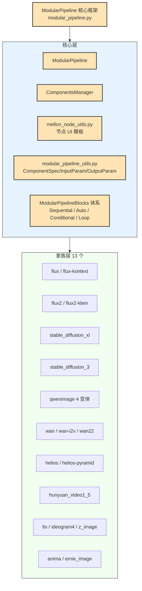
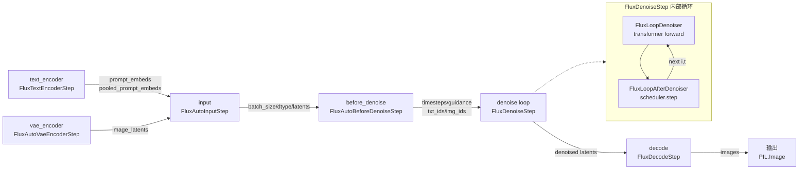
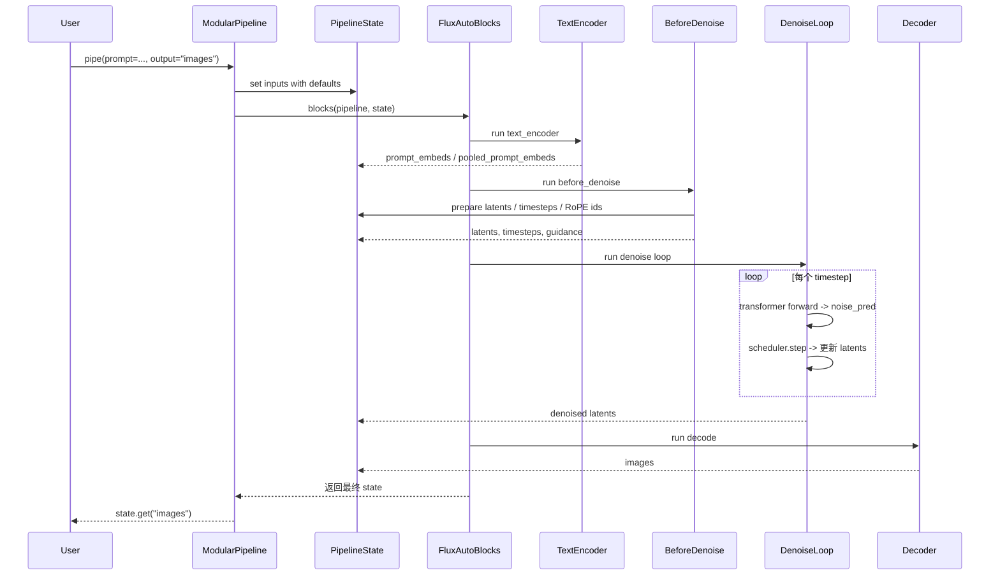
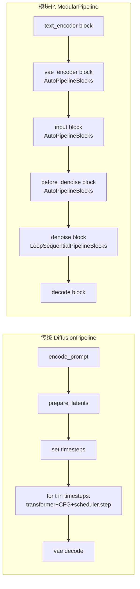

> 基于 diffusers 0.39.0.dev0 版本

# 11 模块化管道 - ModularPipelines

> 本篇为【分】论篇，剖析 diffusers 新一代模块化管道框架（Modular Pipelines）的设计哲学、核心实现与使用方式。模块化管道是 0.39 版本主推的推理组织方式，目标是把传统 `DiffusionPipeline.__call__` 中臃肿的线性流程拆解为可复用、可组合、可单独运行的"节点（Block）"。源码集中在 [modular_pipelines](file:///workspace/src/diffusers/modular_pipelines) 目录，约定文档见 [modular.md](file:///workspace/.ai/modular.md)。

---

## 1. 总起：模块概览

### 1.1 模块化管道是新一代推荐方式

依据 [.ai/modular.md](file:///workspace/.ai/modular.md) 的明确表述：模块化管道是新推荐的管道组织方式。传统 `DiffusionPipeline` 把"编码 → 准备 latents → 去噪循环 → 解码"全部塞进一个动辄数百行的 `__call__` 方法里，导致：

- **代码重复严重**：text2img / img2img / inpaint 在每家族里几乎复制粘贴一整份 `__call__`，只为改几行 latent 准备逻辑；
- **复用困难**：想单独跑一次 text encoder 拿 `prompt_embeds` 缓存复用，必须 mock 一整条管道；
- **可读性差**：关注点未分离，新增一个变体（如 distilled、edit）要侵入主流程。

模块化管道以"节点化（Block）+ 顺序组装（SequentialPipelineBlocks）+ 自动选择（AutoPipelineBlocks）"为核心理念，把单体内核拆成一条流水线，每个节点声明自己的 `inputs` / `intermediate_outputs` / `expected_components`，由框架统一编排。

### 1.2 与传统 DiffusionPipeline 的对比

| 维度 | 传统 DiffusionPipeline | 模块化 ModularPipeline |
| --- | --- | --- |
| 入口 | `__call__` 单体方法 | `ModularPipeline.__call__` 调度 `_blocks` |
| 流程组织 | 函数内顺序代码 | `encoders` / `before_denoise` / `denoise` / `decoders` 节点 |
| 变体切换 | 子类重写 `__call__` | `AutoPipelineBlocks` 按 trigger input 选择 |
| 组件管理 | `register_modules` + `model_index.json` | `ComponentsManager` + `modular_model_index.json` |
| 中间产物 | 局部变量，函数结束即销毁 | `PipelineState` / `BlockState` 持久化、可单独取回 |
| 单节点复用 | 不可，须整条管道跑 | 任意节点可单独运行，输出可保存复用 |
| 配置文件 | `model_index.json` | 优先 `modular_model_index.json`，回退到 `model_index.json` |

### 1.3 家族全景

[LS](file:///workspace/src/diffusers/modular_pipelines) 显示，目录下共有 13 个模型家族目录，配合 [modular_pipeline.py](file:///workspace/src/diffusers/modular_pipelines/modular_pipeline.py) 中的 `MODULAR_PIPELINE_MAPPING`（共 20 个条目，含变体），构成模块化家族全景：

- **图像**：[flux](file:///workspace/src/diffusers/modular_pipelines/flux)、[flux2](file:///workspace/src/diffusers/modular_pipelines/flux2)、[stable_diffusion_xl](file:///workspace/src/diffusers/modular_pipelines/stable_diffusion_xl)、[stable_diffusion_3](file:///workspace/src/diffusers/modular_pipelines/stable_diffusion_3)、[qwenimage](file:///workspace/src/diffusers/modular_pipelines/qwenimage)、[ideogram4](file:///workspace/src/diffusers/modular_pipelines/ideogram4)、[z_image](file:///workspace/src/diffusers/modular_pipelines/z_image)、[anima](file:///workspace/src/diffusers/modular_pipelines/anima)、[ernie_image](file:///workspace/src/diffusers/modular_pipelines/ernie_image)
- **视频**：[wan](file:///workspace/src/diffusers/modular_pipelines/wan)、[ltx](file:///workspace/src/diffusers/modular_pipelines/ltx)、[hunyuan_video1_5](file:///workspace/src/diffusers/modular_pipelines/hunyuan_video1_5)、[helios](file:///workspace/src/diffusers/modular_pipelines/helios)

`MODULAR_PIPELINE_MAPPING` 中的 `_map_fn` 支持按 `config_dict` 动态路由，例如 `_wan_map_fn` 依据 `boundary_ratio` 是否为 None 在 `WanModularPipeline` 与 `Wan22ModularPipeline` 间切换；`_flux2_klein_map_fn` 依据 `is_distilled` 在 `Flux2KleinBaseModularPipeline` 与 `Flux2KleinModularPipeline` 间切换。

### 1.4 设计理念

[modular.md](file:///workspace/.ai/modular.md) 把模块化的设计理念归纳为四点：

1. **节点化**：每家族按 `encoders.py` / `before_denoise.py` / `denoise.py` / `decoders.py` / `modular_blocks_<model>.py` 五个文件切分，每个文件含若干 `ModularPipelineBlocks` 子类。
2. **可复用**：单节点（如 text encoder）必须能独立运行并产出可保存的 `prompt_embeds`，下次直接喂给 denoise 节点；编码器节点不接受预计算 embeds 作为输入（"用户大可直接把编码器节点摘出来单跑"，见 modular.md "Standalone block reusability"）。
3. **可组合**：`SequentialPipelineBlocks` 串联、`AutoPipelineBlocks` 按 trigger 选择、`LoopSequentialPipelineBlocks` 承载去噪循环；推荐扁平组装（见 `flux2/modular_blocks_flux2_klein.py` 范式），避免层层嵌套。
4. **契约化**：`expected_components` / `inputs` / `intermediate_outputs` 是节点的公共契约，框架据此生成文档、校验类型、自动 wiring，节点内不再写防御性 `getattr(..., None)`（modular.md Gotcha 7）。

### 1.5 模块化管道架构图

**图 11-1：模块化管道框架与家族全景**



图 11-1 说明：核心层（`ModularPipeline`、`ComponentsManager`、`modular_pipeline_utils`、`mellon_node_utils`、`ModularPipelineBlocks` 体系）构成框架骨架，向下承载 13 个家族目录。每个家族以 `model_name`（如 `flux`、`wan`）在 `MODULAR_PIPELINE_MAPPING` 中注册，由框架统一加载与调度。

---

## 2. 分述：核心实现

### 2.1 核心框架

#### 2.1.1 ModularPipeline 主类

[modular_pipeline.py](file:///workspace/src/diffusers/modular_pipelines/modular_pipeline.py) 中定义的 `ModularPipeline` 是所有家族管道的基类（继承 `ConfigMixin, PushToHubMixin`），核心职责：

- **`__init__`**（行 1610）：接收 `blocks`（`ModularPipelineBlocks`）、`pretrained_model_name_or_path`、`components_manager`、`collection`，自动从 `modular_model_index.json` 或回退到 `model_index.json` 装配 `_component_specs` / `_config_specs`，对 `default_creation_method="from_config"` 的组件立即 `create()`，对 `from_pretrained` 的设为 `None` 等待 `load_components()` 按需加载。
- **`from_pretrained`**（行 1809）：先尝试 `ModularPipelineBlocks.from_pretrained` 拉远程 blocks 定义（trust_remote_code），再调用 `_load_pipeline_config` 双源加载配置，最后经 `MODULAR_PIPELINE_MAPPING` 路由到具体子类。
- **`__call__`**（行 2764）：核心调度入口。把用户 kwargs 与 `inputs` 默认值合并写入 `PipelineState`，然后 `self._blocks(self, state)` 驱动整条流水线；`output` 参数支持 `None`（返回完整 state）/ `str`（取单个中间量）/ `list[str]`（取字典）。
- **`register_components` / `update_components` / `load_components`**：三段式组件生命周期管理，注册时同步 `modular_model_index.json`、与 `ComponentsManager` 联动。

#### 2.1.2 ComponentsManager 组件管理

[components_manager.py](file:///workspace/src/diffusers/modular_pipelines/components_manager.py) 中的 `ComponentsManager` 是跨管道的组件注册中心：

- **`add(name, component, collection)`**（行 386）：注册组件，生成唯一 `component_id = f"{name}_{id(component)}"`，自动检测重复对象与重复 `_diffusers_load_id`，按 `collection` 分桶组织（同名组件在新 collection 加入时，旧 collection 中的同名条目会被移除）。
- **`search_components(names, collection, load_id)`**（行 509）：支持 `unet` / `!unet` / `unet*` / `*unet*` / `refiner|vae|unet` 等模式匹配语法。
- **`enable_auto_cpu_offload`**（行 695）：基于 `AutoOffloadStrategy` 的智能显存管理，前向时把模型搬到执行设备，显存不足时搜索最优组合卸载到 CPU（`search_best_candidate` 用组合枚举找释放量刚好的最小集合）。
- **`get_model_info`**（行 769）：聚合 `class_name` / `size_gb` / `adapters` / `ip_adapter` / `quantization` 等元信息，`__repr__` 渲染表格化的组件清单。

#### 2.1.3 mellon_node_utils 节点 UI 工具

[mellon_node_utils.py](file:///workspace/src/diffusers/modular_pipelines/mellon_node_utils.py) 主要服务于节点式可视化前端（Mellon），定义 `MELLON_PARAM_TEMPLATES` 字典，为 `prompt` / `negative_prompt` / `guidance_scale` / `strength` / `height` / `width` / `seed` / `num_inference_steps` / `num_frames` / `output_type` / `controlnet_conditioning_scale` 等标准参数提供 `label` / `type` / `display` / `default` / `min` / `max` / `step` / `required_block_params` 等 UI 元数据，使模块化节点能在可视化画布上以滑块、下拉、文本域等控件呈现。它依赖 huggingface_hub 上传/下载节点定义文件。

#### 2.1.4 modular_pipeline_utils 辅助函数

[modular_pipeline_utils.py](file:///workspace/src/diffusers/modular_pipelines/modular_pipeline_utils.py) 提供框架级基础数据结构：

- **`InsertableDict`**：可按 index 插入的有序字典，是 `sub_blocks` 容器的基础，支持在任意位置插入新节点（对扩展变体非常关键）。
- **`ComponentSpec`**：组件规格，含 `name` / `type_hint` / `config` / `pretrained_model_name_or_path` / `subfolder` / `variant` / `revision` / `default_creation_method`，提供 `create()` / `load()` / `from_component()` 等方法。
- **`ConfigSpec`**：配置项规格（如 `requires_safety_checker`）。
- **`InputParam` / `OutputParam`**：节点 IO 声明，支持 `.template("<name>")` 引用预定义描述（如 `prompt` / `latents` / `images` / `videos`），也支持直接声明 `name` / `required` / `type_hint` / `description` / `kwargs_type`（典型值 `"denoiser_input_fields"`，把若干字段打包传给 denoiser）。
- **`combine_inputs` / `combine_outputs` / `format_components` / `format_workflow` / `make_doc_string` / `generate_modular_model_card_content`**：用于合并子块 IO、生成 `__repr__` 与模型卡片。

### 2.2 节点化设计

模块化管道把推理流程切成四类节点文件，每个文件含若干 `ModularPipelineBlocks` 子类：

#### encoders.py — 编码节点

负责把"原始输入"变成"每条 prompt 一份的中间产物"，**不**在此处做 `num_images_per_prompt` 扩展（modular.md "Standalone block reusability" 第 1 条）。典型节点：

- `FluxTextEncoderStep`：双 text encoder（CLIP + T5），输出 `prompt_embeds` + `pooled_prompt_embeds`，二者均带 `kwargs_type="denoiser_input_fields"`。
- `FluxVaeEncoderStep`：可配置 `input_name` / `output_name`，默认 `processed_image → image_latents`，便于复用到 `control_image_latents` 等场景。
- `FluxProcessImagesInputStep` / `FluxKontextProcessImagesInputStep`：图像预处理（resize + preprocess）。

#### before_denoise.py — 去噪前准备

每条逻辑独立成一个 leaf block：

- `FluxSetTimestepsStep`：基于 `calculate_shift` 计算 `mu`，调 `retrieve_timesteps` 得 `timesteps` / `num_inference_steps` / `guidance`。
- `FluxPrepareLatentsStep`：随机初始化或接收 `latents`，调用 `FluxPipeline._pack_latents` 打包。
- `FluxImg2ImgSetTimestepsStep` / `FluxImg2ImgPrepareLatentsStep`：img2img 变体，后者调用 `scheduler.scale_noise` 给 image latents 加噪。
- `FluxRoPEInputsStep`：构造 `txt_ids` / `img_ids` 供 RoPE 使用。

#### denoise.py — 去噪循环节点

由 `LoopSequentialPipelineBlocks` 承载，sub_blocks 为 leaf 节点：

- `FluxLoopDenoiser`：单步前向 `components.transformer(...)`，输出 `noise_pred`。
- `FluxLoopAfterDenoiser`：`components.scheduler.step(noise_pred, t, latents)` 更新 latents。
- `FluxDenoiseLoopWrapper`：循环驱动器，`__call__` 中 `for i, t in enumerate(timesteps): self.loop_step(components, block_state, i=i, t=t)`，附带 `progress_bar`。
- `FluxDenoiseStep`：继承 wrapper，仅声明 `block_classes = [FluxLoopDenoiser, FluxLoopAfterDenoiser]`、`block_names = ["denoiser", "after_denoiser"]`。

[modular.md](file:///workspace/.ai/modular.md) 强调：去噪循环的核心是把传统写死的 `if do_classifier_free_guidance:` 抽象到 **guider** 组件中（`components.guider.prepare_inputs` / `prepare_models` / `cleanup_models` / `__call__`），让 denoise 节点只关心"按 guider 给的 batch 逐条前向 → 合并 → scheduler.step"。Flux 因 distilled 检查点走 guidance embeds，例外地不需要 guider（modular.md Gotcha 3 的例外说明）。

#### decoders.py — 解码节点

最简单的一类，以 `FluxDecodeStep` 为例：`_unpack_latents` → 反 scaling/shift → `vae.decode` → `image_processor.postprocess`，输出 `images`。modular.md 明确：解码独立成节点，不能并入 denoise loop，便于在 denoise 与 decode 之间插入 upscale、latent edit 等中间步骤。

### 2.3 Flux 模块化管道代表实现

#### 2.3.1 modular_pipeline.py 主入口

[flux/modular_pipeline.py](file:///workspace/src/diffusers/modular_pipelines/flux/modular_pipeline.py) 极其精简，仅声明 `FluxModularPipeline(ModularPipeline, FluxLoraLoaderMixin, TextualInversionLoaderMixin)`：

```python
class FluxModularPipeline(ModularPipeline, FluxLoraLoaderMixin, TextualInversionLoaderMixin):
    default_blocks_name = "FluxAutoBlocks"

    @property
    def default_height(self):
        return self.default_sample_size * self.vae_scale_factor
    # ...
```

`default_blocks_name = "FluxAutoBlocks"` 让 `ModularPipeline.__init__` 在未显式传 `blocks` 时通过 `importlib.import_module("diffusers")` 动态拿到 `FluxAutoBlocks` 类并实例化。`FluxKontextModularPipeline` 继承此类，仅替换 `default_blocks_name` 为 `"FluxKontextAutoBlocks"`。

#### 2.3.2 encoders.py — 双 text encoder 编码

`FluxTextEncoderStep`（[encoders.py](file:///workspace/src/diffusers/modular_pipelines/flux/encoders.py) 行 285）声明四个组件：

```python
ComponentSpec("text_encoder", CLIPTextModel)
ComponentSpec("tokenizer", CLIPTokenizer)
ComponentSpec("text_encoder_2", T5EncoderModel)
ComponentSpec("tokenizer_2", T5TokenizerFast)
```

`encode_prompt` 静态方法分别调用 `_get_clip_prompt_embeds`（取 CLIP 的 `pooler_output` 作为 `pooled_prompt_embeds`）和 `_get_t5_prompt_embeds`（取 T5 的 last hidden state 作为 `prompt_embeds`，支持 `max_sequence_length=512`），并处理 LoRA scale 与 textual inversion。两个输出都标 `kwargs_type="denoiser_input_fields"`，意味着它们会自动作为 denoiser 节点的 kwargs 透传。

#### 2.3.3 before_denoise.py — latent prep + timesteps + guider init

`FluxSetTimestepsStep`（[before_denoise.py](file:///workspace/src/diffusers/modular_pipelines/flux/before_denoise.py) 行 154）的核心：

```python
batch_size = block_state.batch_size * block_state.num_images_per_prompt
timesteps, num_inference_steps, sigmas, guidance = _get_initial_timesteps_and_optionals(
    transformer, scheduler, batch_size, height, width,
    components.vae_scale_factor, num_inference_steps, guidance_scale, sigmas, device,
)
components.scheduler.set_begin_index(0)
```

`_get_initial_timesteps_and_optionals` 调 `calculate_shift` 算 `mu`（依据 `image_seq_len` 在 `base_shift=0.5` 与 `max_shift=1.15` 间线性插值），再 `retrieve_timesteps` 得到时间步。若 `transformer.config.guidance_embeds` 为真，把 `guidance_scale` 扩展为 batch tensor；否则 `guidance=None`。

`FluxPrepareLatentsStep`（行 320）调 `randn_tensor` 生成 `(batch, num_channels_latents, height, width)` 后用 `FluxPipeline._pack_latents` 打包成 patchified 形式。

#### 2.3.4 denoise.py — denoise loop

`FluxLoopDenoiser.__call__`（[denoise.py](file:///workspace/src/diffusers/modular_pipelines/flux/denoise.py) 行 92）极简：

```python
noise_pred = components.transformer(
    hidden_states=block_state.latents,
    timestep=t.flatten() / 1000,
    guidance=block_state.guidance,
    encoder_hidden_states=block_state.prompt_embeds,
    pooled_projections=block_state.pooled_prompt_embeds,
    joint_attention_kwargs=block_state.joint_attention_kwargs,
    txt_ids=block_state.txt_ids,
    img_ids=block_state.img_ids,
    return_dict=False,
)[0]
block_state.noise_pred = noise_pred
```

`FluxLoopAfterDenoiser` 调 `components.scheduler.step(noise_pred, t, latents)` 更新 latents，保持 dtype 一致。`FluxDenoiseLoopWrapper.__call__` 用 `progress_bar` 包裹 `for i, t in enumerate(timesteps)` 循环，每轮 `loop_step` 依次跑 `denoiser` → `after_denoiser`。

#### 2.3.5 decoders.py — VAE decode + image postprocess

`FluxDecodeStep`（[decoders.py](file:///workspace/src/diffusers/modular_pipelines/flux/decoders.py) 行 48）：

```python
latents = _unpack_latents(latents, height, width, vae_scale_factor)
latents = (latents / vae.config.scaling_factor) + vae.config.shift_factor
block_state.images = vae.decode(latents, return_dict=False)[0]
block_state.images = components.image_processor.postprocess(images, output_type=block_state.output_type)
```

`output_type="latent"` 时直接返回 latents，跳过 VAE decode，便于把 latents 喂给下一个管道（如 upscale）。

#### 2.3.6 节点装配 — modular_blocks_flux.py

[modular_blocks_flux.py](file:///workspace/src/diffusers/modular_pipelines/flux/modular_blocks_flux.py) 自底向上组装：

1. `FluxImg2ImgVaeEncoderStep` = `SequentialPipelineBlocks([FluxProcessImagesInputStep, FluxVaeEncoderStep])`
2. `FluxAutoVaeEncoderStep` = `AutoPipelineBlocks([FluxImg2ImgVaeEncoderStep], trigger_inputs=["image"])`（无 image 则跳过）
3. `FluxBeforeDenoiseStep` = `SequentialPipelineBlocks([prepare_latents, set_timesteps, prepare_rope_inputs])`（text2image）
4. `FluxImg2ImgBeforeDenoiseStep` 多一步 `FluxImg2ImgPrepareLatentsStep`
5. `FluxAutoBeforeDenoiseStep` = `AutoPipelineBlocks([img2img, text2image], trigger_inputs=["image_latents", None])`
6. `FluxAutoInputStep` = `AutoPipelineBlocks([FluxImg2ImgInputStep, FluxTextInputStep], trigger_inputs=["image_latents", None])`
7. `FluxCoreDenoiseStep` = `SequentialPipelineBlocks([FluxAutoInputStep, FluxAutoBeforeDenoiseStep, FluxDenoiseStep])`
8. `FluxAutoBlocks` = `SequentialPipelineBlocks([text_encoder, vae_encoder, denoise, decode])`，并声明 `_workflow_map = {"text2image": {"prompt": True}, "image2image": {"image": True, "prompt": True}}`

`FluxAutoBlocks.outputs` 重写为 `[OutputParam.template("images")]`，把最终输出对齐到标准模板，使 `pipe(prompt=..., output="images")` 可直接返回 PIL 图像列表。

### 2.4 模块化管道架构图

**图 11-2：Flux 模块化管道节点编排**



图 11-2 说明：`FluxAutoBlocks` 是顶层 `SequentialPipelineBlocks`，按 `text_encoder → vae_encoder → denoise (FluxCoreDenoiseStep) → decode` 顺序串联。`FluxCoreDenoiseStep` 内部再拆为 `input → before_denoise → denoise` 三段；其中 `input` 与 `before_denoise` 是 `AutoPipelineBlocks`，按 `image_latents` 是否存在切 text2image / img2img 两条路径；`denoise` 是 `LoopSequentialPipelineBlocks`，循环体每轮跑 `denoiser` 与 `after_denoiser` 两个 leaf block。

### 2.5 节点调度时序图

**图 11-3：ModularPipeline.__call__ 调度时序**



图 11-3 说明：用户调用 `pipe(prompt=..., output="images")` 后，`ModularPipeline.__call__` 先把 kwargs 与 `inputs` 默认值合并写入 `PipelineState`，再 `self._blocks(self, state)` 驱动 `FluxAutoBlocks` 顺序执行各子块。每个子块通过 `get_block_state(state)` 拿到所需输入，处理后通过 `set_block_state(state, block_state)` 把 `intermediate_outputs` 写回 state。去噪循环内部由 `LoopSequentialPipelineBlocks.loop_step` 在每个 timestep 上依次跑 `FluxLoopDenoiser` 与 `FluxLoopAfterDenoiser`。最终 `output="images"` 让 `__call__` 直接 `state.get("images")` 返回 PIL 图像。

### 2.6 传统 vs 模块化对比图

**图 11-4：传统管道与模块化管道结构对比**



图 11-4 说明：左侧传统管道把全部逻辑塞进 `__call__` 单体方法，CFG、img2img 变体、inpaint 变体都通过 if-else 或子类重写塞入同一函数体；右侧模块化管道把每个阶段独立成可单独运行的 Block，变体切换由 `AutoPipelineBlocks` 按 trigger input 在运行时静态选择（`get_execution_blocks`），输出持久化到 `PipelineState` 供下游任意节点消费。每个 Block 都可被单独 `block(pipeline, state)` 调用，输出可保存复用。

---

## 3. 使用指南

### 3.1 API 速查

`ModularPipeline` 核心方法签名（详见 [modular_pipeline.py](file:///workspace/src/diffusers/modular_pipelines/modular_pipeline.py)）：

```python
# 加载
ModularPipeline.from_pretrained(
    pretrained_model_name_or_path,
    trust_remote_code=None,
    components_manager=None,
    collection=None,
    **kwargs,  # torch_dtype / variant / revision 等
)

# 推理
pipeline(
    state=None,             # 可选：续接上次 PipelineState
    output=None,            # None / str / list[str]
    **kwargs,               # prompt / image / num_inference_steps / guidance_scale / ...
)

# 组件管理
pipeline.load_components(names=None, **kwargs)  # None 加载全部 from_pretrained 组件
pipeline.update_components(unet=new_unet, requires_safety_checker=False)
pipeline.to(device="cuda", dtype=torch.bfloat16)

# 工作流查询
pipeline.blocks                       # 拿到 blocks 副本
pipeline.blocks.available_workflows   # 列出 _workflow_map 中的工作流名
pipeline.blocks.get_workflow("text2image")  # 拿到该工作流的执行块视图
pipeline.blocks.get_execution_blocks(image=True)  # 静态预览某输入组合会跑哪些块
```

### 3.2 最小示例：Flux 模块化管道推理

```python
import torch
from diffusers import FluxModularPipeline

pipe = FluxModularPipeline.from_pretrained(
    "black-forest-labs/FLUX.1-dev",
    torch_dtype=torch.bfloat16,
)
pipe.load_components(torch_dtype=torch.bfloat16)
pipe.to("cuda")

# 方式 1：完整 state
state = pipe(prompt="a cat", num_inference_steps=28, guidance_scale=3.5)
images = state.get("images")

# 方式 2：直接取 images
images = pipe(prompt="a cat", num_inference_steps=28, output="images")

# img2img：传 image 即触发 FluxAutoVaeEncoderStep 与 img2img 分支
images = pipe(prompt="a cat", image=my_pil_image, strength=0.6, output="images")
```

### 3.3 自定义节点：替换/扩展某个节点

模块化管道的核心便利之一是节点可替换。下面的例子把 Flux 的 `before_denoise` 替换为只做 `prepare_latents` 的简化版，并注入自定义 `latents`：

```python
from copy import deepcopy
from diffusers import FluxModularPipeline
from diffusers.modular_pipelines.modular_pipeline_utils import InsertableDict
from diffusers.modular_pipelines.flux.before_denoise import FluxPrepareLatentsStep, FluxSetTimestepsStep, FluxRoPEInputsStep

pipe = FluxModularPipeline.from_pretrained("black-forest-labs/FLUX.1-dev")
pipe.load_components()

# 1. 取出 blocks 副本
blocks = deepcopy(pipe.blocks)

# 2. 替换 before_denoise 子块的 sub_blocks（只保留 prepare_latents + set_timesteps）
blocks.sub_blocks["denoise"].sub_blocks["before_denoise"].sub_blocks = InsertableDict(
    [
        ("prepare_latents", FluxPrepareLatentsStep()),
        ("set_timesteps", FluxSetTimestepsStep()),
    ]
)

# 3. 写回管道（blocks 是 deepcopy，需要重新挂回去）
pipe._blocks = blocks

# 4. 注入自定义 latents 直接跑（绕过 prepare_latents 的随机生成）
import torch
custom_latents = torch.randn(1, 4096, 64, device="cuda", dtype=torch.bfloat16)
state = pipe(prompt="a cat", latents=custom_latents, height=1024, width=1024)
```

> 注意：直接替换 `sub_blocks` 需要保证新节点的 `inputs` / `intermediate_outputs` 与下游契约一致；正式做法是定义自己的 `SequentialPipelineBlocks` 子类并替换 `block_classes`。

---

## 4. 实战案例

### 4.1 案例 1：Flux 模块化管道推理与标准管道对比

**标准 FluxPipeline 写法**：

```python
from diffusers import FluxPipeline
pipe = FluxPipeline.from_pretrained("black-forest-labs/FLUX.1-dev", torch_dtype=torch.bfloat16).to("cuda")
image = pipe(prompt="a cat", num_inference_steps=28, guidance_scale=3.5).images[0]
```

**模块化 FluxModularPipeline 写法**：

```python
from diffusers import FluxModularPipeline
pipe = FluxModularPipeline.from_pretrained("black-forest-labs/FLUX.1-dev", torch_dtype=torch.bfloat16)
pipe.load_components()
pipe.to("cuda")
state = pipe(prompt="a cat", num_inference_steps=28, guidance_scale=3.5)
image = state.get("images")[0]
```

二者数值结果一致（同样的种子、scheduler、transformer），但模块化版本多出的能力：

- **缓存 prompt_embeds**：`state = pipe(prompt="a cat", output="prompt_embeds")` 单独跑 text encoder，把 `prompt_embeds` 保存为 `.pt`，下次直接 `pipe(prompt_embeds=loaded_embeds, pooled_prompt_embeds=loaded_pooled)` 跳过 text encoder（按 modular.md "Standalone block reusability"，标准管道也接受 `prompt_embeds`，但模块化版本是"摘掉 text_encoder block 单跑"，更纯粹）。
- **多工作流切换**：`pipe.blocks.get_workflow("image2image")` 静态预览 img2img 会跑哪些块，无需真正执行。
- **跨管道组件复用**：用 `ComponentsManager` 把 flux 与 flux2 的 `vae` 放到同一 `collection`，自动复用同一显存实例。

### 4.2 案例 2：自定义 before_denoise 节点注入自定义 latent

场景：想在去噪前把 latents 做一次噪声扰动（如 latent edit、mask 注入）。自定义一个 `CustomPrepareLatentsStep` 替换默认的 `FluxPrepareLatentsStep`：

```python
import torch
from diffusers.modular_pipelines.modular_pipeline import ModularPipelineBlocks, PipelineState
from diffusers.modular_pipelines.modular_pipeline_utils import ComponentSpec, InputParam, OutputParam
from diffusers.modular_pipelines.flux.before_denoise import FluxPrepareLatentsStep
from diffusers.pipelines import FluxPipeline


class CustomPrepareLatentsStep(FluxPrepareLatentsStep):
    """在标准 prepare_latents 之后叠加一次 mask 注入。"""

    @property
    def inputs(self):
        return super().inputs + [InputParam("latent_mask", type_hint=torch.Tensor, required=False)]

    @torch.no_grad()
    def __call__(self, components, state: PipelineState):
        components, state = super().__call__(components, state)
        block_state = self.get_block_state(state)
        if block_state.latent_mask is not None:
            # 把 mask 区域的 latent 替换为纯噪声
            noise = torch.randn_like(block_state.latents)
            block_state.latents = torch.where(block_state.latent_mask, noise, block_state.latents)
            self.set_block_state(state, block_state)
        return components, state
```

把自定义 step 装回管道：

```python
from copy import deepcopy
from diffusers.modular_pipelines.modular_pipeline_utils import InsertableDict
from diffusers.modular_pipelines.flux.before_denoise import FluxSetTimestepsStep, FluxRoPEInputsStep
from diffusers import FluxModularPipeline

pipe = FluxModularPipeline.from_pretrained("black-forest-labs/FLUX.1-dev")
pipe.load_components()

blocks = deepcopy(pipe.blocks)
new_before_denoise_sub_blocks = InsertableDict([
    ("prepare_latents", CustomPrepareLatentsStep()),
    ("set_timesteps", FluxSetTimestepsStep()),
    ("prepare_rope_inputs", FluxRoPEInputsStep()),
])
blocks.sub_blocks["denoise"].sub_blocks["before_denoise"].sub_blocks = new_before_denoise_sub_blocks
pipe._blocks = blocks

# 跑：传 latent_mask 触发自定义逻辑
import torch
mask = torch.zeros(1, 4096, 64, dtype=torch.bool, device="cuda")
mask[:, :1024, :] = True  # 前 1024 个 patch 注入噪声
state = pipe(prompt="a cat", height=1024, width=1024, latent_mask=mask, num_inference_steps=28)
```

> 上面通过继承 `FluxPrepareLatentsStep` 并扩展 `inputs`，让新节点声明了 `latent_mask`，框架会自动把它从 `__call__` kwargs 路由到 `block_state.latent_mask`，无需修改任何 wiring 代码（这正是 modular.md Gotcha 7 强调的"声明即契约"威力）。

---

## 5. 总结

### 5.1 要点回顾

模块化管道通过三层抽象重构了 diffusers 推理组织方式：

1. **节点层（`ModularPipelineBlocks`）**：每个 leaf block 声明 `expected_components` / `inputs` / `intermediate_outputs`，单节点可独立运行与复用。
2. **组装层（`SequentialPipelineBlocks` / `AutoPipelineBlocks` / `ConditionalPipelineBlocks` / `LoopSequentialPipelineBlocks`）**：通过组合而非继承表达变体与循环；`AutoPipelineBlocks` 按 trigger input 静态选择分支，`LoopSequentialPipelineBlocks` 承载去噪循环。
3. **运行时层（`ModularPipeline` + `ComponentsManager` + `PipelineState`）**：统一调度、跨管道组件共享、`auto_cpu_offload` 智能显存管理、`PipelineState` 持久化中间产物。

Flux 家族是典型范式：`FluxAutoBlocks` 自顶向下拆为 `text_encoder / vae_encoder / denoise / decode`，`denoise` 内再拆 `input / before_denoise / denoise loop`，每层都按 trigger input 自动选 text2image / img2img 分支，去噪循环内部又拆 `denoiser + after_denoiser`。

### 5.2 与传统管道的关系

模块化管道与传统 `DiffusionPipeline` **长期共存**：

- `ModularPipeline.from_pretrained` 会优先尝试 `modular_model_index.json`，找不到再回退 `model_index.json`，对存量 Hub 仓库完全兼容；
- `MODULAR_PIPELINE_MAPPING` 把传统管道类名（如 `FluxPipeline`）映射到模块化类名（`FluxModularPipeline`），用户既可继续用 `diffusers.FluxPipeline`，也可显式选 `FluxModularPipeline`；
- 模块化 blocks 不允许反向 import `diffusers.pipelines.*`（modular.md Gotcha 1），两套系统并行不互相污染，共享 utility 通过 `# Copied from` 头同步。

[modular.md](file:///workspace/.ai/modular.md) 把模块化定位为"新推荐方式"，但传统管道不会立即下线——新家族、新变体优先以模块化形式落地，老家族逐步迁移。

### 5.3 对未来开发的影响

模块化管道改变了几类常见工作流：

- **新家族落地**：按 `decoders → encoders → before_denoise → denoise` 顺序实现（modular.md "Build order"），用 guider 抽象屏蔽 CFG/CFG++/PAG 差异，新增一个家族只需写四个文件 + 一个 `modular_blocks_<model>.py` 装配；
- **变体扩展**：新工作流（如 edit、layered、kontext）通过新增 `modular_blocks_<model>_<variant>.py` 装配文件 + `AutoPipelineBlocks` trigger input 完成，无需改动主流程；
- **跨家族复用**：`ComponentsManager` + `collection` 让多管道共享 VAE / text encoder，配合 `enable_auto_cpu_offload` 在显存受限场景下自动调度；
- **可视化前端**：`mellon_node_utils.py` 的 `MELLON_PARAM_TEMPLATES` 为节点编辑器（如 Mellon 画布）提供 UI 元数据，每个 block 天然成为画布上的一个节点，用户可在画布上拖拽、替换、跳过任意节点；
- **测试与文档**：`# auto_docstring` + `python utils/modular_auto_docstring.py --fix_and_overwrite` 自动生成每个组装块的 docstring，`make_doc_string` 渲染 `__repr__`，降低维护成本。

模块化管道不是对传统管道的颠覆，而是把"单体 `__call__`"重构为"声明式节点图"，在保留数值等价的前提下换来复用性、可读性与可扩展性，是 diffusers 推理层未来一段时间的主要演进方向。

---

**参考文件**：

- 框架核心：[modular_pipeline.py](file:///workspace/src/diffusers/modular_pipelines/modular_pipeline.py)、[components_manager.py](file:///workspace/src/diffusers/modular_pipelines/components_manager.py)、[modular_pipeline_utils.py](file:///workspace/src/diffusers/modular_pipelines/modular_pipeline_utils.py)、[mellon_node_utils.py](file:///workspace/src/diffusers/modular_pipelines/mellon_node_utils.py)
- 约定文档：[.ai/modular.md](file:///workspace/.ai/modular.md)
- Flux 代表实现：[flux/modular_pipeline.py](file:///workspace/src/diffusers/modular_pipelines/flux/modular_pipeline.py)、[encoders.py](file:///workspace/src/diffusers/modular_pipelines/flux/encoders.py)、[before_denoise.py](file:///workspace/src/diffusers/modular_pipelines/flux/before_denoise.py)、[denoise.py](file:///workspace/src/diffusers/modular_pipelines/flux/denoise.py)、[decoders.py](file:///workspace/src/diffusers/modular_pipelines/flux/decoders.py)、[inputs.py](file:///workspace/src/diffusers/modular_pipelines/flux/inputs.py)、[modular_blocks_flux.py](file:///workspace/src/diffusers/modular_pipelines/flux/modular_blocks_flux.py)
