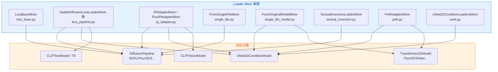
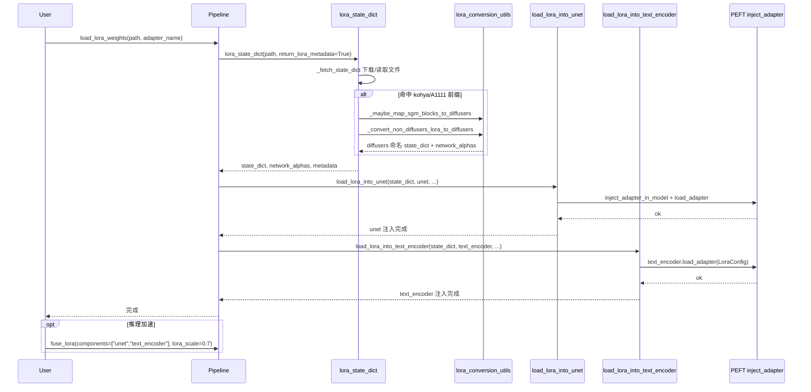
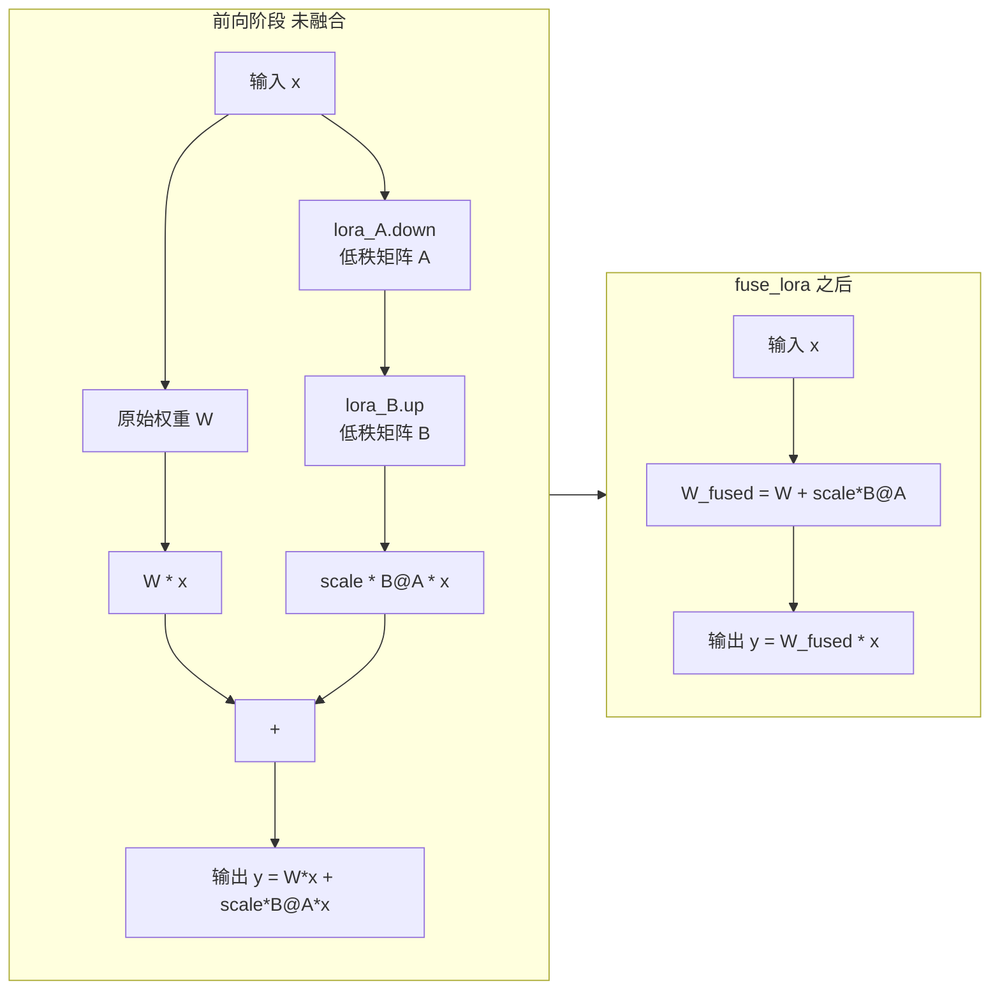
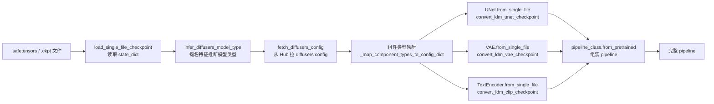

# 12 加载器 - Loaders

> 基于 diffusers 0.39.0.dev0 版本

加载器（Loaders）是 Diffusers 中负责"把外部权重装配进模型/pipeline"的"总线层"。它向上对接用户从 Hugging Face Hub、Civitai、本地 .safetensors/.ckpt 文件等渠道拿到的各种权重点，向下注入到 `UNet2DConditionModel`、`Transformer2DModel`、`CLIPTextModel` 等具体组件中。本章按"总—分—总"结构剖析 `src/diffusers/loaders/` 目录，重点讲清 LoRA、IP-Adapter、单文件三套范式。

---

## 1. 总起：模块概览

### 1.1 多种权重格式

Diffusers 加载器家族覆盖了主流的微调/扩展权重格式：

- **LoRA / LoCon / LyCORIS / DoRA**：低秩适配器，体积小、可叠加、可融合
- **IP-Adapter**：以图像为条件的适配器，注入到 attention 的 cross-attention 中
- **单文件 (.safetensors / .ckpt)**：原版 Stable Diffusion WebUI 风格的整包文件
- **Textual Inversion**：以 token embedding 形式注入的概念向量
- **PEFT**：当安装 `peft` 库时，统一走 PEFT 后端做 adapter 注入

### 1.2 加载器家族全景

`src/diffusers/loaders/` 目录共有 15 个文件，可按职责归类如下：

| 文件 | 主要导出 | 职责 |
| --- | --- | --- |
| [lora_base.py](file:///workspace/src/diffusers/loaders/lora_base.py) | `LoraBaseMixin`、`_load_lora_into_text_encoder`、`fuse_text_encoder_lora` | LoRA 公共基类与跨组件工具函数 |
| [lora_pipeline.py](file:///workspace/src/diffusers/loaders/lora_pipeline.py) | `StableDiffusionLoraLoaderMixin`、`StableDiffusionXLLoraLoaderMixin`、`FluxLoraLoaderMixin` 等 | 各 pipeline 专用 LoRA 加载器 |
| [lora_conversion_utils.py](file:///workspace/src/diffusers/loaders/lora_conversion_utils.py) | `_convert_non_diffusers_lora_to_diffusers`、`_convert_kohya_flux_lora_to_diffusers` 等 | 跨框架 state_dict 键名转换 |
| [ip_adapter.py](file:///workspace/src/diffusers/loaders/ip_adapter.py) | `IPAdapterMixin`、`FluxIPAdapterMixin`、`SD3IPAdapterMixin` | IP-Adapter 加载与 scale 调节 |
| [single_file.py](file:///workspace/src/diffusers/loaders/single_file.py) | `FromSingleFileMixin` | pipeline 级 `from_single_file` |
| [single_file_model.py](file:///workspace/src/diffusers/loaders/single_file_model.py) | `FromOriginalModelMixin` | 单个模型级 `from_single_file` |
| [single_file_utils.py](file:///workspace/src/diffusers/loaders/single_file_utils.py) | `convert_ldm_unet_checkpoint`、`infer_diffusers_model_type` 等 | 原版 checkpoint 解析与映射 |
| [peft.py](file:///workspace/src/diffusers/loaders/peft.py) | `PeftAdapterMixin` | PEFT 后端通用 adapter 管理 |
| [textual_inversion.py](file:///workspace/src/diffusers/loaders/textual_inversion.py) | `TextualInversionLoaderMixin` | Textual Inversion 加载 |
| [unet.py](file:///workspace/src/diffusers/loaders/unet.py) | `UNet2DConditionLoadersMixin` | UNet 级 LoRA 加载 |
| [unet_loader_utils.py](file:///workspace/src/diffusers/loaders/unet_loader_utils.py) | `_maybe_expand_lora_scales` | UNet 块级 scale 展开 |
| [transformer_flux.py](file:///workspace/src/diffusers/loaders/transformer_flux.py) | `FluxTransformer2DLoadersMixin` | Flux Transformer LoRA |
| [transformer_sd3.py](file:///workspace/src/diffusers/loaders/transformer_sd3.py) | `SD3Transformer2DLoadersMixin` | SD3 Transformer LoRA |
| [utils.py](file:///workspace/src/diffusers/loaders/utils.py) | 共享小工具 | 加载器内部辅助函数 |
| [__init__.py](file:///workspace/src/diffusers/loaders/__init__.py) | 公开导出 | 懒加载入口 |

### 1.3 设计理念：Mixin 模式

加载器全部以 `XxxLoaderMixin` / `XxxMixin` 形式实现，通过多继承"按需"挂到 pipeline 或 model 类上。例如 `StableDiffusionXLPipeline` 同时继承 `StableDiffusionXLLoraLoaderMixin`、`IPAdapterMixin`、`TextualInversionLoaderMixin`、`FromSingleFileMixin`，于是 `pipe.load_lora_weights`、`pipe.load_ip_adapter`、`pipe.load_textual_inversion`、`pipe.from_single_file` 这四套 API 自然就位。

这种设计的优点是：

- **可裁剪**：只想要 LoRA 的 pipeline 不必引入 IP-Adapter 代码
- **可复用**：`LoraBaseMixin` 把 `fuse_lora` / `set_adapters` / `unload_lora_weights` 抽到一处，所有 LoRA LoaderMixin 共享
- **可组合**：用户能在同一个 pipeline 上同时挂 LoRA + IP-Adapter + Textual Inversion

### 1.4 加载器家族架构图

**图 12-1：加载器 Mixin 与目标对象关系**



图 12-1 说明：左侧为各 LoaderMixin，右侧为目标对象。pipeline 级 Mixin（`LoraBaseMixin`、`IPAdapterMixin`、`FromSingleFileMixin` 等）混入到 `DiffusionPipeline` 子类，model 级 Mixin（`UNet2DConditionLoadersMixin`、`FromOriginalModelMixin`、`PeftAdapterMixin`）则挂到具体模型类上。pipeline 级方法最终会调用 model 级方法完成真正的权重注入。

---

## 2. 分述：核心实现

### 2.1 LoRA 加载详解

#### 2.1.1 LoraBaseMixin：公共基类

[LoraBaseMixin](file:///workspace/src/diffusers/loaders/lora_base.py)（位于 `lora_base.py:479`）是所有 pipeline 级 LoRA 加载器的公共基类，它定义了 LoRA 生命周期的关键方法：

- **属性** `lora_scale`：返回运行时设定的 LoRA scale（默认 1.0），见 `lora_base.py:486`
- **属性** `fused_loras` / `num_fused_loras`：跟踪已被融合的 adapter 名集合（`_merged_adapters`）
- `load_lora_weights(**kwargs)`：基类只抛 `NotImplementedError`，由具体 pipeline Mixin 实现
- `unload_lora_weights()`：卸载 adapter，对 `ModelMixin` 调用 `model.unload_lora()`，对 `PreTrainedModel` 调 `_remove_text_encoder_monkey_patch`
- `fuse_lora(components, lora_scale, safe_fusing, adapter_names)`：把 LoRA 权重融合进原权重
- `unfuse_lora(components)`：反向操作
- `set_adapters(adapter_names, adapter_weights)`：切换当前激活的 adapter 及其权重
- `disable_lora()` / `enable_lora()`：临时关闭/打开 LoRA 层

`_lora_loadable_modules` 是关键类属性，列出该 pipeline 可注入 LoRA 的组件名（如 SDXL 为 `["unet", "text_encoder", "text_encoder_2"]`）。`fuse_lora` 会遍历它，对每个组件分别调用 `ModelMixin.fuse_lora` 或 `fuse_text_encoder_lora`：

```python
for fuse_component in components:
    if fuse_component not in self._lora_loadable_modules:
        raise ValueError(f"{fuse_component} is not found in {self._lora_loadable_modules=}.")
    model = getattr(self, fuse_component, None)
    if model is not None:
        if issubclass(model.__class__, ModelMixin):
            model.fuse_lora(lora_scale, safe_fusing=safe_fusing, adapter_names=adapter_names)
        if issubclass(model.__class__, PreTrainedModel):
            fuse_text_encoder_lora(model, lora_scale=lora_scale, ...)
```

#### 2.1.2 pipeline 级 load_lora_weights

以 [StableDiffusionLoraLoaderMixin.load_lora_weights](file:///workspace/src/diffusers/loaders/lora_pipeline.py)（`lora_pipeline.py:146`）为例，加载分三步：

1. **拉取并解析 state_dict**：调用 `self.lora_state_dict(...)`（`lora_pipeline.py:249`），内部用 `_fetch_state_dict` 下载/读取文件，再视情况走 `_convert_non_diffusers_lora_to_diffusers` 做键名转换。返回 `(state_dict, network_alphas, metadata)`。
2. **注入 UNet**：调用 `cls.load_lora_into_unet(state_dict, network_alphas, unet, ...)`，将 LoRA 注入到 UNet 的 `nn.Linear` / `nn.Conv2d` 模块。
3. **注入 text encoder**：调用 `cls.load_lora_into_text_encoder(state_dict, ..., text_encoder, ...)`，将文本编码器部分的 LoRA 注入到 `q_proj/k_proj/v_proj/out_proj/fc1/fc2`。

`lora_state_dict` 还会处理 DoRA：若发现 `dora_scale` 键且与当前 PEFT 版本不兼容，会过滤掉对应键并打 warning（`lora_pipeline.py:332`）。同时它检测 A1111/kohya 风格的 `lora_unet_` / `lora_te_` 前缀，命中则走 `_maybe_map_sgm_blocks_to_diffusers` + `_convert_non_diffusers_lora_to_diffusers`。

#### 2.1.3 _load_lora_into_text_encoder 的注入流程

[_load_lora_into_text_encoder](file:///workspace/src/diffusers/loaders/lora_base.py)（`lora_base.py:321`）展示了一个标准 PEFT 注入过程：

```python
# 1. 剥离 prefix
state_dict = {k.removeprefix(f"{prefix}."): v for k, v in state_dict.items() if k.startswith(f"{prefix}.")}
# 2. 转成 diffusers 命名再转成 peft 命名
state_dict = convert_state_dict_to_diffusers(state_dict)
state_dict = convert_state_dict_to_peft(state_dict)
# 3. 推断每层 rank
for name, _ in text_encoder.named_modules():
    if name.endswith((".q_proj", ".k_proj", ".v_proj", ".out_proj", ".fc1", ".fc2")):
        rank_key = f"{name}.lora_B.weight"
        if rank_key in state_dict:
            rank[rank_key] = state_dict[rank_key].shape[1]
# 4. 构造 LoraConfig
lora_config = _create_lora_config(state_dict, network_alphas, metadata, rank, is_unet=False)
# 5. 注入并加载
text_encoder.load_adapter(adapter_name=adapter_name, adapter_state_dict=state_dict, peft_config=lora_config, **peft_kwargs)
# 6. 应用 scale
scale_lora_layers(text_encoder, weight=lora_scale)
```

注意第 5 步调用的是 transformers 提供的 `load_adapter`，由 PEFT 后端真正 monkey-patch 进 `nn.Linear`，把 `W*x` 替换为 `W*x + scale * B@A*x`。

#### 2.1.4 fuse_lora / unfuse_lora：推理加速

`fuse_lora` 把 LoRA 的 A、B 矩阵乘积直接加到原权重 `W` 上，之后前向就不再走 adapter 分支，省掉一次矩阵乘法。这对推理吞吐显著有益。注意：

- 融合后 `set_adapters` / `set_ip_adapter_scale` 等动态调整对已融合的 adapter 不再生效
- `safe_fusing=True` 会先检查融合结果是否含 NaN，是则跳过融合
- `unfuse_lora` 可恢复原权重，但只能恢复最近一次融合

#### 2.1.5 lora_scale / set_adapters：动态加权

`lora_scale` 属性配合 pipeline `__call__` 中的 `cross_attention_kwargs`，可在每次前向时调整 scale。`set_adapters` 用于多 LoRA 场景，按权重混合多个 adapter：

```python
pipeline.set_adapters(["cinematic", "pixel"], adapter_weights=[0.5, 0.5])
```

实现细节见 `LoraBaseMixin.set_adapters`（`lora_base.py:682`），它会把 `adapter_weights` 按 `_lora_loadable_modules` 拆解到每个组件，分别调用 `model.set_adapters(adapter_names, weights)` 或 `set_adapters_for_text_encoder`。

#### 2.1.6 lora_conversion_utils.py：跨框架转换

[kohya/A1111](file:///workspace/src/diffusers/loaders/lora_conversion_utils.py) 等外部训练框架使用 `lora_unet_input_blocks_4_1_transformer_blocks_0_attn1_to_q.lora_down.weight` 这种扁平键名，而 Diffusers 内部使用 `unet.down_blocks.0.attentions.0.transformer_blocks.0.attn1.processor.to_q_lora.down.weight` 这种层级键名。`_convert_non_diffusers_lora_to_diffusers`（`lora_conversion_utils.py:158`）负责把前者映射成后者，核心步骤：

1. 遍历所有 `*.lora_down.weight` 键
2. 对 unet 键调用 `_convert_unet_lora_key`（`lora_conversion_utils.py:266`）做字符串替换：`input.blocks` → `down_blocks`、`to.q.lora` → `to_q_lora`、`time.embed.0` → `time_embedding.linear_1` 等
3. 对 text encoder 键调用 `_convert_text_encoder_lora_key`（`lora_conversion_utils.py:341`）：`q.proj.lora` → `to_q_lora` 等
4. 处理 `dora_scale`、`alpha`，最终拼成 `unet.xxx` / `text_encoder.xxx` 前缀的 diffusers 风格 state_dict

除此之外，文件还提供了针对各模型的专用转换器，如 `_convert_kohya_flux_lora_to_diffusers`、`_convert_bfl_flux_control_lora_to_diffusers`、`_convert_hunyuan_video_lora_to_diffusers`、`_convert_non_diffusers_wan_lora_to_diffusers` 等。`lora_pipeline.py` 顶部一次性导入这 20+ 个转换器，按 pipeline 类型分发。

#### 2.1.7 PEFT 集成（peft.py）

[PeftAdapterMixin](file:///workspace/src/diffusers/loaders/peft.py)（`peft.py:57`）是更底层的通用 adapter 接口，挂在 `UNet2DConditionModel` / `Transformer2DModel` 上。它提供 `load_lora_adapter`、`set_adapters`、`disable_lora_layers`、`enable_lora_hotswap` 等方法。当 `USE_PEFT_BACKEND=True` 时，所有 LoRA 加载最终都会落到 PEFT 的 `inject_adapter_in_model` 与 `LoraConfig`。

### 2.2 IP-Adapter 加载详解

[ip_adapter.py](file:///workspace/src/diffusers/loaders/ip_adapter.py) 定义了多个 IP-Adapter Mixin：`IPAdapterMixin`（通用 SD1.5/SDXL）、`FluxIPAdapterMixin`、`SD3IPAdapterMixin`、`ModularIPAdapterMixin`。

#### 2.2.1 load_ip_adapter 流程

`IPAdapterMixin.load_ip_adapter`（`ip_adapter.py:58`）签名：

```python
def load_ip_adapter(
    self,
    pretrained_model_name_or_path_or_dict: str | list[str] | dict[str, torch.Tensor],
    subfolder: str | list[str],
    weight_name: str | list[str],
    image_encoder_folder: str | None = "image_encoder",
    **kwargs,
):
```

核心步骤：

1. **支持多 IP-Adapter**：把 `weight_name` / `subfolder` / `path` 都规整为 list，长度对齐
2. **解析 state_dict**：用 `_get_model_file` 下载文件后用 `safe_open` 读取，把键按 `image_proj.` 和 `ip_adapter.` 前缀拆成两份（`ip_adapter.py:179-185`）
3. **加载 image encoder**：若 pipeline 还没有 `image_encoder` 且 `image_encoder_folder` 不为 `None`，则从 `CLIPVisionModelWithProjection.from_pretrained(...)` 加载，并通过 `self.register_modules(image_encoder=...)` 注册到 pipeline
4. **创建 feature_extractor**：若缺失，按 image_encoder 的 `image_size` 创建 `CLIPImageProcessor`
5. **注入 UNet**：调用 `unet._load_ip_adapter_weights(state_dicts, ...)`，把 image projection 与 cross-attention 的 KV 投影权重注入
6. **额外加载 FaceID LoRA**：若 IP-Adapter 自带 FaceID LoRA（`extra_loras` 非空），调用 `self.load_lora_weights(lora, adapter_name=f"faceid_{k}")` 自动挂上

#### 2.2.2 set_ip_adapter_scale

`set_ip_adapter_scale`（`ip_adapter.py:252`）支持多种粒度的 scale 设置：

- **标量**：所有 attention processor 用同一个 scale
- **字典**：按 down/up/mid 块细化，如 `{"up": {"block_0": [0.0, 1.0, 0.0]}}`
- **列表**：对多个 IP-Adapter 分别设定

实现上调用 `_maybe_expand_lora_scales(unet, scale, default_scale=0.0)` 把缩放配置展开到每个 attention processor 的 `scale` 列表，然后遍历 `unet.attn_processors`，把展开后的 scale 写入 `IPAdapterAttnProcessor.scale[i]`。

### 2.3 单文件加载详解

单文件加载分两层：pipeline 级 `FromSingleFileMixin.from_single_file`（`single_file.py:266`）和 model 级 `FromOriginalModelMixin.from_single_file`（`single_file_model.py:258`）。两者共享 `single_file_utils.py` 中的转换函数。

#### 2.3.1 FromOriginalModelMixin.from_single_file

核心流程（`single_file_model.py:322-552`）：

1. **解析 mapping class**：`_get_single_file_loadable_mapping_class(cls)` 找到该模型类在 `SINGLE_FILE_LOADABLE_CLASSES` 注册表中的条目
2. **下载/读取 checkpoint**：`load_single_file_checkpoint(...)` 拿到原版 state_dict
3. **获取 diffusers config**：优先用 `config=` 参数指定的 repo；否则 `fetch_diffusers_config(checkpoint)` 通过键名特征自动推断（如检测到 `model.diffusion_model.` 前缀则推断为 Flux），再从 Hub 拉取对应 diffusers 模型的 `config.json`
4. **实例化空模型**：`cls.from_config(diffusers_model_config)`，配合 `low_cpu_mem_usage` 使用 `init_empty_weights` 上下文避免全量初始化
5. **映射 checkpoint → diffusers 命名**：调用 `checkpoint_mapping_fn`（如 `convert_ldm_unet_checkpoint` / `convert_flux_transformer_checkpoint_to_diffusers`），把原版 state_dict 转成 diffusers 命名空间
6. **加载权重**：`low_cpu_mem_usage=True` 时走 `load_model_dict_into_meta`，否则 `model.load_state_dict(diffusers_format_checkpoint, strict=False)`
7. **后处理**：处理 `_keys_to_ignore_on_load_unexpected`、量化器、dtype、device_map

注册表 `SINGLE_FILE_LOADABLE_CLASSES` 把每个模型类（`UNet2DConditionModel`、`AutoencoderKL`、`FluxTransformer2DModel`、`StableCascadeUNet`、`SD3Transformer2DModel` 等）映射到一组函数，包括 `checkpoint_mapping_fn`、可选的 `config_mapping_fn`、`legacy_kwargs`、`default_subfolder`。

#### 2.3.2 FromSingleFileMixin.from_single_file（pipeline 级）

`single_file.py:266` 的 `from_single_file` 处理整 pipeline 单文件加载：

1. 接受 `.ckpt` / `.safetensors` 路径或 URL，调用 `load_single_file_checkpoint` 读出 state_dict
2. 用 `infer_diffusers_model_type(checkpoint)`（`single_file_utils.py:586`）从键名推断原版模型类型（SD1.x/SD2.x/SDXL/SD3/Flux/...）
3. 用 `fetch_diffusers_config(checkpoint)` 获取对应的 diffusers 配置 repo
4. 通过 `_map_component_types_to_config_dict` 拼装各组件的 config 字典
5. 对每个组件（unet/vae/text_encoder/scheduler/tokenizer）调用 `load_single_file_sub_model`，它内部会再次调用对应类的 `from_single_file`（即 2.3.1 的 model 级方法）
6. 最终用 `pipeline_class.from_pretrained` 把所有组件装配成 pipeline

#### 2.3.3 single_file_utils.py：原版 checkpoint 解析

[single_file_utils.py](file:///workspace/src/diffusers/loaders/single_file_utils.py) 是 4000+ 行的"翻译字典"，提供：

- `infer_diffusers_model_type(checkpoint)`：基于键名前缀、tensor shape 推断模型类型
- `create_unet_diffusers_config_from_ldm`：从 LDM yaml config 生成 diffusers UNet 配置
- `convert_ldm_unet_checkpoint`、`convert_ldm_vae_checkpoint`、`convert_controlnet_checkpoint`：把 LDM 风格 checkpoint 重映射到 diffusers 命名
- `convert_flux_transformer_checkpoint_to_diffusers`、`convert_sd3_transformer_checkpoint_to_diffusers`、`convert_wan_transformer_to_diffusers` 等：针对各新模型的转换器
- `convert_ldm_clip_checkpoint`、`create_diffusers_clip_model_from_ldm`：从原版 ckpt 中抠出 CLIP 权重并组装

#### 2.3.4 from_single_file 与 from_pretrained 的区别

| 维度 | `from_pretrained` | `from_single_file` |
| --- | --- | --- |
| 输入 | 仓库目录（含 `model_index.json` + 多 subfolder） | 单个 `.ckpt` / `.safetensors` 文件 |
| 配置来源 | 各 subfolder 的 `config.json` | 自动推断 + 从 Hub 拉 diffusers config |
| 权重映射 | 直接对齐，键名一致 | 需 `checkpoint_mapping_fn` 重命名 |
| 适用场景 | diffusers 原生存档 | 兼容 WebUI/A1111 生态 |
| 性能 | 快 | 需要解析、转换，略慢 |

### 2.4 加载流程时序图

**图 12-2：LoRA 加载时序**



图 12-2 说明：用户调用 `load_lora_weights` 后，pipeline 先通过 `lora_state_dict` 拉取并转换权重，再分别注入 UNet 与 text encoder。两路注入最终都落到 PEFT 的 `load_adapter` / `inject_adapter_in_model`。可选的 `fuse_lora` 在加载完成后做一次矩阵融合，加速推理。

### 2.5 LoRA 注入数据流图

**图 12-3：LoRA 前向与融合数据流**



图 12-3 说明：未融合时每次前向需额外做一次 `B@A` 矩阵乘法；`fuse_lora` 把 `scale * B@A` 直接加到 `W` 上得到 `W_fused`，前向就退化成普通线性层，去掉所有 LoRA 分支开销。代价是失去对该 adapter 的动态 scale 调整能力，且需 `unfuse_lora` 才能恢复。

### 2.6 单文件加载流程图

**图 12-4：单文件加载流程**



图 12-4 说明：单文件加载先把整包 state_dict 拆给各组件，每个组件各自调用 `FromOriginalModelMixin.from_single_file`（内部用 `checkpoint_mapping_fn` 做键名映射），最后用 `from_pretrained` 把所有组件装配成 pipeline。这与 `from_pretrained` 直接读多 subfolder 的 diffusers 仓库形成对照。

---

## 3. 使用指南

### 3.1 API 速查

| 方法 | 所在 Mixin | 作用 |
| --- | --- | --- |
| `pipeline.load_lora_weights(path, weight_name=..., adapter_name=...)` | `LoraBaseMixin` | 加载 LoRA 权重 |
| `pipeline.unload_lora_weights()` | `LoraBaseMixin` | 卸载所有 LoRA |
| `pipeline.fuse_lora(components=[...], lora_scale=...)` | `LoraBaseMixin` | 融合 LoRA 到原权重 |
| `pipeline.unfuse_lora(components=[...])` | `LoraBaseMixin` | 反融合 |
| `pipeline.set_adapters(names, adapter_weights=...)` | `LoraBaseMixin` | 切换/加权多 LoRA |
| `pipeline.disable_lora()` / `enable_lora()` | `LoraBaseMixin` | 临时关闭/打开 |
| `pipeline.lora_scale` | `LoraBaseMixin` | 运行时 scale |
| `pipeline.load_ip_adapter(path, subfolder, weight_name)` | `IPAdapterMixin` | 加载 IP-Adapter |
| `pipeline.set_ip_adapter_scale(scale)` | `IPAdapterMixin` | 设 IP-Adapter scale |
| `pipeline.unload_ip_adapter()` | `IPAdapterMixin` | 卸载 IP-Adapter |
| `pipeline.load_textual_inversion(path, token=...)` | `TextualInversionLoaderMixin` | 加载概念向量 |
| `PipelineClass.from_single_file(file, torch_dtype=..., config=...)` | `FromSingleFileMixin` | pipeline 单文件加载 |
| `ModelClass.from_single_file(file, config=...)` | `FromOriginalModelMixin` | 模型单文件加载 |

### 3.2 最小示例：SDXL + 单 LoRA

```python
import torch
from diffusers import StableDiffusionXLPipeline

pipeline = StableDiffusionXLPipeline.from_pretrained(
    "stabilityai/stable-diffusion-xl-base-1.0",
    torch_dtype=torch.float16,
).to("cuda")

# 加载 LoRA，给个 adapter 名方便后续切换
pipeline.load_lora_weights(
    "nerijs/pixel-art-xl",
    weight_name="pixel-art-xl.safetensors",
    adapter_name="pixel",
)

# 推理
image = pipeline(
    prompt="a cat in pixel art style, 8k",
    cross_attention_kwargs={"scale": 0.8},
    num_inference_steps=30,
).images[0]
image.save("pixel_cat.png")
```

### 3.3 常用参数

- **`weight_name`**：当仓库里有多个权重文件时指定要加载的那个，例如 `weight_name="pytorch_lora_weights.safetensors"`
- **`adapter_name`**：给本次加载的 LoRA 起名，后续 `set_adapters` / `fuse_lora(adapter_names=...)` 用它引用；不传则自动 `default_{i}`
- **`lora_scale`**：在 `fuse_lora`、`cross_attention_kwargs={"scale": ...}`、`set_adapters(adapter_weights=...)` 中都可用，控制 LoRA 影响强度
- **`components`**（`fuse_lora` / `unfuse_lora`）：指定要融合哪些组件，如 `["unet", "text_encoder", "text_encoder_2"]`
- **`safe_fusing`**：融合前检查 NaN，避免坏权重污染模型
- **`hotswap`**（`load_lora_weights`）：在不新增 adapter 的前提下替换已有 adapter 权重，配合 `torch.compile` 可避免重新编译
- **`low_cpu_mem_usage`**：用 `accelerate` 的 `init_empty_weights` 减少 CPU 内存峰值

---

## 4. 实战案例

### 4.1 案例 1：SDXL + 多 LoRA 混合（含加权）

需求：把"电影感"和"像素艺术"两个 LoRA 以 0.6 / 0.4 的权重叠加到 SDXL 上。

```python
import torch
from diffusers import StableDiffusionXLPipeline

pipeline = StableDiffusionXLPipeline.from_pretrained(
    "stabilityai/stable-diffusion-xl-base-1.0",
    torch_dtype=torch.float16,
).to("cuda")

# 1. 分别挂两个 LoRA，起不同的 adapter_name
pipeline.load_lora_weights(
    "jbilcke-hf/sdxl-cinematic-1",
    weight_name="pytorch_lora_weights.safetensors",
    adapter_name="cinematic",
)
pipeline.load_lora_weights(
    "nerijs/pixel-art-xl",
    weight_name="pixel-art-xl.safetensors",
    adapter_name="pixel",
)

# 2. 按权重混合激活
pipeline.set_adapters(["cinematic", "pixel"], adapter_weights=[0.6, 0.4])

# 3. 推理
image = pipeline(
    prompt="a cinematic still of a neon city in pixel art style",
    num_inference_steps=30,
).images[0]
image.save("mixed.png")

# 4. 想完全切到像素艺术：再调一次 set_adapters
pipeline.set_adapters(["pixel"], adapter_weights=[1.0])

# 5. 推理加速：融合当前激活的 LoRA（融合后 set_adapters 对已融合项无效）
pipeline.fuse_lora(components=["unet", "text_encoder", "text_encoder_2"], lora_scale=1.0)
image = pipeline("a pixel art dragon", num_inference_steps=30).images[0]
image.save("fused.png")

# 6. 想恢复原权重做新的混搭
pipeline.unfuse_lora(components=["unet", "text_encoder", "text_encoder_2"])
```

要点：

- 同一个 adapter_name 第二次 `load_lora_weights` 会覆盖前一次
- `set_adapters` 可在不重新加载权重的情况下快速切换组合
- `fuse_lora` 之后 `set_adapters` 失效，必须先 `unfuse_lora`
- 若希望按组件分别给权重，可传字典：`adapter_weights=[{"unet": 0.6, "text_encoder": 0.3}, {"unet": 0.4}]`

### 4.2 案例 2：从 Civitai 下载的 .safetensors 单文件加载

Civitai 上的 SD 1.5 / SDXL 模型通常是整包 `.safetensors`，包含 unet + vae + text_encoder + tokenizer。直接用 `from_single_file`：

```python
import torch
from diffusers import StableDiffusionPipeline

# 假设从 Civitai 下载到本地
ckpt_path = "./AbyssOrangeMix.safetensors"

pipeline = StableDiffusionPipeline.from_single_file(
    ckpt_path,
    torch_dtype=torch.float16,
    config="stabilityai/stable-diffusion-2-1",  # 可选：显式指定 diffusers config 仓库
).to("cuda")

# 也可以直接传 URL，diffusers 会自动下载
# pipeline = StableDiffusionPipeline.from_single_file(
#     "https://civitai.com/api/download/models/123456",
#     torch_dtype=torch.float16,
# )

# 在单文件 pipeline 上叠 LoRA 完全没问题
pipeline.load_lora_weights("./my_style.safetensors", adapter_name="style")

image = pipeline(
    "a girl walking in tokyo street, masterpiece, best quality",
    negative_prompt="lowres, bad anatomy",
    num_inference_steps=25,
    cross_attention_kwargs={"scale": 0.7},
).images[0]
image.save("civitai_out.png")
```

要点：

- `from_single_file` 内部会调用 `infer_diffusers_model_type` 自动判断是 SD1.5 / SD2 / SDXL / Flux 等，无需手动指定
- 若自动推断失败，传 `config=<diffusers repo id>` 显式指定
- 单文件加载完后，所有 diffusers 标准 API（`load_lora_weights`、`load_ip_adapter`、`load_textual_inversion`）都能正常使用
- 单文件加载比 `from_pretrained` 慢，因为要做键名映射；建议首次加载后调用 `pipeline.save_pretrained("./out")` 转成 diffusers 多 subfolder 格式以加速后续加载

---

## 5. 总结

### 5.1 要点回顾

- 加载器家族以 `XxxLoaderMixin` 形式存在，通过多继承挂到 pipeline 与 model 上，`LoraBaseMixin` / `IPAdapterMixin` / `FromSingleFileMixin` / `FromOriginalModelMixin` / `TextualInversionLoaderMixin` / `PeftAdapterMixin` 是六大支柱
- LoRA 加载分三步：`lora_state_dict` 拉取并转换 → `load_lora_into_unet` / `load_lora_into_text_encoder` 注入 → PEFT 后端 monkey-patch `nn.Linear`
- `fuse_lora` 把 `scale * B@A` 融入原权重 `W`，去掉前向分支，加速推理；`unfuse_lora` 反向
- `lora_conversion_utils.py` 提供 20+ 个跨框架转换器，覆盖 kohya、A1111、LoCon、LyCORIS、DoRA 以及各新模型（Flux、Wan、HunyuanVideo、LTX、SD3 等）
- IP-Adapter 在 UNet/Transformer 的 cross-attention 上加 KV 投影，需配套加载 image_encoder + image_projection_model
- 单文件加载分两层：pipeline 级 `FromSingleFileMixin` 拆分组件，model 级 `FromOriginalModelMixin` 借助 `single_file_utils.py` 的 `checkpoint_mapping_fn` 把原版 state_dict 重映射到 diffusers 命名空间

### 5.2 与其他模块的关系

- **models**：`UNet2DConditionLoadersMixin` / `FluxTransformer2DLoadersMixin` / `SD3Transformer2DLoadersMixin` 挂在对应模型类上，提供 model 级 `load_lora` / `fuse_lora` / `_load_ip_adapter_weights`
- **pipelines**：pipeline Mixin（`StableDiffusionLoraLoaderMixin`、`IPAdapterMixin`、`FromSingleFileMixin` 等）混入到 `DiffusionPipeline` 子类，对外暴露统一 API，对内调用 model 级方法
- **utils**：`USE_PEFT_BACKEND`、`convert_state_dict_to_peft`、`scale_lora_layers`、`set_adapter_layers`、`get_adapter_name` 等工具函数在 `diffusers.utils` 中，被加载器反复使用
- **quantizers**：`_maybe_dequantize_weight_for_expanded_lora`（`lora_pipeline.py:87`）处理 bnb 4bit/8bit 与 GGUF 量化模型上的 LoRA 注入，先反量化再注入

### 5.3 三种范式对比

| 维度 | LoRA | IP-Adapter | 单文件加载 |
| --- | --- | --- | --- |
| 注入对象 | 任意 `nn.Linear` / `nn.Conv2d` | UNet cross-attention 的 KV | 整个 pipeline / 单个 model |
| 权重体积 | 小（MB 级） | 中（百 MB 级，含 image_encoder） | 大（GB 级，整包） |
| 运行时开销 | 可 `fuse_lora` 抹除 | 需要额外 image_encoder 前向 | 无额外开销 |
| 多个叠加 | 支持，`set_adapters` 加权 | 支持，列表 scale | 不适用（替换整模型） |
| 典型场景 | 风格微调、角色定制 | 图生图风格迁移、参考图控制 | 加载 Civitai/WebUI 整包模型 |
| 后端依赖 | PEFT | PEFT（FaceID LoRA 部分） | 无（但解析器庞大） |

三种范式并不互斥，常常组合使用：先用 `from_single_file` 载入基础模型，再 `load_ip_adapter` 加参考图能力，最后 `load_lora_weights` 叠风格，并用 `set_adapters` 调权重——这正是加载器家族设计成可组合 Mixin 的价值所在。
