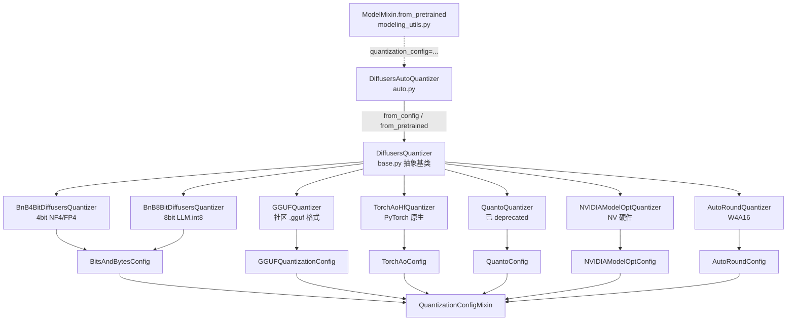
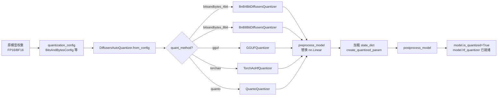
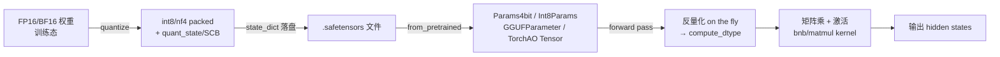
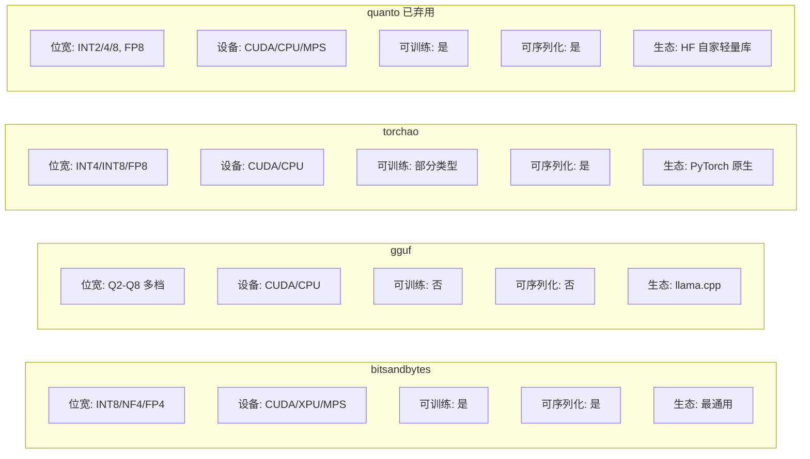

# 13 量化 - Quantizers

> 基于 diffusers 0.39.0.dev0 版本

## 1. 总起：模块概览

### 1.1 量化的目标

扩散模型在最近两年从 UNet 时代的 ~1B 参数（SDXL ~6.6B）跃迁到 DiT 时代的 12B（Flux.1-Dev），甚至 30B+（HunyuanVideo、Sora 类模型）。原始权重通常以 `float16` / `bfloat16` 存储，单参数 2 字节，10B 模型仅权重就需 ~20 GB 显存，超出消费级显卡的承载能力。

量化（Quantization）的核心目标是**在不显著降低生成质量的前提下，把权重的有效位宽从 16 bit 压缩到 8 bit / 4 bit / 2 bit**，从而：

- 降低显存占用：FP16 → NF4 约压缩至 1/4，让 12B 模型可跑在 16 GB 甚至 8 GB 消费级 GPU 上；
- 降低推理成本：减少显存带宽压力，在 batch 较大或 DiT 这种算子访存比偏低的场景下可获得一定加速；
- 跨设备部署：CPU/MPS 等显存受限的设备也能加载大模型。

代价是精度损失和**反量化（dequantize on the fly）**带来的算子开销，因此社区衍生出多种后端方案，权衡精度、速度、易用性。

### 1.2 家族全景

diffusers `quantizers/` 包含 **6 个量化后端**，由 [QuantizationMethod](file:///workspace/src/diffusers/quantizers/quantization_config.py) 枚举统一管理：

| 后端 | 枚举值 | 主要位宽 | 依赖库 | 适用场景 |
| --- | --- | --- | --- | --- |
| bitsandbytes | `bitsandbytes` | INT8 / NF4 / FP4 | `bitsandbytes>=0.43.3`, `accelerate>=0.26.0` | 通用、入门首选 |
| gguf | `gguf` | Q2–Q8 多档位 | `gguf>=0.10.0`, `accelerate` | llama.cpp 社区格式 |
| torchao | `torchao` | INT4 / INT8 / FP8 | `torchao>=0.15.0`, `torch>=2.5.0` | PyTorch 原生量化 |
| quanto | `quanto` | INT2 / INT4 / INT8 / FP8 | `optimum-quanto>=0.2.6` | 轻量、跨设备（已 deprecated） |
| modelopt | `modelopt` | FP8 / INT8 / INT4 / NVFP4 / NF4 | `nvidia-modelopt` | NVIDIA 硬件优化 |
| autoround | `auto-round` | W4A16 为主 | `auto-round` | 高精度 W4A16 |

### 1.3 设计理念

整个 quantizers 模块沿用了与 `transformers` 几乎同构的抽象（事实上很多文件头都标注 `Adapted from transformers/...`），但做了三点关键调整：

1. **统一接口**：所有后端都继承自 [DiffusersQuantizer](file:///workspace/src/diffusers/quantizers/base.py) 抽象基类，对外暴露 `preprocess_model` / `postprocess_model` / `validate_environment` / `check_if_quantized_param` / `create_quantized_param` 等一组固定方法。
2. **后端可插拔**：[DiffusersAutoQuantizer](file:///workspace/src/diffusers/quantizers/auto.py) 通过 `AUTO_QUANTIZER_MAPPING` 字典把字符串 key（如 `"bitsandbytes_4bit"`、`"gguf"`）映射到具体的 Quantizer 类。新增一个后端只需在映射表里加一行 + 实现一个子类。
3. **可选依赖管理**：所有后端库都通过 `is_xxx_available()` 守卫，在 import 失败时给出友好错误而非崩溃。`required_packages` 属性让基类可以统一报错。

值得注意的是，**diffusers 0.39.0.dev0 并没有名为 `QuantizerMixin` 的类**（与 transformers 不同）。`ModelMixin` 与量化器的集成是通过 `from_pretrained` 流程中临时挂载的 `hf_quantizer` 属性完成的（详见 §2.1）。

### 1.4 量化器家族架构图

**图 13-1：DiffusersQuantizer 家族架构**



图 13-1 说明：上层是配置类族（`QuantizationConfigMixin` 及其 6 个子类），下层是 Quantizer 实现族（6 个后端的 7 个具体类，bnb 拆为 4bit/8bit 两个）。`DiffusersAutoQuantizer` 是工厂入口，`ModelMixin.from_pretrained` 通过它构造具体 Quantizer 并挂载为 `hf_quantizer`。

## 2. 分述：核心实现

### 2.1 核心框架

#### DiffusersQuantizer 基类

[DiffusersQuantizer](file:///workspace/src/diffusers/quantizers/base.py) 是一个 `ABC` 子类，定义了所有量化器共有的契约：

- **生命周期钩子**：`preprocess_model` → `_process_model_before_weight_loading`（在 meta device 上替换 `nn.Linear` 为量化版）→ 加载权重 → `postprocess_model` → `_process_model_after_weight_loading`。
- **dtype / device_map 协商**：`update_torch_dtype`、`update_device_map`、`adjust_target_dtype`、`adjust_max_memory` 让量化器介入 `from_pretrained` 的设备/dtype 推断。
- **量化参数识别**：`check_if_quantized_param` 判断 state_dict 中的某个 tensor 是否为量化参数；`create_quantized_param` 把它构造成对应后端的量化 Parameter（如 `bnb.nn.Params4bit`、`GGUFParameter`）。
- **元数据/序列化**：`get_state_dict_and_metadata`、`maybe_update_state_dict`、`supports_safetensors_serialization` 用于 safetensors 兼容性（torchao 主要使用）。
- **抽象属性**：`is_serializable`、`is_trainable`、`_process_model_before_weight_loading`、`_process_model_after_weight_loading` 必须由子类实现；`is_compileable` 默认 False，子类可覆盖。
- **dequantize**：`dequantize(model)` 调子类 `_dequantize` 反量化回原模型，并清掉 `hf_quantizer` 属性、置 `is_quantized=False`。

类属性 `requires_calibration = False`、`required_packages = None` 是默认值，子类按需覆盖。

#### ModelMixin 集成（而非 QuantizerMixin）

与 transformers 不同，diffusers 没有独立的 `QuantizerMixin`。集成通过 `ModelMixin.from_pretrained`（[modeling_utils.py](file:///workspace/src/diffusers/models/modeling_utils.py) L1147–1173）中的几行代码完成：

```python
pre_quantized = "quantization_config" in config and config["quantization_config"] is not None
if pre_quantized or quantization_config is not None:
    if pre_quantized:
        config["quantization_config"] = DiffusersAutoQuantizer.merge_quantization_configs(
            config["quantization_config"], quantization_config
        )
    else:
        config["quantization_config"] = quantization_config
    hf_quantizer = DiffusersAutoQuantizer.from_config(
        config["quantization_config"], pre_quantized=pre_quantized
    )
```

随后 `hf_quantizer` 被挂到 model 实例上，在权重加载前后由 `preprocess_model` / `postprocess_model` 调用。`save_pretrained` 中也会读 `hf_quantizer.is_serializable` 和 `supports_safetensors_serialization` 决定能否落盘。

#### auto.py 自动选后端

[DiffusersAutoQuantizer](file:///workspace/src/diffusers/quantizers/auto.py) 暴露三个 `classmethod`：

- `from_config(quantization_config)` — 入口最常用，按 `quant_method` 字段查 `AUTO_QUANTIZER_MAPPING` 表，对 bnb 额外根据 `load_in_8bit`/`load_in_4bit` 加 `_8bit`/`_4bit` 后缀。
- `from_dict(quantization_config_dict)` — 字典到 Config 对象。
- `from_pretrained(path)` — 读 model index.json 的 `quantization_config`，再走 `from_dict`。
- `merge_quantization_configs` — 处理「模型本身已有 quantization_config，用户又传一份」的合并，模型侧优先；对 AutoRound 允许部分字段被覆盖。

#### quantization_config.py 配置类

[QuantizationConfigMixin](file:///workspace/src/diffusers/quantizers/quantization_config.py) 是 `@dataclass`，提供 `from_dict` / `to_dict` / `to_json_file` / `to_json_string` / `update` 等通用方法。6 个子类各自的 `__init__` 在内部强制设置 `self.quant_method = QuantizationMethod.XXX`，便于 `auto.py` 路由。`BitsAndBytesConfig` 是唯一一个同时承载 4bit/8bit 的配置类，靠 `load_in_4bit` / `load_in_8bit` 互斥标志区分。

### 2.2 BitsAndBytes 后端详解

[bitsandbytes/](file:///workspace/src/diffusers/quantizers/bitsandbytes) 是 diffusers 最早支持、也是用户量最大的量化后端，对应 `BitsAndBytesConfig`：

- `load_in_8bit` / `load_in_4bit` — 二选一，互斥。
- `bnb_4bit_compute_dtype` — 反量化后用于前向计算的 dtype，常设 `torch.bfloat16`。
- `bnb_4bit_quant_type` — `"fp4"`（默认）或 `"nf4"`（QLoRA 论文提出的 NormalFloat4，对正态分布权重更友好）。
- `bnb_4bit_use_double_quant` — 是否对量化常数二次量化，再省 ~0.4 bit/参数。
- `bnb_4bit_quant_storage` — 打包存储 dtype，默认 `torch.uint8`（两个 4bit 值打包成 1 byte）。
- `llm_int8_threshold` — LLM.int8() 的离群点阈值（默认 6.0），超过阈值的列保留 fp16 计算。
- `llm_int8_skip_modules` — 不量化的模块名列表。
- `llm_int8_enable_fp32_cpu_offload` — 允许把部分模块卸到 CPU 以 fp32 跑。

`post_init()` 会做类型检查，并要求 4bit 模式下 `bitsandbytes>=0.39.0`。`is_quantizable()` 仅在 4bit 或 8bit 任一为 True 时返回 True。

[BnB4BitDiffusersQuantizer](file:///workspace/src/diffusers/quantizers/bitsandbytes/bnb_quantizer.py) 的关键流程：

- `validate_environment` — 强制 CUDA/XPU/MPS，要求 `accelerate>=0.26.0`、`bitsandbytes>=0.43.3`。
- `adjust_target_dtype` — 把 `target_dtype` 替换成 `accelerate.utils.CustomDtype.INT4`，让 `infer_auto_device_map` 知道权重只有 4 bit。
- `_process_model_before_weight_loading` — 调 [utils.replace_with_bnb_linear](file:///workspace/src/diffusers/quantizers/bitsandbytes/utils.py)，递归把 `nn.Linear` 替换为 `bnb.nn.Linear4bit`；同时把 `keep_in_fp32_modules` 与 offload 到 CPU/Disk 的模块合入 `modules_to_not_convert`。
- `check_if_quantized_param` + `create_quantized_param` — 识别 `bnb.nn.Params4bit`，预量化时调用 `bnb.nn.Params4bit.from_prequantized` 重组权重 + `quant_state`（含 `bitsandbytes__nf4`/`bitsandbytes__fp4` 子张量）；非预量化时直接 `bnb.nn.Params4bit(value).cuda()`，首次 `.cuda()` 触发真正量化。

[BnB8BitDiffusersQuantizer](file:///workspace/src/diffusers/quantizers/bitsandbytes/bnb_quantizer.py) 与 4bit 高度同构，差别仅在：替换为 `bnb.nn.Linear8bitLt`，量化参数类是 `bnb.nn.Int8Params`，状态字段叫 `SCB`（scale statistics），`adjust_target_dtype` 返回 `torch.int8`。`is_compileable` 在 8bit 上返回 True（4bit 因 CUDA graph 兼容性返回 False）。

### 2.3 GGUF 后端详解

[gguf/](file:///workspace/src/diffusers/quantizers/gguf) 支持 [llama.cpp](https://github.com/ggerganov/llama.cpp) 生态的 `.gguf` 文件格式。`GGUFQuantizationConfig` 极简，只有 `compute_dtype`（反量化计算 dtype，默认 `torch.float32`）和 `modules_to_not_convert`。

[GGUFQuantizer](file:///workspace/src/diffusers/quantizers/gguf/gguf_quantizer.py) 的特点：

- **只能加载预量化权重**（`pre_quantized=True`），不支持运行时量化；`is_serializable=False`、`is_trainable=False`。
- `validate_environment` 要求 `accelerate>=0.26.0`、`gguf>=0.10.0`。
- `_replace_with_gguf_linear` 在加载前把 `nn.Linear` 换成 `GGUFLinear`，参数类是 `GGUFParameter`，附带 `quant_type` 字段（如 `"q4_K"`、`"q8_0"`）。
- `check_quantized_param_shape` 用 `GGML_QUANT_SIZES` 表查 block_size/type_size 反推期望形状，校验 .gguf 数据是否对得上模型骨架。
- `create_quantized_param` 中，若 `param_name` 落在 `modules_to_not_convert`，会调用 `dequantize_gguf_tensor` 当场反量化回 fp32/compute_dtype。
- `_dequantize` 走 `_dequantize_gguf_and_restore_linear`，把所有 GGUFLinear 还原为 nn.Linear。

社区已经把 SDXL、Flux、HunyuanVideo 等模型以 Q4_K_M / Q8_0 等档位发布到 HF Hub，diffusers 加载只需 `from_pretrained(..., quantization_config=GGUFQuantizationConfig())`。

### 2.4 TorchAo 后端详解

[torchao/](file:///workspace/src/diffusers/quantizers/torchao) 接入 PyTorch 官方的 [torchao](https://github.com/pytorch/ao) 库。`TorchAoConfig` 的核心字段 `quant_type` 是一个 `AOBaseConfig` 实例，例如 `Int4WeightOnlyConfig`、`Int8WeightOnlyConfig`、`Float8WeightOnlyConfig` 等，由用户直接从 `torchao.quantization` import 后传入。`to_dict`/`from_dict` 通过 `torchao.core.config.config_to_dict` / `config_from_dict` 处理序列化。

[TorchAoHfQuantizer](file:///workspace/src/diffusers/quantizers/torchao/torchao_quantizer.py) 的特点：

- `required_packages = ["torchao"]`，要求 `torchao>=0.15.0`、`torch>=2.5.0`。
- `validate_environment` 会检测 `device_map` 是否含 CPU/Disk，预量化模型不支持 offload；非预量化允许 offload 但相应模块不量化。
- `update_torch_dtype` 在整数量化时强制 `bfloat16`（dtype 不匹配会 warning）。
- `create_quantized_param` 是核心：预量化时直接把 tensor 作为 `Parameter` 装回（torchao 的 tensor subclass 自带量化元数据），并 monkey-patch `module.extra_repr` 让打印更友好；非预量化时调用 `quantize_(module, self.quantization_config.get_apply_tensor_subclass())` 即时量化。
- `get_state_dict_and_metadata` + `maybe_update_state_dict` 处理 torchao ≥0.16.0 的 safetensors flatten/unflatten 协议，把 tensor subclass 拍平成普通 tensor 加元数据存盘。
- `is_trainable` 限白名单（Int8WeightOnly 等 5 种）；`is_compileable=True`；`is_serializable` 依赖 `huggingface_hub>=0.25.0`。
- `_dequantize` 遍历 `nn.Linear`，对 `TorchAOBaseTensor` 类型的 `module.weight` 调 `.dequantize()`。

### 2.5 Quanto 后端详解

[quanto/](file:///workspace/src/diffusers/quantizers/quanto) 接入 HuggingFace 自家的 [optimum-quanto](https://github.com/huggingface/optimum-quanto)。`QuantoConfig` 字段精简：`weights_dtype`（`"float8"`/`"int8"`/`"int4"`/`"int2"`）和 `modules_to_not_convert`。

> **注意**：0.39.0.dev0 中 `QuantoConfig` 和 `QuantoQuantizer` 都已 `deprecate("QuantoConfig", "1.0.0", ...)`，将在 1.0 移除，新代码建议改用 bnb 或 torchao。

[QuantoQuantizer](file:///workspace/src/diffusers/quantizers/quanto/quanto_quantizer.py) 的关键：

- `validate_environment` 要求 `optimum-quanto>=0.2.6`、`accelerate`，且不支持多 GPU/CPU offload 的 `device_map`。
- `_process_model_before_weight_loading` 调 `_replace_with_quanto_layers` 把 `nn.Linear` 替换为 `optimum.quanto.QModuleMixin` 子类。
- `create_quantized_param` 非预量化时 `set_module_tensor_to_device` 后调 `module.freeze()` 锁定权重并执行量化；预量化时直接 setattr 还原 `QTensor`/`PackedTensor`。
- `adjust_target_dtype` 用 accelerate 的 `CustomDtype`（INT2/INT4/FP8）。
- `is_trainable`、`is_serializable`、`is_compileable` 均为 True。

### 2.6 量化流程图

**图 13-2：从原模型到量化模型的加载流程**



图 13-2 说明：用户传入的 `quantization_config` 经 `DiffusersAutoQuantizer` 路由到具体 Quantizer，Quantizer 在权重加载前后接管模型骨架替换与参数构造。整条链路在 `ModelMixin.from_pretrained` 内部完成，对外只暴露 `quantization_config=...` 一个参数。

### 2.7 数据流图

**图 13-3：量化权重的前向计算数据流**



图 13-3 说明：量化模型的权重在显存中始终以压缩形式存储（4bit/8bit），每次前向计算时由后端 kernel 现场反量化到 `compute_dtype` 再做 GEMM。这种「存压缩、算反量化」的模式让显存占用降低但访存与计算比改变，是量化提速/降速的关键。

### 2.8 后端选型对比图

**图 13-4：四个主流后端的能力对比**



图 13-4 说明：四个后端在位宽覆盖、设备支持、可训练性上各有侧重。bnb 是入门首选；gguf 适合直接消费社区 .gguf 资源；torchao 适合追求 PyTorch 原生 + 编译优化；quanto 因弃用建议新项目避开。modelopt 限于 NVIDIA 硬件，autoround 主打高精度 W4A16，未在此图展开。

## 3. 使用指南

### 3.1 API 速查

```python
# 1. 构造量化配置
from diffusers import BitsAndBytesConfig, GGUFQuantizationConfig, TorchAoConfig

bnb_config = BitsAndBytesConfig(
    load_in_4bit=True,
    bnb_4bit_quant_type="nf4",
    bnb_4bit_compute_dtype=torch.bfloat16,
    bnb_4bit_use_double_quant=True,
)

# 2. 加载时传入 quantization_config 参数
model = FluxTransformer2DModel.from_pretrained(
    "black-forest-labs/FLUX.1-dev",
    subfolder="transformer",
    quantization_config=bnb_config,
    torch_dtype=torch.bfloat16,
)

# 3. 加载已预量化的模型（不需要传 config，模型 index.json 自带）
from diffusers import DiffusersAutoQuantizer
quantizer = DiffusersAutoQuantizer.from_pretrained("City81/FLUX.1-dev-gguf")

# 4. 反量化回原模型
model = model.hf_quantizer.dequantize(model)

# 5. 管道级量化
from diffusers import PipelineQuantizationConfig
pipe_quant = PipelineQuantizationConfig(
    quant_backend="bitsandbytes_4bit",
    quant_kwargs={"load_in_4bit": True, "bnb_4bit_quant_type": "nf4"},
    components_to_quantize=["transformer"],
)
```

### 3.2 最小示例：Flux NF4 量化推理

```python
import torch
from diffusers import FluxPipeline, BitsAndBytesConfig

quant_config = BitsAndBytesConfig(
    load_in_4bit=True,
    bnb_4bit_quant_type="nf4",
    bnb_4bit_compute_dtype=torch.bfloat16,
    bnb_4bit_use_double_quant=True,
)

pipe = FluxPipeline.from_pretrained(
    "black-forest-labs/FLUX.1-dev",
    transformer=None,  # 先建空 pipe
    torch_dtype=torch.bfloat16,
)
# 单独量化 transformer，避免 VAE/TextEncoder 被误量化
from diffusers import FluxTransformer2DModel
transformer = FluxTransformer2DModel.from_pretrained(
    "black-forest-labs/FLUX.1-dev",
    subfolder="transformer",
    quantization_config=quant_config,
    torch_dtype=torch.bfloat16,
)
pipe.transformer = transformer
pipe.enable_model_cpu_offload()

image = pipe("a cyberpunk cat, neon lights", height=1024, width=1024).images[0]
```

### 3.3 常用参数

| 配置类 | 参数 | 取值 | 说明 |
| --- | --- | --- | --- |
| BitsAndBytesConfig | `load_in_4bit` | bool | 4bit 总开关，与 8bit 互斥 |
| | `bnb_4bit_quant_type` | `"fp4"` / `"nf4"` | NF4 对正态分布权重精度更高 |
| | `bnb_4bit_compute_dtype` | `torch.dtype` | 反量化后计算 dtype |
| | `bnb_4bit_use_double_quant` | bool | 二次量化，进一步省显存 |
| | `llm_int8_threshold` | float | 8bit 离群点阈值，默认 6.0 |
| GGUFQuantizationConfig | `compute_dtype` | `torch.dtype` | 反量化计算 dtype |
| TorchAoConfig | `quant_type` | `AOBaseConfig` | 如 `Int4WeightOnlyConfig()` |
| | `modules_to_not_convert` | list[str] | 不量化的模块名 |
| QuantoConfig | `weights_dtype` | `"int8"` 等 | 已 deprecated |
| PipelineQuantizationConfig | `quant_backend` | str | 管道级后端名 |
| | `components_to_quantize` | list[str] | 量化哪些组件 |
| | `quant_mapping` | dict | 细粒度：每个组件用不同 config |

## 4. 实战案例

### 4.1 案例 1：Flux NF4 量化推理（4bit）

最经典的「把 24 GB 才能跑的 Flux 塞进 12 GB 显卡」场景：

```python
import torch
from diffusers import FluxTransformer2DModel, FluxPipeline, BitsAndBytesConfig

nf4_config = BitsAndBytesConfig(
    load_in_4bit=True,
    bnb_4bit_quant_type="nf4",
    bnb_4bit_compute_dtype=torch.bfloat16,
    bnb_4bit_use_double_quant=True,
)

# 仅量化 transformer（占 99% 显存），VAE/text encoders 保持 bf16
transformer = FluxTransformer2DModel.from_pretrained(
    "black-forest-labs/FLUX.1-dev",
    subfolder="transformer",
    quantization_config=nf4_config,
    torch_dtype=torch.bfloat16,
)

pipe = FluxPipeline.from_pretrained(
    "black-forest-labs/FLUX.1-dev",
    transformer=transformer,
    torch_dtype=torch.bfloat16,
)
pipe.enable_model_cpu_offload()  # 进一步降到 ~8 GB 显存

out = pipe("a photorealistic portrait of a fox in snow", num_inference_steps=28).images[0]
out.save("fox.png")
```

要点：

- 只量化 transformer：VAE 解码对精度敏感，NF4 会让画面出现色块。
- `bnb_4bit_compute_dtype=torch.bfloat16`：4bit 反量化后用 bf16 算，比 fp32 快且省内存。
- `enable_model_cpu_offload`：把不同子模型在 CPU/GPU 间切换，进一步降低峰值显存。
- 量化模型**不可直接 `to("cuda")` 后再做 `pipe.to("cuda")`**，会触发 bnb 重新量化报错；用 `enable_model_cpu_offload` 或 `device_map="auto"`。

### 4.2 案例 2：GGUF 模型加载

社区已有大量 `.gguf` 格式的 Flux/HunyuanVideo 检查点，加载流程：

```python
import torch
from diffusers import FluxPipeline, GGUFQuantizationConfig, FluxTransformer2DModel

# 选用 Q4_K_M 量化版本（约 6 GB）
transformer = FluxTransformer2DModel.from_single_file(
    "https://huggingface.co/city96/FLUX.1-dev-gguf/resolve/main/flux1-dev-Q4_K_M.gguf",
    quantization_config=GGUFQuantizationConfig(compute_dtype=torch.bfloat16),
    torch_dtype=torch.bfloat16,
)

pipe = FluxPipeline.from_pretrained(
    "black-forest-labs/FLUX.1-dev",
    transformer=transformer,
    torch_dtype=torch.bfloat16,
)
pipe.enable_model_cpu_offload()
```

要点：

- GGUF 用 `from_single_file` 加载单个 `.gguf` 文件，而非 `from_pretrained` 的目录结构。
- `compute_dtype` 决定反量化后矩阵乘的精度，CPU 推理用 `torch.float32`，GPU 用 `torch.bfloat16`。
- GGUF 不支持运行时再量化，也不能 `save_pretrained`（`is_serializable=False`），需要保留原 .gguf 链接。
- 若想反量化回原模型用于微调：`transformer = transformer.hf_quantizer.dequantize(transformer)`。

## 5. 总结

### 5.1 要点回顾

- 量化以「存压缩、算反量化」的方式降低显存占用，代价是精度损失与反量化 kernel 开销。
- diffusers `quantizers/` 模块以 `DiffusersQuantizer` 抽象基类 + `DiffusersAutoQuantizer` 工厂统一管理 6 个后端，配置侧由 `QuantizationConfigMixin` 派生类承载。
- ModelMixin 通过 `hf_quantizer` 属性在 `from_pretrained` 中接入量化器，无独立 `QuantizerMixin`。
- 量化器在权重加载前后通过 `preprocess_model`/`postprocess_model` 替换 `nn.Linear`、构造量化 Parameter，前向计算时由后端 kernel 现场反量化。

### 5.2 后端选型指南

- **bnb（4bit NF4）**：通用入门首选，CUDA/XPU/MPS 全覆盖，可训练可序列化，社区生态最成熟。
- **gguf**：直接消费 llama.cpp 生态的 .gguf 资源，多档位可选，但不可训练不可序列化。
- **torchao**：PyTorch 原生量化，支持 INT4/INT8/FP8 与 `torch.compile`，适合追求极致性能与编译优化。
- **quanto**：HF 自家轻量库，跨设备友好，但 0.39.0.dev0 已 deprecated，新项目建议避开。
- **modelopt**：限 NVIDIA 硬件，提供 NVFP4 等先进格式。
- **autoround**：W4A16 高精度场景，支持 exllamav2/marlin 等推理 kernel。

### 5.3 与 ModelMixin/loaders 的关系

- `ModelMixin.from_pretrained` 是量化器入口，`hf_quantizer` 在此被构造并贯穿整个加载流程。
- `ModelMixin.save_pretrained` 通过 `hf_quantizer.is_serializable` 和 `supports_safetensors_serialization` 决定能否落盘，并通过 `get_state_dict_and_metadata` 处理 safetensors flatten。
- `ModelMixin.dequantize` 直接转调 `hf_quantizer.dequantize`，反量化后 `is_quantized=False`、`hf_quantizer` 被删除。
- [PipelineQuantizationConfig](file:///workspace/src/diffusers/quantizers/pipe_quant_config.py) 在 `DiffusionPipeline.from_pretrained` 层面把多个组件的量化需求统一管理，支持「全局 backend」和「per-component mapping」两种模式，并在初始化时校验 diffusers 与 transformers 同名 backend 的 `__init__` 签名是否一致。
