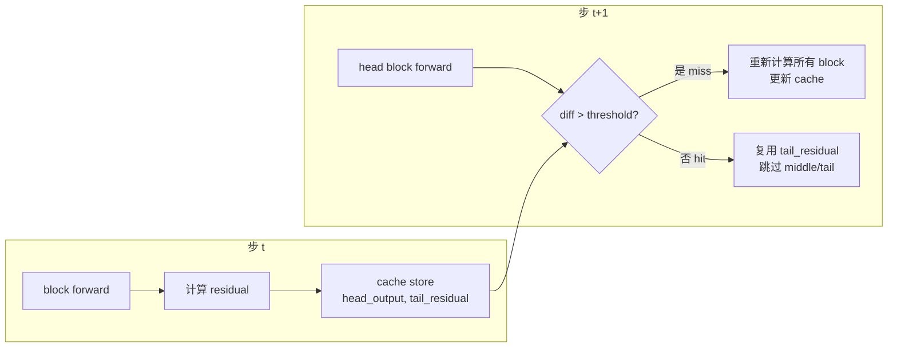
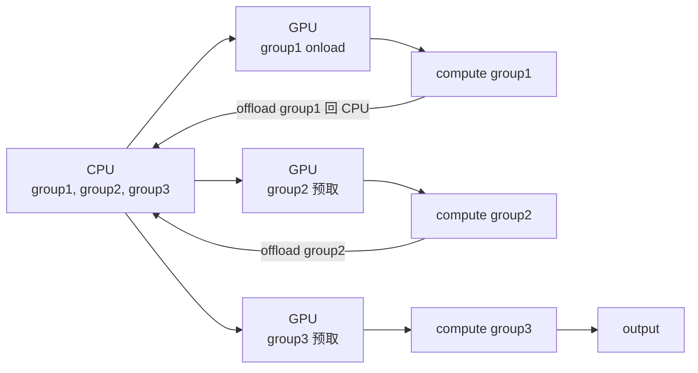
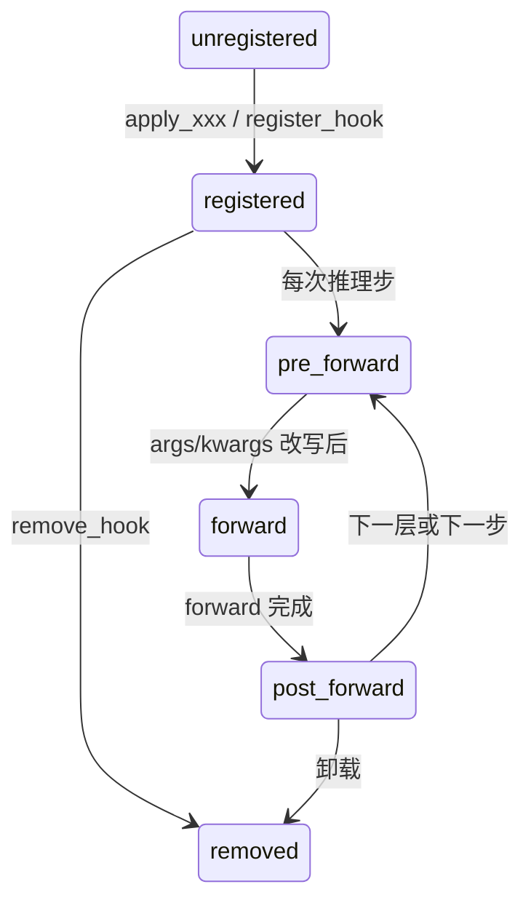

# 14 优化钩子 - Hooks

> 基于 diffusers 0.39.0.dev0 版本

> 本文为「分」论篇，剖析 Diffusers 中 Hook 钩子家族的设计哲学、核心实现与组合用法。钩子是 Diffusers 推理优化的统一可插拔底座——从 First Block Cache 的相邻步复用，到 Group Offloading 的层组卸载，再到 Layerwise Casting 的混合精度，所有优化都通过同一套 `ModelHook` / `HookRegistry` 协议注入到 `torch.nn.Module` 的 forward 链中。

---

## 1. 总起：模块概览

### 1.1 钩子机制提供推理时优化

Diffusers 0.39 把所有「推理时优化」收敛到一套钩子（Hook）机制上。它的核心目标是把优化策略与模型实现解耦：模型作者只写一次 forward，优化作者通过 hook 在 `pre_forward` / `post_forward` / `new_forward` 三个切入点注入逻辑，从而实现：

- **缓存加速**：相邻去噪步之间 block 输出高度相似，可跳过部分计算（First Block Cache、MAG Cache、Faster Cache、TaylorSeer Cache）；
- **省显存**：把层组按需在 CPU/GPU 之间换入换出（Group Offloading），或把权重以低精度存储、高精度计算（Layerwise Casting）；
- **精度转换**：fp8 存储 + bf16 计算，兼顾显存与质量；
- **并行**：上下文并行（Context Parallel），把序列维度切到多卡；
- **其他**：层跳过（LayerSkip）、金字塔注意力广播（PyramidAttentionBroadcast）、文本 KV 缓存（TextKVCache）、平滑能量引导（SmoothedEnergyGuidance）。

### 1.2 钩子家族全景

整个家族位于 [src/diffusers/hooks/](file:///workspace/src/diffusers/hooks/)，共 16 个文件，按职能分组如下：

| 类别 | 文件 | 主要导出 |
| --- | --- | --- |
| 核心框架 | [hooks.py](file:///workspace/src/diffusers/hooks/hooks.py) | `ModelHook`、`HookRegistry`、`StateManager`、`BaseState`、`HookFunctionReference` |
| 公共辅助 | [_common.py](file:///workspace/src/diffusers/hooks/_common.py)、[_helpers.py](file:///workspace/src/diffusers/hooks/_helpers.py) | 块标识符、`TransformerBlockRegistry`、`AttentionProcessorRegistry` |
| 缓存类 | [first_block_cache.py](file:///workspace/src/diffusers/hooks/first_block_cache.py) | `FirstBlockCacheConfig`、`apply_first_block_cache` |
|  | [mag_cache.py](file:///workspace/src/diffusers/hooks/mag_cache.py) | `MagCacheConfig`、`apply_mag_cache` |
|  | [faster_cache.py](file:///workspace/src/diffusers/hooks/faster_cache.py) | `FasterCacheConfig`、`apply_faster_cache` |
|  | [taylorseer_cache.py](file:///workspace/src/diffusers/hooks/taylorseer_cache.py) | `TaylorSeerCacheConfig`、`apply_taylorseer_cache` |
| 省显存 | [group_offloading.py](file:///workspace/src/diffusers/hooks/group_offloading.py) | `apply_group_offloading`、`GroupOffloadingHook` |
| 精度 | [layerwise_casting.py](file:///workspace/src/diffusers/hooks/layerwise_casting.py) | `apply_layerwise_casting`、`LayerwiseCastingHook` |
| 并行 | [context_parallel.py](file:///workspace/src/diffusers/hooks/context_parallel.py) | `apply_context_parallel` |
| 其他 | [text_kv_cache.py](file:///workspace/src/diffusers/hooks/text_kv_cache.py) | `TextKVCacheConfig`、`apply_text_kv_cache` |
|  | [layer_skip.py](file:///workspace/src/diffusers/hooks/layer_skip.py) | `LayerSkipConfig`、`apply_layer_skip` |
|  | [pyramid_attention_broadcast.py](file:///workspace/src/diffusers/hooks/pyramid_attention_broadcast.py) | `PyramidAttentionBroadcastConfig` |
|  | [smoothed_energy_guidance_utils.py](file:///workspace/src/diffusers/hooks/smoothed_energy_guidance_utils.py) | `SmoothedEnergyGuidanceConfig` |

入口文件 [__init__.py](file:///workspace/src/diffusers/hooks/__init__.py) 统一把这些 `apply_*` 函数与对应 `Config` 暴露为公开 API：`from diffusers.hooks import apply_first_block_cache, FirstBlockCacheConfig`。

### 1.3 设计理念：可插拔，通过 apply_* 注册到 ModelMixin

Diffusers 钩子的设计哲学有三条：

1. **统一协议**：所有优化都实现 `ModelHook`，通过 `HookRegistry.register_hook` 装配。Registry 会改写 `module.forward`，用 `HookFunctionReference` 把 `pre_forward → forward → post_forward` 串成一条新链。
2. **可组合**：同一模块可挂多个 hook（顺序执行），有状态 hook 通过 `StateManager` + `_set_context` 隔离上下文，避免互相污染。
3. **可移除**：每个 hook 有名字，`remove_hook` 能精确还原原始 forward，便于调试与切换。

`ModelMixin`（[src/diffusers/models/modeling_utils.py](file:///workspace/src/diffusers/models/modeling_utils.py)）暴露了两个便捷封装：`enable_group_offload`（520 行）和 `enable_layerwise_casting`（435 行），它们内部都只是配置参数后调用对应的 `apply_*`。缓存类钩子则直接通过 `apply_first_block_cache(pipe.transformer, config)` 形式应用。

### 1.4 钩子家族架构图

**图 14-1：Hook 钩子家族架构图**

```mermaid
flowchart TD
    Base["ModelHook<br/>基类协议"]
    Reg["HookRegistry<br/>注册表/forward 改写"]
    State["StateManager<br/>有状态 hook 上下文隔离"]

    Base --> Reg
    Base --> State

    subgraph Cache["缓存类"]
        FBC["FBCHeadBlockHook<br/>FBCBlockHook<br/>first_block_cache"]
        MAG["MagCacheHeadHook<br/>mag_cache"]
        FASTER["FasterCacheHook<br/>faster_cache"]
        TAYLOR["TaylorSeerCacheHook<br/>taylorseer_cache"]
        TKV["TextKVCacheTransformerHook<br/>text_kv_cache"]
    end

    subgraph Mem["省显存与精度"]
        GO["GroupOffloadingHook<br/>group_offloading"]
        LC["LayerwiseCastingHook<br/>layerwise_casting"]
    end

    subgraph Other["并行与其他"]
        CP["ContextParallelSplitHook<br/>ContextParallelGatherHook"]
        LS["LayerSkipHook<br/>layer_skip"]
        PAB["PyramidAttentionBroadcastHook"]
        SEG["SmoothedEnergyGuidanceHook"]
    end

    Base --> FBC
    Base --> MAG
    Base --> FASTER
    Base --> TAYLOR
    Base --> TKV
    Base --> GO
    Base --> LC
    Base --> CP
    Base --> LS
    Base --> PAB
    Base --> SEG
```



图 14-1 说明：`ModelHook` 是所有钩子的基类，`HookRegistry` 负责把 hook 装配到 `torch.nn.Module.forward`，`StateManager` 为有状态 hook（`_is_stateful=True`，如各类 cache）提供按 context 隔离的状态缓存。下方的三大子图分别对应缓存类、省显存与精度、并行与其他优化。

---

## 2. 分述：核心实现

### 2.1 核心框架（hooks.py）

整个钩子家族的地基是 [hooks.py](file:///workspace/src/diffusers/hooks/hooks.py) 中的 `ModelHook` 与 `HookRegistry`。

#### ModelHook 协议

`ModelHook`（hooks.py:59）定义了五个可被子类覆盖的回调：

- `initialize_hook(module)`：装配时调用一次，常用于把元数据写入 hook（如 `FBCHeadBlockHook.initialize_hook` 调用 `TransformerBlockRegistry.get` 拿到该 block 的 `return_hidden_states_index`）。
- `pre_forward(module, *args, **kwargs)`：原 forward 执行**前**调用，可改写输入。返回 `(args, kwargs)`。
- `post_forward(module, output)`：原 forward 执行**后**调用，可改写输出。
- `new_forward(module, *args, **kwargs)`：可选，**完全替换**原 forward。当 hook 定义了它时，`HookRegistry` 会把原 forward 存到 `fn_ref.original_forward`，链路变为 `pre_forward → new_forward(内部调用 original_forward) → post_forward`。缓存类钩子几乎都用 `new_forward`，因为它们要在原 forward 前后插入「是否命中缓存」的判断。
- `detach_hook` / `deinitalize_hook` / `reset_state`：卸载与有状态重置。

类属性 `_is_stateful` 标记 hook 是否持有跨步状态。若为 `True`，则必须实现 `reset_state`，并在每轮推理开始时由 `HookRegistry.reset_stateful_hooks` 主动重置。

#### HookRegistry 与 forward 改写

`HookRegistry`（hooks.py:167）挂在 `module._diffusers_hook` 上，由 `HookRegistry.check_if_exists_or_initialize` 惰性创建。`register_hook` 的核心逻辑（hooks.py:177-215）：

```python
def create_new_forward(function_reference: HookFunctionReference):
    def new_forward(module, *args, **kwargs):
        args, kwargs = function_reference.pre_forward(module, *args, **kwargs)
        output = function_reference.forward(*args, **kwargs)
        return function_reference.post_forward(module, output)
    return new_forward
```

每次注册一个 hook，都会用一份 `HookFunctionReference` 把当前 hook 的 `pre/post_forward` 与「上一层 hook 留下的 forward」绑在一起，再用 `functools.partial` 包成新的 `module.forward`。当 hook 提供 `new_forward` 时，`fn_ref.forward` 被替换成 `hook.new_forward`，原 forward 保存到 `fn_ref.original_forward`，从而 hook 内部仍可通过 `self.fn_ref.original_forward(*args, **kwargs)` 调用真实计算。

`remove_hook` 通过 `fn_ref.original_forward` 还原上一层的 forward，从而实现精确拆卸而无需重建整条链。`_get_child_registries` 还做了缓存，避免对大模型（如 Flux）每次 `_set_context` 都遍历整棵模块树（注释里提到原本每次 ~2.7ms）。

#### StateManager 与 context 隔离

`StateManager`（hooks.py:34）维护一份 `{context_name: state_instance}` 的字典。`get_state` 返回当前 context 对应的状态；`set_context` 切换 context；`reset` 清空全部。这套机制让同一 hook 在「正向/负向 prompt」「不同 batch」之间互不污染——`TextKVCacheTransformerHook` 正是用 `data_ptr()` 作 key 来区分不同 prompt。

### 2.2 缓存类钩子详解

缓存类钩子的共同思路是：相邻去噪步之间，transformer block 的输出残差变化很小，可以把上一步的残差缓存起来，本步若变化幅度低于阈值就直接复用，跳过整段 forward。不同方法 differ 在「如何判断该跳」与「跳过哪些 block」。

#### FirstBlockCache（first_block_cache.py）

[FirstBlockCacheConfig](file:///workspace/src/diffusers/hooks/first_block_cache.py) 只有一个参数 `threshold: float = 0.05`。`apply_first_block_cache`（first_block_cache.py:193）的工作流：

1. 遍历 `module.named_children()`，找出 `ModuleList` 形态的 transformer block 栈（用 `_ALL_TRANSFORMER_BLOCK_IDENTIFIERS` 匹配 `transformer_blocks`、`single_transformer_blocks`、`blocks` 等名字）。
2. 把栈分成三类：**head block**（第一个）、**tail block**（最后一个）、**middle blocks**（中间所有）。
3. 给 head 挂 `FBCHeadBlockHook`，给 middle 与 tail 挂 `FBCBlockHook`。三者共享同一个 `StateManager(FBCSharedBlockState)`。

`FBCHeadBlockHook.new_forward`（first_block_cache.py:78）的逻辑是关键：

- 调用 `original_forward` 拿到 head block 输出，计算残差 `residual = output - input`。
- 调用 `_should_compute_remaining_blocks`：用「当前残差与上一步残差的 absmean 之差 / 上一步残差的 absmean」作为相对变化指标，若 `diff > threshold` 则需要继续算后面 block，否则复用缓存。
- 若**不**需要算：把上一步缓存的 `tail_block_residuals` 加到当前 head 输出上，直接返回拼好的输出，**所有 middle 与 tail block 完全跳过**。
- 若需要算：把 head 输出存入 `shared_state.head_block_output`，让 tail block 在 forward 后计算并缓存 `tail_block_residuals`（tail block 的残差 = tail 输出 − head 输出，本质是「后面所有 block 累计贡献的增量」）。

`FBCBlockHook.new_forward`（first_block_cache.py:157）则根据 `shared_state.should_compute` 决定：要算就调 `original_forward`；不算就直接把输入原样返回（等价于「这个 block 没动」）。tail block 多一步：算完后把残差写回共享状态。

> 注：用户文档中提到的「lru cache 策略」并非字面意义的 `functools.lru_cache`，而是「按 absmean 阈值复用上一步残差」的隐式缓存——只要连续步的相对变化低于阈值就一直复用，直到出现显著变化才刷新。这是一种 step 级单槽缓存，而非多槽 LRU。代码中 `@torch.compiler.disable` 装饰的 `_should_compute_remaining_blocks` 把判断逻辑排除出 `torch.compile`，保证 `.item()` 调用不被追踪。

#### MAG Cache（mag_cache.py）

[MagCacheConfig](file:///workspace/src/diffusers/hooks/mag_cache.py) 是更精细的运动幅度缓存，灵感来自 [MagCache](https://github.com/Zehong-Ma/MagCache)。它引入了「每步 magnitude ratio」的概念——ratio 数组与模型强相关，所以要么传入 `mag_ratios`（Flux 模型可直接用 `FLUX_MAG_RATIOS`），要么开启 `calibrate=True` 跑一遍校准拿到 ratio。

关键参数：

- `threshold=0.06`：累计误差阈值；
- `max_skip_steps=3`：最多连续跳 K 步；
- `retention_ratio=0.2`：前 20% 步强制不跳，保证前期稳定；
- `num_inference_steps=28`：用于把 `mag_ratios` 插值到目标长度。

`MagCacheHeadHook.new_forward`（mag_cache.py:185）维护 `accumulated_ratio`、`accumulated_err`、`accumulated_steps` 三个累加器。每步把当前 ratio 乘进 `accumulated_ratio`，把 `|1 - accumulated_ratio|` 累加到 `accumulated_err`。当 `accumulated_err ≤ threshold` 且 `accumulated_steps ≤ max_skip_steps` 时跳过；否则重置累加器、执行真实计算。这种「累计误差 + 最大连续跳步」的设计比 FBC 的单步阈值更稳健，适合对质量敏感的场景。

#### Faster Cache（faster_cache.py）

[FasterCacheConfig](file:///workspace/src/diffusers/hooks/faster_cache.py) 来自 [FasterCache 论文](https://huggingface.co/papers/2410.19355)，专门针对视频扩散模型，缓存**注意力输出**而非整个 block。它的策略更细：

- `spatial_attention_block_skip_range=2`：每 N 步算一次空间注意力，其余步复用缓存；
- `temporal_attention_block_skip_range`：时间注意力同理；
- `spatial_attention_timestep_skip_range=(-1, 681)`：只在某个 timestep 区间内启用跳过；
- `unconditional_batch_skip_range=5`：每 N 步算一次无条件分支，其余步用条件分支 + 频域权重缩放近似；
- `alpha_low_frequency=1.1`、`alpha_high_frequency=1.1`：低/高频分量的加权系数，用来从条件分支反推无条件分支。

Faster Cache 注册两个 hook：`_FASTER_CACHE_DENOISER_HOOK`（denoiser 级，处理无条件分支跳过）和 `_FASTER_CACHE_BLOCK_HOOK`（block 级，处理注意力跳过）。它用正则 `_SPATIAL_ATTENTION_BLOCK_IDENTIFIERS`（如 `^blocks.*attn`）匹配要挂载的注意力子模块。

#### TaylorSeer Cache（taylorseer_cache.py）

[TaylorSeerCacheConfig](file:///workspace/src/diffusers/hooks/taylorseer_cache.py) 来自 [TaylorSeer 论文](https://huggingface.co/papers/2503.06923)，用**泰勒展开**预测下一步输出。配置项包括 `cache_interval=5`、`disable_cache_before_step=3`、`max_order=1`、`taylor_factors_dtype=bfloat16`，以及 `skip_predict_identifiers` / `cache_identifiers` 两组正则来区分「inactive」（预测步返回零张量）和「active」（缓存 + 泰勒预测）模块。`use_lite_mode=True` 是预置的轻量配置。

### 2.3 Group Offloading 详解（group_offloading.py）

[group_offloading.py](file:///workspace/src/diffusers/hooks/group_offloading.py) 是 Diffusers 0.39 主推的低显存方案。核心 API 是 `apply_group_offloading`（group_offloading.py:565），`ModelMixin.enable_group_offload` 是其便捷封装。

#### 两种粒度

`offload_type` 有两种：

- `block_level`：把 `ModuleList` / `Sequential` 里每 `num_blocks_per_group` 个 block 划为一组，整组在 CPU/GPU 之间换。适合 transformer 这种「一大串 block」结构。
- `leaf_level`：到叶子层粒度，类似 `enable_sequential_cpu_offload`，但能用 stream 加速。

#### ModuleGroup 与换入换出

`ModuleGroup`（group_offloading.py:115）持有一组 module 及其参数/buffer，提供 `onload_()` / `offload_()`。关键设计：

- **onload_leader / offload_leader**：每组指定一个 leader，由 leader 在 `pre_forward` 里触发整组 onload、在 `post_forward` 里触发整组 offload。这样组内非 leader 模块无需各自换入换出，减少同步次数。
- **stream 预取**：`use_stream=True` 时，当前组在算的同时，下一组异步换入 GPU，重叠计算与传输。但要求 `num_blocks_per_group=1`（代码会强制设为 1 并 warning）。
- **磁盘 offload**：`offload_to_disk_path` 可把参数存到 safetensors 文件，进一步省 RAM。每组用 `group_id` 的哈希作文件名。
- **TorchAO 张量**：对 torchao 量化张量有专门处理（`_swap_torchao_tensor` / `_restore_torchao_tensor`），因为 `.data` setter 不能完整替换 wrapper subclass 的内部属性。

`GroupOffloadingHook.pre_forward`（group_offloading.py:388）的逻辑：若是 onload_leader，按 `onload_self` 决定自己 onload 还是依赖前一组预取；同时若有 `next_group` 且 `next_group.onload_self=False`，则触发下一组预取；最后 `send_to_device` 把输入张量搬到 GPU。`post_forward` 里 offload_leader 触发整组 offload 回 CPU。

#### 与 enable_model_cpu_offload / enable_sequential_cpu_offload 的区别

[apply_group_offloading 的 docstring](file:///workspace/src/diffusers/hooks/group_offloading.py)（group_offloading.py:580-604）讲得很清楚：

- `enable_model_cpu_offload`：**整模型粒度**，模型作为整体在 CPU/GPU 间换。显存需求 = 模型大小 + 最大激活。
- `enable_sequential_cpu_offload`：**叶子粒度**，每个最小参数各自换。显存最低，但同步开销最大、最慢。
- `apply_group_offloading`：**层组粒度**，介于两者之间，显存比 module 级低、速度比 leaf 级快，配合 stream 还能进一步加速。

### 2.4 Layerwise Casting 详解（layerwise_casting.py）

[layerwise_casting.py](file:///workspace/src/diffusers/hooks/layerwise_casting.py) 实现「fp8 存储 + bf16 计算」的混合精度方案。`LayerwiseCastingHook`（layerwise_casting.py:40）的三个回调非常简洁：

- `initialize_hook`：把模块权重一次性转到 `storage_dtype`（如 `torch.float8_e4m3fn`）。
- `pre_forward`：把权重临时转回 `compute_dtype`（如 `torch.bfloat16`）。
- `post_forward`：算完再转回 `storage_dtype` 存储。

`apply_layerwise_casting`（layerwise_casting.py:101）会遍历模块树，按 `skip_modules_pattern` 跳过精度敏感层（默认 `pos_embed`、`patch_embed`、`norm`、`proj_in`、`proj_out`），其余叶子层（受 `_GO_LC_SUPPORTED_PYTORCH_LAYERS` 限制，包括 `Conv*`、`Linear`、`Embedding`）挂上 hook。`ModelMixin.enable_layerwise_casting` 还会自动把 `_keep_in_fp32_modules` 与 PEFT 的 LoRA/LoHa/LoKr 适配层名加入 skip 列表。

> 注意：`deinitalize_hook` 主动 raise `NotImplementedError`——一旦权重被转成 fp8 就不可逆，强行转回原精度会有精度损失，作者选择「不允许卸载，请重新加载模型」。

### 2.5 Text KV Cache 详解（text_kv_cache.py）

[text_kv_cache.py](file:///workspace/src/diffusers/hooks/text_kv_cache.py) 是「无损」缓存，专门针对文本编码器侧的 KV 投影。许多视频/图像 DiT 在每个去噪步都重复执行文本侧的 K/V 投影，但文本嵌入在整个去噪过程中不变，可以算一次缓存复用。

实现分两层 hook：

- `TextKVCacheTransformerHook`（text_kv_cache.py:62）：挂在 transformer 顶层，`new_forward` 里捕获 `encoder_hidden_states.data_ptr()` 写入共享 `TextKVCacheState.key`。用 `data_ptr()` 而非张量内容作 key，是因为它稳定且比较廉价。
- `TextKVCacheBlockHook`（text_kv_cache.py:87）：挂每个 block，`new_forward` 里以 `cache_key` 查 `TextKVCacheBlockState.kv_cache`，命中则直接返回缓存的 `(txt_key, txt_value)`，未命中则计算后存入。正负向 prompt 通过不同 `data_ptr()` 自动隔离。

### 2.6 缓存机制原理图

**图 14-2：缓存机制原理图（以 First Block Cache 为例）**



图 14-2 说明：步 t 正常执行并缓存 head 输出与 tail 残差；步 t+1 先算 head，用残差相对变化判断是否命中——命中则把上一步 tail 残差叠加到当前 head 输出上直接返回，miss 则重算并刷新缓存。MAG Cache / Faster Cache / TaylorSeer 的差异主要在「判断指标」（absmean 阈值 / 累计误差 / 泰勒预测）与「缓存对象」（整 block / 注意力 / KV），但整体「算-存-判-复用」的骨架一致。

### 2.7 Group Offloading 数据流图

**图 14-3：Group Offloading 数据流图**



图 14-3 说明：每个层组按「onload → compute → offload」的节奏在 CPU/GPU 间轮转。开启 `use_stream=True` 时，下一组的 onload 与当前组的 compute 重叠（如图中 group2 预取与 group1 compute 并行），用 GPU 算力掩盖 PCIe 传输延迟。同一时刻 GPU 上只驻留当前正在算的组（可选加上正在预取的下一组），显存占用远低于整模型驻留。

### 2.8 钩子生命周期图

**图 14-4：Hook 生命周期状态图**



图 14-4 说明：hook 从 `unregistered` 经 `apply_*` 函数进入 `registered` 态（此时 `module.forward` 已被 Registry 改写）。每次推理步，被改写的 forward 依次执行 `pre_forward → forward（可能是 new_forward 包裹 original_forward）→ post_forward`，循环往复。调用 `remove_hook` 还原原始 forward，进入 `removed`。有状态 hook 在每轮推理开始还会被 `reset_stateful_hooks` 重置一次状态。

---

## 3. 使用指南

### 3.1 API 速查

| 用途 | API | 说明 |
| --- | --- | --- |
| First Block Cache | `apply_first_block_cache(model, FirstBlockCacheConfig(threshold=0.05))` | 最常用、最简单的缓存 |
| MAG Cache | `apply_mag_cache(model, MagCacheConfig(mag_ratios=FLUX_MAG_RATIOS, num_inference_steps=28))` | 需 ratio 数组或 calibrate |
| Faster Cache | `apply_faster_cache(model, FasterCacheConfig())` | 视频模型注意力缓存 |
| TaylorSeer Cache | `apply_taylorseer_cache(model, TaylorSeerCacheConfig())` | 泰勒展开预测 |
| Text KV Cache | `apply_text_kv_cache(model, TextKVCacheConfig())` | 无损，KV 投影复用 |
| Group Offloading | `model.enable_group_offload(onload_device='cuda', offload_type='block_level', num_blocks_per_group=2, use_stream=True)` | 层组粒度省显存 |
| Layerwise Casting | `model.enable_layerwise_casting(storage_dtype=torch.float8_e4m3fn, compute_dtype=torch.bfloat16)` | fp8 存储 + bf16 计算 |
| Context Parallel | `apply_context_parallel(model, parallel_config, plan)` | 多卡序列并行 |
| Layer Skip | `apply_layer_skip(model, LayerSkipConfig(indices=[0]))` | 跳过指定层 |
| Pyramid Attn Broadcast | `apply_pyramid_attention_broadcast(model, config)` | 注意力广播 |

### 3.2 最小示例

**Flux + First Block Cache 加速：**

```python
import torch
from diffusers import FluxPipeline
from diffusers.hooks import apply_first_block_cache, FirstBlockCacheConfig

pipe = FluxPipeline.from_pretrained("black-forest-labs/FLUX.1-dev", torch_dtype=torch.bfloat16)
pipe.to("cuda")

# 给 transformer 挂上 First Block Cache
apply_first_block_cache(pipe.transformer, FirstBlockCacheConfig(threshold=0.2))

image = pipe("a cute cat", generator=torch.Generator().manual_seed(0)).images[0]
image.save("cat.png")
```

**Group Offloading 省显存：**

```python
import torch
from diffusers import CogVideoXTransformer3DModel
from diffusers.hooks import apply_group_offloading

transformer = CogVideoXTransformer3DModel.from_pretrained(
    "THUDM/CogVideoX-5b", subfolder="transformer", torch_dtype=torch.bfloat16
)

apply_group_offloading(
    transformer,
    onload_device=torch.device("cuda"),
    offload_device=torch.device("cpu"),
    offload_type="block_level",
    num_blocks_per_group=2,
    use_stream=True,
)
```

### 3.3 性能 vs 质量权衡

- **缓存类**：`threshold` 越大跳得越狠、越快但质量越差。FBC 默认 0.05，Flux 上可放到 0.2 仍有不错效果；MAG Cache 用累计误差更稳，但需要校准 ratio。TaylorSeer 的 `max_order` 越高越准但越慢。Faster Cache 的 `skip_range` 越大越省但高频细节可能丢。
- **Group Offloading**：`num_blocks_per_group` 越大显存越高、同步越少越快；`use_stream=True` 几乎是免费午餐（只要有 CUDA stream），建议开启。`leaf_level` 比 `block_level` 更省显存但更慢。
- **Layerwise Casting**：`storage_dtype=float8_e4m3fn` 显存减半但有一点点质量损失；`compute_dtype` 建议保持 bf16 而非 fp16，因为 fp8→bf16 的精度损失最小。skip 模式不要随便改成 `None`，否则 norm/pos_embed 转 fp8 会显著掉质量。

---

## 4. 实战案例

### 4.1 案例 1：Flux + First Block Cache 加速推理

场景：Flux.1-dev 在 4090 上 28 步默认耗时约 8-10 秒/张，希望在质量可控前提下加速。

```python
import torch, time
from diffusers import FluxPipeline
from diffusers.hooks import apply_first_block_cache, FirstBlockCacheConfig

pipe = FluxPipeline.from_pretrained("black-forest-labs/FLUX.1-dev", torch_dtype=torch.bfloat16)
pipe.to("cuda")

# 基线
t0 = time.time()
img_baseline = pipe("a cinematic photo of a fox in snow", num_inference_steps=28,
                    generator=torch.Generator().manual_seed(42)).images[0]
print("baseline:", time.time() - t0)

# 挂 FBC，threshold=0.2 是 Flux 上常见的甜点值
apply_first_block_cache(pipe.transformer, FirstBlockCacheConfig(threshold=0.2))

t0 = time.time()
img_fbc = pipe("a cinematic photo of a fox in snow", num_inference_steps=28,
               generator=torch.Generator().manual_seed(42)).images[0]
print("fbc:", time.time() - t0)
```

经验数据：threshold=0.2 时 Flux.dev 通常能跳过 30%-50% 的 block 计算，端到端加速 1.3-1.6×，肉眼几乎无差异；threshold=0.3 时加速可达 2× 但细节会软化。若要更激进，可改用 MAG Cache 配合 `FLUX_MAG_RATIOS`，质量略好于同加速比的 FBC。

### 4.2 案例 2：group_offloading 在低显存 GPU 上跑 Flux

场景：手头只有 16GB 显存的 GPU（如 RTX 4080），Flux.dev transformer 本身 bf16 约 23GB，直接 `pipe.to("cuda")` 会 OOM。

```python
import torch
from diffusers import FluxPipeline

pipe = FluxPipeline.from_pretrained("black-forest-labs/FLUX.1-dev", torch_dtype=torch.bfloat16)
# 不要 pipe.to("cuda")！

# 让每个组件以层组粒度按需上卡
for name, model in [("transformer", pipe.transformer), ("text_encoder", pipe.text_encoder),
                    ("text_encoder_2", pipe.text_encoder_2), ("vae", pipe.vae)]:
    model.enable_group_offload(
        onload_device=torch.device("cuda"),
        offload_device=torch.device("cpu"),
        offload_type="block_level",
        num_blocks_per_group=2,
        use_stream=True,
        low_cpu_mem_usage=False,  # 内存够就 pin_memory 加速
    )

image = pipe("a cute cat", generator=torch.Generator().manual_seed(0)).images[0]
```

效果：峰值显存可压到 ~6-8GB（取决于 `num_blocks_per_group`），CPU 内存需 ~24GB+。`use_stream=True` 让相邻 block 组的传输与计算重叠，相比 `enable_sequential_cpu_offload` 通常快 1.5-2×。若 RAM 也吃紧，可加 `offload_to_disk_path="/tmp/flux_offload"` 把参数存磁盘，代价是更慢。

进一步组合：在 group offloading 之上再叠 layerwise casting，把存储 dtype 降到 fp8，显存还能再砍一半：

```python
pipe.transformer.enable_layerwise_casting(
    storage_dtype=torch.float8_e4m3fn,
    compute_dtype=torch.bfloat16,
)
```

注意两者顺序：建议先 layerwise casting（改变存储 dtype）再 group offloading（控制换入换出），这样 CPU 端存的是 fp8 张量，PCIe 传输量也减半。

---

## 5. 总结

### 5.1 要点回顾

- 钩子是 Diffusers 推理优化的统一底座，所有 `apply_*` 函数都通过 `HookRegistry.register_hook` 把 `ModelHook` 装配到 `module.forward`。
- 钩子有三种切入点：`pre_forward` 改输入、`post_forward` 改输出、`new_forward` 完全替换 forward（仍可调 `fn_ref.original_forward`）。
- 有状态钩子（`_is_stateful=True`）通过 `StateManager` 按 context 隔离状态，在每轮推理前由 `reset_stateful_hooks` 重置。
- 缓存类钩子（FBC/MAG/Faster/TaylorSeer/TextKV）省算力，Group Offloading 省显存，Layerwise Casting 省显存兼保质量，Context Parallel 多卡分序列。

### 5.2 钩子组合策略

钩子的可组合性是设计亮点，常见组合：

| 目标 | 组合 | 注意 |
| --- | --- | --- |
| 极致速度 | FBC + Layerwise Casting + fp8 | 速度最快，质量有损，需调阈值 |
| 极致省显存 | Group Offloading + Layerwise Casting | 显存最低，速度中等 |
| 速度+显存平衡 | FBC + Group Offloading（use_stream） | 推荐，质量可控 |
| 多卡速度 | Context Parallel + FBC | 序列分卡 + 缓存跳步 |
| 视频模型 | Faster Cache + Group Offloading | Faster Cache 专为视频设计 |

组合时需注意 hook 注册顺序：缓存类 hook 通常需要看到「真实计算」的输入输出，应挂在最里层；offloading 负责换入换出，应挂最外层。`HookRegistry` 的 `_hook_order` 列表保证按注册顺序执行，所以**先 apply offloading、再 apply cache** 是正确顺序。

### 5.3 与 ModelMixin/pipeline 的关系

`ModelMixin`（[src/diffusers/models/modeling_utils.py](file:///workspace/src/diffusers/models/modeling_utils.py)）为最常用的两类 hook 暴露了 `enable_group_offload` / `enable_layerwise_casting` 便捷方法，自动处理 `_skip_layerwise_casting_patterns`、`_keep_in_fp32_modules`、PEFT 适配层等模型相关默认值。缓存类钩子目前没有 `enable_cache` 方法，需直接调 `apply_first_block_cache(pipe.transformer, config)`，因为缓存配置（threshold、mag_ratios）因模型而异，统一封装意义不大。

Pipeline 层面，钩子作用于 pipeline 内部的 `transformer` / `unet` 子模型，pipeline 本身不感知钩子——这符合「钩子是模型级优化」的定位。Context Parallel 是例外，它需要 pipeline 层面协调 mesh 与 plan，所以 `apply_context_parallel` 通常由 pipeline 的并行启动逻辑调用。

至此，我们从「核心框架 → 各类实现 → 组合使用」完整剖析了 Hook 钩子家族。理解了 `ModelHook` + `HookRegistry` + `StateManager` 这套三件套，再去读任何 `apply_*` 函数都只是「填回调」的细节问题——这正是 Diffusers 钩子设计的优雅之处。
