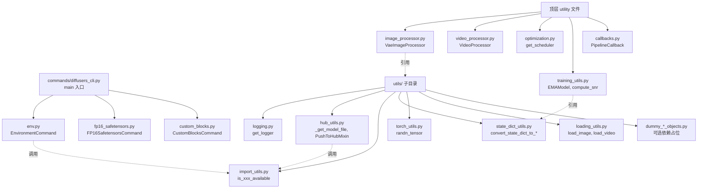
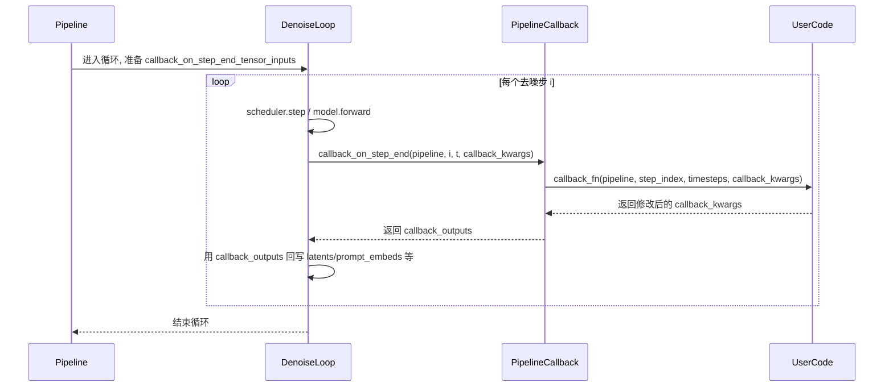
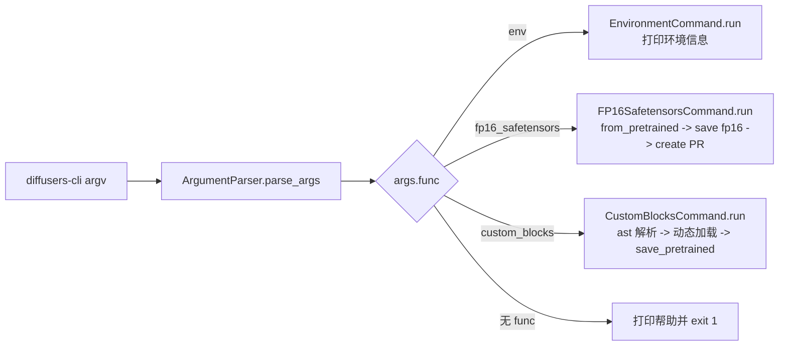

> 基于 diffusers 0.39.0.dev0 版本

# 15 工具与入口 - Utils 和 Commands

【分】论篇，剖析 utils 工具层与 commands CLI 入口。

Diffusers 的核心层（ModelMixin、DiffusionPipeline、Scheduler）解决"模型如何定义、如何推理"的问题；而围绕这一核心的图像归一化、视频帧堆叠、学习率调度、EMA、推理回调、日志、Hub 下载、依赖探测、CLI 子命令等横切关注点，则统一沉淀到 `utils/` 与 `commands/` 两个模块。本文自顶向下剖析这两个"配角"模块的实现细节、交互方式与典型用法。

## 1. 总起：模块概览

### 1.1 utils 是横切关注点，commands 是 CLI 入口

`src/diffusers/utils/` 与 `src/diffusers/` 顶层的若干 utility 文件共同承担"被全库复用、但不属于核心抽象"的功能：

- **图像/视频预处理**：`image_processor.py` 的 `VaeImageProcessor`、`video_processor.py` 的 `VideoProcessor`，被几乎所有 pipeline 在 `prepare_latents`/`__call__` 中调用。
- **训练辅助**：`optimization.py`（LR scheduler）、`training_utils.py`（EMAModel、compute_snr 等）、`callbacks.py`（推理回调）。
- **运行时基础设施**：`utils/logging.py`、`utils/hub_utils.py`、`utils/import_utils.py`、`utils/torch_utils.py`、`utils/state_dict_utils.py`、`utils/loading_utils.py`、`utils/pil_utils.py` 等。
- **CLI 入口**：`commands/diffusers_cli.py` 用 argparse 注册 `env`、`fp16_safetensors`、`custom_blocks` 三个子命令。

### 1.2 全景

顶层 utility 文件：

- [image_processor.py](file:///workspace/src/diffusers/image_processor.py)：`VaeImageProcessor`、`VaeImageProcessorLDM3D`、`PixArtImageProcessor` 等。
- [video_processor.py](file:///workspace/src/diffusers/video_processor.py)：`VideoProcessor`（继承自 `VaeImageProcessor`）。
- [optimization.py](file:///workspace/src/diffusers/optimization.py)：LR scheduler 工厂 `get_scheduler` 与 7 种 schedule 实现。
- [training_utils.py](file:///workspace/src/diffusers/training_utils.py)：`EMAModel`、`compute_snr`、`cast_training_params`、`unet_lora_state_dict` 等。
- [callbacks.py](file:///workspace/src/diffusers/callbacks.py)：`PipelineCallback`、`MultiPipelineCallbacks` 及若干内置 cutoff callback。

`utils/` 子目录（约 40 个文件）核心成员：

- [logging.py](file:///workspace/src/diffusers/utils/logging.py)：`get_logger`、`set_verbosity` 等。
- [hub_utils.py](file:///workspace/src/diffusers/utils/hub_utils.py)：`_get_model_file`、`PushToHubMixin`。
- [import_utils.py](file:///workspace/src/diffusers/utils/import_utils.py)：`is_torch_available`、`is_xformers_available`、`requires_backends`、`BACKENDS_MAPPING`。
- [state_dict_utils.py](file:///workspace/src/diffusers/utils/state_dict_utils.py)：`convert_state_dict_to_diffusers`、`convert_state_dict_to_peft`、`convert_state_dict_to_kohya` 等。
- [torch_utils.py](file:///workspace/src/diffusers/utils/torch_utils.py)：`randn_tensor`、`is_compiled_module`、`apply_freeu`、`get_device`。
- [loading_utils.py](file:///workspace/src/diffusers/utils/loading_utils.py)：`load_image`、`load_video`。
- [pil_utils.py](file:///workspace/src/diffusers/utils/pil_utils.py)：`PIL_INTERPOLATION`、`make_image_grid`、`numpy_to_pil`。
- [constants.py](file:///workspace/src/diffusers/utils/constants.py)：`CONFIG_NAME`、`WEIGHTS_NAME`、`SAFETENSORS_WEIGHTS_NAME` 等。
- 大量 `dummy_*_objects.py`：可选依赖未安装时的占位 metaclass。

`commands/` 子目录（5 个文件）：

- [__init__.py](file:///workspace/src/diffusers/commands/__init__.py)：抽象基类 `BaseDiffusersCLICommand`。
- [diffusers_cli.py](file:///workspace/src/diffusers/commands/diffusers_cli.py)：`main()` 入口。
- [env.py](file:///workspace/src/diffusers/commands/env.py)：`EnvironmentCommand`。
- [fp16_safetensors.py](file:///workspace/src/diffusers/commands/fp16_safetensors.py)：`FP16SafetensorsCommand`。
- [custom_blocks.py](file:///workspace/src/diffusers/commands/custom_blocks.py)：`CustomBlocksCommand`。

### 1.3 设计理念

- **集中管理**：工具函数集中沉淀到 `utils/`，避免在 pipeline、model、scheduler 中各自复刻。例如 `randn_tensor` 同时服务 latent 初始化与 VAE 编码噪声注入，`get_logger` 被全库共用。
- **可选依赖懒加载**：`import_utils.py` 通过环境变量 `USE_TORCH`/`USE_TF`/`USE_JAX` 与 `_importlib.util.find_spec` 探测可用后端，配合 `dummy_*_objects.py` 让 import 总是成功，但访问未安装依赖时才抛 `ImportError`。
- **ConfigMixin 复用**：`VaeImageProcessor`、`PipelineCallback` 都继承 `ConfigMixin`，可以像模型一样 `from_pretrained` / `save_pretrained`，保留 `do_resize`、`vae_scale_factor`、`cutoff_step_ratio` 等配置。
- **CLI 子命令可插拔**：每个子命令独立文件，统一通过 `register_subcommand` 注册到顶层 argparse，扩展新命令只需新增一个继承 `BaseDiffusersCLICommand` 的类。

### 1.4 工具层架构图

**图 15-1：Diffusers 工具层与 CLI 层架构**



图 15-1 说明：顶层 utility 文件（图像/视频/优化器/训练/回调）面向业务，被 pipeline 与 model 直接调用；`utils/` 子目录则是更底层的基础设施，被顶层 utility 与 commands 共同复用。CLI 子命令 `env` 反向调用 `import_utils` 来探测环境。

## 2. 分述：核心实现

### 2.1 VaeImageProcessor 详解

`VaeImageProcessor` 是几乎所有图像 diffusion pipeline 的预处理/后处理入口，继承 `ConfigMixin`，配置项包括 `do_resize`、`vae_scale_factor`、`vae_latent_channels`、`resample`、`do_normalize`、`do_binarize`、`do_convert_rgb`、`do_convert_grayscale`。详见 [image_processor.py](file:///workspace/src/diffusers/image_processor.py)。

类型别名 `PipelineImageInput` 统一描述输入："PIL.Image.Image | np.ndarray | torch.Tensor | list[...]"，配合 `is_valid_image` 与 `is_valid_image_imagelist` 做格式校验。

**preprocess**（[image_processor.py:607](file:///workspace/src/diffusers/image_processor.py)）的核心流程：

1. 若 `do_convert_grayscale` 且输入是 3D tensor/ndarray，按形状推断补 channel 维度。
2. 兼容已弃用的"list of 4d"输入，自动 concatenate。
3. 校验 `is_valid_image_imagelist`，把单图包装成 list。
4. 按首元素类型分支：
   - PIL：可选 `crops_coords` 裁剪 → `do_resize` 时调用 `get_default_height_width` 对齐到 `vae_scale_factor` 的整数倍 → `resize` → `convert_to_rgb/grayscale` → `pil_to_numpy` → `numpy_to_pt`。
   - numpy：concat/stack → `numpy_to_pt` → `get_default_height_width` → `resize`。
   - tensor：concat/stack → 若 channel 数等于 `vae_latent_channels`，**视为 latent 直接返回**（关键短路逻辑）→ 否则 `get_default_height_width` → `resize`。
5. 期望输入值域 `[0,1]`；若 `do_normalize` 且 `image.min() < 0`，发出 `FutureWarning` 并跳过归一化（兼容旧用法）。
6. `do_binarize` 时执行 `image[image < 0.5] = 0; image[image >= 0.5] = 1`。

**postprocess**（[image_processor.py:738](file:///workspace/src/diffusers/image_processor.py)）按 `output_type` 分支：

- `"latent"`：直接返回 tensor。
- `"pt"`：经 `_denormalize_conditionally` 反归一化后返回。
- `"np"`：进一步 `pt_to_numpy`。
- `"pil"`：再经 `numpy_to_pil`。

`_denormalize_conditionally` 支持按 batch 元素逐张决定是否反归一化，便于 inpainting 中同时输出"已生成"和"未生成"区域。

辅助静态方法：

- `numpy_to_pil`：`(images * 255).round().astype("uint8")`，单通道走 `mode="L"`。
- `pil_to_numpy`：`np.array(image).astype(np.float32) / 255.0`。
- `numpy_to_pt`：`transpose(0, 3, 1, 2)` 把 NHWC 转 NCHW。
- `pt_to_numpy`：`cpu().permute(0, 2, 3, 1).float().numpy()`。
- `normalize`：`2.0 * images - 1.0`，把 `[0,1]` 映射到 `[-1,1]`。
- `denormalize`：`(images * 0.5 + 0.5).clamp(0, 1)`。

`resize`（[image_processor.py:462](file:///workspace/src/diffusers/image_processor.py)）支持三种 `resize_mode`：

- `"default"`：PIL 走 `PIL_INTERPOLATION[self.config.resample]`（默认 lanczos），tensor/ndarray 走 `torch.nn.functional.interpolate`。
- `"fill"`：保持长宽比缩放后居中，空缺用图像自身边缘像素填充（`_resize_and_fill`）。
- `"crop"`：保持长宽比缩放后居中裁剪（`_resize_and_crop`）。仅 PIL 输入支持 `fill`/`crop`。

### 2.2 VideoProcessor 详解

[VideoProcessor](file:///workspace/src/diffusers/video_processor.py) 继承 `VaeImageProcessor`，把"图像"扩展为"视频帧序列"。其核心方法是 `preprocess_video` 与 `postprocess_video`：

- `preprocess_video` 接收 `list[PIL.Image]`、`list[list[PIL.Image]]`、4D/5D tensor/ndarray；先归一化为"视频列表"，再对每段视频逐帧调用 `self.preprocess`，最后 `torch.stack` 后 `permute(0, 2, 1, 3, 4)`，把 channel 提到 num_frames 之前，输出形状 `(batch, channels, frames, H, W)`。
- `postprocess_video` 对 batch 内每段视频 `permute(1, 0, 2, 3)` 把帧维度提到首位，再委托 `self.postprocess`，最后按 `output_type` 用 `np.stack` / `torch.stack` 重组 batch。
- 额外提供 `classify_height_width_bin`（按预设 aspect ratio 比例选最近的桶）与 `resize_and_crop_tensor`（对 `(N, C, T, H, W)` 视频做等比缩放 + 中心裁剪），用于长视频生成模型（如 CogVideoX、ConsisID）的分辨率适配。

### 2.3 optimization.py 详解

[optimization.py](file:///workspace/src/diffusers/optimization.py) 提供 7 种基于 `LambdaLR` 的学习率调度器，以及一个统一工厂 `get_scheduler`：

| name                       | 函数                                              | 说明                            |
| -------------------------- | ------------------------------------------------- | ------------------------------- |
| `constant`                 | `get_constant_schedule`                           | 恒定 lr                         |
| `constant_with_warmup`     | `get_constant_schedule_with_warmup`               | 线性 warmup 后保持恒定          |
| `piecewise_constant`       | `get_piecewise_constant_schedule`                 | 按 `"1:10,0.1:20,0.01"` 规则分段 |
| `linear`                   | `get_linear_schedule_with_warmup`                 | warmup 后线性衰减到 0           |
| `cosine`                   | `get_cosine_schedule_with_warmup`                 | warmup 后余弦衰减              |
| `cosine_with_restarts`     | `get_cosine_with_hard_restarts_schedule_with_warmup` | 余弦 + 多次硬重启              |
| `polynomial`               | `get_polynomial_decay_schedule_with_warmup`       | warmup 后多项式衰减            |

`SchedulerType` 枚举与 `TYPE_TO_SCHEDULER_FUNCTION` 字典构成 name→func 映射。`get_scheduler`（[optimization.py:296](file:///workspace/src/diffusers/optimization.py)）按 name 分支：

- `CONSTANT` 不需要 `num_warmup_steps`，直接返回。
- `PIECEWISE_CONSTANT` 需要 `step_rules`。
- `CONSTANT_WITH_WARMUP` 只需 `num_warmup_steps`。
- 其余调度器还需 `num_training_steps`，`COSINE_WITH_RESTARTS` 额外用 `num_cycles`，`POLYNOMIAL` 额外用 `power`。

注：本版本 `optimization.py` 不再内嵌自定义 `AdamW`，训练脚本直接使用 `torch.optim.AdamW`。

### 2.4 training_utils.py 详解

[training_utils.py](file:///workspace/src/diffusers/training_utils.py) 主要服务训练循环：

- **`EMAModel`**（[training_utils.py:576](file:///workspace/src/diffusers/training_utils.py)）：维护影子参数 `shadow_params`，每个 step 按 `shadow = shadow + (1 - decay) * (param - shadow)` 平滑更新。`decay` 由 `get_decay` 计算，支持 warmup（`use_ema_warmup=True` 时按 `(1 + step/inv_gamma)^-power` 增长）。提供 `step`、`copy_to`（把 EMA 权重灌回模型）、`save_pretrained`/`from_pretrained`（依赖 `model_cls`/`model_config` 重建模型并写入 config）、`pin_memory`、`store`/`restore`（参数临时换出，便于 fp16 训练 + fp32 EMA）。`foreach=True` 时使用 `torch._foreach_*` 批量操作加速，并兼容 DeepSpeed ZeRO-3 的 `GatheredParameters`。
- **`compute_snr(noise_scheduler, timesteps)`**（[training_utils.py:81](file:///workspace/src/diffusers/training_utils.py)）：按 Min-SNR-Diffusion 论文计算每步 SNR `(alpha / sigma)^2`，其中 `alpha = sqrt(alphas_cumprod)[t]`，`sigma = sqrt(1 - alphas_cumprod)[t]`，用于加权 loss。
- **`cast_training_params(model, dtype)`**（[training_utils.py:321](file:///workspace/src/diffusers/training_utils.py)）：仅把 `requires_grad=True` 的参数 upcast 到指定 dtype（通常是 fp32），常用于混合精度训练。
- **`unet_lora_state_dict(unet)`**：收集 UNet 中所有 `lora_layer` 的 `down`/`up` 矩阵，组装为 `{name}.lora.{down|up}` 形式的 state_dict，便于保存/加载 LoRA 权重。
- 还包含 SD3 专用的 `compute_density_for_timestep_sampling`（logit_normal / mode / uniform 三种 timestep 采样密度）、`compute_loss_weighting_for_sd3`（sigma_sqrt / cosmap 加权）、`compute_confidence_aware_loss`、`resolve_interpolation_mode`、`free_memory` 等。

### 2.5 callbacks.py 详解

[callbacks.py](file:///workspace/src/diffusers/callbacks.py) 提供推理阶段的可插拔回调机制。

- **`PipelineCallback`**（[callbacks.py:7](file:///workspace/src/diffusers/callbacks.py)）：继承 `ConfigMixin`，构造参数 `cutoff_step_ratio`（0.0–1.0）或 `cutoff_step_index`（二选一）。子类必须实现 `tensor_inputs` 属性与 `callback_fn(pipeline, step_index, timesteps, callback_kwargs) -> dict`。`__call__` 转发到 `callback_fn`。
- **`MultiPipelineCallbacks`**（[callbacks.py:46](file:///workspace/src/diffusers/callbacks.py)）：把多个 `PipelineCallback` 串成一个调用链，`tensor_inputs` 取并集，`__call__` 按顺序调用并把上一步返回的 `callback_kwargs` 传给下一步。
- 内置 cutoff 回调：`SDCFGCutoffCallback`、`SDXLCFGCutoffCallback`、`SDXLControlnetCFGCutoffCallback`、`SD3CFGCutoffCallback`、`IPAdapterScaleCutoffCallback`。前四者在指定 step 后把 `_guidance_scale` 置零并裁剪 prompt_embeds 至 conditional 部分，从而停用 CFG 加速；后者调用 `pipeline.set_ip_adapter_scale(0.0)` 关闭 IP-Adapter。

**与 pipeline 的交互**：pipeline `__call__` 接收 `callback_on_step_end` 与 `callback_on_step_end_tensor_inputs`（默认 `["latents"]`）。若传入的是 `PipelineCallback`/`MultiPipelineCallbacks`，则用其 `tensor_inputs` 覆盖默认值。在 denoise loop 内每个 step 之后（参考 [pipeline_consisid.py:950](file:///workspace/src/diffusers/pipelines/consisid/pipeline_consisid.py)）：

```python
if callback_on_step_end is not None:
    callback_kwargs = {}
    for k in callback_on_step_end_tensor_inputs:
        callback_kwargs[k] = locals()[k]
    callback_outputs = callback_on_step_end(self, i, t, callback_kwargs)
    latents = callback_outputs.pop("latents", latents)
    prompt_embeds = callback_outputs.pop("prompt_embeds", prompt_embeds)
    ...
```

回写机制让 callback 可以**直接修改 denoise loop 的中间状态**（如把 latents 替换为新的潜变量），从而实现 CFG cutoff、IP-Adapter cutoff 等运行时干预。

### 2.6 utils/ 子目录

- **logging.py**：`get_logger(name)` 返回与 `diffusers` 共根的 logger，自动应用 `_configure_library_root_logger` 与 rank-zero filter；可通过 `set_verbosity`、`set_verbosity_info`、`set_verbosity_warning`、`disable_default_handler`、`enable_propagation` 等控制输出。日志级别由环境变量 `DIFFUSERS_VERBOSITY` 与 `DIFFUSERS_LOGGING_LEVEL` 驱动。
- **hub_utils.py**：核心函数 `_get_model_file`（[hub_utils.py:228](file:///workspace/src/diffusers/utils/hub_utils.py)）依次处理 DDUF 内嵌文件、本地 file、本地 dir（含 subfolder）、远程 hub 下载（带 `revision`、`variant`、`commit_hash`、`cache_dir`、`proxies`、`token`）；`_get_checkpoint_shard_files` 处理分片权重；`PushToHubMixin` 提供 `push_to_hub`/`save_pretrained` 的通用模板；还有 `load_or_create_model_card`、`populate_model_card`、`extract_commit_hash`、`http_user_agent` 等。
- **import_utils.py**：通过环境变量 `USE_TORCH`/`USE_TF`/`USE_JAX`（[import_utils.py:51](file:///workspace/src/diffusers/utils/import_utils.py)）和 `find_spec` 探测后端，导出 `is_torch_available`、`is_xformers_available`、`is_transformers_available`、`is_flax_available`、`is_peft_available`、`is_safetensors_available`、`is_bitsandbytes_available`、`is_torchao_available`、`is_gguf_available`、`is_optimum_quanto_available` 等几十个探测函数，以及 `is_torch_version`/`is_xformers_version` 等版本比较。`BACKENDS_MAPPING`（[import_utils.py:623](file:///workspace/src/diffusers/utils/import_utils.py)）把每个 backend 名映射到 `(is_available_fn, import_error_msg)`，`requires_backends(obj, backends)` 用于在 dummy 对象被访问时抛出统一错误。`DummyObject` 元类让 `class XXX(metaclass=DummyObject)` 在访问任意属性时触发 backend 检查。
- **state_dict_utils.py**：LoRA/diffusers/kohya/peft 之间的 state_dict 互转。`convert_state_dict_to_diffusers`、`convert_state_dict_to_peft`、`convert_state_dict_to_kohya`、`convert_unet_state_dict_to_peft`、`convert_sai_sd_control_lora_state_dict_to_peft`、`convert_all_state_dict_to_peft`、`state_dict_all_zero` 等，是 LoRA 加载/保存与跨框架迁移的关键。
- **torch_utils.py**：`randn_tensor`（[torch_utils.py:183](file:///workspace/src/diffusers/utils/torch_utils.py)）解决跨 device、跨 generator、batch 内逐样本 seed 的随机张量生成；`is_compiled_module` 检测 `torch.compile`；`unwrap_module`、`fourier_filter`、`apply_freeu`（FreeU 增强）、`get_torch_cuda_device_capability`、`get_device`、`empty_device_cache`、`device_synchronize`、`enable_full_determinism`、`lru_cache_unless_export` 等运行时辅助。
- **loading_utils.py**：`load_image`（支持 URL/本地/PIL/np）、`load_video`、`get_module_from_name`、`get_submodule_by_name`。
- **pil_utils.py**：`PIL_INTERPOLATION`（name→PIL filter 映射）、`make_image_grid`、`numpy_to_pil`、`pt_to_pil`。
- **constants.py**：`CONFIG_NAME="config.json"`、`WEIGHTS_NAME="diffusion_pytorch_model.bin"`、`SAFETENSORS_WEIGHTS_NAME="diffusion_pytorch_model.safetensors"`、`FLAX_WEIGHTS_NAME`、`ONNX_WEIGHTS_NAME`、`DEPRECATED_REVISION_ARGS`、`HF_MODULES_CACHE` 等。
- **dummy_*_objects.py**：约 25 个文件，按"可选依赖组合"分类（如 `dummy_torch_and_transformers_objects.py`、`dummy_onnx_objects.py`、`dummy_gguf_objects.py`、`dummy_torchao_objects.py`、`dummy_bitsandbytes_objects.py`），用 `DummyObject` 元类在依赖缺失时提供占位类，访问时通过 `requires_backends` 抛出友好错误。

### 2.7 commands/ CLI 详解

[BaseDiffusersCLICommand](file:///workspace/src/diffusers/commands/__init__.py) 是抽象基类，要求子类实现静态方法 `register_subcommand(parser)` 与实例方法 `run()`。

[diffusers_cli.py](file:///workspace/src/diffusers/commands/diffusers_cli.py) 的 `main()` 创建顶层 `ArgumentParser`，调用三个子命令的 `register_subcommand` 注册各自的 subparser 与 `set_defaults(func=...)`，随后 `parse_args` → 用 `args.func(args)` 构造命令对象 → 调用 `run()`。

**EnvironmentCommand**（[env.py](file:///workspace/src/diffusers/commands/env.py)）：注册 `diffusers-cli env`，无参数。`run()` 收集 diffusers 版本、平台、Python 版本、PyTorch（含 CUDA 可用性）、Flax/JAX/JaxLib、transformers、accelerate、peft、各类量化后端（bitsandbytes/gguf/optimum-quanto/torchao/nvidia-modelopt 通过 `_QUANTIZATION_BACKENDS` 元组遍历）、safetensors、xformers、accelerator（Linux/Windows 调 `nvidia-smi`，Darwin 调 `system_profiler SPDisplaysDataType`），格式化为 markdown list 输出，便于用户贴到 GitHub issue。

**FP16SafetensorsCommand**（[fp16_safetensors.py](file:///workspace/src/diffusers/commands/fp16_safetensors.py)）：注册 `diffusers-cli fp16_safetensors --ckpt_id=... [--fp16] [--use_safetensors]`。`run()` 读取 `model_index.json` 获取 `_class_name`，动态 `import_module("diffusers")` 拿到 pipeline 类，按 `fp16` 标志用 `torch.float16` 重新 `from_pretrained`，`save_pretrained` 到 `/tmp/{ckpt_id}`，再用 `glob` 收集 `*.fp16.*` 或 `*.safetensors`，通过 `huggingface_hub.create_commit(create_pr=True)` 提交一个 PR，把 fp16/safetensors variant 上传到原仓库。

**CustomBlocksCommand**（[custom_blocks.py](file:///workspace/src/diffusers/commands/custom_blocks.py)）：注册 `diffusers-cli custom_blocks --block_module_name=block.py [--block_class_name=...]`。`run()` 用 `ast.parse` 解析用户提供的 Python 文件，找出继承 `ModularPipelineBlocks` 的类，通过 `importlib.util.spec_from_file_location` 动态加载模块并实例化该类，再调用 `save_pretrained(os.getcwd())` 把自定义 modular block 落盘为标准 diffusers 模块结构。

### 2.8 图像处理数据流图

**图 15-2：VaeImageProcessor 在推理中的数据流**


图 15-2 说明：preprocess 把 PIL/numpy/tensor 三种输入统一为 `[-1,1]` 归一化的 NCHW float tensor，VAE encoder 下采样得到 latent；denoise loop 在 latent 空间运行；VAE decoder 还原回图像域；postprocess 反向 `denormalize → pt_to_numpy → numpy_to_pil` 还原为 PIL。如果输入 tensor 的 channel 已等于 `vae_latent_channels`，preprocess 直接短路返回（视为已编码 latent）。

### 2.9 回调时序图

**图 15-3：denoise loop 中 callback_on_step_end 的调用时序**



图 15-3 说明：pipeline 把 `latents`、`prompt_embeds` 等中间变量按 `callback_on_step_end_tensor_inputs` 打包成 `callback_kwargs` 传给回调；回调返回的字典会被 denoise loop 逐键 pop 回写，因此回调能**修改下一步的输入**。`MultiPipelineCallbacks` 在 CB 位置串联多个回调，把上一步返回的 kwargs 传给下一个。

### 2.10 CLI 流程图

**图 15-4：diffusers-cli 命令分发流程**



图 15-4 说明：每个子命令在 `register_subcommand` 中通过 `set_defaults(func=factory)` 注入工厂函数，`main` 仅做 `args.func(args)` → `service.run()` 两步调度，新增子命令只需新增一个文件并注册到 `main`。

## 3. 使用指南

### 3.1 API 速查

| 任务 | 入口 |
| ---- | ---- |
| 图像预处理 | `VaeImageProcessor(do_resize=True, vae_scale_factor=8).preprocess(image, height, width)` |
| 图像后处理 | `proc.postprocess(tensor, output_type="pil")` |
| 视频预处理 | `VideoProcessor().preprocess_video(video, height, width)` 返回 `(B, C, T, H, W)` |
| 创建 LR scheduler | `get_scheduler("cosine", optimizer, num_warmup_steps=100, num_training_steps=10000)` |
| EMA | `EMAModel(unet.parameters(), decay=0.9999); ema.step(unet.parameters())` |
| 训练 SNR 加权 | `snr = compute_snr(noise_scheduler, timesteps)` |
| 推理回调 | `pipeline(prompt, callback_on_step_end=SDCFGCutoffCallback(0.5), callback_on_step_end_tensor_inputs=["prompt_embeds"])` |
| 跨域 state_dict 转换 | `convert_state_dict_to_diffusers(lora_state_dict)` |
| 日志 | `logger = get_logger(__name__); logger.info("...")` |
| CLI 环境 | `diffusers-cli env` |

### 3.2 最小示例

```python
import torch
from diffusers import VaeImageProcessor
from diffusers.utils import load_image

# 1. 用 VaeImageProcessor 处理一张 PIL 图像
processor = VaeImageProcessor(do_resize=True, vae_scale_factor=8, do_normalize=True)
image = load_image("https://huggingface.co/datasets/hf-internal-testing/diffusers-images/resolve/main/sd_controlimg/house.png")
image = image.resize((512, 512))

tensor = processor.preprocess(image)          # (1, 3, 512, 512), range [-1, 1]
print(tensor.shape, tensor.min().item(), tensor.max().item())

# 模拟 VAE 输出
fake_output = tensor.clone()
pil_back = processor.postprocess(fake_output, output_type="pil")  # list[PIL.Image]
pil_back[0].save("restored.png")
```

```python
from diffusers import StableDiffusionPipeline
from diffusers.callbacks import SDCFGCutoffCallback

pipe = StableDiffusionPipeline.from_pretrained("runwayml/stable-diffusion-v1-5")
pipe.to("cuda")

# 推理到 50% step 后停用 CFG，节省算力
img = pipe(
    prompt="a photo of a cat",
    num_inference_steps=30,
    callback_on_step_end=SDCFGCutoffCallback(cutoff_step_ratio=0.5),
    callback_on_step_end_tensor_inputs=["prompt_embeds"],
).images[0]
img.save("cat.png")
```

### 3.3 CLI：diffusers-cli env

```bash
# 安装 diffusers 后即可使用
diffusers-cli env
```

输出形如：

```
- 🤗 Diffusers version: 0.39.0.dev0
- Platform: Linux-6.5.0-xxx-x86_64-with-glibc2.35
- Running on Google Colab?: No
- Python version: 3.11.9
- PyTorch version (GPU?): 2.5.1 (True)
- Huggingface_hub version: 0.26.5
- Transformers version: 4.46.3
- Accelerate version: 1.1.1
- Safetensors version: 0.4.5
- xFormers version: not installed
- Accelerator: NVIDIA GeForce RTX 4090, 24564 MiB
- Using GPU in script?: <fill in>
- Using distributed or parallel set-up in script?: <fill in>
```

## 4. 实战案例

### 4.1 案例 1：用 PipelineCallback 实时保存推理中间 latent 为图像

内置 cutoff callback 只用于"裁剪 CFG"，更常见的诉求是在去噪过程中观察中间结果。我们可以自定义一个回调，把每步的 `latents` 解码并保存为 PNG：

```python
import os
import torch
from diffusers import StableDiffusionPipeline
from diffusers.callbacks import PipelineCallback

class LatentSnapshotCallback(PipelineCallback):
    tensor_inputs = ["latents"]

    def __init__(self, vae, save_dir, every_n=5, cutoff_step_ratio=1.0, cutoff_step_index=None):
        super().__init__(cutoff_step_ratio=cutoff_step_ratio, cutoff_step_index=cutoff_step_index)
        self.vae = vae
        self.save_dir = save_dir
        self.every_n = every_n
        os.makedirs(save_dir, exist_ok=True)

    def callback_fn(self, pipeline, step_index, timestep, callback_kwargs):
        if step_index % self.every_n != 0:
            return callback_kwargs
        latents = callback_kwargs["latents"]
        with torch.no_grad():
            image = self.vae.decode(latents / self.vae.config.scaling_factor).sample
            image = (image / 2 + 0.5).clamp(0, 1)
            image = image.cpu().permute(0, 2, 3, 1).numpy()
        for i, arr in enumerate(image):
            from PIL import Image
            Image.fromarray((arr * 255).round().astype("uint8")).save(
                os.path.join(self.save_dir, f"step{step_index:03d}_b{i}.png")
            )
        return callback_kwargs


pipe = StableDiffusionPipeline.from_pretrained("runwayml/stable-diffusion-v1-5", torch_dtype=torch.float16)
pipe.to("cuda")

cb = LatentSnapshotCallback(pipe.vae, save_dir="./snapshots", every_n=5)
image = pipe(
    prompt="a cinematic shot of a fox in snowy forest",
    num_inference_steps=30,
    callback_on_step_end=cb,
    callback_on_step_end_tensor_inputs=["latents"],
).images[0]
image.save("final.png")
```

要点：

- `tensor_inputs = ["latents"]` 必须出现在 pipeline 的 `self._callback_tensor_inputs` 白名单中，否则 prepare 阶段会抛 `ValueError`。
- 回调内不要修改 `callback_kwargs` 中的 latents，除非你真的想改变去噪轨迹；只读快照则直接返回原 dict。
- 用 `MultiPipelineCallbacks([cb, SDCFGCutoffCallback(0.7)])` 可同时挂载多个回调。

### 4.2 案例 2：diffusers-cli env 环境诊断 + fp16 转换

**环境诊断**——当你向 diffusers 仓库提 issue 时，维护者通常要求贴上 `diffusers-cli env` 的完整输出。该命令在 [env.py:61](file:///workspace/src/diffusers/commands/env.py) 中按需 lazy import 各后端，因此即使某些依赖未安装也能正常运行，对未安装项打印 `not installed`：

```bash
$ diffusers-cli env

Copy-and-paste the text below in your GitHub issue and FILL OUT the two last points.

- 🤗 Diffusers version: 0.39.0.dev0
- Platform: Linux-5.15.0-91-generic-x86_64-with-glibc2.35
- PyTorch version (GPU?): 2.5.1 (True)
- bitsandbytes version: 0.44.1
- gguf version: 0.10.0
- torchao version: not installed
- Accelerator: NVIDIA GeForce RTX 4090, 24564 MiB
- Using GPU in script?: <fill in>
- Using distributed or parallel set-up in script?: <fill in>
```

**fp16 safetensors 转换**——为社区仓库贡献 fp16 + safetensors variant（[fp16_safetensors.py:79](file:///workspace/src/diffusers/commands/fp16_safetensors.py)）：

```bash
# 登录 huggingface_hub
huggingface-cli login

# 把 openai/shap-e 转为 fp16 safetensors 并向原仓库提交 PR
diffusers-cli fp16_safetensors --ckpt_id=openai/shap-e --fp16 --use_safetensors
```

执行后命令会：

1. `hf_hub_download("openai/shap-e", "model_index.json")` 拿到 `_class_name`。
2. 动态 `import_module("diffusers").{pipeline_class_name}` 拿到 pipeline 类。
3. `pipeline_class.from_pretrained("openai/shap-e", torch_dtype=torch.float16)` 重新加载。
4. `save_pretrained("/tmp/openai/shap-e", safe_serialization=True, variant="fp16")`。
5. 用 `glob` 收集所有 `*.fp16.safetensors`，通过 `CommitOperationAdd` + `create_commit(create_pr=True)` 提交 PR，PR 描述里附带本工具的源码链接，便于审核。

注意：`use_auth_token` 参数已弃用，认证现在由 `huggingface-cli login` 自动处理；`use_safetensors` 与 `fp16` 至少要有一个为真，否则 `__init__` 直接 `NotImplementedError`。

## 5. 总结

### 5.1 要点回顾

工具层与 CLI 层是 diffusers 的"配角"，但贯穿整个推理/训练链路：

- `VaeImageProcessor`/`VideoProcessor` 统一 PIL/numpy/tensor 三种输入到 NCHW `[-1,1]` tensor，处理 latent 通道短路。
- `optimization.py` 用 `LambdaLR` 实现 7 种 LR 调度，`get_scheduler` 工厂统一入口。
- `training_utils.py` 的 `EMAModel`、`compute_snr`、`cast_training_params`、`unet_lora_state_dict` 是训练脚本的核心依赖。
- `callbacks.py` 通过 `PipelineCallback` + `MultiPipelineCallbacks` 提供 denoise loop 内的可修改回调，实现 CFG/IP-Adapter cutoff 等运行时干预。
- `utils/` 子目录沉淀日志、Hub 下载、依赖探测、state_dict 转换、随机张量生成、图像加载等横切关注点，约 25 个 `dummy_*_objects.py` 让可选依赖懒加载且对用户透明。
- `commands/` 用 argparse + `BaseDiffusersCLICommand` 抽象基类提供 `env`、`fp16_safetensors`、`custom_blocks` 三个子命令，分别服务环境诊断、模型格式转换、modular block 落盘。

### 5.2 与其他模块的关系

- **image_processor ↔ pipeline**：几乎所有 image/video pipeline 的 `__call__` 在 `prepare_latents` 与最终输出阶段调用 `image_processor.preprocess`/`postprocess`。
- **logging ↔ 全库**：每个模块顶部 `logger = get_logger(__name__)`，由 `utils/logging.py` 统一配置 root logger、handler、formatter，并支持 rank-zero 过滤（分布式训练时只主进程打印）。
- **hub_utils ↔ from_pretrained**：`ModelMixin.from_pretrained`/`DiffusionPipeline.from_pretrained` 通过 `_get_model_file` 与 `_get_checkpoint_shard_files` 解析权重路径，处理本地/远程/DDUF/variant/shard 五种情形。
- **import_utils ↔ 全库**：dummy 模块在 import 时被加载，访问具体类时通过 `requires_backends` 触发实际依赖检查，使 `from diffusers import ...` 永不因可选依赖缺失而失败。
- **state_dict_utils ↔ loaders**：`lora_loader`、`unet_loader` 等 loader 在加载/保存 LoRA 时调用 `convert_state_dict_to_diffusers`/`convert_state_dict_to_peft` 完成键名映射。
- **callbacks ↔ pipeline**：pipeline 的 `_callback_tensor_inputs` 属性白名单决定 callback 可读写的张量；callback 返回的 dict 被 denoise loop 回写。
- **commands/env ↔ utils/import_utils**：`EnvironmentCommand` 反向调用 `is_xxx_available` 系列函数收集环境信息。

### 5.3 CLI 的辅助作用

`diffusers-cli` 不参与运行时推理，而是面向"工程化运维"场景：

- `env`：诊断依赖版本与硬件，是提 issue 的标配。
- `fp16_safetensors`：批量为社区 hub 仓库贡献 fp16 + safetensors variant，降低用户下载与显存成本。
- `custom_blocks`：服务 modular pipeline 生态，让用户用 AST 解析 + 动态加载的方式把自定义 block 落盘为标准 diffusers 模块。

整体而言，utils 与 commands 既是核心抽象的"补给线"，又是用户与库交互的"前哨站"——它们的设计哲学是**集中、可选、可插拔**，让 diffusers 在保持核心精简的同时，能够优雅地承载日益庞杂的生态依赖与工程需求。
