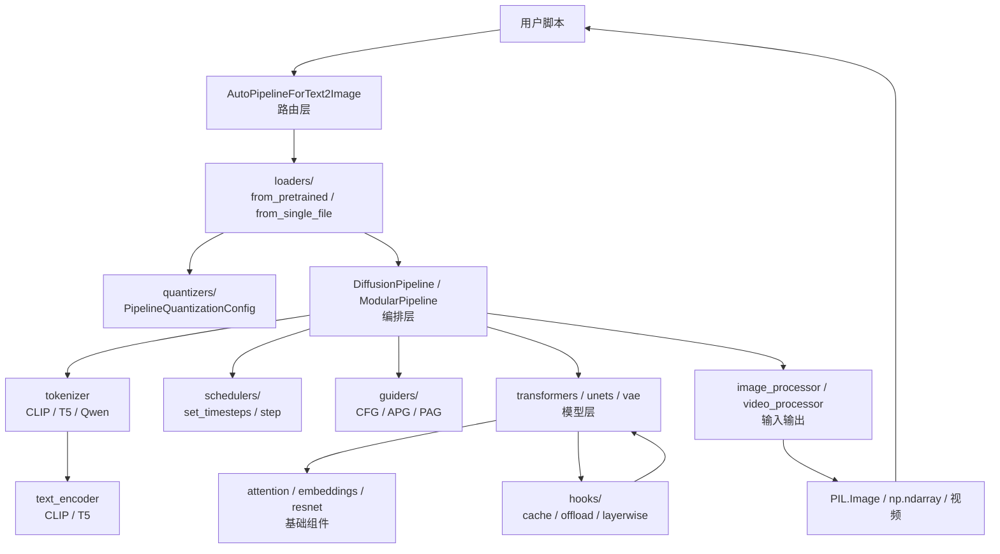
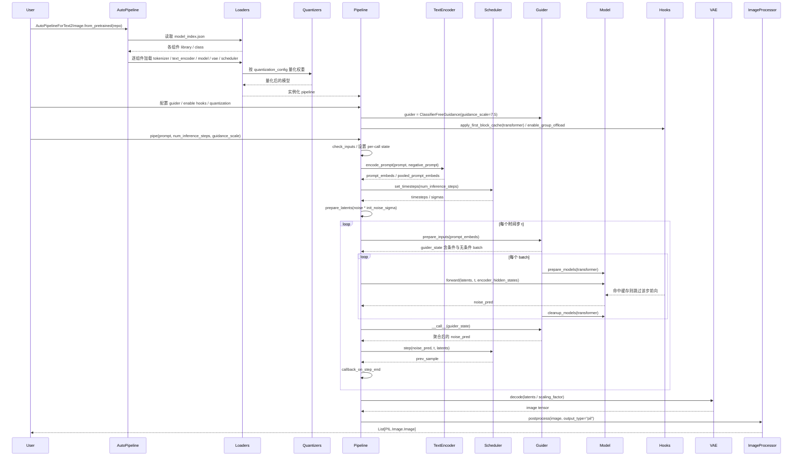
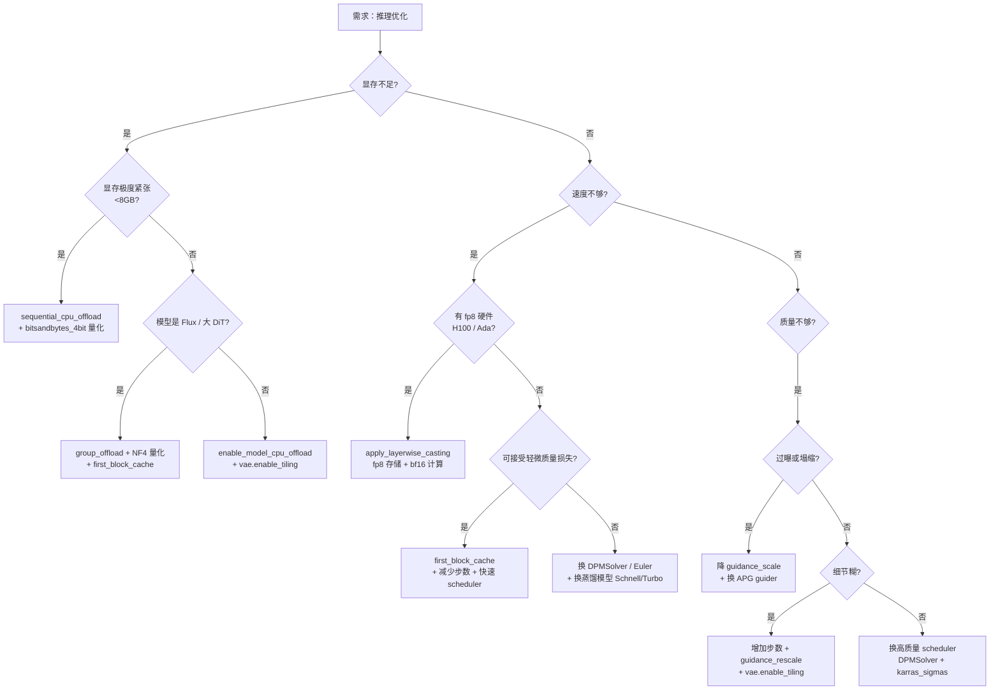
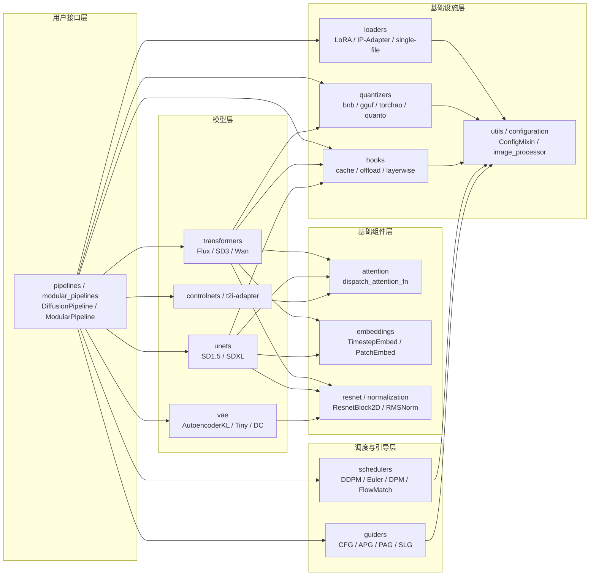

# 16 总结 - 推理全链路与最佳实践

> 基于 diffusers 0.39.0.dev0 版本

本文是 Diffusers 代码分析全套文档的收篇之作。前 15 篇分论各自剖析了一个子系统的设计与实现，本篇将它们重新缝合为一条完整的推理链路，并在此基础上给出最佳实践矩阵、组合配方、性能调优决策树与两个生产级实战脚本。如果说 02-15 是"显微镜下的剖面图"，那么本篇就是"全局卫星图"——把模块之间的协作时序、参数流转、显存与速度的取舍一次性铺开。

---

## 1. 总起：回顾

### 1.1 全部分论一句话回顾

- **02 核心基座 ConfigMixin 与 ModelMixin**：`ConfigMixin` 通过 `@register_to_config` 把 `__init__` 参数自动序列化为 JSON 配置，`ModelMixin` 在其上叠加 `from_pretrained` / `save_pretrained` / dtype 与 device 管理，是所有模型与管道共享的"配置 + 序列化"地基。
- **03 模型层 VAE 家族**：`AutoencoderKL` / `AutoencoderTiny` / `AutoencoderDC` 及各模型专属 VAE 通过统一的 `encode` / `decode` 接口与 `AutoencoderMixin` 的 `enable_tiling` / `enable_slicing`，把像素空间压缩到 latent 空间再还原，是潜在扩散的"压缩器"。
- **04 模型层 Transformer 家族**：60 余个 `transformer_*.py` 单文件实现 DiT 范式，Flux / SD3 / Wan / HunyuanVideo 等旗舰模型通过 `ModelMixin` + `dispatch_attention_fn` + 单文件策略组织代码，已取代 UNet 成为新模型首选骨干。
- **05 模型层 UNet 家族**：`UNet2DConditionModel` 等仍是 SD1.5 / SDXL 的核心，沿"下采样—中间—上采样 + skip connection"卷积结构组织，并通过 `AttentionMixin` 与 `attention_dispatch` 复用注意力后端。
- **06 模型层 ControlNet 家族**：`ControlNetModel` / `T2IAdapter` 等条件控制网络以"可训练副本 + zero conv"方式注入到 UNet / Transformer 的中间特征，把图、边缘、深度等空间条件引入去噪过程。
- **07 模型构建块 Attention 与基础组件**：`attention.py` / `embeddings.py` / `normalization.py` / `resnet.py` 提供可复用积木，`dispatch_attention_fn` 在 flash / sage / sdpa 后端间切换，是模型层的"零件库"。
- **08 调度器 Schedulers**：57 个调度器文件统一实现 `set_timesteps` / `step` / `scale_model_input` 协议，DDPM、DDIM、Euler、DPM-Solver、Flow Match 五族覆盖从 1000 步随机到 4 步极速的全部折中，可互换、无状态、可序列化。
- **09 引导器 Guiders**：0.39 新增的 `guiders/` 把 CFG / APG / PAG / SLG / AutoG 等引导策略从 pipeline 中抽离，通过 `prepare_inputs` / `prepare_models` / `__call__` 三段式协议，让同一份去噪骨干灵活搭配不同引导算法。
- **10 管道层 DiffusionPipeline**：基类提供 `from_pretrained` / `save_pretrained` / `enable_*_offload` / `enable_xformers` 等通用能力，子类按"check_inputs → encode_prompt → timesteps → prepare_latents → denoise loop → decode"六段式实现 `__call__`，`AutoPipelineForXxx` 通过 `_class_name` 路由到具体家族。
- **11 模块化管道 ModularPipelines**：新一代推荐方式，把单体 `__call__` 拆成 `encoders` / `before_denoise` / `denoise` / `decoders` 四类 Block，每个 Block 声明 IO 契约可独立运行，`SequentialPipelineBlocks` / `AutoPipelineBlocks` / `LoopSequentialPipelineBlocks` 表达顺序、选择与循环。
- **12 加载器 Loaders**：以 `XxxLoaderMixin` 多继承方式把 LoRA / IP-Adapter / 单文件 / Textual Inversion / PEFT 五套加载能力挂到 pipeline 与 model，`lora_base.py` 的 `set_adapters` / `fuse_lora` 是多 adapter 加权与融合的统一入口。
- **13 量化 Quantizers**：`PipelineQuantizationConfig` + `quant_backend` 统一接入 `bitsandbytes_4bit` / `bitsandbytes_8bit` / `gguf` / `quanto` / `torchao` / `modelopt` / `auto-round` 七类后端，配合 `quant_mapping` 支持按组件差异化量化。
- **14 优化钩子 Hooks**：`hooks/` 目录承载缓存（`first_block_cache` / `faster_cache` / `mag_cache` / `text_kv_cache` / `taylorseer_cache`）、卸载（`group_offloading`）、精度（`layerwise_casting`，fp8 存储 + 高精度计算）、引导扰动（`layer_skip` / `smoothed_energy_guidance_utils`）、并行（`context_parallel` / `pyramid_attention_broadcast`）等运行时增强。
- **15 工具与入口 Utils 和 Commands**：`image_processor` / `video_processor` 负责 PIL / numpy / tensor 互转，`callback_on_step_end` 提供逐步回调钩子，`optimization/` 文档与 `commands/` CLI 入口把常用工作流封装为可复现脚本。

### 1.2 本篇目标

前 15 篇是"竖切"——每个子系统单独成章；本篇是"横切"——把它们组装成一次完整推理。具体目标有三：

1. **串联完整推理链路**：从 `AutoPipeline.from_pretrained` 到最终输出 PIL 图像 / 视频帧，用一张综合时序图把所有模块的参与时序铺开，并标注每一步"哪个模块在做什么、参数如何流转"。
2. **给出最佳实践矩阵**：按"显存优化 / 速度优化 / 质量优化"三个维度，列出 0.39 中可用的全部优化手段及其适用场景、代价与组合关系，给出 4 个开箱即用的组合配方。
3. **提供性能调优决策树**：从"显存不足 / 速度不够 / 质量不够"三类需求出发，给出推荐优化路径，避免用户在海量优化选项中迷失。

### 1.3 模块协作全景图

**图 16-1：一次推理中的模块协作全景**



图 16-1 说明：用户调用 `AutoPipeline.from_pretrained` 后，加载器（`loaders/`）配合量化器（`quantizers/`）从 Hub 拉取权重并按需量化，实例化编排层 `DiffusionPipeline` 或 `ModularPipeline`。推理时编排层依次调度 tokenizer / text_encoder 完成文本编码，schedulers 给出时间步，guiders 决定引导策略，模型层（transformers / unets / vae）在基础组件（attention / embeddings / resnet）支撑下完成去噪与解码，hooks 在前向过程中提供缓存、卸载、精度转换等运行时增强，最后 image_processor 把张量转为 PIL 图像或视频帧返回给用户。这是一条"加载 → 编码 → 调度 → 去噪 → 解码 → 后处理"的单向流水线，但 hooks 与 quantizers 横切在每一层之上。

---

## 2. 分述：推理全链路与最佳实践

### 2.1 推理全链路综合时序图

下面这张时序图把"加载"与"推理"两阶段合在一起，覆盖从用户调用到输出的完整链路。它综合了 [10 管道层](file:///workspace/ReadCode/10_管道层_DiffusionPipeline.md) 的标准 `__call__` 流程与 [11 模块化管道](file:///workspace/ReadCode/11_模块化管道_ModularPipelines.md) 的 guider 抽象，是图 10-2 与图 11-3 的"超集"。

**图 16-2：推理全链路综合时序**



图 16-2 说明：时序图分两个阶段。**加载阶段**（前 6 条消息）：`AutoPipeline` 通过 `loaders` 读 `model_index.json`，逐组件下载权重，`quantizers` 按用户传入的 `quantization_config` 把权重转为 NF4 / INT8 / GGUF 等低精度格式，最后实例化 pipeline。**配置阶段**（中间 3 条消息）：用户可在调用 `__call__` 前装配 guider、挂载 cache hook、启用 group_offload——这三类增强都是"横切"在模型前向上的，不修改 pipeline 主流程。**推理阶段**（后半部分）：`encode_prompt` 把文本变为嵌入，`scheduler.set_timesteps` 给出去噪时间步序列，`prepare_latents` 初始化噪声。去噪循环每一步先由 guider `prepare_inputs` 切分条件 / 无条件 batch，模型按 batch 逐次前向（hooks 在此提供缓存命中跳过），guider `__call__` 聚合得到最终 `noise_pred`，scheduler `step` 推进一步。循环结束后 VAE 解码、image_processor 后处理返回给用户。注意 `callback_on_step_end` 在每步末尾被调用，可用来监控或修改中间 latents。

### 2.2 最佳实践矩阵

下表把 0.39 中全部主流优化手段按三个维度归类。"代价"列标注启用该优化后通常会牺牲什么，"组合性"列指出能否与其他优化叠加。

#### 2.2.1 显存优化

| 手段 | API | 效果 | 代价 | 组合性 |
|------|-----|------|------|--------|
| 模型级 CPU offload | `pipe.enable_model_cpu_offload()` | 按链顺序在 CPU/GPU 间搬运模型，显存中只留当前模型 | 速度损失小，搬运有开销 | 与 `.to("cuda")` 互斥，可与量化叠加 |
| 子模块级 sequential offload | `pipe.enable_sequential_cpu_offload()` | leaf 级挂 hook，每个子模块前向时才 onload，显存最省 | 速度损失最大 | 与 `.to("cuda")` 互斥 |
| 分组 offload | `pipe.enable_group_offload(onload_device, offload_type="block_level", num_blocks_per_group=10)` | 按 `nn.ModuleList` 分组搬运，介于上述两者之间，支持 `non_blocking` / `use_stream` | 速度损失中等 | 0.39 新特性，可与量化叠加 |
| NF4 / INT8 量化 | `PipelineQuantizationConfig(quant_backend="bitsandbytes_4bit")` 传入 `from_pretrained` | 权重 4bit / 8bit 存储，显存降至 1/4 ~ 1/2 | 推理速度略降，精度轻微损失 | 与 offload 叠加效果最佳 |
| GGUF 量化 | `quant_backend="gguf"` | 加载社区 GGUF 格式权重 | 需安装 `diffusers[gguf]` | 与 offload 叠加 |
| torchao / quanto | `quant_backend="torchao"` / `"quanto"` | 多种量化算法 | 依赖对应后端 | 与 offload 叠加 |
| VAE 分块解码 | `pipe.vae.enable_tiling()` | 高分辨率解码时分块，防 OOM | 略增解码时间 | 独立，推荐高分辨率必开 |
| VAE 切片解码 | `pipe.vae.enable_slicing()` | 按 batch 切片解码 | 略增解码时间 | 与 tiling 叠加 |
| 注意力切片 | `pipe.enable_attention_slicing("auto")` | 按 head 分批算注意力 | 速度损失明显 | 低显存救急 |
| fp16 / bf16 加载 | `torch_dtype=torch.float16` | 半精度存储，显存减半 | 极少数数值溢出 | 与量化互斥（量化更低） |

> 注：`pipe.enable_vae_slicing()` / `pipe.enable_vae_tiling()` 在 0.39 已标记 deprecated，方法体转发到 `self.vae.enable_slicing()` / `enable_tiling()`，0.40 起应直接调用 `pipe.vae.enable_*()`（见 [10 管道层](file:///workspace/ReadCode/10_管道层_DiffusionPipeline.md) 第 2.1 节）。

#### 2.2.2 速度优化

| 手段 | API | 效果 | 代价 | 组合性 |
|------|-----|------|------|--------|
| 首块缓存 | `from diffusers.hooks import apply_first_block_cache, FirstBlockCacheConfig; apply_first_block_cache(pipe.transformer, FirstBlockCacheConfig())` | 相邻步若 latent 变化小于阈值则跳过整次前向 | 极少数情况下质量微降 | 与 group_offload / 量化叠加 |
| 其他缓存 | `faster_cache` / `mag_cache` / `text_kv_cache` / `taylorseer_cache` | 不同缓存策略，按模型特性选择 | 各异 | 通常互斥，择一 |
| fp8 layerwise casting | `from diffusers.hooks import apply_layerwise_casting; apply_layerwise_casting(pipe.transformer, storage_dtype=torch.float8_e4m3fn, compute_dtype=torch.bfloat16)` | 权重 fp8 存储、前向时转 bf16 计算，省显存且提速 | 需 H100 / Ada 等 fp8 硬件 | 与 offload 叠加 |
| 减少步数 | `num_inference_steps=20` 甚至更少 | 步数线性影响耗时 | 步数过少质量下降 | 与快速 scheduler 配合 |
| 快速 scheduler | `FlowMatchEulerDiscreteScheduler` / `EulerDiscreteScheduler` / `DPMSolverMultistepScheduler` | 一阶 / 高阶求解器，少步数高质量 | 高阶求解器单步更贵但总步数更少 | 与 distilled 模型配合可 1-4 步出图 |
| 蒸馏模型 | Flux Schnell / SDXL Turbo / LCM | 1-4 步出图 | 需对应蒸馏权重 | 与 LCM scheduler 配合 |
| FreeU | `pipe.enable_freeu(s1=0.9, s2=0.2, b1=1.2, b2=1.4)` | 增强低频特征，质量与速度兼得 | 仅适用于 UNet 系（SD/SDXL） | 独立 |
| xFormers 注意力 | `pipe.enable_xformers_memory_efficient_attention()` | 注意力更快更省 | PyTorch ≥ 2.0 已有 sdpa，收益减小 | 与 sdpa 二选一 |

#### 2.2.3 质量优化

| 手段 | API | 效果 | 代价 | 组合性 |
|------|-----|------|------|--------|
| 高质量 scheduler | `DPMSolverMultistepScheduler` / `DPM++` 系列 / `FlowMatchEulerDiscreteScheduler` | 数值格式更优，同步数质量更高 | 高阶求解器单步略贵 | 与 guider 叠加 |
| 引导策略选择 | `ClassifierFreeGuidance` / `AdaptiveProjectedGuidance` / `PerturbedAttentionGuidance` / `SkipLayerGuidance` | APG 自适应投影、PAG 扰动注意力、SLG 跳层引导，各有侧重 | PAG/SLG 需额外前向 | guider 互斥，择一 |
| guidance_scale 调优 | `guidance_scale=3.5`（Flux）/ `7.5`（SDXL） | 控制条件贴合度 | 过大过曝塌缩，过小发糊 | 与 scheduler 配合 |
| 高分辨率 VAE tiling | `pipe.vae.enable_tiling()` | 高分辨率解码质量更稳 | 略增时间 | 独立 |
| guidance_rescale | `guidance_rescale=0.7` | rescale noise CFG，缓解过曝 | 仅 SDXL/SD 系支持 | 与 CFG 配合 |
| 多 LoRA 加权融合 | `pipe.load_lora_weights(...); pipe.set_adapters(["a","b"], adapter_weights=[0.7,0.3])` | 多风格融合 | 显存略增 | 与 fuse_lora 二选一 |
| 充足步数 | `num_inference_steps=40~50` | 细节更丰富 | 耗时增加 | 与快速 scheduler 平衡 |

### 2.3 常见组合配方

#### 配方 1：SDXL 极致质量

适用场景：显存充足（≥16GB），追求最佳画质。组合高质量 scheduler + APG 引导 + 充足步数 + VAE tiling。

```python
import torch
from diffusers import StableDiffusionXLPipeline
from diffusers.schedulers import DPMSolverMultistepScheduler

pipe = StableDiffusionXLPipeline.from_pretrained(
    "stabilityai/stable-diffusion-xl-base-1.0",
    torch_dtype=torch.float16,
    variant="fp16",
    use_safetensors=True,
).to("cuda")

# 1. 换高质量 scheduler
pipe.scheduler = DPMSolverMultistepScheduler.from_config(
    pipe.scheduler.config,
    algorithm_type="dpmsolver++",
    solver_order=2,
    use_karras_sigmas=True,
)

# 2. 高分辨率解码必开 tiling
pipe.vae.enable_tiling()

# 3. 充足步数 + 适中的 guidance_scale
generator = torch.Generator("cuda").manual_seed(42)
image = pipe(
    prompt="a photorealistic macro photo of a hummingbird, iridescent feathers, bokeh background",
    negative_prompt="lowres, blurry, deformed, watermark, text",
    num_inference_steps=45,
    guidance_scale=7.0,
    guidance_rescale=0.7,        # rescale noise CFG，缓解过曝
    height=1024,
    width=1024,
    generator=generator,
).images[0]
image.save("sdxl_quality.png")
```

要点：`DPMSolverMultistepScheduler` 配 `use_karras_sigmas=True` 在中等步数下质量优于默认 Euler；`guidance_rescale` 来自 [SDXL pipeline](file:///workspace/src/diffusers/pipelines/stable_diffusion_xl/pipeline_stable_diffusion_xl.py) 的 `rescale_noiseCfg` 论文，能在高 guidance_scale 下抑制过曝。

#### 配方 2：Flux 低显存推理

适用场景：8-12GB 消费级显卡跑 Flux dev。组合 NF4 量化 + group_offload + first_block_cache。

```python
import torch
from diffusers import FluxPipeline
from diffusers import PipelineQuantizationConfig
from diffusers.hooks import apply_first_block_cache, FirstBlockCacheConfig

# 1. NF4 量化加载，transformer 权重 4bit
quant_config = PipelineQuantizationConfig(
    quant_backend="bitsandbytes_4bit",
    quant_kwargs={
        "transformer": {"load_in_4bit": True, "bnb_4bit_compute_dtype": torch.bfloat16},
    },
    ignore_patterns=["vae", "text_encoder*", "tokenizer*"],  # 仅量化 transformer
)

pipe = FluxPipeline.from_pretrained(
    "black-forest-labs/FLUX.1-dev",
    torch_dtype=torch.bfloat16,
    quantization_config=quant_config,
)

# 2. 分组 offload，按 block 分组搬运
pipe.enable_group_offload(
    onload_device=torch.device("cuda"),
    offload_type="block_level",
    num_blocks_per_group=4,
)

# 3. 首块缓存：相邻步 latent 变化小时跳过整次前向
apply_first_block_cache(pipe.transformer, FirstBlockCacheConfig())

# 4. 推理
generator = torch.Generator("cuda").manual_seed(0)
image = pipe(
    prompt="a cinematic still of a lone astronaut on Europa, volumetric light, ultra detailed",
    num_inference_steps=20,        # 配合缓存可适当减少
    guidance_scale=3.5,
    generator=generator,
).images[0]
image.save("flux_lowmem.png")
```

要点：`PipelineQuantizationConfig` 的 `quant_kwargs` 按组件名差异化配置（见 [13 量化](file:///workspace/src/diffusers/quantizers/pipe_quant_config.py)），`ignore_patterns` 让 VAE / text_encoder 保持高精度；`apply_first_block_cache` 来自 [14 钩子](file:///workspace/src/diffusers/hooks/first_block_cache.py)，对 Flux 这类深 DiT 收益显著。

#### 配方 3：Wan 视频生成

适用场景：生成短视频。视频 pipeline 在 latent 上加时间维，调度器与 transformer 都需处理时序。

```python
import torch
from diffusers import WanPipeline
from diffusers.schedulers import UniPCMultistepScheduler

# Wan 视频管道（视频模型无 AutoPipeline 路由，直接用 WanPipeline）
pipe = WanPipeline.from_pretrained(
    "Wan-AI/Wan2.1-T2V-1.3B-Diffusers",
    torch_dtype=torch.bfloat16,
).to("cuda")

# 视频建议用高阶 scheduler，少步数仍稳定
pipe.scheduler = UniPCMultistepScheduler.from_config(pipe.scheduler.config)

# VAE tiling 在视频解码时尤为重要（帧数多易 OOM）
pipe.vae.enable_tiling()

# 视频帧数与分辨率需匹配模型训练分布
output = pipe(
    prompt="a red panda playing guitar on a beach at sunset, cinematic",
    num_frames=49,
    height=832,
    width=480,
    num_inference_steps=30,
    guidance_scale=5.0,
    generator=torch.Generator("cuda").manual_seed(42),
)
# 保存为视频文件
import torch
frames = output.frames[0]  # (T, H, W, C) numpy
# 用 imageio 或 torchvision.io.write_video 保存为 mp4
import imageio
imageio.mimsave("wan_panda.mp4", frames, fps=16)
```

要点：Wan 使用 `WanTransformer3DModel`（见 [04 Transformer 家族](file:///workspace/ReadCode/04_模型层_Transformer家族.md)），在 latent `(C, T, H, W)` 上做 3D 注意力；`num_frames` 通常为 `4k+1`（如 49、81）匹配 3D VAE 的时序下采样；视频解码显存压力大，`vae.enable_tiling()` 几乎必开。

#### 配方 4：LoRA 多模型混合

适用场景：融合多个风格 LoRA，按权重混合。`load_lora_weights` 加载多 adapter，`set_adapters` 设权重。

```python
import torch
from diffusers import StableDiffusionXLPipeline

pipe = StableDiffusionXLPipeline.from_pretrained(
    "stabilityai/stable-diffusion-xl-base-1.0",
    torch_dtype=torch.float16,
    variant="fp16",
).to("cuda")

# 1. 加载两个 LoRA，分别命名
pipe.load_lora_weights(
    "ostris/ikea-instructions-lora-sdxl",
    adapter_name="ikea",
)
pipe.load_lora_weights(
    "CiroN2022/ink-style",
    adapter_name="ink",
)

# 2. 按权重混合（数值会自动归一化）
pipe.set_adapters(["ikea", "ink"], adapter_weights=[0.7, 0.5])

# 3. 推理时通过 cross_attention_kwargs 传 scale（与 set_adapters 二选一）
image = pipe(
    prompt="a futuristic city skyline, ink wash painting style",
    num_inference_steps=30,
    guidance_scale=7.0,
    cross_attention_kwargs={"scale": 0.9},
    generator=torch.Generator("cuda").manual_seed(7),
).images[0]
image.save("sdxl_lora_mix.png")

# 4. 不再需要时卸载
pipe.delete_adapters(["ink"])
# 或融合进权重以提速（融合后不可再调权重）
# pipe.fuse_lora(adapter_names=["ikea"], lora_scale=0.7)
```

要点：`set_adapters` 来自 [lora_base.py](file:///workspace/src/diffusers/loaders/lora_base.py) 的 `LoraBaseMixin`，支持多 adapter 加权；`fuse_lora` 把 LoRA 权重融进 base 权重以消除推理开销但失去可调性；`cross_attention_kwargs={"scale": ...}` 是逐步缩放 LoRA 强度的便捷方式。

### 2.4 性能调优决策树

**图 16-3：性能调优决策树**



图 16-3 说明：决策树从"显存不足 / 速度不够 / 质量不够"三类需求出发。显存维度先看是否极度紧张（<8GB），是则用最省显存的 sequential offload + 4bit 量化；否则按是否大 DiT 选择 group_offload 或 model_cpu_offload。速度维度优先看是否有 fp8 硬件，有则 layerwise casting 收益最大；否则按能否接受质量损失选择缓存或换蒸馏模型。质量维度先区分过曝（降 guidance / 换 APG）还是细节糊（增步数 / rescale / tiling），最后兜底换高质量 scheduler。注意三条路径并非互斥——实际生产中常组合使用，例如"显存不足 + 质量不够"可同时上 group_offload 与高质量 scheduler。

### 2.5 模块协作关系图

**图 16-4：模块协作关系图**



图 16-4 说明：模块自上而下分五层。用户接口层（pipelines / modular_pipelines）编排调度与引导层（guiders + schedulers），后者决定"如何引导"与"如何去噪"；模型层（transformers / unets / vae / controlnets）是去噪与编解码骨干，向下复用基础组件层（attention / embeddings / resnet）；基础设施层（loaders / quantizers / hooks / utils）横切在所有层之上，提供加载、量化、运行时增强与通用工具。注意 hooks 与 quantizers 同时作用于 pipelines 与 models，是真正的"横切关注点"。

---

## 3. 使用指南（综合）

### 3.1 选型指南

#### 3.1.1 模型选型

| 需求 | 推荐模型 | 理由 |
|------|----------|------|
| 通用文生图、生态最全 | SDXL | 社区 LoRA / ControlNet 最多，硬件门槛低（8GB fp16 可跑） |
| 极致画质、长 prompt 理解 | Flux dev / pro | MMDiT 双流结构 + T5 文本编码，1024+ 分辨率细节最佳，需 12GB+ |
| 极速出图、低延迟 | Flux Schnell / SDXL Turbo / LCM | 1-4 步出图，适合实时交互 |
| 视频生成 | Wan 2.1 / HunyuanVideo / CogVideoX | Wan 1.3B 起步门槛低，HunyuanVideo 画质最佳但显存要求高 |
| 中文 prompt | QwenImage / Kolors | 文本编码器对中文友好 |
| 可控编辑 | SDXL + ControlNet | ControlNet 生态最成熟 |

#### 3.1.2 scheduler 选型

- **Flow Match 系列**（`FlowMatchEulerDiscreteScheduler`）：Flux / SD3 / Wan 默认，σ 从 1 线性到 0，少步数稳定。
- **Euler 系列**（`EulerDiscreteScheduler` / `EulerAncestralDiscreteScheduler`）：SD1.5 / SDXL 通用， ancestral 带随机性、discrete 确定性。
- **DPM-Solver 系列**（`DPMSolverMultistepScheduler` + `dpmsolver++` + `use_karras_sigmas`）：少步数高质量首选，20 步即可接近 50 步 Euler 效果。
- **DDIM**：经典确定性，调试可复现。
- **LCM / TCD / Consistency**：蒸馏模型专用，1-4 步出图。

#### 3.1.3 guider 选型

- **`ClassifierFreeGuidance`**（CFG）：默认，SDXL `guidance_scale=7`、Flux `3.5`。
- **`AdaptiveProjectedGuidance`**（APG）：自适应投影，缓解高 guidance 过曝，适合追求画质上限。
- **`PerturbedAttentionGuidance`**（PAG）：扰动注意力增强结构，需额外前向。
- **`SkipLayerGuidance`**（SLG）：跳层引导，SD3.5 提出，与 APG 互斥。
- **蒸馏模型**（Flux Schnell）：guidance_scale=0 跳过 CFG，无需 guider。

#### 3.1.4 优化策略选型

显存优先：`sequential_offload > group_offload > model_cpu_offload`，叠加 `bitsandbytes_4bit` 量化。
速度优先：`first_block_cache + layerwise_casting(fp8) + 减少步数 + 快速 scheduler`。
质量优先：`DPMSolver + APG + guidance_rescale + 充足步数 + vae.enable_tiling`。

### 3.2 调试技巧

#### 3.2.1 日志与详细输出

```python
import logging
# 开启 diffusers 日志，查看加载与推理细节
logging.basicConfig()
logging.getLogger("diffusers").setLevel(logging.INFO)

# 强制非惰性导入，便于排查 import 问题
import os
os.environ["DIFFUSERS_SLOW_IMPORT"] = "1"
import diffusers
```

`DIFFUSERS_SLOW_IMPORT=1` 会跳过 `_LazyModule`，把所有 import 提前到 `import diffusers` 时执行，方便定位循环依赖或缺失依赖（见 [02 核心基座](file:///workspace/ReadCode/02_核心基座_ConfigMixin与ModelMixin.md)）。

#### 3.2.2 callback 监控中间结果

`callback_on_step_end` 在每步末尾被调用，签名 `callback(pipe, step, timestep, callback_kwargs)`，可读取或修改 `callback_kwargs["latents"]`。

```python
from diffusers.utils import export_to_video
import torch

intermediate = []

def save_intermediate(pipe, step, timestep, callback_kwargs):
    # 每隔 5 步存一张 latent 解码预览
    if step % 5 == 0:
        with torch.no_grad():
            latents = callback_kwargs["latents"]
            # Flux 需 unpack + 反 scaling
            # 这里以 SDXL 为例，直接解码
            img = pipe.vae.decode(latents / pipe.vae.config.scaling_factor, return_dict=False)[0]
            intermediate.append(pipe.image_processor.postprocess(img, output_type="pil")[0])
    return callback_kwargs

image = pipe(
    prompt="a cat",
    num_inference_steps=30,
    callback_on_step_end=save_intermediate,
    callback_on_step_end_tensor_inputs=["latents"],
).images[0]

# 保存中间过程为 gif
intermediate[0].save("progress.gif", save_all=True, append_images=intermediate[1:], duration=200)
```

#### 3.2.3 检查组件状态

```python
# 查看管道加载了哪些组件
print(pipe.components.keys())
# 查看各组件 device / dtype
for name, comp in pipe.components.items():
    if hasattr(comp, "device"):
        print(f"{name}: {comp.device} / {comp.dtype}")
# 查看 offload 状态
print(getattr(pipe, "model_cpu_offload_seq", None))
```

### 3.3 性能 profiling

#### 3.3.1 torch profiler

```python
from torch.profiler import profile, ProfilerActivity

pipe.to("cuda")
with profile(activities=[ProfilerActivity.CPU, ProfilerActivity.CUDA]) as prof:
    image = pipe("a cat", num_inference_steps=20).images[0]

# 打印按 GPU 时间排序的前 20 个算子
print(prof.key_averages().table(sort_by="cuda_time_total", row_limit=20))
# 导出 chrome trace 文件，用 chrome://tracing 打开
prof.export_chrome_trace("trace.json")
```

#### 3.3.2 benchmark

```python
import torch
import time

pipe.to("cuda")
# 预热
for _ in range(2):
    _ = pipe("a cat", num_inference_steps=10)

torch.cuda.synchronize()
t0 = time.perf_counter()
for _ in range(5):
    _ = pipe("a cat", num_inference_steps=20)
torch.cuda.synchronize()
elapsed = (time.perf_counter() - t0) / 5
print(f"avg: {elapsed:.2f}s, {20/elapsed:.1f} it/s")

# 显存峰值
print(f"peak memory: {torch.cuda.max_memory_allocated() / 1e9:.2f} GB")
torch.cuda.reset_peak_memory_stats()
```

benchmark 时务必 `torch.cuda.synchronize()` 等待异步 kernel 完成，并先做 1-2 次预热避免首次 JIT 编译开销污染数据。

---

## 4. 实战案例

### 4.1 案例 1：完整生产级 Flux 推理脚本

下面这个脚本综合了优化组合 + LoRA + callback 保存中间结果，可作为生产部署的起点。

```python
"""生产级 Flux 推理：NF4 量化 + group_offload + first_block_cache + LoRA + callback。"""
import os
import time
import torch
from pathlib import Path

from diffusers import FluxPipeline, PipelineQuantizationConfig
from diffusers.hooks import apply_first_block_cache, FirstBlockCacheConfig


def build_pipeline():
    # 1. NF4 量化：仅量化 transformer，VAE/text_encoder 保持 bf16
    quant_config = PipelineQuantizationConfig(
        quant_backend="bitsandbytes_4bit",
        quant_kwargs={
            "transformer": {
                "load_in_4bit": True,
                "bnb_4bit_quant_type": "nf4",
                "bnb_4bit_compute_dtype": torch.bfloat16,
                "bnb_4bit_use_double_quant": True,
            },
        },
        ignore_patterns=["vae", "text_encoder*", "tokenizer*"],
    )

    pipe = FluxPipeline.from_pretrained(
        "black-forest-labs/FLUX.1-dev",
        torch_dtype=torch.bfloat16,
        quantization_config=quant_config,
    )

    # 2. group_offload：按 block 分组搬运
    pipe.enable_group_offload(
        onload_device=torch.device("cuda"),
        offload_type="block_level",
        num_blocks_per_group=4,
    )

    # 3. 首块缓存
    apply_first_block_cache(pipe.transformer, FirstBlockCacheConfig())

    # 4. 加载 LoRA
    pipe.load_lora_weights(
        "black-forest-labs/FLUX.1-dev-LoRA-Black-MYTH",
        adapter_name="myth",
    )
    pipe.set_adapters(["myth"], adapter_weights=[0.8])
    return pipe


def main():
    out_dir = Path("output")
    out_dir.mkdir(exist_ok=True)
    pipe = build_pipeline()

    intermediate = []

    def callback(pipe, step, timestep, kwargs):
        # 每 7 步存一次 latent 预览
        if step % 7 == 0:
            latents = kwargs["latents"]
            # Flux latent 需 unpack 后再 decode（此处省略 unpack，仅记录步数）
            intermediate.append((step, float(latents.abs().mean())))
        return kwargs

    prompts = [
        "a cinematic still of a lone astronaut on Europa, volumetric light",
        "macro photo of a dewdrop on a spider web at sunrise",
        "a cyberpunk cat neon portrait, ultra detailed",
    ]

    for i, prompt in enumerate(prompts):
        torch.manual_seed(42 + i)
        t0 = time.perf_counter()
        image = pipe(
            prompt=prompt,
            num_inference_steps=24,
            guidance_scale=3.5,
            callback_on_step_end=callback,
            callback_on_step_end_tensor_inputs=["latents"],
        ).images[0]
        elapsed = time.perf_counter() - t0
        image.save(out_dir / f"flux_{i}.png")
        print(f"[{i}] {elapsed:.1f}s  {prompt[:40]}...")

    print(f"peak memory: {torch.cuda.max_memory_allocated() / 1e9:.2f} GB")
    print("intermediate latent mean:", intermediate)


if __name__ == "__main__":
    main()
```

要点：脚本把"显存（NF4 + group_offload）、速度（first_block_cache + 24 步）、可定制（LoRA + callback）"三类优化同时打开，适合 12GB 显卡跑 Flux dev。`bnb_4bit_use_double_quant=True` 在 NF4 基础上再做一次量化，进一步省显存。callback 记录每步 latent 的均值用于诊断去噪是否稳定（若中途发散则均值异常）。

### 4.2 案例 2：低显存环境（8GB）跑 SDXL

8GB 显卡跑 SDXL 需要把所有显存优化手段叠加，并适当降低分辨率。

```python
"""8GB 显存跑 SDXL：sequential offload + 4bit 量化 + 注意力切片 + vae tiling。"""
import torch
from diffusers import StableDiffusionXLPipeline, PipelineQuantizationConfig

# 1. 4bit 量化加载（low_cpu_mem_usage 降低加载时的 CPU 峰值）
quant_config = PipelineQuantizationConfig(
    quant_backend="bitsandbytes_4bit",
    quant_kwargs={"unet": {"load_in_4bit": True, "bnb_4bit_compute_dtype": torch.float16}},
    ignore_patterns=["vae", "text_encoder*", "tokenizer*"],
)

pipe = StableDiffusionXLPipeline.from_pretrained(
    "stabilityai/stable-diffusion-xl-base-1.0",
    torch_dtype=torch.float16,
    variant="fp16",
    quantization_config=quant_config,
    low_cpu_mem_usage=True,
)

# 2. 不要 .to("cuda")，改用 sequential offload（最省显存）
pipe.enable_sequential_cpu_offload()

# 3. 注意力切片救急
pipe.enable_attention_slicing("auto")

# 4. VAE 分块解码
pipe.vae.enable_tiling()

# 5. 适当降低分辨率到 768（SDXL 原生 1024，降一档省显存）
generator = torch.Generator("cpu").manual_seed(42)
image = pipe(
    prompt="a watercolor painting of a mountain village in autumn, soft light",
    negative_prompt="lowres, blurry, deformed",
    num_inference_steps=25,
    guidance_scale=7.0,
    height=768,
    width=768,
    generator=generator,
).images[0]
image.save("sdxl_8gb.png")
print(f"peak memory: {torch.cuda.max_memory_allocated() / 1e9:.2f} GB")
```

要点：8GB 环境下三件套——`sequential_cpu_offload`（最省显存）、`bitsandbytes_4bit`（unet 权重 4bit）、`enable_attention_slicing`（注意力按 head 分批）。注意 `enable_sequential_cpu_offload` 与 `.to("cuda")` 互斥，generator 须放在 `cpu` 上（latents 在 CPU 生成再随模型 onload）。分辨率从 1024 降到 768 显存压力显著下降，质量损失可接受。`vae.enable_tiling()` 在解码阶段防止 OOM，是高分辦率或低显存的必选项。

---

## 5. 总结

### 5.1 要点回顾：模块化设计如何支撑灵活组合

回望全 16 篇，Diffusers 之所以能在"显存从 8GB 到 80GB、模型从 SD1.5 到 Flux 视频模型、需求从极速到极致画质"这么宽的光谱里都给出可行方案，根本原因在于其模块化设计让优化手段可正交组合：

- **加载层可替换**：`from_pretrained` / `from_single_file` / `quantization_config` / `variant` 四个旋钮独立控制权重来源、格式、量化、精度，任意组合。
- **调度与引导解耦**：scheduler 管"如何去噪"，guider 管"生成方向"，0.39 把这两者拆开后，APG / PAG / SLG 可以与任意 scheduler 搭配，pipeline 不再写死 CFG 公式。
- **模型与优化解耦**：hooks 以 `ModelHook` 形式挂在前向链路上，`first_block_cache` / `group_offloading` / `layerwise_casting` 不修改模型代码就能生效，可叠加可移除。
- **管道与变体解耦**：标准管道用子类化（每变体一个文件），模块化管道用 `AutoPipelineBlocks` 按 trigger input 静态选择，用户无需 if-else 即可切换 text2img / img2img / inpaint。
- **组件可独立复用**：`pipe.components` 字典、`from_pipe`、模块化管道的"单 Block 可独立运行"都让组件能在多任务管道间零拷贝共享。

这种"每个旋钮独立、组合不爆炸"的设计，正是 [01 总览](file:///workspace/ReadCode/01_总览_项目架构与设计哲学.md) 所述"可定制 > 抽象"哲学的工程兑现。

### 5.2 设计哲学回顾

[README.md](file:///workspace/README.md#L30) 开篇提出三条原则，本系列文档逐一验证了它们如何落地：

- **可用性 > 性能**：`DiffusionPipeline.from_pretrained("repo")(...)` 三行出图，所有加载、调度、解码细节被封装。即便有 50+ 家族、57 个 scheduler、11 个 guider，用户入口始终统一。代价是某些极致性能场景需要用户手动调优，但库从不因此牺牲易用性。
- **简单 > 便利**：每个变体独立成文件而非子类化（[pipelines.md](file:///workspace/.ai/pipelines.md) Gotcha 4），牺牲代码复用换可读性；[AGENTS.md](file:///workspace/.ai/AGENTS.md) 反复强调"inline 小 helper、不要防御性代码、不要 fallback"；模型采用单文件策略让"读完一个文件就懂一个模型"。宁可写法显式稍长，也不要隐式魔法。
- **可定制 > 抽象**：组件以 `register_modules` setattr 到管道实例，用户可自由替换 `pipe.scheduler` / `pipe.unet`、注入 ControlNet；模块化管道把每个 Block 设计成可独立运行单元（[modular.md](file:///workspace/.ai/modular.md) "Standalone block reusability"），鼓励"拼装"而非"继承"；`# Copied from` + `make fix-copies` 让多人维护的复制代码自动同步，把"复制优于继承"做到工程化。

这三条不是装饰性口号，而是每一处 API 形态、每一份代码约定的决策依据。理解了它们，就理解了 Diffusers 的"为什么这么写"。

### 5.3 生态位与未来趋势

从 0.39 版本可以清晰看到三个演进方向：

1. **模块化管道是新方向**：[pipelines.md](file:///workspace/.ai/pipelines.md) 第 6 行明确"Prefer modular for new pipelines"。模块化把单体 `__call__` 拆成可独立运行的 Block，配合 `ComponentsManager` 跨管道共享组件、`mellon_node_utils` 服务可视化前端，是推理层未来一段时间的主要演进方向。传统 `DiffusionPipeline` 长期共存但不再是默认。

2. **DiT 取代 UNet**：[04 Transformer 家族](file:///workspace/ReadCode/04_模型层_Transformer家族.md) 显示 60 余个 transformer 实现已覆盖图像 / 视频 / 音频全模态，Flux / SD3 / Wan / HunyuanVideo / CogVideoX 等新旗舰全部是 DiT。UNet 仍服务于 SD1.5 / SDXL 存量生态，但新模型几乎不再选择卷积骨干。

3. **量化与缓存成为标配**：随着模型规模从 SD1.5 的 1B 涨到 Flux 的 12B、视频模型的数十 B，`bitsandbytes_4bit` / `gguf` / `torchao` 量化与 `first_block_cache` / `faster_cache` / `text_kv_cache` 缓存不再是可选项，而是消费级硬件跑大模型的必选项。`PipelineQuantizationConfig` 统一量化入口、`apply_*_cache` 统一缓存入口，让这些能力像"开关"一样易用。

4. **引导策略多样化**：0.39 新增 `guiders/` 模块一口气引入 CFG-Zero* / TCFG / APG / MAMBO-G / SEG / AutoG 等 11 种引导器，反映社区对"生成方向控制"的研究热度。这些引导器通过 `prepare_models` / `cleanup_models` 临时挂载 hook（如 SLG 跳层、PAG 扰动注意力），与模型层解耦，可热插拔。

### 5.4 学习路径建议

**进阶资源**：

- **`.ai/` 规范文档**：[AGENTS.md](file:///workspace/.ai/AGENTS.md)、[models.md](file:///workspace/.ai/models.md)、[pipelines.md](file:///workspace/.ai/pipelines.md)、[modular.md](file:///workspace/.ai/modular.md) 是项目约定的权威来源，AI 代理贡献代码前必读，普通用户也能从中理解"为什么这么设计"。
- **`examples/` 目录**：包含 `text_to_image/`、`controlnet/`、`dreambooth/`、`textual_inversion/` 等训练脚本，是理解模型内部张量流转的最佳入口（推理看 pipeline，训练看 examples）。
- **`tests/` 目录**：`tests/pipelines/test_pipelines_common.py` 定义了所有管道的通用测试基类，`tests/models/` 下每个模型都有 `test_model_*.py`，是验证"修改是否破坏行为"的安全网。
- **官方文档**：`docs/source/en/optimization/` 下的 `fp16.md` / `memory.md` / `fp8.md` / `para_attn.md` 等是优化专题，与本文第 2 节互为补充。

**贡献指南**：[README.md](file:///workspace/README.md#L111-L119) 指向 [Contribution guide](https://huggingface.co/docs/diffusers/main/en/conceptual/contribution)。AI 代理贡献前应先运行 `make claude` 或 `make codex` 把 `.ai/` 下的 skills 链接到本地，并用 self-review skill 对照 [review-rules.md](file:///workspace/.ai/review-rules.md) 自检。新管道优先走模块化路径（见 [modular.md](file:///workspace/.ai/modular.md) "Conversion checklist"），新模型遵循 [models.md](file:///workspace/.ai/models.md) 的单文件策略与 attention dispatch 模式。

**学习顺序建议**：先读 01 总览建立全局观 → 按需深读 02-15 分论 → 用本篇 16 的配方与决策树做实战 → 遇到具体问题回到对应分论查源码细节。`make style` 与 `make fix-copies` 是任何 PR 前的必经步骤，`self-review` skill 是与 `@claude` CI reviewer 一致的自检 pass。

---

至此，Diffusers 0.39.0.dev0 代码分析全套文档（01-16）完结。从 `ConfigMixin` 的一行 `@register_to_config`，到 `ModularPipeline` 的节点图编排，再到本篇的优化组合配方，我们看到了一个"把扩散模型做到既前沿又好用"的工程范本。模块化的设计、显式简单的代码风格、可定制的接口边界，让 Diffusers 既能跟上每周一发的模型浪潮，又能让普通用户三行代码出图——这或许就是"usability over performance, simple over easy, customizable over abstractions"最好的注脚。

---

**参考文件**：

- 项目入口：[README.md](file:///workspace/README.md)、[.ai/AGENTS.md](file:///workspace/.ai/AGENTS.md)、[.ai/pipelines.md](file:///workspace/.ai/pipelines.md)、[.ai/modular.md](file:///workspace/.ai/modular.md)
- 管道层：[pipeline_utils.py](file:///workspace/src/diffusers/pipelines/pipeline_utils.py)、[auto_pipeline.py](file:///workspace/src/diffusers/pipelines/auto_pipeline.py)、[pipeline_loading_utils.py](file:///workspace/src/diffusers/pipelines/pipeline_loading_utils.py)
- 模块化管道：[modular_pipeline.py](file:///workspace/src/diffusers/modular_pipelines/modular_pipeline.py)、[components_manager.py](file:///workspace/src/diffusers/modular_pipelines/components_manager.py)
- 引导器：[guider_utils.py](file:///workspace/src/diffusers/guiders/guider_utils.py)、[classifier_free_guidance.py](file:///workspace/src/diffusers/guiders/classifier_free_guidance.py)、[adaptive_projected_guidance.py](file:///workspace/src/diffusers/guiders/adaptive_projected_guidance.py)
- 调度器：[scheduling_utils.py](file:///workspace/src/diffusers/schedulers/scheduling_utils.py)、[scheduling_flow_match_euler_discrete.py](file:///workspace/src/diffusers/schedulers/scheduling_flow_match_euler_discrete.py)、[scheduling_dpmsolver_multistep.py](file:///workspace/src/diffusers/schedulers/scheduling_dpmsolver_multistep.py)
- 量化与钩子：[pipe_quant_config.py](file:///workspace/src/diffusers/quantizers/pipe_quant_config.py)、[auto.py](file:///workspace/src/diffusers/quantizers/auto.py)、[first_block_cache.py](file:///workspace/src/diffusers/hooks/first_block_cache.py)、[layerwise_casting.py](file:///workspace/src/diffusers/hooks/layerwise_casting.py)、[group_offloading.py](file:///workspace/src/diffusers/hooks/group_offloading.py)
- 加载器：[lora_base.py](file:///workspace/src/diffusers/loaders/lora_base.py)、[ip_adapter.py](file:///workspace/src/diffusers/loaders/ip_adapter.py)、[single_file.py](file:///workspace/src/diffusers/loaders/single_file.py)
- 前序文档：[01 总览](file:///workspace/ReadCode/01_总览_项目架构与设计哲学.md)、[10 管道层](file:///workspace/ReadCode/10_管道层_DiffusionPipeline.md)、[11 模块化管道](file:///workspace/ReadCode/11_模块化管道_ModularPipelines.md)、[12 加载器](file:///workspace/ReadCode/12_加载器_Loaders.md)
