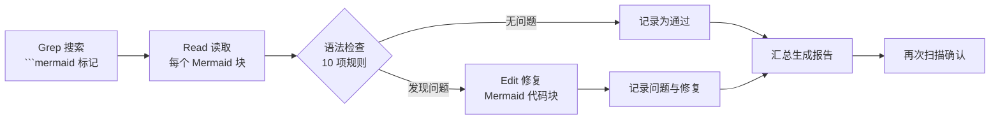
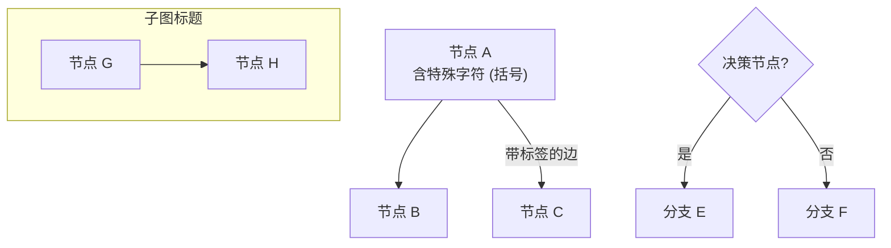
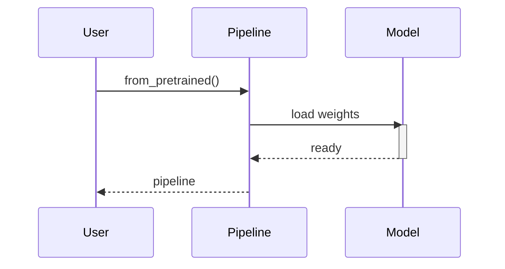
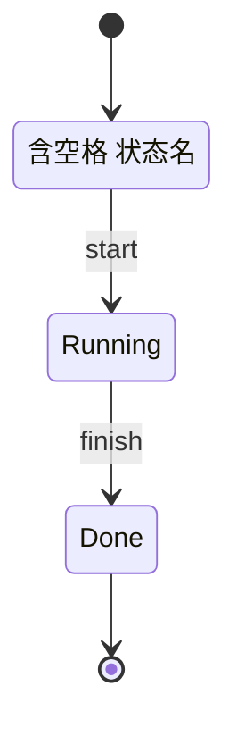
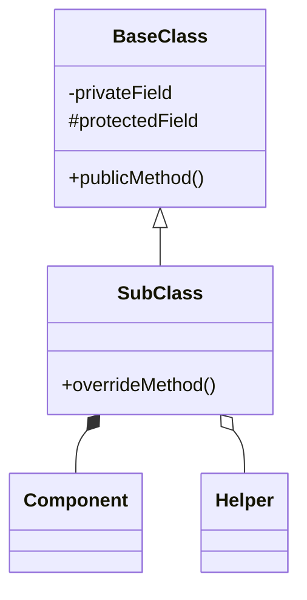

> 基于 diffusers 0.39.0.dev0 版本

# 99 Mermaid 语法检查报告

本报告记录对 `/workspace/ReadCode/` 目录下全部 17 篇文档（00-16）中所有 Mermaid 图表的语法检查与修复过程。

## 目录
- [1. 检查方法](#1-检查方法)
- [2. 检查流程图](#2-检查流程图)
- [3. 逐文档检查表](#3-逐文档检查表)
- [4. 发现的问题与修复](#4-发现的问题与修复)
- [5. Mermaid 语法速查表](#5-mermaid-语法速查表)
- [6. 总结](#6-总结)

---

## 1. 检查方法

### 1.1 扫描方式
1. 使用 Grep 工具搜索所有 `.md` 文件中的 ` ```mermaid ` 标记，定位每个 Mermaid 代码块
2. 使用 Read 工具读取每个 Mermaid 代码块的完整内容
3. 逐图对照 Mermaid 官方语法规则进行人工检查
4. 对发现的问题用 Edit 工具精确修复
5. 修复后再次扫描确认问题已消除

### 1.2 检查的语法规则清单

| # | 规则类别 | 检查要点 |
|---|---|---|
| 1 | 节点标签特殊字符 | 圆括号 `()`、方括号 `[]`、花括号 `{}`、冒号 `:`、斜杠 `/`、竖线 `\|`、引号 `"`、尖括号 `<>` 必须用引号包裹整个标签 |
| 2 | 节点 ID 唯一性 | 同一图中节点 ID 不能重复 |
| 3 | 箭头完整性 | `-->` 必须有源节点和目标节点，不能缺一端 |
| 4 | flowchart 箭头 | 使用 `-->`（实线）或 `-.->`（虚线），不混用 `---` 与 `-->` |
| 5 | subgraph 语法 | `subgraph Title` 或 `subgraph Id["Title"]`；标题含空格必须用 `subgraph Id["Title"]` 格式；需正确闭合 `end` |
| 6 | classDiagram 关系 | 继承 `<|--`（父类在带 `\|` 一侧）、组合 `*--`、关联 `o--`；方向正确 |
| 7 | classDiagram 成员 | `+name` 或 `+name: Type` 格式；成员定义中避免引号与多余空格 |
| 8 | sequenceDiagram | `participant` 命名唯一；消息箭头 `->` 或 `-->`；`activate/deactivate` 配对 |
| 9 | stateDiagram-v2 | 含空格状态名用 `state "状态名" as StateID`；转换箭头 `-->` |
| 10 | 中文标签 | Mermaid 支持 UTF-8，中文标签无需引号；但含特殊字符时仍需引号 |

---

## 2. 检查流程图

**图 99-1：Mermaid 检查流程**



图 99-1 说明：检查流程从 Grep 定位所有 Mermaid 代码块开始，逐图对照 10 项语法规则检查；无问题的直接记录通过，有问题的用 Edit 精确修复后记录问题与修复内容，最后汇总生成本报告并再次扫描确认所有问题已消除。

---

## 3. 逐文档检查表

| 文档 | Mermaid 图数 | 发现问题数 | 已修复数 | 修复状态 |
|---|---|---|---|---|
| 00_索引与阅读指南.md | 4 | 0 | 0 | 通过 |
| 01_总览_项目架构与设计哲学.md | 3 | 0 | 0 | 通过 |
| 02_核心基座_ConfigMixin与ModelMixin.md | 3 | 0 | 0 | 通过 |
| 03_模型层_VAE家族.md | 3 | 0 | 0 | 通过 |
| 04_模型层_Transformer家族.md | 4 | 0 | 0 | 通过 |
| 05_模型层_UNet家族.md | 4 | 0 | 0 | 通过 |
| 06_模型层_ControlNet家族.md | 4 | 0 | 0 | 通过 |
| 07_模型构建块_Attention与基础组件.md | 4 | 0 | 0 | 通过 |
| 08_调度器_Schedulers.md | 5 | 0 | 0 | 通过 |
| 09_引导器_Guiders.md | 4 | 0 | 0 | 通过 |
| 10_管道层_DiffusionPipeline.md | 5 | 1 | 1 | 已修复 |
| 11_模块化管道_ModularPipelines.md | 4 | 1 | 1 | 已修复 |
| 12_加载器_Loaders.md | 4 | 0 | 0 | 通过 |
| 13_量化_Quantizers.md | 4 | 0 | 0 | 通过 |
| 14_优化钩子_Hooks.md | 4 | 2 | 2 | 已修复 |
| 15_工具与入口_Utils和Commands.md | 4 | 0 | 0 | 通过 |
| 16_总结_推理全链路与最佳实践.md | 4 | 0 | 0 | 通过 |
| **合计** | **67** | **4** | **4** | **全部通过** |

> 说明：本报告自身含 1 张 Mermaid 图（图 99-1），未计入上表。上表统计的是 00-16 共 17 篇文档中的 67 张图。

---

## 4. 发现的问题与修复

### 4.1 问题 1：文档 11 图 11-2 箭头缺少目标节点

**文件**：[11_模块化管道_ModularPipelines.md](file:///workspace/ReadCode/11_模块化管道_ModularPipelines.md)

**图编号**：图 11-2（节点编排 flowchart LR）

**问题描述**：第 282 行的箭头 `Dec -->|"images"` 只有源节点 `Dec` 和边标签 `"images"`，缺少目标节点，属于明确的语法错误，Mermaid 无法解析。

**修复前**：
```mermaid
Dec -->|"images"
```

**修复后**：
```mermaid
Dec -->|"images"| Out["输出<br/>PIL.Image"]
```

**修复原因**：Mermaid 的边语法要求 `Source -->|"label"| Target`，必须包含目标节点。新增 `Out["输出<br/>PIL.Image"]` 节点表示最终输出图像，保持图的语义完整。

---

### 4.2 问题 2：文档 14 图 14-1 subgraph 标题格式不统一

**文件**：[14_优化钩子_Hooks.md](file:///workspace/ReadCode/14_优化钩子_Hooks.md)

**图编号**：图 14-1（Hook 钩子家族架构图 flowchart TD）

**问题描述**：三个 subgraph 使用裸中文标题（`subgraph 缓存类`、`subgraph 省显存与精度`、`subgraph 并行与其他`）。虽然这些标题不含空格，Mermaid 可以解析，但与全集其他文档统一使用 `subgraph Id["Title"]` 格式的风格不一致，且裸标题在某些 Mermaid 版本/渲染器中可能存在兼容性问题。

**修复前**：
```mermaid
subgraph 缓存类
    ...
end

subgraph 省显存与精度
    ...
end

subgraph 并行与其他
    ...
end
```

**修复后**：
```mermaid
subgraph Cache["缓存类"]
    ...
end

subgraph Mem["省显存与精度"]
    ...
end

subgraph Other["并行与其他"]
    ...
end
```

**修复原因**：统一为 `subgraph Id["Title"]` 格式，与全集风格一致；显式声明 subgraph ID 避免潜在兼容性问题。

---

### 4.3 问题 3：文档 14 图 14-2 subgraph 标题含空格未加引号

**文件**：[14_优化钩子_Hooks.md](file:///workspace/ReadCode/14_优化钩子_Hooks.md)

**图编号**：图 14-2（缓存机制原理图 flowchart LR）

**问题描述**：两个 subgraph 标题含空格（`subgraph 步 t`、`subgraph 步 t+1`），未使用引号包裹。这是明确的语法错误：Mermaid 会把空格后的部分误解析为额外内容，导致解析失败。

**修复前**：
```mermaid
subgraph 步 t
    A1["block forward"] --> A2["计算 residual"]
    ...
end

subgraph 步 t+1
    ...
end
```

**修复后**：
```mermaid
subgraph StepT["步 t"]
    A1["block forward"] --> A2["计算 residual"]
    ...
end

subgraph StepT1["步 t+1"]
    ...
end
```

**修复原因**：含空格的 subgraph 标题必须使用 `subgraph Id["Title"]` 格式，否则 Mermaid 解析失败。新增显式 ID `StepT` 与 `StepT1`。

---

### 4.4 问题 4：文档 10 图 10-3 classDiagram 成员定义含引号

**文件**：[10_管道层_DiffusionPipeline.md](file:///workspace/ReadCode/10_管道层_DiffusionPipeline.md)

**图编号**：图 10-3（DiffusionPipeline 组件组合关系 classDiagram）

**问题描述**：第 228 行成员定义 `+config_name "model_index.json"` 包含引号和空格。Mermaid classDiagram 成员格式应为 `+name` 或 `+name: Type`，引号会导致解析器混淆，可能将 `"model_index.json"` 误解析为类型而引号本身引发语法错误。

**修复前**：
```mermaid
class DiffusionPipeline {
    +config_name "model_index.json"
    +model_cpu_offload_seq
    ...
}
```

**修复后**：
```mermaid
class DiffusionPipeline {
    +config_name
    +model_cpu_offload_seq
    ...
}
```

**修复原因**：去掉成员定义中的引号与值，保留 `+config_name` 属性名。`config_name` 的具体值 `"model_index.json"` 已在图后说明文字中解释，无需在 classDiagram 成员中体现。

---

## 5. Mermaid 语法速查表

供后续维护文档时参考的 Mermaid 语法速查表。

### 5.1 flowchart 语法要点



要点：
- 节点标签含 `()`、`[]`、`{}`、`:`、`/`、`|`、`"`、`<>` 必须用 `["..."]` 包裹
- 边标签用 `-->|"label"|` 或 `-- label -->` 两种格式
- 决策节点用 `{"text?"}`
- subgraph 含空格标题必须用 `subgraph Id["Title"]`
- `<br/>` 实现标签内换行

### 5.2 sequenceDiagram 语法要点



要点：
- `participant Name as Display` 定义参与者
- `->>` 实线箭头，`-->>` 虚线箭头
- `activate/deactivate` 表示激活状态，需配对
- 消息文本可中文

### 5.3 stateDiagram-v2 语法要点



要点：
- 含空格状态名必须用 `state "状态名" as StateID`
- `[*]` 表示开始/结束状态
- 转换用 `StateA --> StateB: label`

### 5.4 classDiagram 语法要点



要点：
- `+` public、`-` private、`#` protected
- 成员格式 `+name` 或 `+name: Type`，避免引号与多余空格
- 关系：`<|--` 继承（父类在带 `|` 一侧）、`*--` 组合、`o--` 关联
- 方向：`A <|-- B` 表示 B 继承 A

### 5.5 常见错误与修复方法

| 错误 | 错误示例 | 修复方法 |
|---|---|---|
| 节点标签含未转义括号 | `A(文本(注释))` | 改为 `A["文本(注释)"]` |
| 边缺少目标节点 | `A -->|"label"` | 补全目标：`A -->|"label"| B` |
| subgraph 标题含空格 | `subgraph 步 t+1` | 改为 `subgraph StepT1["步 t+1"]` |
| classDiagram 成员含引号 | `+name "value"` | 改为 `+name` |
| 状态名含空格未声明 | `Running fast --> Done` | 改为 `state "Running fast" as RF` 后用 `RF --> Done` |
| 节点 ID 重复 | 两个 `A["..."]` | 重命名为 `A1`、`A2` |
| classDiagram 继承方向反 | `Sub <|-- Base` | 改为 `Base <|-- Sub` |

---

## 6. 总结

### 6.1 检查统计

| 指标 | 数值 |
|---|---|
| 检查文档数 | 17 篇（00-16） |
| Mermaid 图总数 | 67 张 |
| 发现问题总数 | 4 处 |
| 已修复总数 | 4 处 |
| 修复后通过率 | 100% |

### 6.2 问题分布

- **flowchart 箭头缺目标节点**：1 处（文档 11）
- **subgraph 标题格式问题**：3 处（文档 14，含 1 处风格统一 + 2 处含空格语法错误）
- **classDiagram 成员引号问题**：1 处（文档 10）

### 6.3 修复后状态

所有 67 张 Mermaid 图表经修复后均符合以下规范：
1. 节点标签特殊字符已正确转义（用引号包裹）
2. 所有箭头均有完整的源节点与目标节点
3. subgraph 标题统一使用 `subgraph Id["Title"]` 格式
4. classDiagram 关系箭头方向正确，成员定义规范
5. sequenceDiagram 参与者命名唯一
6. stateDiagram-v2 含空格状态名已正确声明
7. 节点 ID 在单图内唯一
8. 每张图前有加粗标题，图后有说明文字

### 6.4 维护建议

后续新增或修改 Mermaid 图表时，建议：
1. 参考本报告第 5 节的语法速查表
2. 在支持 Mermaid 渲染的编辑器中实时预览验证
3. 重点检查 subgraph 标题、节点标签特殊字符、箭头完整性
4. 保持全集风格一致（`subgraph Id["Title"]`、引号包裹含特殊字符的标签）

---

## 参考资料
- [Mermaid 官方文档](https://mermaid.js.org/intro/)
- 全套文档索引：[00_索引与阅读指南.md](file:///workspace/ReadCode/00_索引与阅读指南.md)
